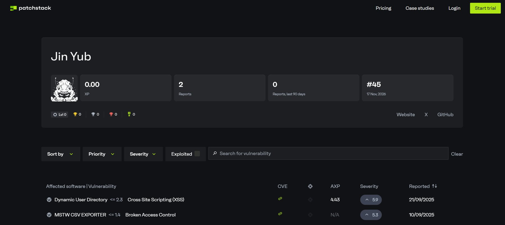
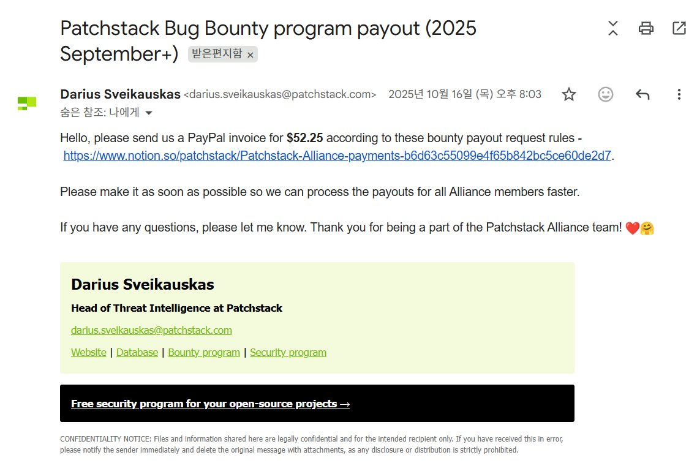
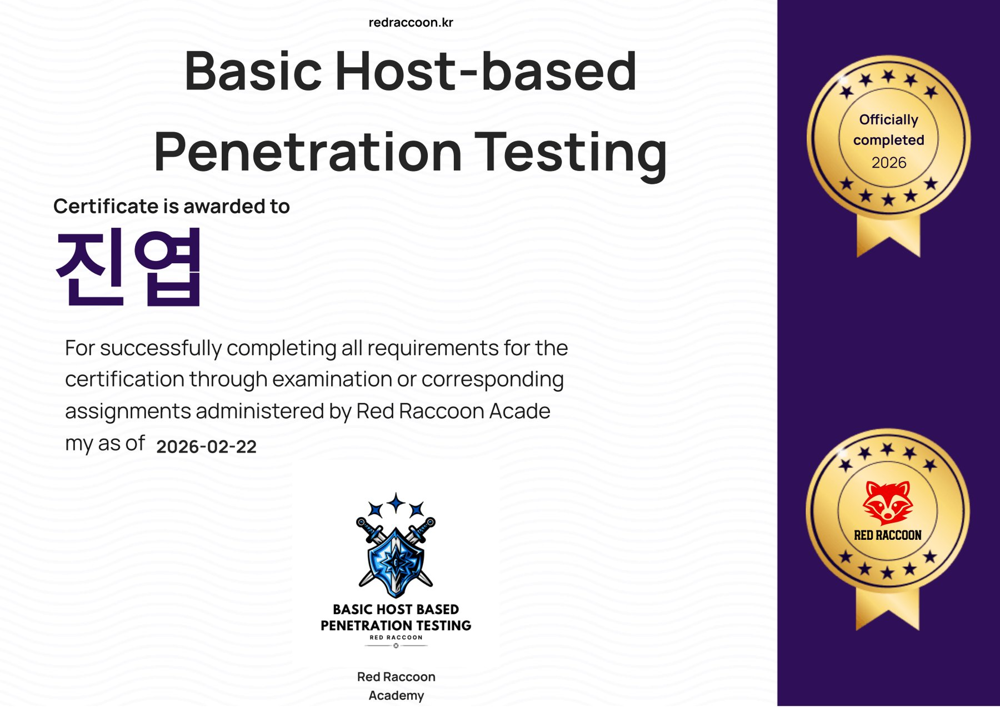
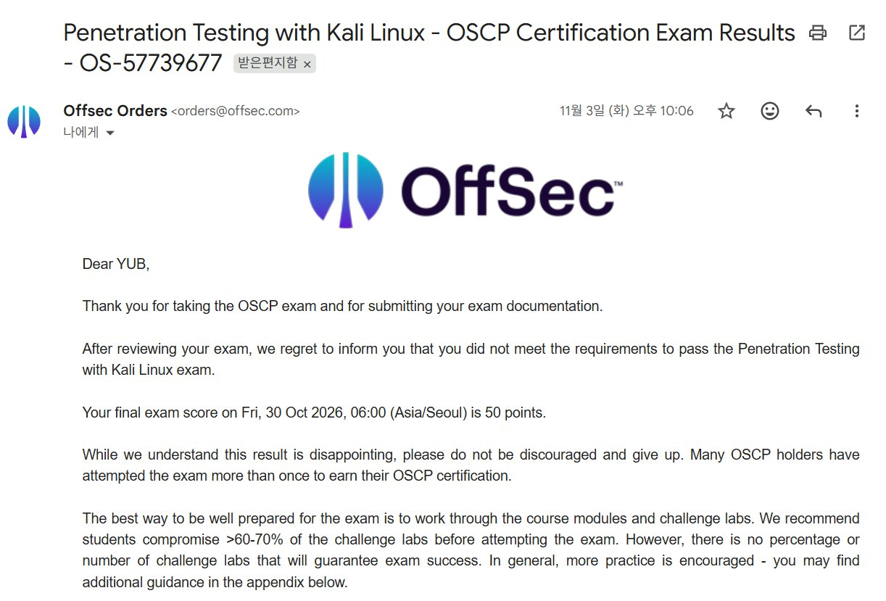

## 주요 성과

| 구분    | 성과                                            | 근거                          |
| ----- | --------------------------------------------- | --------------------------- |
| CVE   | WordPress 플러그인 취약점 2건 발견 및 CVE 등록             | Patchstack 공개 취약점 정보        |
| 버그바운티 | 2025년 9월 Patchstack 월간 순위 45위, 보상금 52.25달러 수령 | 월간 순위표, 지급 안내 메일 및 본인 수령 내역 |
| BHPT  | BHPT 합격, 합격증 기준일 2026.02.22                   | Red Raccoon Academy 합격증     |
| OSCP  | 2026.10.30 OSCP 응시, 최종 50점·미합격                | OffSec 시험 결과 안내             |

## 1. 기술블로그

기술블로그 바로가기 (<https://jjjj0202.github.io/index.html>)

웹 취약점 분석과 Hack The Box(HTB), Proving Grounds(PG) 침투테스트 학습 과정을 기록합니다. 정보 수집 결과를 바탕으로 공격 가설을 세우고, 초기 접근과 권한 상승으로 연결되는 조건을 확인하는 데 집중하고 있습니다.

### 주요 학습 내용

- **웹 보안:** Blind SQL Injection, XSS, 인증·접근통제 분석 및 소스코드 기반 취약점 검증
- **Windows·Linux 침투테스트:** 서비스 열거, 노출 파일·자격증명 분석, 원격 접근 및 권한 상승
- **Active Directory:** BloodHound를 통한 권한 관계 분석, AS-REP Roasting, 커버로스팅(Kerberoasting), DCSync 등 공격 흐름 학습
- **결과 기록:** 공격의 성립 조건, 실행 결과, 접근 권한과 한계를 구분해 정리

## 2. CVE

Patchstack 연구자 프로필 (<https://patchstack.com/database/researchers/b985022c-eaee-4be7-afe3-e84b445cc34b>) · 2025년 9월 월간 순위 (<https://patchstack.com/database/leaderboard/september-2025>)

WordPress 플러그인을 분석해 접근통제 취약점과 XSS 취약점을 발견·제보했습니다. 두 취약점은 CVE로 등록되었으며, 공개 취약점 정보에 **Jin Yub**으로 발견자 등재되었습니다.

| CVE | 대상 | 취약점 유형 | 영향 버전 | CVSS |
| --- | --- | --- | --- | --- |
| CVE-2025-62944 (<https://patchstack.com/database/wordpress/plugin/mstw-csv-exporter/vulnerability/wordpress-mstw-csv-exporter-plugin-1-4-broken-access-control-vulnerability>) | MSTW CSV EXPORTER | Broken Access Control | 1.4 이하 | 5.3 |
| CVE-2025-62982 (<https://patchstack.com/database/wordpress/plugin/dynamic-user-directory/vulnerability/wordpress-dynamic-user-directory-plugin-2-3-cross-site-scripting-xss-vulnerability>) | Dynamic User Directory | Cross-Site Scripting(XSS) | 2.3 이하 | 5.9 |

### 성과와 배운 점

- 취약점 2건 제보 및 CVE 등록
- 2025년 9월 Patchstack 버그바운티 월간 순위 **45위**
- 버그바운티 보상금 **52.25달러 수령**
- 재현 가능한 증거를 바탕으로 취약점의 발생 조건과 영향을 전달한 경험

### 증빙

*연구자 프로필 캡처. 2025년 9월 월간 순위는 위 월간 순위표 링크에서 확인할 수 있습니다.*

*2025.10.16 발송된 보상금 지급 안내 메일. 메일에는 52.25달러 지급을 위한 인보이스 요청이 기재되어 있으며, 수령 사실은 본인 제공 정보입니다.*

## 3. BHPT

**자격명:** Basic Host-based Penetration Testing(BHPT)  
**발급기관:** Red Raccoon Academy  
**결과:** 합격  
**합격증 기준일:** 2026.02.22  
**시험 분석 기간:** 2026.02.16 ~ 2026.02.18

모의해킹 결과 보고서 (<https://jjjj0202.github.io/post4/bhpt-redraccoon-report/>)

OSCP 도전을 준비하며 호스트 기반 침투테스트의 기초 역량을 다지기 위해 응시했습니다. 시험 환경에서 정보 수집, 초기 침투, 권한 상승을 수행하고 증거와 대응 방안을 보고서로 정리했습니다.

### 수행 내용

| 환경 | 분석 및 공격 경로 | 검증 결과 |
| --- | --- | --- |
| Windows | 익명 FTP로 노출된 소스코드 분석, 웹 기능을 통한 명령 실행, 서비스 경로·파일 권한 설정 오류 분석 | 로컬 관리자 권한 확보 |
| Linux / WordPress | 노출된 백업 문서에서 자격증명 확인, 관리자 기능을 통한 명령 실행, sudo 설정 오류 분석 | root 권한 확보 |

### 확보한 역량

- 노출된 서비스와 파일에서 초기 침투 단서를 찾는 정보 수집 능력
- 웹 서비스 접근을 운영체제 권한 획득으로 연결하는 공격 경로 분석
- Windows·Linux 권한 설정 오류의 영향 검증
- 재현 과정, 증거 화면, 취약점 원인 및 대응 방안 문서화

### 합격 증빙

## 4. OSCP

**응시일:** 2026.10.30  
**최종 점수:** 50점  
**결과:** 미합격

웹 중심의 실무 경험을 내부망 침투와 Windows 도메인 환경으로 확장하기 위해 OSCP에 도전했습니다. 시험에서는 개별 시스템의 접근 경로뿐 아니라, 여러 시스템에 걸쳐 자격증명과 권한 관계가 연결되는 공격 흐름을 검증했습니다.

### 수행 경험

- 노출된 자격증명과 비밀번호 재사용을 활용한 초기 접근
- 내부망 피벗팅을 통한 추가 시스템 접근
- BloodHound를 통한 AD 계정·그룹 권한 관계 분석
- 과도하게 부여된 그룹 권한을 활용한 접근 확대
- Pass-the-Hash를 이용한 도메인 컨트롤러 접근
- AD 환경 세 시스템의 증거 확보 및 공격 과정·개선 권고 보고서 작성

### 결과와 보완 과제

독립형 대상 중 한 시스템에서는 파일 읽기 취약점으로 두 개의 플래그를 확인했지만 셸 확보까지 이어가지 못했습니다. 최종 점수는 50점으로, 자격 취득에는 이르지 못했습니다.

이 경험을 통해 파일 읽기, 명령 실행, 권한 획득을 구분하고 각 단계에서 실제로 확보한 접근 수준을 증명하는 중요성을 배웠습니다. 초기 접근 이후의 공격 경로 탐색, 셸 확보와 권한 상승을 보완 과제로 삼고 있습니다.

### 시험 결과 증빙

